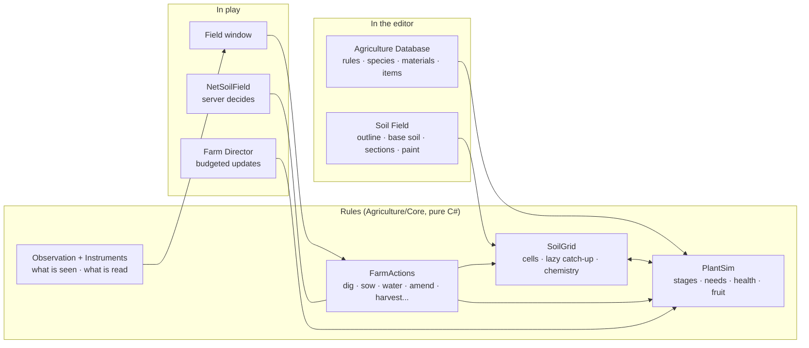

# Agriculture, Cultivation and Plant Development

**Scripts:** `Agriculture/Core/*` (the rules, no MonoBehaviour: soil types and properties, soil layouts and their
sections, the soil grid and its chemistry, water, weather, calendar and moon, plant species, growth, genes, pests and
diseases, instruments, what a player is told, the actions, skills, the trial plot, the built-in content),
`Agriculture/Items/*` (seeds, produce, soil materials, farming tools, instruments, water containers),
`Agriculture/Runtime/*` (the Soil Field component, the Agriculture Database, Plant Species assets, the farm clock and
director, the player's knowledge, items made at runtime, water sources, growing structures, drawing), `Agriculture/UI/*`
(the field window), `Networking/Runtime/Agriculture/NetSoilField.cs` (multiplayer), `CustomEditor/Agriculture/*` (the
Soil Field inspector and Scene view tools, menus, inspectors, validation, Edit Mode tests).

A piece of the city is **soil** — real soil, made of cells that each have their own type, pH, twelve nutrients, organic
matter, salts, water, packing, stones, magic and soil diseases — and players grow plants in it **by hand**, one seed,
one hole, one watering at a time. Nothing tells them what a plant needs: they find out.

* **You define the soil in the editor.** Put a Soil Field on the ground of the city, draw its outline in the Scene view
  and say what its soil is — then add **sections** where it differs (a sour corner, a stony strip, a bed dug with
  compost, a magical patch, an irrigated row): rectangles, circles, polygons or painted cells, with soft edges, each
  changing only the properties you tick. The preview draws the baked soil over the field, property by property
  ([chapter 02](02-Defining-Soil-Areas.md)).
* **The soil lives.** Rain soaks in and drains, taking nitrogen and salts with it; the surface dries in the sun and
  wind; organic matter rots and feeds the soil; limestone, sulfur and ash change the pH over days; worked soil settles;
  open holes slump. Eight soil types, a pH that decides what the roots can take, twelve nutrients, fertilizers and
  amendments, water of eight sources and qualities, irrigation, mulch.
* **The weather matters.** Four seasons, a lunar cycle, day and night, sunlight that builds up through the day, warmth,
  frost, humidity, rain — the city's own climate, or the world's Weather System. Greenhouses, shade shelters, cold frames
  and magical chambers change it for what grows under them.
* **Plants grow from what they live through.** Twelve stages from seed to death; growth limited by the scarcest need
  (light, water, warmth, each nutrient, pH, salts, packing, magic...); health, stress and quality from their whole
  history; visible pests and diseases; neighbours that help or hinder; individual fruits that each ripen on their own
  timer and must be picked within their window; dormancy, pruning, perennials that live for years.
* **Seeds carry genes.** Every seed is its own: twelve traits, a vigour, sometimes a rare trait. Saved seeds pass on
  what their parents were; flowers pollinated by a neighbour cross; some crosses make new varieties.
* **The player learns by doing.** Inspecting describes only what is seen ("The leaf edges are turning brown."), never
  why. Instruments read the soil — crude ones roughly, fine ones precisely. A notebook keeps what the player writes
  down. Seven skills (Agriculture, Botany, Herbalism, Plant Medicine, Alchemy, Magical Cultivation, Seed Breeding)
  sharpen the eye and the hands; they never give the answer.
* **It is cheap.** Soil cells are worked out only when touched; plants are data drawn in batches (no GameObject per
  plant), updated about once a game hour within a per-frame budget ([chapter 07](07-Scripting-Editor-Multiplayer.md)).
* **It joins the rest of the game:** produce is food, crafting material or an alchemy ingredient, with its own quality
  per copy; seeds, materials and tools are items (assets or made at runtime); experience feeds the character; the whole
  system runs server-authoritative in a network session.

| Chapter | What it covers |
|---|---|
| [01 — Overview and Setup](01-Overview-and-Setup.md) | Two-minute setup, the field window and how a player works, the components, saving |
| [02 — Defining Soil Areas](02-Defining-Soil-Areas.md) | The Soil Field inspector and Scene view tools: outline, base soil, sections of every shape, soft edges, painting, patchiness, irrigation and mulch, the preview, validation |
| [03 — Soil, Water and Weather](03-Soil-Water-and-Weather.md) | Soil types and properties, pH and nutrients, the organic cycle, leaching, materials, water sources and irrigation, climate, seasons, the moon, light, growing structures |
| [04 — Plants](04-Plants.md) | Planting by hand, the growth stages, health, stress and quality, pests and diseases, neighbours, produce and harvest windows, dormancy and pruning, seeds, genes and crosses |
| [05 — Knowledge, Instruments and Skills](05-Knowledge-Instruments-and-Skills.md) | What a player is told and what never, every instrument and its precision, the notebook, the skills |
| [06 — Authoring Species and Materials](06-Authoring-Species-and-Materials.md) | The Agriculture Database, Plant Species assets field by field, the trial plot, the built-in species, soil materials, hybrids, items |
| [07 — Scripting, Editor Tools, Multiplayer, Performance and Tests](07-Scripting-Editor-Multiplayer.md) | The API, the menus, the network component, how it stays light, the Edit Mode tests |

