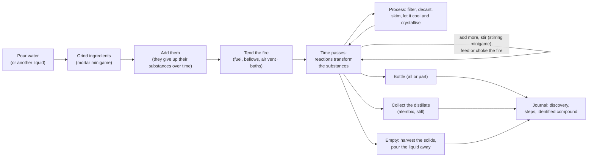

# Alchemy 01 — Overview and Setup

**Scripts:** `Alchemy/Runtime/AlchemyStation.cs`, `Alchemy/UI/AlchemyStationUI.cs`, `Alchemy/UI/AlchemyCirclePad.cs`, `AlchemyTrace.cs`,
`Alchemy/Runtime/AlchemyKnowledge.cs`, `Alchemy/Items/AlchemyIngredientSO.cs`, `Alchemy/Items/BrewedPotionSO.cs`,
`CustomEditor/Alchemy/AlchemyEditors.cs`.

---

## 1. Setup (two minutes)

1. *Tools ▸ SimpleMovements ▸ Alchemy ▸ Create Test Bench (free ingredients)*. It builds a cauldron on a fire pit in the
   open scene (at the Scene view's centre) with an **Alchemy Station**, **Alchemy Surroundings** (weather and time of day)
   and **Alchemy Station Visuals** (liquid, bubbles, steam, smoke, sparks, fire light). On a test bench every built-in
   ingredient is a free supply, so you can brew straight away.
2. Press Play, walk to it and press **Interact** (*[E] Brew*). The station window opens.
3. For a real game: *Create Alchemy Station* (no free supplies), then *Tools ▸ SimpleMovements ▸ Alchemy ▸ Create
   Ingredient Items* and put the ingredients in loot tables, merchants' stock or starting items. Players then brew with
   what they carry.
4. Optional, recommended:
   * *Tools ▸ SimpleMovements ▸ Project Setup ▸ Create Alchemy Database (Resources)* — a copy of the built-in rules you
     can edit (without it the built-in alchemy is used).
   * *Tools ▸ SimpleMovements ▸ Alchemy ▸ Create Potion Items* — an item asset for every quality band of every result.
     Without them, bottles are items made at runtime: fine in single player, but **network sessions and saves need
     assets** (then rebuild the Item Database).
   * *Create Equipment Presets* — the Iron Cauldron, Copper Alembic, Glass Retort, Frost Basin, Fractionating Still and
     Evaporating Dish as assets; put one in the station's *Equipment*.
   * Put **Firewood**, **Filter Paper** and **Charcoal** items where players find them when your stations have no woodpile
     or use paper and charcoal filters (*Create Ingredient Items* makes them too).

The station inspector lists problems (no collider, no water and no supplies, a manual fire without a woodpile, an unknown
filter...) and, in Play Mode, shows the preparation live: every substance, the reactions running and their rates, the
fire, the stirring, the pH and the layers, what it would be if bottled, with Stir, Pause, *Copy State JSON* and *Open In
Lab*.

---

## 2. How a player brews

* **Liquid first.** Ingredients give up their substances into the liquid in the vessel; without liquid they barely do.
  Water comes from the station (*Water Source*) or from items (Spring Water, Grain Spirit, Lamp Oil, Turpentine,
  Vinegar...). The right solvent matters: oils and alkaloids want spirit or oil, salts want water — and oil and water
  form two layers.
* **Ingredients** come from the inventory (+1 / +5). Each is made of several substances that come out at their own pace
  (faster when hot, stirred, at the right pH), and its own temperature mixes in (Frostmint is ice cold, Ice Chips colder).
* **Grinding** (a station with a mortar): *Grind…* opens the **mortar minigame**. Drag the pestle round in circles (or
  press *Pound*): each full turn grinds a little — fewer turns for soft petals, more for hard roots, and more when grinding
  several at once. The bar passes **Partially ground → Finely ground → Pulverised**; stop at the level you want and *Add*.
  A **steady rhythm** and enough turns grind evenly; a few erratic turns leave lumps and dust (part goes in coarser, part
  finer). Finer gives everything up faster — the bitter, locked-in parts too — and pulverising lets volatile scents escape.
* **The fire** — at most stations a **real fire** (the fire minigame): put fuel on it (*+ Firewood*, *+ Charcoal*, *+ Pine
  Resin*, *+ Lamp Oil*), **pump the bellows** to blow it up, and open or choke the **air vent** to hold it low. The flames
  rise and fall over seconds and burn the fuel down, so holding a temperature means tending it: the trace shows the last
  minute of the temperature and whether it is *held steady*, *wavering* or *swinging*. A regulated station has a burner
  instead (a heat slider: *Heat 35% → 97 °C*). Poor control has consequences: a roaring fire scorches the bottom of a
  vessel nobody stirs, spirit fumes flare over an open fire, overshooting destroys what is heat-sensitive.
* **Baths**: stand the vessel in a **water bath** (gentle, at most ~96 °C, nothing scorches) or an **ice bath** (fast
  cooling toward 0 °C: preserves what heat destroys, crash-cools into powders rather than crystals).
* **Stirring** — the **stirring minigame**: drag circles on the pad; how fast you turn is the stirring speed (1.5 turns a
  second is full speed), and the window says whether you stir *steady*, *uneven* or *erratic*. Stirring speeds extraction
  and brings reactants together, mixes oil and water into an emulsion, and stirs up the sediment; too hard beats air in
  (healing essences brown) and slops the brew over the rim. *Stir once* gives a single stir. Leave it still to let
  crystals grow and particles settle.
* **Time** is a real variable: the preparation keeps transforming continuously, even when the window is closed (*Run
  While Away*). A healing essence that forms after a minute may turn into something else after three, and into ash and
  sludge after ten.
* **Adding during the process**: what an ingredient does depends on what is in the vessel when it goes in — and on the
  pH (vinegar draws alkaloids out, curdles milk, destroys healing essence).
* **Process**: *Filter* (cloth strainer, filter paper, charcoal bed — what each catches differs), *Decant* (pour off the
  top layer: an oil from water), *Skim* (take what floats), *Clean* (scrub the residue film out of an empty vessel).
  What the filter or skimmer catches is collected — crystals, salts, charcoal.
* **Pause** stops time for the preparation (its state is kept exactly); **Fire off** chokes the fire (or turns the burner
  off) and lets it cool by the rules.
* **Bottle** takes the liquid out as bottles of what it is *now* — all of it, or one bottle: what is left keeps going.
  An optional *Bottle Item* (an empty vial) is used per bottle. Items that do not fit drop at the station.
* **Empty vessel** ends the preparation: solids at the bottom (crystals, ash...) are harvested, the liquid is poured
  away (the window asks first when it is worth something). A film of residue stays in the vessel unless it is cleaned.

---

## 3. The window

| Area | Shows |
|---|---|
| Left — **Ingredients** | *Pour water*, the station's free supplies, then the alchemy ingredients in the inventory, with their form and what the player knows they contain ("Whole · Solar Sap, ?"); *Grind…*, *Add*, *Add 5* |
| Middle — status | Temperature with its trend (▲ ▼), time, fill, boiling, pressure (sealed vessels), pH, layers, stirring, pause, the surroundings' temperature and night |
| Middle — **On the fire** | Manual fire: the fuel buttons (how many the player carries), the flames and the fuel left, *Bellows*, the *Air vent* slider, the temperature trace (*held steady ±0.8 °C*, *cooling fast*), *Stand in*: no bath / *Water bath* / *Ice bath*. A burner: the *Heat* slider instead |
| Middle — **Stirring** | The stir pad (drag circles with the spoon), the speed and how steady, *Stir once*, *Pause / Resume*, *Fire off* |
| Middle — **In the vessel** | Every substance: its name if identified, else what it looks like ("a deep rose liquid that smells of summer"), units and share, saturated or supersaturated, and what is undissolved (floating, clouding or settled; crystals); the layers; ingredients still giving up their substances (form, "% given up"); vapour held; the distillate flask |
| Middle — **What is happening** | The reactions running (breakdown in the heat or the acid included): by name and rule once understood, else what is seen ("the rose darkens to amber..."); substances coming out of solution or crystallising |
| Right — **If bottled now** | The result *if the player has made it before* (else "Unknown result"), its quality with strength and purity, why ("Weak: diluted", "Cloudy: filter it", "In two layers", "Contaminated"), how many bottles it fills |
| Right — buttons | *Bottle all*, *Bottle one*, *Collect distillate* (distilling vessels), *Empty vessel*; **Process**: *Filter* (a choice of the filters at hand, with what they use up), *Decant*, *Skim*, *Clean* |
| Right — **Observations** | The log of the preparation in the player's words |
| **Mortar** (over the window) | The pestle pad, the fineness bar with a mark per level, the evenness bar, the level reached and what it does ("gives up its substances ×3 as fast, brings out the locked-in parts too"), *Less / More* (how many), *Pound*, *Add*, *Cancel* |
| **Journal** | Discoveries (with the steps of the best one), Reactions, Substances, Ingredients, Experiments ([04](04-Discovery-and-Journal.md)) |

The window is an open panel of the inventory (free cursor, clicks never attack); Escape closes the mortar, the journal or
the confirmation, then the window. It closes when the player walks away (and nobody stirs a closed window: the stirring
stops).

---

## 4. Station settings

| Setting | |
|---|---|
| *Station Name* | Prompt and window title (empty = the vessel's name) |
| *Database* | The rules (empty = the project's Alchemy Database, else the built-in alchemy) |
| *Equipment* | The vessel ([02 §12](02-Simulation-Rules.md#12-vessels)); empty = an iron cauldron |
| *Interaction Point*, *Range* | Where the prompt is and how close the player must be |
| *Fire Control* | **Manual** (a real fire: fuel, bellows, air vent — the fire minigame) or **Regulated** (a burner: a heat slider) ([02 §6](02-Simulation-Rules.md#6-heat-the-fire-baths-boiling-and-evaporation)) |
| *Woodpile* | Free firewood at the station (off: players need Firewood items or other fuels) |
| *Has Mortar* | The *Grind…* button and the mortar minigame ([02 §3](02-Simulation-Rules.md#3-extraction-ingredients-forms-and-grinding)) |
| *Has Water Bath*, *Has Ice Bath* | The baths the vessel can stand in |
| *Filters* | The filters at hand (ids: `strainer`, `paper`, `charcoal`; empty = all of the database's) — a filter with a medium uses up that item |
| *Vessel Gets Dirty* | A residue film stays in the vessel when it is emptied ([02 §10](02-Simulation-Rules.md#10-compatibility-and-contamination)); players *Clean* it |
| *Water Source*, *Water Per Pour*, *Water Temperature* | A *Pour water* button (units per press, °C) |
| *Free Ingredients*, *Free Default Ingredients* | Supplies that cost nothing (a teaching lab, a test bench) |
| *Bottle Item* | An item used up per bottle (an empty vial); empty = free bottles |
| *Drop Point* | Where items that do not fit in the inventory drop |
| *Run While Away* | The preparation keeps transforming while nobody tends it (off: time stops when the window closes) |
| *Seed*, *New Seed Each Preparation* | The defined random variable ([02 §14](02-Simulation-Rules.md#14-reproducibility-and-randomness)) |
| *Conditions Interval*, *Max Steps Per Frame* | How often the surroundings are read; catch-up after a hitch |
| *Persist Preparation*, *Station Id* | Save the preparation in progress (and the vessel's residue film) and continue it after a restart ([02 §15](02-Simulation-Rules.md#15-interrupting-resuming-and-saving)) |
