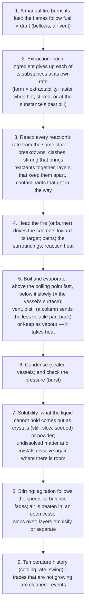

# Alchemy 02 — Simulation Rules

**Scripts:** `Alchemy/Core/AlchemyMixture.cs`, `AlchemySimulator.cs`, `AlchemyBrew.cs`, `AlchemyReaction.cs`,
`AlchemyConditions.cs`, `AlchemyEvaluator.cs`, `AlchemyEquipment.cs`, `AlchemyProcessing.cs`, `AlchemyBrewState.cs`,
`AlchemyDatabase.cs` (`AlchemySimulationSettings`).

The outcome of a preparation is decided by the **actual state of the mixture** when it is taken out — which follows from
the substances that went in, everything that happened to them, and when. This chapter is the rulebook.

---

## 1. The state of a preparation

| Part | Meaning |
|---|---|
| **Contents** | Units of every substance dissolved in the liquid (bottled, boils away) and of every solid (settles, harvested when emptied) |
| **Undissolved matter** | What the liquid cannot hold ([§4](#4-solubility-saturation-and-crystals)): it floats, settles or clouds the liquid, and takes no part in reactions |
| **Ingredients giving up their substances** | Ingredients put in that still hold some of what they are made of, each substance coming out at its own pace |
| **Temperature** | °C of the contents, its recent average, how far it strays from it (*swing*) and how fast it cools |
| **Heat** | A burner's setting, −1 (full cooling) … 0 (off) … 1 (full heat) — or a **manual fire**: fuel, flames, bellows air, air vent ([§6](#6-heat-the-fire-baths-boiling-and-evaporation)) |
| **Bath** | Nothing, a water bath or an ice bath |
| **Stirring** | The stirring speed, the agitation it gives (settling by itself), how unevenly it was stirred (*turbulence*), the air beaten in (*aeration*) and how mixed two layers are (*emulsion*) ([§7](#7-stirring)) |
| **Vapour** | What boiled or evaporated off and is held inside a sealed vessel (makes pressure) |
| **Distillate** | What an alembic condensed and collected apart |
| **Surroundings** | Ambient temperature and named variables (night, humidity, rain, yours) |
| **Clock** | Elapsed preparation time and the step count |
| **History** | Every operation, with the step it happened at (and the form and evenness each ingredient went in as) |

Substances have a **role** (Solvent, Raw, Intermediate, Active, Reagent, Byproduct, Residue), a **phase** (Liquid or
Solid), a **boiling point**, a **density**, a colour, **properties** (Vitality, Fire, Toxicity, Acid, Alkali,
Contaminant...), and optionally a **solubility** in each solvent, a **crystal** form, a **stable temperature and pH range**,
a preferred **pH for extraction** and **interactions** with other substances. Many substances can be present at once:
untransformed ingredient matter, intermediate compounds, active compounds, side products and residues all take part in
what happens next.

---

## 2. A step

Preparations advance in **fixed steps** (*Step Seconds*, 0.2 s by default) — never by frame time — so a preparation
transforms the same way at any frame rate, while nobody watches, on a server, or in a test.



Operations (add an ingredient, feed the fire, stir, filter, bottle...) happen *between* steps and are recorded with the
step number. **Same operations at the same steps ⇒ same mixture.**

---

## 3. Extraction: ingredients, forms and grinding

An ingredient is not one thing: it **contains several substances in set proportions**, and each comes out its own way.
A Sunpetal holds a healing sap that comes out readily, a fragrant oil, and a toxic latex locked in its stems that a whole
petal barely gives up. Each listed substance has units per item and an **extractability** (0–1: how easily it comes out).

The ingredient's **form** decides how its substances come out. Per second, substance *k* of an ingredient leaves it at

```
share of its total per second = Release Speed(form) × extractability_k ^ Selectivity(form) ÷ Dissolve Seconds
                                × 2 ^ ((T − 20) / Dissolve Doubling Degrees)      (¼ … 8×; 30 °C by default)
                                × (1 + 2 × agitation)
                                × pH factor (substances with a pH Sensitivity, below)
                                × 0.15 when the vessel has (almost) no liquid
```

| Built-in form | Release Speed | Selectivity | What it means |
|---|---|---|---|
| **Whole** | × 1 | 2 | Easy parts come out readily, hard parts barely (extractability² : 0.9 → 0.81, 0.06 → 0.004) |
| **Partially ground** (`coarse`) | × 1.8 | 1.6 | Faster, still fairly selective |
| **Finely ground** (`ground`) | × 3 | 0.5 | Everything comes out faster, the hard parts most of all (0.06 → 0.24) |
| **Pulverised** (`powder`) | × 4 | 0.15 | Almost everything at once — and the grinding warms it: 40 % of its volatile oils (those boiling below 150 °C, the more the lower) escape before it goes in |
| **Extract** | × 8 | 0 | Everything at the same fast rate: what it holds was already drawn out |

So grinding a Sunpetal releases its sap faster — and its latex far faster (~200× finely ground): **grinding speeds
extraction, but it also makes the unwanted components easy to extract.**

* **Grinding** happens at a station with a mortar, in the **mortar minigame** ([01](01-Overview-and-Setup.md)): each turn
  of the pestle grinds a little (less for hard ingredients, *Hardness*, and for several at once); the player stops at the
  level wanted. **Evenness** matters: an uneven grind (`evenness` below 1) goes in as 0.4 + 0.6 × evenness of it at the
  chosen level and the rest split between the next coarser and the next finer level — lumps and dust.
* Ingredients whose profile has *Can Be Ground* off (liquids, powders, extracts, crystals) go in as they are. The form and
  evenness are recorded in the history, so replays grind the same way.
* **Forms are data** (the database's *Forms*): speed, selectivity, volatile loss, and the form each one grinds into.
* **pH**: a substance with a *pH Sensitivity* comes out faster the closer the liquid's pH is to its *Extraction pH* (×2 per
  2 ÷ sensitivity pH units closer than neutral is, ×0.1 … ×8). Dreamshade's alkaloid comes out about twice as fast in
  vinegar; in lye it does not survive at all ([§9](#9-acidity-ph)).
* Liquids and powders (*Dissolve Seconds* 0) mix in at once. When an ingredient goes in, its own temperature mixes with the
  contents' by thermal mass (Ice Chips at −60 °C stand for the heat melting takes).
* An ingredient keeps giving up what it still holds for as long as it is in the vessel: a whole herb left to steep slowly
  leaches what is hard to extract. A strainer takes the spent ingredients out ([§11](#11-separating-filtering-decanting-skimming)).

---

## 4. Solubility, saturation and crystals

A liquid substance can have a **solubility** — how much of it each solvent can hold (units per unit of solvent). The
liquid's **capacity** for it (its saturation point):

```
capacity = S × exp( Σ (sⱼ / S) × ln solubilityⱼ ) × 2 ^ ((T − 20) / Solubility Doubling Degrees)     (× 0.05 … × 50)
           ÷ (1 + strength × share of what curdles it, in %)

  S             units of solvent in the liquid;   sⱼ  units of solvent j
  solubilityⱼ   the substance's solubility in solvent j (Other Solvent Solubility, 0.05, for solvents it does not list)
```

A blend of mixing solvents holds a substance **between** what each holds, on a log scale. Two layers ([§8](#8-layers-density-and-particles))
hold what each layer holds. Most things dissolve more when hot (×2 per 40 °C by default; saltpetre ×2 per 22 °C, alum per
16 °C, salt barely: ×2 per 400 °C).

* **Too much for the liquid**: what is beyond its capacity comes out of solution — *Precipitation Rate* (0.5) of the
  excess per second — and lies **undissolved**: not bottled (unless floating in the liquid, [§8](#8-layers-density-and-particles)),
  no reactions, but it fills the vessel. **Room again** (more solvent, more heat): it dissolves again — *Redissolve Rate*
  (0.15) of what there is room for per second, × (1 + 2 × agitation).
* **Crystals**: a substance with a *Crystal* (a Solid substance) crystallises instead of falling out as a powder — **if it
  is left still** (agitation ≤ *Crystal Stillness*) **and cools slowly** (≤ *Max Cooling Rate* °C/s). Crystals start on a
  **seed** (crystals of it already in the vessel) as soon as it is saturated, or by themselves once it is *Nucleation* times
  supersaturated; below that, unseeded, the liquid **stays supersaturated**. Stirred or crash-cooled (an ice bath), it comes
  out as a fine powder instead. Crystals dissolve again where there is room (*Crystal Redissolve Factor* times slower than
  a powder). In a vessel with no liquid at all, what is left dries into crystals where it is.
* **Curdling**: an interaction ([§10](#10-compatibility-and-contamination)) can divide a substance's capacity — milk's curd
  comes out of solution in acid.
* When the vessel is emptied or filtered, undissolved matter and crystals are collected: as the substance's *Harvest
  Item*, else an ingredient of the same name (Alum Crystals), else the built-in ingredient it mainly comes from (settled
  brine → Rock Salt).

The window marks substances as *saturated* or *supersaturated*, lists undissolved matter (floating, clouding or settled)
and logs when something comes out of solution or starts to crystallise.

---

## 5. Reactions

A reaction consumes *reactants* (a substance, **anything with a property**, or **anything of a role**) and makes
*products*. Its rate, in units of reaction per second:

```
rate = k × T(temperature) × Π (cᵢ ^ orderᵢ) × V × Π modifiers × Π conditional rates
       × mixing × contact × contamination                                          (0 if a condition is not met)

  k          Rate constant at the Reference Temperature
  T(t)       0 outside [Min, Max Temperature]; else 2 ^ ((t − reference) / Doubling Degrees), at most 64
             (a negative Doubling Degrees makes it faster when colder)
  cᵢ         concentration of reactant i (its units / the liquid's units)
  V          units of liquid — so dilution slows a reaction, concentration speeds it up
  modifier   substances that are not used up: catalyst (× > 1), inhibitor / stabiliser (× < 1), blocker (× 0)
  conditional  "× 2 in a copper vessel", "× 1.5 at night", "× 3 when air is stirred in"...
  mixing     reactions of two or more reactants: × (1 + Mixing Boost × agitation) — stirring brings them together (§7)
  contact    in a layered liquid, how well the reactants meet (§8)
  contamination  ÷ (1 + Contaminant Interference × dirt ÷ 0.05) — except reactions that make residue or eat dirt (§10)
```

* All reactions see the same state at the start of a step. Shared reactants are **split by availability**: none can
  take more than there is — the **order of addition matters**.
* *Heat Per Unit* warms or cools the contents; at *Eruption Rate* or above the reaction erupts and *Spill Fraction* of
  the contents splashes out; *Conditions* can read any variable ([§13](#13-crafting-conditions)): `ph`, `aeration`, `heat`,
  `bath`, `swing`, `liquid`...
* Undissolved matter takes no part: only what is in solution (and the solids) reacts.

Because reactions name substances, properties and roles — never ingredients — **the same ingredient does different
things depending on what is already in the vessel**, and each substance of the same herb follows its own reactions.

### Thermal and pH stability

Each substance can have a **stable temperature range** (*Stable Max*, *Stable Min*) and a **stable pH range** (*Stable
pH Min*, *Stable pH Max*). Outside them it breaks down: the rules make a reaction of each ("Vital Essence breaks down" —
`breakdown_hot.<id>`, `breakdown_cold.<id>`; "Acid destroys Vital Essence" — `breakdown_acid.<id>`, `breakdown_alkali.<id>`)
that turns it into its *Degrades Into* products (none = destroyed). The heat breakdown runs at *Degrade Rate* (the share per
second 10 °C past the limit) doubling every *Degrade Doubling Degrees*; the pH breakdown at *pH Degrade Rate* at 20 °C,
×2 per 20 °C hotter. Players see it happen, then learn the limit like any other reaction.

So **a higher temperature is not always better** (mana essence forms at 30–75 °C and breaks down above 85 °C), and **the
pH that draws a substance out can destroy another** (vinegar extracts alkaloids, and curdles the healing essence below
pH 3).

---

## 6. Heat: the fire, baths, boiling and evaporation

* **A burner** (a station with *Regulated* fire control, and scripts' `SetHeat`): the target temperature is `ambient +
  heat × (Max Heat Temperature − ambient)` (cooling: toward the vessel's *Cooling Temperature*). The contents move toward
  it by `Heat Transfer × (target − T) / thermal mass` per second; with the fire off, toward the ambient temperature by
  *Ambient Transfer*. Thermal mass = vessel mass + contents.
* **A manual fire** (the fire minigame; scripts' `AddFuel`, `Bellows`, `SetDamper`): fuel is put on the fire (firewood 1
  unit, charcoal 2.2, resin 0.5 that flares, lamp oil 1.2); the **flames** rise (*Fire Rise Seconds*, 5) toward and fall
  (*Fire Fall Seconds*, 10) toward
  `(1 − e^(−fuel / Fuel Scale)) × air vent × (Draft Base + Bellows Draft × bellows air)` and burn *Fuel Burn Rate* (0.02)
  units per second at full flame. Each pump of the bellows adds *Bellows Gain* (0.35) of air, which fades over *Bellows
  Decay Seconds* (3); the air vent (0–1) chokes the fire. The flames are the heat setting: one log brings 2 water and 3
  Sunpetals to ~79 °C and burns out in about 4 minutes; holding a temperature means feeding and fanning it. A vessel that
  can cool keeps a cooling setting beside the fire.
* **Poor fire control** has consequences besides the temperature itself: a roaring fire (heat ≥ 0.85) under a vessel
  nobody stirs **scorches what sits on the bottom** (whatever the liquid's temperature); spirit fumes over a roaring fire
  in an open vessel **flare** and erupt; overshooting destroys what is heat-sensitive; and the **swing** (how far the
  temperature strays from its 20-second average) is a variable reactions can require to be small.
* **Baths** (`SetBath`): a **water bath** caps the contents at *Water Bath Max* (96 °C) and heats them *Water Bath
  Transfer* (0.7) times more gently — nothing scorches in it; an **ice bath** pulls them toward *Ice Bath Temperature* (0 °C)
  with *Ice Bath Transfer* (3), whatever the fire does — it preserves what heat destroys, and crash-cools (powders instead of
  crystals).
* **Boiling**: a liquid above its boiling point boils off at *Boil Rate* × amount × (T − boiling point) — limited by the
  heat available. Each unit takes *Latent Heat*, so **boiling holds the temperature at the boiling point** while that
  liquid lasts. Boiling off the solvent **concentrates** what is left. 20 u of water in the iron cauldron boils from 0:24
  and is dry at about 7 minutes at 50 % fire; at full fire, dry in about 1.5 minutes.
* **Evaporation below the boiling point**: every liquid also evaporates at *Evaporation Rate* × the vessel's *Surface* ×
  *Evaporation Multiplier* × amount × 2 ^ ((T − boiling point) / *Evaporation Doubling Degrees*, 15 °C) — a simmer slowly
  concentrates, volatile oils (lavender boils at 92 °C, esters at 77 °C) leave first, and a wide evaporating dish (*Surface*
  6) does it six times faster. It takes heat too.
* **Where vapour goes** (the vessel's *Vapour*): **Vent** (lost), **Condense** (collected apart in an alembic's flask),
  **Sealed** (held: condenses back as it cools; pressure = vapour ÷ free space × *Pressure Scale* × absolute temperature;
  above *Max Pressure* the vessel bursts).
* **Distillation and fractions**: what boils or evaporates first reaches the flask first — collect the flask at the right
  time to keep a fraction (the heads of a mead are almost pure spirit and esters). A **fractionating column**
  (*Fractionation*) sends back what boils well above the most volatile part present: each substance reaches the flask
  at ÷ (1 + Fractionation × (its boiling point − the lowest one boiling) ÷ 10); the rest drips back. The Fractionating
  Still's first cut of a mead is 98 % spirit, an alembic's 83 %.

---

## 7. Stirring

* **A stir** (`Stir`, the *Stir once* button) adds *Stir Efficiency* of agitation at once; it settles by itself over
  *Agitation Decay Seconds* (4).
* **Continuous stirring** (the stirring minigame: drag circles on the pad; scripts' `SetStirring(speed)`): the agitation
  follows `speed × (0.5 + Stir Efficiency)` within *Stir Response Seconds* (0.8). Every change of speed adds
  *Turbulence Gain* × the change to the **turbulence**, which fades over *Turbulence Decay Seconds* (3): steady circles stir
  evenly, erratic ones do not (the window says *steady*, *uneven*, *erratic*; conditions can read `turbulence`).
* What stirring does: ingredients give up their substances faster (× (1 + 2 × agitation)); reactions of two or more
  reactants run faster (× (1 + *Mixing Boost* × agitation)); two layers **emulsify** (above *Emulsify Agitation*, 0.35) and
  separate again when it stops; particles are **stirred up** and would go into the bottles ([§8](#8-layers-density-and-particles));
  crystals cannot grow.
* Too hard: above *Splash Agitation* (0.9) an open vessel **slops over** (*Splash Rate* of the contents per second, scaled by
  how far above); and **air is beaten in** — the `aeration` variable follows max(0, agitation − 0.5) × 2 over *Aeration
  Seconds* (5): the default Oxidation reaction browns what is *oxidisable* (healing sap and essence, lavender oil, tannin)
  once aeration passes 0.3 — four times faster with iron filings, 1.5 × in an iron vessel.

---

## 8. Layers, density and particles

Every substance has a **density** (relative to water) and, for solvents, a **layer**: water is *Aqueous*, oil and
turpentine are *Oily*, spirit mixes with both (*Auto*). When a watery and an oily solvent are each at least *Layer Min
Share* (8 %) of the solvent, the liquid forms **two layers**; the lighter one floats on top.

* Each substance sits in the layers by where it dissolves best: solvents by their layer, substances with a solubility by
  how much each layer holds of them, others (a fixed *Layer* aside) by the layers' volumes. Vital essence is watery; oils,
  resins and pepperfire go to the oil.
* **Reactions between layers**: a reaction of two or more reactants runs where they meet — its *contact* is
  Σ over layers of share × Π (reactant's share in it ÷ layer's share) ^ order: 0 when they sit in different layers, above
  1 when crowded into the same small one. An **emulsion** brings it back toward 1: stirring makes one (above *Emulsify
  Agitation*, within *Emulsion Seconds*), and it breaks within *Emulsion Break Seconds* when the stirring stops —
  *Emulsifier Stability* (150) times longer with 1 % of an *emulsifier* (egg yolk's lecithin, soap). Soap is made from lye
  (watery) and oil (oily): slow until stirred, then the first soap holds them together.
* **Decanting** pours the top layer off (an emulsion pours off as a blend) — [§11](#11-separating-filtering-decanting-skimming).
* **Particles**: undissolved matter lighter than the liquid **floats** (skim it: wax, charcoal, ash); heavier sinks; within
  0.08 of the liquid's density it **stays suspended** (half of it, silt, rosin) — and stirring stirs everything up
  (+1.5 × agitation). What is suspended pours out with the liquid: it **clouds the bottles** and lowers their purity
  (*Cloudy* note). *Clarifiers* (alum, egg white) make particles settle: suspension ÷ (1 + *Clarifier Strength* × the
  clarifying property).

---

## 9. Acidity (pH)

The liquid's pH comes from its **acid** and **alkali** properties: `pH = 7 − 7 × tanh((acid − alkali) / pH Scale)` (0.08).
A flask of vinegar in two of water gives pH ~4.4; potash pH ~13.

* It decides **what comes out of ingredients** (each substance's *Extraction pH* and *pH Sensitivity*, [§3](#3-extraction-ingredients-forms-and-grinding)),
  **what can react** (conditions on `ph`: willow bark only gives its essence in warm acid, pH ≤ 5, twice as fast at ≤ 3.5),
  **what survives** (pH breakdown, [§5](#5-reactions)), and **what stays dissolved** (milk curdles in acid).
* Acids and alkalis **neutralise** each other (the default Neutralisation reaction: they fizz into salt and water). Chalk
  hardly dissolves, so it neutralises acid slowly as it dissolves.
* Acids and their salts are dissolved matter like any other: they lower a potion's purity.

---

## 10. Compatibility and contamination

**Interactions** (a substance's *Interactions*) say what it does not get along with:

| Kind | Effect | Default examples |
|---|---|---|
| **Interferes** | Every reaction that consumes it runs (1 + strength) times slower once the other is 2 % of the liquid (a modifier the rules add to copies of those reactions) | — (for your content) |
| **Clashes** | They destroy each other into products (or nothing) as soon as they meet: the rules make a reaction of it (`clash.<id>.<n>`, at *strength* per second) | Holy water's sanctity and venom, sludge, unstable aether · egg white and tannin (into lees) · milk curd and venom (into bound toxins) |
| **Curdles** | Its capacity is divided by (1 + strength × the other's share in %): it comes out of solution | Milk curd in anything acid |

**Contamination**: substances with the *contaminant* property (silt, sludge, egg curds) get in the way of every reaction —
dissolved, floating in the liquid, or (a third as much) settled at the bottom: rates ÷ (1 + *Contaminant Interference* ×
their share ÷ 0.05). Decay (reactions that make residue) and reactions that eat dirt are not slowed. Contaminants also spoil
purity, and some outcomes look for them (a healing brew made with muddy water is a *Murky Healing Draught*).

**A dirty vessel**: when emptied, *Vessel Residue Share* (5 %) of the residues and contaminants stays in it as a film
(`AlchemyHarvest.Leftovers`). A station keeps that film (and saves it) and the next preparation starts with it — recorded
as "left in the vessel by the last preparation" — unless the player cleans the vessel first.

---

## 11. Separating: filtering, decanting, skimming

* **Filter** (`AlchemyBrew.Filter(id)`): pours the liquid through one of the database's *Filters*. It strains out the
  ingredients still in the vessel (spent herbs, with what they still hold), catches a share of the undissolved matter and
  the solids (returned to be collected: crystals, salts), **adsorbs** a share of what its list names (dissolved), and soaks
  up a little liquid. Built-in: **Cloth Strainer** (reusable; 60 % of the particles, 80 % of the solids), **Filter Paper**
  (every particle; uses a sheet), **Charcoal Bed** (every particle, and 75 % of the toxins, 80 % of residues, 90 % of
  contaminants, 50 % of tannins — and 10 % of the active compounds; uses a charcoal).
* **Decant** (`Decant`): pours off the top layer. It is evaluated like any liquid: bottled when it is a potion (a lavender
  oil decanted from water), else what it holds is collected (oil back as Lamp Oil).
* **Skim** (`Skim`): takes everything that floats — undissolved matter and solids lighter than the liquid — and collects it.

---

## 12. Vessels

| Setting | Effect on the rules |
|---|---|
| *Capacity* | Most units it holds (ingredients still in it and undissolved matter count) |
| *Vessel Mass* | Thermal mass of the empty vessel: heavy vessels heat and cool slowly |
| *Max Heat Temperature*, *Heat Transfer*, *Ambient Transfer* | How hot the fire drives it and how fast |
| *Can Cool*, *Cooling Temperature* | The heat goes below zero: cooling toward that temperature |
| *Vapour*, *Max Pressure* | Vent / Condense / Sealed ([§6](#6-heat-the-fire-baths-boiling-and-evaporation)) |
| *Surface* | Evaporation below the boiling point × this (a wide dish 6, a still's narrow neck 0.8) |
| *Fractionation* | A distilling vessel's column: how strongly it sends back what boils higher |
| *Stir Efficiency* | Agitation added per stir, and how much agitation a stirring speed gives |
| *Reveals Substances* | Transparent: the player identifies what is in it ([04](04-Discovery-and-Journal.md)) |
| *Tags*, *Variables* | Read by conditions: copper speeds moon infusions; an `open` vessel lets spirit flare; `iron` hurries oxidation |

The built-in presets: **Iron Cauldron** (60 u, open, up to 240 °C), **Copper Alembic** (30 u, distils, copper),
**Glass Retort** (20 u, sealed, transparent, bursts above 2 pressure), **Frost Basin** (40 u, cools to 2 °C, at most 70 °C),
**Fractionating Still** (30 u, distils with a column, fractionation 2.5), **Evaporating Dish** (25 u, open, surface 6).

---

## 13. Crafting conditions

| Variable | From |
|---|---|
| `temperature`, `agitation`, `pressure`, `volume`, `liquid`, `time`, `heat` (the fire's or burner's), `ambient` | The preparation |
| `ph`, `fire`, `fuel`, `turbulence`, `aeration`, `emulsion`, `cooling` (°C/s), `swing` (°C), `bath` (0 none, 1 water, 2 ice), `layered` | The preparation |
| Tags and *Variables* of the vessel | The equipment |
| `night`, `humidity`, `rain`, ambient temperature | **Alchemy Surroundings** (weather and world clock; indoors = a fixed temperature) |
| Anything | **Alchemy Fixed Conditions** (a shrine's `ley` 0.8, a cold cellar's −2 °C) or your own `IAlchemyConditionSource` |

Surroundings are read every *Conditions Interval* and recorded in the history **only when they change**, so a replay sees
the same surroundings at the same steps. Condition types: *Variable Range*, *Equipment Tag*, *Substance Amount*,
*Property Range*, *Dominant Substance*, *Role Share*, *All Of*, *Any Of*, *Not* — and yours ([06](06-Scripting-and-Extending.md)).

---

## 14. Reproducibility and randomness

* Everything is deterministic: same rules, vessel, surroundings, seed and operations at the same steps give the same
  mixture, bit for bit. The minigames only produce operations (a grind level and evenness, stirring speeds, fuel, bellows
  pumps), so `AlchemyBrew.Replay(history)` rebuilds a preparation exactly; the tests check it.
* The one **defined random variable** is a reaction's *Rate Variance* (0 by default in every built-in reaction): its
  rate varies by up to ± that share each step, drawn from the preparation's seed (xorshift64*, identical on every
  machine). *New Seed Each Preparation* makes identical preparations differ a little.
* Nothing changes without a rule: a mixture only changes through extraction, reactions, heat, boiling and evaporation,
  condensation, pressure, solubility, stirring and the operations — each visible in the log. Amounts below *Trace Amount*
  that are not growing are cleaned away; a trickle building up is kept.

---

## 15. Interrupting, resuming and saving

* **Pause** (`Suspend`) stops time for the preparation: the state is kept exactly; **Resume** continues.
* **Fire off** (a burner) or **choke the fire** (a manual fire's air vent closed) is the in-world interruption: the
  contents cool by the rules; an ice bath cools them fast.
* **Partial bottling** takes some liquid out (the same share of every dissolved liquid substance, and of the particles
  floating in it); the rest keeps transforming.
* **Saving**: `AlchemyBrew.Capture()` gives an `AlchemyBrewState` (version 3, JsonUtility-friendly: contents, undissolved
  matter, vapour, distillate, the ingredients still giving up their substances, temperature and its history, the fire, the
  stirring, the bath, surroundings, clock, random stream, reaction tracking, history); `AlchemyBrew.Restore` continues it
  exactly (older states load with the new parts at rest). Stations with *Persist Preparation* save theirs to
  `persistentDataPath/Alchemy/Stations/<Station Id>.json`, and the vessel's residue film to `<Station Id>.residue.json`.

---

## 16. What a mixture is (outcomes)

When the liquid is evaluated (the window's verdict, bottling, collecting the distillate, decanting, emptying), the
outcomes are tried **from the highest priority down**; the first whose requirements the liquid meets is the result.
Outcomes are **classifiers of state**, not recipes. What is evaluated is what would be poured: the liquid **and the
particles floating in it**.

* **Quality** = min(1, potency) × (1 − *Purity Influence* × (1 − purity)).
  *Potency* = concentration of the outcome's potency substance ÷ its *Full Potency At*; *purity* = that substance's share
  of everything dissolved (or floating) that is not solvent. The quality picks the **tier** (Weak, Standard, Potent,
  Superior), each with its own item and effect multiplier.
* **Bottles** = liquid units ÷ units per bottle (the last bottle when at least *Min Fill For Bottle* of it is there).
* **Notes** say why: diluted, concentrated, impure, ingredients still giving up their substances, part of it undissolved,
  cloudy (filter it), in two layers or emulsified, contaminated, raw matter left, residues.
* **Failures are results too**: *Incomplete*, *Degraded*, *Unstable*, *Inert* (nothing to bottle), and a catch-all *Failed*
  (Murky Mixture).
* **Several products**: the bottled liquid, the decanted layer, what filtering and skimming catch, the solids and
  undissolved matter harvested when emptying (crystals, salt, powder), and the alembic's distillate.
