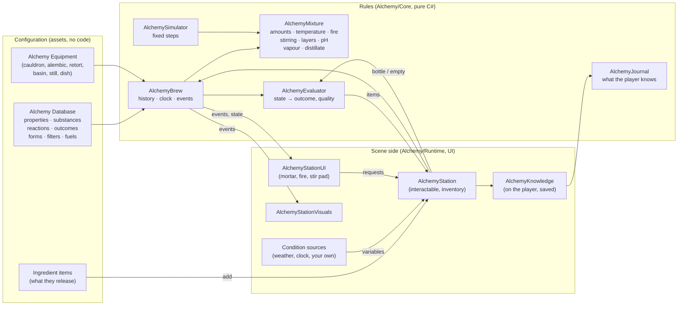

# Alchemy

**Scripts:** `Alchemy/Core/*` (the rules: no MonoBehaviour), `Alchemy/Items/*` (ingredient and potion items),
`Alchemy/Runtime/*` (the station, the player's journal, surroundings, visuals, generated art), `Alchemy/UI/*` (the
station window and its minigames), `CustomEditor/Alchemy/*` (menus, inspectors, the Alchemy Lab, Edit Mode tests).

An experimentation-based alchemy system. Players grind ingredients in a mortar, put them into a vessel, tend a real fire
(fuel, bellows, air vent, water and ice baths), stir by hand, wait, add more while it works, filter, decant, skim, let it
cool and crystallise, distil — and take out whatever the mixture **has become**. There is no recipe list: ingredients
are made of *substances* (each extracted at its own pace — faster when ground, at the right pH —, dissolving only as far
as the liquid can hold it, floating, sinking or forming layers by density, evaporating by volatility, stable only in its
own temperature and pH range, clashing with what it is incompatible with), general *reactions* transform substances over
time (by temperature, concentration, catalysts, stirring, layers, pH, contamination, the vessel, the surroundings), and
*outcomes* classify the mixture's actual state when it is bottled. The same ingredients give different results at another
temperature, after more time, in another order, in another vessel, whole or finely ground, stirred evenly or not, in
another solvent, filtered or not — and players discover all of it by experimenting, with a journal that records what
they have seen and how they made it.

The built-in content: 65 ingredients, 99 substances, 101 reactions, 44 outcomes (healing, vigour, calming, fortitude,
frost, mana, speed, breath, salamander, antidote, sleep, pain relief, lavender, mead, brandy, salve, soap, ink, venom,
bloodmoss, stormcall, starfrost, shadows, dragonheart, ginger, spiced mead, rosewater, wakefulness, restoration, phoenix,
featherfall, vitriol, berserker, panacea, blessed, gillweed, fireward...), with reversible reactions, competing and dependent reactions, alternative
pathways and branches,
3 filters, 4 fuels, 6 vessels.

| Chapter | What it covers |
|---|---|
| [01 — Overview and Setup](01-Overview-and-Setup.md) | Two-minute setup, how a player brews (the grinding, fire and stirring minigames), what the window shows, station settings |
| [02 — Simulation Rules](02-Simulation-Rules.md) | The mixture's state, the step, extraction (grind levels, evenness, pH), solubility, saturation and crystals, reactions and thermal / pH stability, the fire, baths, boiling, evaporation and distillation, stirring, layers and density, acidity, compatibility and contamination, filtering / decanting / skimming, vessels, conditions, reproducibility, saving |
| [03 — Authoring Content](03-Authoring-Content.md) | Properties, substances, reactions, outcomes, ingredients, forms, filters, fuels, vessels, condition sources, content packs — all without code |
| [04 — Discovery and the Journal](04-Discovery-and-Journal.md) | What players know and how they learn it; failed experiments; reproducing a discovery |
| [05 — The Default Chemistry](05-Default-Chemistry.md) | **Spoilers**: every built-in ingredient, substance, reaction, outcome, filter, fuel and vessel, with measured example procedures |
| [06 — Scripting and Extending](06-Scripting-and-Extending.md) | `AlchemyBrew` and `AlchemyStation` APIs, the minigame components, events, custom conditions and condition sources, saving, networking hook |
| [07 — Editor Tools and Testing](07-Editor-Tools-and-Testing.md) | Menus, inspectors, the Alchemy Lab (timeline and outcome map), Edit Mode tests |

The rules never depend on the window, animations or sounds: a preparation is a plain object that tests, the editor
and a server can run without a scene.
