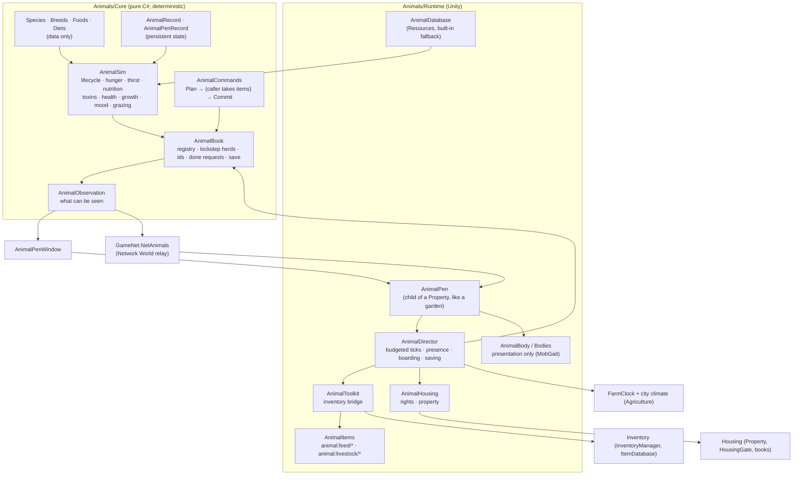
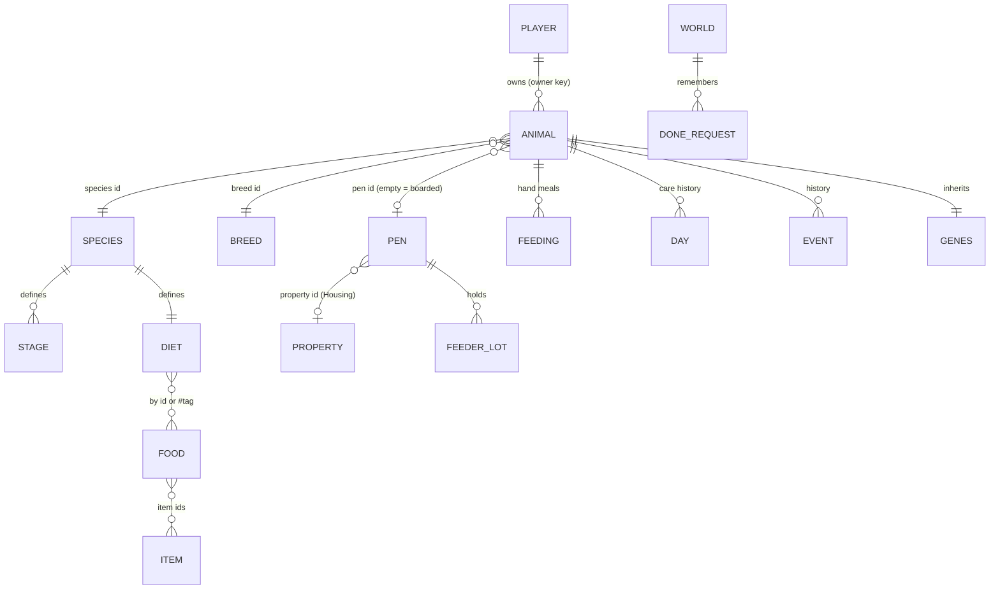
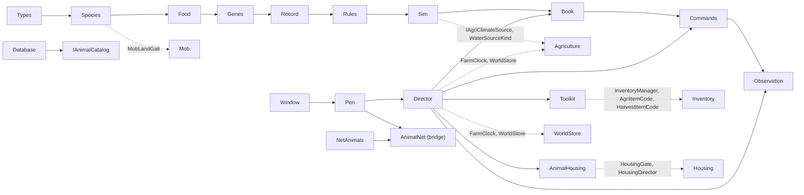
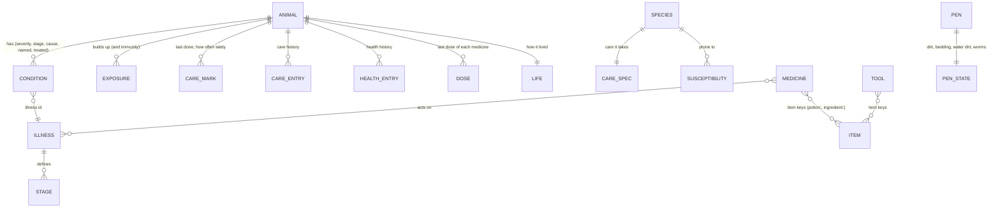

# 00 — Architecture, Requirements and Phased Plan

[← Animals](README.md)

This chapter collects the 14 deliverables asked for before any code: the analysis of the repository, the
architecture, the data model, the strategies (persistence, offline simulation, security, performance), the Phase 1 plan
and its acceptance criteria, and the testing strategy. The Phase 1 code it describes is in `Animals/`, and it is done.

**Phase 2 (care, welfare and health) is done too.** [§15](#15-phase-2-care-welfare-and-health-done) says what it
built, its data model and save version 2, its acceptance criteria, its known issues and the next phase. **So is Phase 3
(production)**: [§16](#16-phase-3-production-done) does the same for it, with save version 3, **and Phase 4 (breeding,
genetics, behaviour, affinity and relationships)**: [§17](#17-phase-4-breeding-genetics-behaviour-and-relationships-done),
with save version 4. Sections 1-14 are the Phase 1 plan as it was written; where a later phase changed what they foretell,
§15, §16 or §17 says so.

---

## 1. Repository architecture analysis

The package is a Unity 6 project's `Assets/Scripts/`. It has no asmdefs: everything compiles into
`Assembly-CSharp`, and `CustomEditor/` is guarded by `#if UNITY_EDITOR`. Gameplay types live in the global namespace,
network code in `GameNet` behind `#if FISHNET`, and tests in `<System>System.Tests` behind
`#if UNITY_INCLUDE_TESTS && UNITY_EDITOR`.

Each system has the same layout:

| Folder | What it holds |
|---|---|
| `Core/` | Plain C# rules and data, Edit Mode testable (UnityEngine maths and `JsonUtility` only, no MonoBehaviour) |
| `Items/` | `ItemSO` subclasses |
| `Runtime/` | MonoBehaviours, the database ScriptableObject, the director, toolkits, art |
| `UI/` | uGUI windows built in code with `UITheme` |
| `Networking/Runtime/<System>/` | Fish-Net relays (server-authoritative) |
| `CustomEditor/<System>/` | Inspectors, menus, validation, Edit Mode tests |
| `Documentation/<System>/` | README plus numbered chapters |

Every system also follows the same conventions:

* Settings are a `[Serializable]` rules class with `Defaults()`, held by a database ScriptableObject that loads from
  `Resources/SimpleMovements/Settings` and falls back to a built-in instance.
* Built-in content lives in a `*Defaults` static class.
* Statics are reset in `ResetStatics()` at `SubsystemRegistration`.
* Enums are serialized as ints, so new values are only ever added at the end.

## 2. Existing system dependency analysis

| Existing system | What Animal Husbandry reuses | How |
|---|---|---|
| **Agriculture / Garden** | The **farm clock** (`FarmClock.Now`: game hours, saved per world, never backwards, followed by clients); `FarmDirector.Ensure()` (keeps the clock ticking with no garden); the city's deterministic **climate** (`CityClimateSource`, `AgriEnvironment.Climate/Evaporation`); the **garden's conventions**: a component with an outline in local X,Z metres, a trigger child plus an Interaction Point, `Perform`/`PerformHere`/`RulesHere`, the access hook, and atomic per-world saves (`FarmClock.WriteWhole`/`CopiesOf`, never overwrite an unreadable save); produce items as **feed** (`agri:produce/*`, per-copy quality from `AgriItemCode`); water containers (`WaterContainerSO`, `AgriItemCode.Water`) to fill troughs | Direct calls. The Phase 1 core uses `IAgriClimateSource` and `WaterSourceKind` |
| **Housing** | `Property` (now lists its **pens** the way it lists gardens; pens are priced and listed as **Pasture** land, which costs the same as plain land by default, so rents do not change); `HousingGate.AccessOf` (the **Garden** right lets a player tend a pen and keep animals in it); `HousingDirector.Book.AccessOf(key)` (to **board** an offline owner's animals when their lease ends); `HousingDirector.KeyOf` (lasting **owner keys**); `HousingGeometry` (areas, containment, overlap); `HousingIds` (stable ids); the editor's `FreeSpot` placement ("**+ Pasture / + Coop / + Sty**", like "+ Garden") and the property checks (pens against the land, the house, zones, gardens and each other) | Small additive edits to `Property.cs`, `HousingEditors.cs`, `PropertyEditor.cs` and `HousingValidation.cs` |
| **Mobs** | `MobGait` (the mobs' locomotion gaits, pure functions: a rabbit hops) and `MobLandGait` (species look data) | Presentation only. Bodies are not `Mob`s (see §3, decision D4) |
| **Harvesting** | Species carry their `harvestAnatomy` id (`sheep`, `boar`, `rabbit` already exist) | Phase 2 turns dead animals into carcasses through Harvesting (done: §15) |
| **Inventory / Items** | `ItemSO`, `IRuntimeItem`/`IRuntimeItemSource` (`animal:` ids made on every machine), per-copy codes in `DurabilityList`, `InventoryManager.AddItem/ConsumeItem`, `ItemHandler.SpawnWorldItem`; merchants sell the new items as they are | `AnimalItems` and `AnimalToolkit` |
| **Networking** | `NetAuthority`, `NetObjects.PlayerOf/OwnerOf`, `NetSession.ClientLeft`, `NetPayload`/`NetPayloadAssembler`, the "Network World" global relay list | `GameNet.NetAnimals`, registered in `GlobalRelayComponents` |
| **Persistence** | `WorldStore` (world id, folder, `Committing` when `Closing`, `WorldChanged`); the per-world folder pattern | `Worlds/<world>/Animals/animals.json` (gzip) |
| **UI / Interaction** | `IInteractable`, `PlayerInteractor`, `UITheme`, `IExclusivePanel`, `HudFocus`, `InputBindingStore` | `AnimalPen`, `AnimalPenWindow` |
| **Editor / Validation** | `SMMenu` (new `Animals = 209`), `ProjectValidator` events, `ValidationIssue.WithFix`, `GroundAreaHandles` | `CustomEditor/Animals/AnimalEditors.cs` |

Findings that shaped the design:

* **The player inventory is not persisted at all.** Only world.json holds wallets, housing chests and held bundles.
  The animal ledger is therefore the authoritative, durable side of every exchange.
* `HousingAccess` is a serialized flags int that has no "Animals" bit. Adding one would touch saved grants and four UIs,
  so Phase 1 reuses **Garden**.
* There is **no public lease-ended hook** in Housing. Owners whose access ended are found lazily, by key, against the
  books. That approach also survives crashes and unloaded scenes.
* **Mobs are not suitable as livestock bodies:**
  * they need a NavMesh;
  * players treat every mob as an enemy;
  * there is no pooling;
  * the brain's wander is radius-only, not a polygon.
* **The sky resets on every server restart**, so the farm clock can jump up to about 24 game hours. The lockstep
  catch-up lives through that jump truthfully.

## 3. Animal Husbandry architecture proposal

**Key decisions**

* **D1: Animals are data, simulated by herd in lockstep.** A pen and its animals advance together in steps of at most
  `stepHours`. That way they share the feeder, the trough and the grass truthfully. Boarded animals advance alone.
  Nothing runs per frame per animal.
* **D2: Every change goes through validated commands, in two steps.**
  1. `Plan` checks everything against the present and changes nothing.
  2. The runtime takes the items and reads their per-copy quality.
  3. `Commit` records what was really taken.

  When a commit fails, the items are given back and the records are restored from a snapshot.
* **D3: Pens are placed and checked like gardens.** A pen is a child of the `Property`, with a local outline. It is
  never over the house, a garden, a zone or another pen, and never on another property's land. Pens are priced as
  Pasture.
* **D4: Bodies only present, never decide.** Each machine builds the bodies from the picture it holds, so pens need no
  NetworkObject per animal. Bodies move with the mobs' `MobGait` inside the pen's polygon, and their choices follow the
  farm clock and the animal's id, so clients see nearly the same herd. A species may give a model; it must not be a Mob.
* **D5: One global network relay.** `NetAnimals` sits on the Network World, which every client observes. It applies
  per-pen watchers, interest by real position, token-bucket rate limiting and retry dedupe by request token.
* **D6: The farm clock is the biological clock.** It runs in game hours, is saved per world, and never goes backwards.
  The housing clock is not used: it freezes after restarts and changes rate online.

## 4. Functional requirements breakdown

| FR | Requirement | Phase 1 status | Where | Later phase |
|---|---|---|---|---|
| FR-01 | Identity and ownership | **Done** | `AnimalRecord` (id, owner key, species, breed, name, born, acquired, stage, sex, genes, status); `AnimalBook.NewId` (from the world serial, never reused); ownership checks in `AnimalCommands`; history in `events` | Ownership transfer (Phase 5) |
| FR-02 | Growth and life cycle | **Done** | Configurable stages per species (`AnimalStageSpec`); growth from nutrition and health; Senior by age; old age; offline catch-up | — |
| FR-03 | Feeding and nutrition | **Done** | Favourite → Toxic (+ Inedible) per species, by id or `#tag`; hunger, satiety, nutrition (five nutrients over a 48 h window), preference, toxins, irritation kept apart; feeding history; by hand or from the feeder | — |
| FR-04 | Care and grooming | Data kept (hygiene, comfort) | `AnimalRecord.hygiene/comfort` | **Phase 2** |
| FR-05 | Welfare | Partial (happiness, stress) | `AnimalSim.Mood` | **Phase 2** (configurable weights, thresholds, consequences) |
| FR-06 | Production | Stage flags | `AnimalStageSpec.productionEnabled` | **Phase 3** |
| FR-07 | Product quality | Care history recorded | `AnimalRecord.days` (daily means) | **Phase 3** |
| FR-08 | Health and veterinary | Poisoning, malnutrition, starvation, dehydration, old age | `AnimalSim` | **Phase 2** (diseases, diagnosis, Alchemy treatments) |
| FR-09 | Habitat and environment | **Basic** | `AnimalPen` (kind, area capacity, feeder, trough with rain and evaporation, pasture grass), `AnimalPenRecord`, boarding | Upgrades, cleanliness, temperature (Phases 2 and 5) |
| FR-10 | Interaction | Feed, inspect, rename, move, release, stock, water, clear remains | `AnimalActionKind`, `AnimalPenWindow` | Pet, brush, wash, treat, collect, breed, sell |
| FR-11 | Breeding and genetics | Genes stored, deterministic | `AnimalGenes.FromSeed` | **Phase 4** |
| FR-12 | Behaviour | Presentation | `AnimalBody` (idle, walk, eat, drink, graze, sleep, dead) | **Phase 4** |
| FR-13 | Affinity | Hand-feeding by the owner | `AnimalRecord.affinity` | **Phase 4** |
| FR-14 | Resource collection | — | — | **Phase 3** |

## 5. Non-functional requirements breakdown

| NFR | How it is met |
|---|---|
| NFR-01 Many animals | Data-only simulation, round robin, at most `stepsPerFrame` animal-steps and `millisPerFrame` per frame. Bodies exist only near players. Pictures go only to watchers |
| NFR-02 Persistent state | Every record and pen lives in one per-world file, written whole with a backup, on change, at once after trades, and when the world closes |
| NFR-03 No constant per-animal updates | Each pen is updated at most every `tickHours` game hours. Timestamps (`livedTo`) are caught up in steps |
| NFR-04 Data-driven | Species, breeds, foods, diets and rules are ScriptableObject data with built-in defaults. No species is named in the rules |
| NFR-05 Secure against clients | Server-authoritative. The client sends only a choice; everything is re-validated with server positions, rights, inventory and state. Hidden numbers never leave the server |
| NFR-06 No duplicate production | Ids come from a persisted serial. Requests are remembered by token (persisted). Items are taken before the commit, and nothing is created twice (§10) |
| NFR-07 Collection validated by the server | The same command pipeline carries Phase 3 collection (§16) |
| NFR-08 Logging | Each animal keeps an event history. Saves, reads and failures are logged as `Animals: ...` |
| NFR-09 New species without core changes | Proven by a test that adds a llama as data and grows it |
| NFR-10 Clear interfaces | `IAnimalCatalog`, `IAnimalNetRelay`, `AnimalCommands`, `AnimalBook`, `AnimalPen.AccessCheck` |
| NFR-11 Deterministic | No randomness in the rules. Hashes and seeds only. The climate is deterministic. Lockstep steps give the same result watched or not (tested) |
| NFR-12 Balancing without code | Every rate and threshold is in `AnimalRules`, `AnimalNeedsSpec` or `AnimalFoodData` |

## 6. Data model proposal (as implemented)

The entities named in the brief map onto these types:

| Entity in the brief | Type | Notes |
|---|---|---|
| AnimalInstance | `AnimalRecord` | identity, life, condition (0–100), nutrition memory (`intake`/`need`), history, `revision` |
| SpeciesDefinition | `AnimalSpeciesData` (asset `AnimalSpecies`) | stages, needs, diet, habitat, look, breeds, harvest anatomy |
| BreedDefinition | `AnimalBreedData` | growth, appetite, size, hardiness, temperament, production quality, rarity, coats, value |
| FoodDefinition | `AnimalFoodData` (asset `AnimalFood`) | tags, item ids (with `prefix*`), portions per item, satiety, hydration, nutrients, toxin, irritation, freshness |
| FoodCompatibility | `AnimalDiet` (per species, optionally per stage) | Favorite, Preferred, Normal, Neutral, Poor, Harmful, Toxic, then *otherwise* |
| HabitatInstance | `AnimalPen` (scene) + `AnimalPenRecord` (world) | kind, area, feeder lots, water, grass, the scene's spec kept for unloaded scenes |
| AnimalCareHistory | `AnimalDay` list (14 days) + `AnimalFeeding` list | daily means of satiety, hydration, nutrition, health, mood; meals; hours starving or away |
| AnimalHealthRecord | `AnimalEvent` list (Poisoned, Upset, Starving, Thirsty, Recovered, Died) | a full record since Phase 2 (§15.2) |
| AnimalGenetics | `AnimalGenes` | 9 traits plus coat, pattern, rare trait and seed |
| ProductionDefinition, AnimalProduct | `AnimalProductSpec` (per species), `AnimalProductState` and `AnimalProductLot` (per animal), `AnimalProductRecord` (the ledger) | Phase 3 (§16.2) |

## 7. Module dependency graph

The dependencies run in one direction only. `Core` depends on nothing in Runtime. Housing references `AnimalPen` the
way it references `SoilField`: a property lists what belongs to it. Housing does not depend on any other animal type.

## 8. Persistence strategy

* **Where**: `persistentDataPath/Worlds/<world>/Animals/animals.json`, the folder of the world `WorldStore` has open.
  It holds gzip JSON (plain JSON is also read). It is not a world.json section, because it is large (about 5–10 KB an
  animal with its history) and changes hourly. Every commit of world.json would re-serialize it.
* **What**: one `AnimalWorldSave` per world. It holds `version`, the world, the serial, every animal, every pen with
  its feeder, water, grass and last known spec, and the remembered requests.
* **How it is written**: whole, with `FarmClock.WriteWhole` (aside, flushed, swapped in, with the previous copy kept as
  `.bak`).
* **When it is written**:
  * every `autosaveSeconds` (30) while something changed;
  * **at once** after a trade (a release, a move, remains removed, a boarding), at most every 2 s;
  * synchronously when the world closes (`WorldStore.Committing` with `Closing`), which is also how quitting saves;
  * on pause.
* **Reading**: the main copy, or a `.tmp` when it is newer (a write not swapped in), else `.bak`.
  * A main file that could not be read is set aside as `.unreadable-<time>`.
  * If it cannot be set aside, or no copy can be read, or a copy was saved by a newer version of the game, the animals
    office **stays closed** and nothing is written over the save.
* **Writing**: the book is written down on the main thread, then packed and written by a worker, one write at a time.
  A closing world waits for any write in flight and writes at once, before its lock is let go. Quitting saves through
  that closing commit, never after it.
* **Worlds are apart**: a book remembers the world it was read from (`FarmClock.World`) and is never saved into another.
* **Versioning**: `AnimalWorldSave.version`. A newer version is refused (thrown) and never half read. Missing lists are
  repaired. Enums are only ever extended at the end.

## 9. Offline simulation strategy

* **Owners offline while the server runs**: every pen keeps being simulated (data only, budgeted). While the owner is
  logged out, needs grow at `awayNeedsRate` (0.35), and hardship cannot take health below `awayHealthFloor` (25). Old
  age still applies.
* **Long gaps** (a clock jump from sleeping, a restart that re-syncs the sky, a pen behind on its round-robin turn):
  * the gap is lived in `stepHours` (1 h) steps against the city's deterministic climate for those hours;
  * a week lived in one call ends **exactly** as a week lived hour by hour (tested);
  * work spread over frames ends exactly as work done at once (tested).
* **Server down**: the farm clock does not advance, so animals do not age or starve while nobody can care for them.
* **Clock behind a record after a crash** (records are saved every 30 s, the clock independently): a pen ahead of the
  clock is taken at its word and resumes when the clock passes it.
* **Lost access while offline**: animals are boarded by key against the housing books, and keep living on a plain diet
  until their owner brings them home.

## 10. Security and exploit prevention analysis

| Threat | Prevention |
|---|---|
| Forged requests (another player's animal, an unowned pen) | The player comes from the connection (`NetObjects.PlayerOf`). Rights come from the housing books. Ownership comes from the record. Nothing in the payload identifies the actor. On public land nobody may hand-feed or clear another player's animal (`CareForOthers` comes only from Housing). A pen sharing another's id is out of order |
| Save spam (forcing writes) | Urgent saves happen at most every 2 s. The book is written down on the main thread and packed and written on a worker, one write at a time |
| Acting from afar | Reach is checked with the server's positions twice: the relay gate (+2 m) and `PerformHere` (+0.75 m) |
| Item forgery or quality spoofing | The client names an item key only. The server counts the player's own stacks and reads each copy's code before consuming it |
| Duplicated animals or items | Ids come from a persisted serial and are never reused. A release consumes the crate **before** the animal is recorded, and a trade is saved at once. A retried request (same token) is answered from the persisted done list. Living records are never deleted |
| Partial consumption | Plan, then take, then commit. When a commit fails, the items (with their codes) and the water are given back, and the records are restored from a JSON snapshot. A commit that got nothing does nothing |
| Request floods | Token bucket (burst 8, 0.1 s), refusals at most once a second, bounded lengths (JSON 4 KB, ids 128, text 120), counts 0–1000 |
| Information leaks | Pictures carry coarse levels and words only: no genes, toxins, nutrient balances or owner keys (tested) |
| Toxic feeding without consequence | Configurable doses, poisoning and its signs, health loss, death by poisoning. The window warns: the animal refuses when it is not hungry enough |
| Feeding once to max quality | Nutrition is judged over a 48 h window with daily history (one meal does not undo a week, tested) |
| Infinite accumulation | Pen capacity by area (adult space), a per-player limit, feeder and trough capacities, grass limited by the pasture's ground |
| Offline exploits | Server timestamps only. The owner-away rule lowers needs instead of pausing time. Lockstep catch-up |
| Lease abuse (keeping animals on land no longer rented) | Owners without the Keep right are boarded automatically |
| Known risk (accepted) | The inventory is not persisted by the game. A crash loses the bag anyway, so the animal ledger is the durable side. A crash between consuming a crate and the immediate save can lose that crate's animal, but can never duplicate it |

## 11. Performance strategy

* **No per-frame animal updates.** Each pen is advanced at most every game hour, within `stepsPerFrame` (400) and
  `millisPerFrame` (2 ms). An idle pen costs only its water and grass steps.
* **No GameObject per animal** except bodies within `showRadius` (70 m) of a local player, built from pictures.
  Bodies have no colliders and raycast the ground every 0.5 s.
* **Network**: one relay. A pen's picture goes only to its watchers, when its revision changes (at most every 0.5 s),
  with a 30 s refresh. Pictures are JSON packed with `NetPayload` (deflated above 256 bytes).
* **Saving**: gzip, at most once per 30 s while dirty (trades at most every 2 s). The book is written down on the main
  thread and packed and written on a worker; on pause, on world close and in a browser build it is written at once. For
  very large servers Phase 5 can split the save per owner (§12).
* **The Housing checks** for pens reuse `HousingGeometry`, as the garden checks do.

## 12. Phase 1 implementation plan (done) and the phases after it

**Phase 1: Core MVP** (this delivery). It contains:

* the entity;
* species, breeds and foods as data, with eight built-in species, 24 breeds and 24 foods;
* growth stages;
* feeding (from the hand and from the feeder) and nutrition;
* persistence;
* a basic habitat (pens with a feeder, a trough and pasture grass);
* ownership validation and boarding;
* offline growth;
* a window, a network relay, editor tools, validation and tests.

**Phase 2: Care, welfare and health** (done: what was built, and how it differs from this plan, is in §15)

* Care actions (brush, wash, clean hooves, clean habitat) with cooldowns and tools.
* `AnimalWelfare` with configurable weights and thresholds that drive outcomes.
* Diseases with identifiable causes and stages: malnutrition, dehydration, infection from dirty water or habitat,
  parasites, digestive problems, stress, injury, food poisoning.
* Diagnosis by symptoms.
* Treatments from Alchemy:
  1. read `BrewedPotionSO.CodeOf` before consuming;
  2. map the outcome id to a treatment;
  3. consume through the same Plan/Commit pipeline.
* Remains through Harvesting:
  * add `HarvestCondition.rearing` (a quality multiplier applied in `HarvestResolver`);
  * add `HarvestableCreature.LayOut(condition)`, so a carcass can be laid out without a mob death;
  * turn starvation, illness and poisoning into lean meat, tainted organs and lower quality.

**Phase 3: Production**

* Production cycles per species stage (eggs, milk, wool).
* Products as `animal:product/*` items.
* Quality from the care history of the cycle (`AnimalDay`) through a configurable formula.
* Traceability through a persisted product ledger referenced by the per-copy code (quality plus ledger reference).
* Storage at the animal or pen, collected by command. Products waiting at a lease's end go to Housing's held bundle.
  *(Done, §16. As built, products wait at the animal: a boarded animal keeps them for its owner, so the held bundle
  is not needed; the ids are `animal:product/<product id>`.)*

**Phase 4: Breeding, genetics and behaviour**

* Compatibility, gestation and cooldowns.
* Inheritance from both parents' `AnimalGenes` with configurable mutation, and offspring ids from the same serial.
* Affinity effects.
* A behaviour model. Optionally, `IMobMovementArea` and behaviour-override hooks in the Mob brain, for species that
  want a full mob body.

**Phase 5: Economy and expansion**

* Crating an animal to trade it (a livestock code carries its record id; the record transfers with validation).
* A livestock merchant preset and boarding fees.
* Habitat upgrades.
* Automation (feeders filled by NPC workers).
* The integration with Cooking, Crafting and Alchemy.
* Per-owner save files if servers grow very large.

(Built in §18: crating and trading, habitat upgrades, automation - the hopper, the waterer and egg trays, by the
player's choice instead of NPC workers - and the integrations. Boarding fees and per-owner save files were not needed and
are left for later: the animal goods merchant already sells livestock.)

## 13. Phase 1 acceptance criteria

| Criterion | Status | Evidence |
|---|---|---|
| Players can acquire and own animals | ✅ | Let out a crate (`Release`): owner key, `Acquired` event; `ACrateWithoutACodeBecomesAnAnimalOfItsOwn` |
| Animals have persistent identities | ✅ | `TheWorldSavesAndLoadsWholeAndIdsAreNeverReused` |
| Animals grow according to species | ✅ | `AnimalsGrowThroughTheirStagesAndPoorFeedingSlowsThem`, `ANewSpeciesNeedsNoCode` |
| Favourite, neutral and harmful foods | ✅ | `ADietTellsFavouritesFromPoisonsByIdAndByTag`, `ToxicFoodPoisonsAndHarmfulFoodUpsets` |
| Feeding modifies nutritional attributes | ✅ | `AFullAnimalCanStillBeBadlyNourished`, `OneGoodMealDoesNotMakeUpForAWeekOfPoorOnes` |
| Neglect produces consequences | ✅ | `HungerAndThirstHarmAndKill` |
| The system supports offline growth | ✅ | `AWeekNobodyWatchedEndsExactlyAsAWeekWatchedHourByHour`, `WhileItsOwnerIsAwayAnAnimalNeverFallsBelowTheFloor`, `BoardedAnimalsAreFedAPlainDiet` |
| The system prevents duplication | ✅ | `ARequestDoneOnceIsAnsweredButNeverDoneTwice`, `ACommandThatGotNothingDoesNothing`, persisted serial |
| New species through configuration | ✅ | `ANewSpeciesNeedsNoCode`, `TheBuiltInContentIsSound` |
| Habitat ownership integrates with property | ✅ | `Property.pens`, `AnimalHousing`, the Housing checks |
| Ownership validation | ✅ | `OnlyTheOwnerNamesOrMovesAnAnimalAndOnlyKeepersTendThePen` |
| Care, welfare, health, the vet, Alchemy and Harvesting integrations | ✅ Phase 2 | §15.4 |
| Production, product quality, products, breeding, trading | Later phases | §4, §15.7 |

**Deliverable**: a player can acquire an animal, feed it, watch it grow, and find it as they left it (or as it lived)
next session.

## 14. Testing strategy

* **Edit Mode, pure core** (`CustomEditor/Animals/AnimalCoreTests.cs`, 28 tests): no scene and no assets. They cover
  diets, nutrition, growth, hardship, toxins (eaten only as far as hunger drives), grazing, a stocked pasture with its
  usual trough, determinism (slept equals watched; spread over frames equals all at once), commands, rights,
  idempotency, boarded remains, save and load, ids, item codes, data-only species, built-in content and what is
  shown.
* **The Housing tests** (`HousingCoreTests`, `HousingValidationTests`) still apply unchanged: a property with no pens
  prices as before.
* **Manual Play Mode checks**:
  1. Add a property pen (**+ Pasture**), press Play, and use **Animals ▸ Give Me A Keeper's Starter Kit**.
  2. Let a crate out, feed it, stock the feeder and fill the trough.
  3. Skip a day or a week from the pen inspector, then quit and play again.
  4. Online: host plus a client, both near the pen. Check that the client sees the animals and that its requests are
     answered.
* **Not covered automatically**: runtime components with GameObjects, the window, and the Fish-Net relay. Fish-Net
  tests would need the package; the relay's rules (validation, dedupe) are core-tested.

**Escalation assessment**: no critical architectural, security or persistence issue remains open that needs a deeper
review before Phase 2. The accepted risk in §10 (the game does not persist inventories) predates this system and does
not allow duplication.

---

## 15. Phase 2: Care, welfare and health (done)

### 15.1 What was built

| Part | What it is | Where |
|---|---|---|
| **Care** | Species-specific care actions as data (brush, wash, pet, clean hooves, or a species' own), with tools, water, an optional supply, cooldowns, harm from too much or the wrong care, cold and heat; care for a whole pen at once; a daily cap on the bond care can buy | `AnimalCare` (Core), the species' `care` |
| **Tools and supplies** | Soft brush, curry comb, hoof pick, pitchfork (items of animal husbandry's own that wear), the farm's shovel and straw, crafting's soap | `AnimalToolData`, `AnimalToolSO`, `animal:tool/<id>` |
| **Living conditions** | Hygiene that settles toward a resting level, hooves that wear, comfort from the weather after shelter, warmth and shade, crowding, loneliness, bedding, a dirty floor; stress from all of them; what bothers an animal shown in words | `AnimalCare`, `AnimalPenSpec` (shelter, warmth, shade, bedding, self-cleaning) |
| **Welfare** | The reference formula with configurable weights, a stress penalty and a health cap; five bands that change how fast illness builds, how fast it heals, growth, stress and spirits (and Phase 3 production); the owner told when an animal is in a bad way | `AnimalWelfare` |
| **The habitat** | Floor dirt, bedding, trough fouling (algae, dilution, the kind of water poured), worms in a pasture; mucking out (fork or shovel, straw, manure for Agriculture), scrubbing the trough | `AnimalHabitat` |
| **Illness** | Nine data-driven illnesses with causes, a build-up, onset, stages, symptoms, a course, a recovering stage, immunity, relapse and contagion; species susceptibility; no random illness | `AnimalHealth`, `AnimalDefaultsCare` |
| **Diagnosis** | Symptoms a keeper sees; a careful look that names an illness from a given stage; hidden early stages only the vet finds | `AnimalHealth.Examine` |
| **Medicine** | 17 medicines: ten Alchemy potions, three veterinary outcomes added to Alchemy, and four plain remedies a merchant sells; doses by body size, strength from the bottle's quality, doses together (each game hour the strongest working then, each dose to its own end), a dose too soon (within its interval of the last dose that did its good: refused for a medicine with no overdose, which is told when it may be; for one with an overdose, no more good at once, only its harm), a whole pen at once (leaving out those that had it too lately) | `AnimalHealth.Treat`, `AnimalHealth.Dose`, `AnimalHealth.WaitBefore`, `AnimalAlchemy` |
| **The veterinarian** | An NPC (and a merchant of the keeper's goods) sent for from a pen for a fee: names everything, treats it, cures what keeper medicine can only hold; without one in the world, keeper medicine cures everything | `AnimalVeterinarian`, `AnimalVetWindow` |
| **Histories** | A health history (in symptom words until named, nothing from before it showed), a care history, Phase 2 day means, a lifelong record of how it lived | `AnimalRecord`, `AnimalObservation.History` |
| **Remains** | Owner-only slaughter; owner-only butchering through Harvesting, the carcass laid by the fence, its quality from how it was raised, its meat, organs and hide from how it died | `AnimalRemains`, `AnimalCarcass`, Harvesting's `rearing`, `LayOut`, `AccessCheck` and six farm anatomies |
| **Goods** | A merchant component that sells every tool, supply, feed, a crate of each species and every medicine; a care kit for testing | `AnimalMerchantStock`, `AnimalToolkit.GiveCareKit` |
| **The window and the bodies** | The pen window's Overview, Care, Health and History tabs; muck out and scrub in the pen column; bodies that look dirty, sick, lame, stressed, thin or content and react to care; dung and straw on the floor; optional sounds | `AnimalPenWindow`, `AnimalBody`, `AnimalAudio` |
| **Editor** | The vet-and-merchant NPC, goods for any merchant, the species update, the carcass prefab, the care kit, validation of the content and of where animals are kept, the pen inspector's Phase 2 numbers and debug tools | `AnimalEditors.cs`, `NetworkSetupMenu` |

How it all plays is in [chapter 04](04-Care-Welfare-and-Health.md).

**New dependencies**:

| System | What Phase 2 uses | How |
|---|---|---|
| **Alchemy** | `AlchemyDatabase` extension packs (three outcomes classifying liquids existing ingredients already make: no new substance or reaction), `BrewedPotionSO` and its per-copy code (strength and purity), `AlchemyItems` | `AnimalAlchemy` (installed before the first scene on every machine; a project's database asset is never changed) |
| **Harvesting** | `HarvestCondition.rearing` and `cause` (new, ×1 and empty by default: every existing result unchanged), `HarvestableCreature.LayOut` and `AccessCheck` (new), the `IHarvestLaidOutBody` marker (new: the creature's inspector asks a body laid out from code for no anatomy, combat entity or body parts), six farm anatomies (cow, horse, goat, pig, chicken, duck) | `AnimalCarcass`, `AnimalCarcassTag`, `AnimalCarcassLook` (the marker) |
| **NPC, Merchant, Currency** | `NPCBehaviour` (the vet's option), `Merchant` entries, `CurrencyWallet` (the fee, given back on failure, saved at once) | `AnimalVeterinarian`, `AnimalMerchantStock`, `AnimalToolkit.TakeFee` |
| **Crafting, Agriculture** | Crafting's soap and charcoal (`craftstock:` keys), the farm's shovel, straw mulch and manure | `AnimalToolkit.KeyOf`, the rules' *Manure Item* |

**The non-functional requirements still hold**:

* **Cost.** No per-frame work per animal. A pen's step builds its herd facts once (from the step's start, so the order
  animals are stepped in does not matter). Contagion is summed in a fixed order, in double precision.
* **Determinism.** No randomness: a week caught up at once ends exactly as one watched hour by hour, illness and dirt
  included (tested), and steps of 1, 0.25 and 0.1 h agree, and so do the short steps commands make (every request
  brings its pen up to date, so a client that sends many steps it in slices; tested at 200 requests a game hour: the
  same illnesses, each within 2 game hours).
* **Nothing hidden leaves the server.** No severity, build-up or owner key (tested).
* **Every change goes through plan, take, commit.** Money is taken first and given back on failure. A carcass is laid
  out before its record is removed.

### 15.2 Data model additions and save version 2

| Type | What it gained |
|---|---|
| `AnimalRecord` | `hooves` (100), `welfare` (60), `absorbFactor`, `discomfort` and `stressor`; lists `conditions`, `exposures`, `care` (marks), `careLog`, `healthLog`, `doses` (its last dose of each medicine that did its good: `Dosed` puts a dose in the place of the last of the same medicine); `lastExaminedAt`, `lastVetAt`, `lastOwnerCareAt`, `lastNeedsHelpAt`; `deathCondition`; `life` (`AnimalLife`: slow averages of welfare, nutrition, health, hygiene, comfort and illness; hours ill, starved and lived) |
| `AnimalDay` | `hygiene`, `comfort`, `welfare`, `minWelfare`, `illness` (means), `cares`, `ownerCares`, `affinityGained` |
| `AnimalPenRecord` | `dirt`, `bedding` (−1: not laid yet), `waterDirt`, `parasites`, `lastCleanedAt`, `cleanedBy`, `lastBeddedAt`, `lastDisturbedAt`, `manureOwed` |
| `AnimalPenSpec` | `shelter`, `warmth`, `shade`, `bedding`, `selfCleanHours` (−1: from its kind), with resolved `Shelter`, `Warmth`, `Shade`, `UsesBedding`, `SelfCleanHours`, `Open` |
| `AnimalSpeciesData` | `care` (`AnimalCareSpec` with its `AnimalCareActionSpec` list), `susceptibility`, `dataVersion` (2) |
| `IAnimalCatalog` | illnesses (`AnimalConditionData`), medicines (`AnimalTreatmentData`), tools (`AnimalToolData`), each by id and by item key |
| `AnimalRules` | groups Care, Habitat, Comfort, Welfare (`AnimalWelfareSpec`), Health, Veterinarian, Remains |
| Enums (appended, saved as numbers) | `AnimalEventKind` + Cared, FellIll, Worsened, Diagnosed, Treated, Healed, SeenByVet, Slaughtered, NeedsHelp; `AnimalActionKind` + Care, CleanPen, Examine, Treat, CallVet, Slaughter, Butcher, History; new `AnimalCareKind`, `AnimalWelfareBand`, `AnimalConditionKind`, `AnimalCause`, `AnimalHealthEventKind`, `AnimalTreatmentRoute`, `AnimalLooks`, `AnimalDiscomfort` |
| Requests and views | `AnimalRequest.expected` (the vet's fee seen); `AnimalView` levels for hygiene, comfort, calm, welfare and hooves, the welfare word, looks, named illnesses, care cards, the vet's fee and whether the vet can be sent for (`vetCanCome`), the last care; `AnimalPenView` cleanliness, bedding, water, shelter and weather words and levels |

The entities of the brief now map as: **AnimalHealthRecord** → `AnimalCondition` + `AnimalHealthEntry` + `AnimalDose`;
**AnimalCareHistory** → `AnimalCareEntry` + `AnimalDay` + `AnimalLife`; **HabitatInstance** → `AnimalPenRecord` with its
cleanliness, and `AnimalPenSpec` with its shelter.

**Save version 2.** `AnimalWorldSave.CurrentVersion` is 2.

* A version 1 save loads: every missing list is made, and the new fields take their initial values (hooves 100,
  welfare 60). The life record is primed at the animal's first step, from where it is. The day it was saved in takes
  its new means (coat, comfort, welfare) from the animal as it loads; earlier days are left as they are. A pen's
  bedding is laid at its first use (fresh in a bedded pen).
* A current record is left exactly as it is, so a version 2 save round-trips every field (tested with a literal
  version 1 file and a full version 2 round trip).
* An illness's treatment is kept as steps, each dose to its own end: `AnimalCondition.treatPower` until `treatedUntil`
  (the strongest working), then `thenPower` until `thenUntil` (−1: none), then `laterSteps` (`AnimalDoseStep`: `power`,
  `until`), at most `AnimalHealth.MaxDoseSteps` (8) in all. A version 2 save made before these steps were added reads
  none (0 and −1, no later steps), and the treatment it saved works on as it was; the version stays 2.
* A newer version is still refused, never half read.
* Species assets are versioned on their own (`dataVersion`): one made before Phase 2 is filled in from the built-in
  species of its id until **Update Species Assets To Phase 2** writes the fields into it. One made now (the Create
  menu, or *Reset*) starts at version 2.

### 15.3 Functional requirements after Phase 2

| FR | Requirement | Status after Phase 2 | Where |
|---|---|---|---|
| FR-04 | Care and grooming | **Done** (shearing is Phase 3) | Brush, wash, pet, clean hooves, clean habitat (muck out, scrub the trough), treat, feed, hydrate; species-specific; tools, water, supplies; cooldowns; harm from too much or the wrong care |
| FR-05 | Welfare | **Done** | `AnimalWelfareSpec` (weights, thresholds, band effects), welfare drives illness, healing, growth, stress and spirits |
| FR-07 | Product quality | Care history and the life record kept; rearing quality applied to remains | **Phase 3** for products |
| FR-08 | Health and veterinary | **Done** | Nine illnesses, causes, symptoms, diagnosis, Alchemy treatments, plain remedies, the vet, stages and recovery, no random illness |
| FR-09 | Habitat and environment | **Done** except upgrades | Cleanliness, bedding, shelter and temperature, crowding, contagion, trough water; upgrades in **Phase 5** |
| FR-10 | Interaction | **Done** for Phase 2 | Pet, brush, wash, clean hooves, muck out, scrub, examine, treat, call the vet, history, slaughter, butcher; collect (Phase 3), breed (Phase 4), sell (Phase 5) |
| FR-13 | Affinity | Grows with its owner's care (capped per day), fades with neglect, counts in welfare | Its effects on behaviour: **Phase 4** |

### 15.4 Phase 2 acceptance criteria

The evidence is Edit Mode tests: `AnimalCareTests` and `AnimalCoreTests` (`CustomEditor/Animals/`),
`AnimalAlchemyTests` (`CustomEditor/Animals/`) and `HarvestRearingTests` (`CustomEditor/Harvesting/`).

| Criterion | Status | Evidence |
|---|---|---|
| Care actions are species-specific, need their tools, water and supplies, and wear tools | ✅ | `BrushingCleansAndSoothesNeedsABrushWaitsItsTurnAndWearsTheBrush`, `AWashNeedsItsWaterAndSoapIsOptional`, `TheBuiltInHealthAndCareContentIsSound` |
| Some actions have cooldowns; excessive or inappropriate care does harm | ✅ | `BrushingCleansAndSoothes…`, `TooMuchBrushingGivesLessAndDoesHarm`, `WashingARabbitOrWashingInTheColdChillsIt` |
| A whole pen can be cared for at once; a bond is not bought by grinding | ✅ | `CareForAWholePenIsDoneToEveryAnimalThatCanTakeIt`, `ABondIsNotBoughtByPettingAllDay`, `ABondIsNotBoughtByHandFeedingAllDay`, `TheOwnersMedicineAddsToTheBondAtMostOncePerInterval` |
| Each animal has hygiene and comfort that its habitat and the weather drive | ✅ | `ACoatSettlesWhereItsPenAllowsAndCareLiftsItAboveThat`, `ShelterKeepsAnimalsComfortableInColdRainAndAKeeperCanSeeWhatBothersThem` |
| Overcrowding and loneliness reduce welfare | ✅ | `ACrowdedPenIsLessComfortableMoreStressedAndOfLowerWelfare`, `AnAnimalKeptAloneMissesItsKind` (lonely: more stressed) |
| Welfare follows the reference formula with configurable weights and the five thresholds | ✅ | `WelfareFollowsTheWeightedFormulaAndItsBands` |
| Welfare changes simulation outcomes, not only a number | ✅ | `ACriticalAnimalFallsIllFasterThanAnExcellentOne`, `DailyCareMakesWelfareGoodAndAnOwnersAffectionExcellent` |
| A Critical animal calls for intervention | ✅ | `ItsOwnerIsToldWhenAnAnimalIsInABadWayAtMostOnceADay`, `AnOwnerWhoComesBackIsToldAtOnceThatTheirAnimalIsInABadWay`, `ALongSpellInABadWayIsToldEveryDayButKeptOnceInItsHistory`, `AnAnimalInABadWayFromLowHealthShowsItNeedsHelp` |
| Environmental hygiene influences health; cleaning the habitat works | ✅ | `AFilthyCrowdedCoopMakesItsHensIll…`, `MuckingOutNeedsAForkCleansLaysStrawGivesManureAndDisturbsTheHerd`, `MuckingOutAFreshBarnWithNoStrawSaysStrawIsWhatIsMissingAndFreshStrawWaitsItsTurn`, `PouringWaterMixesAndScrubbingTheTroughChangesFoulWater`, `AStrangerOnPublicLandMayNotMakeATroughMurkyButMayFillADryOne`, `AStrangerMayNotMakeATroughMurkyALittleAtATime`, `AStrangerMayNotMakeABigTroughMurkyByPoursTooSmallToMeasure`, `AStrangerMayPourWaterNoDirtierThanAMurkyTroughs` |
| Diseases have identifiable causes; no unexplained random disease | ✅ | `AFilthyCrowdedCoopMakesItsHensIll…` (cause: a dirty pen; none when mucked out), `AFullPastureNeverMuckedOutFallsIllBetweenDay5AndDay20` (worms), `PoisonousFoodShowsAsFoodPoisoningWithinHours`, `AWellKeptAnimalOfEverySpeciesStaysWellForAMonth`, `ALoneCowOnAPastureStaysWellAndAtEase` |
| Diseases have stages, recovery with a duration, immunity, relapse | ✅ | `AMendingIllnessComesBackIfItsCauseReturnsElseItClearsAndLeavesImmunity`, `AnIllnessThatComesBackInAStageThatHidesIsHiddenUntilItShowsThenItsOwnerIsTold`, `AComebackThatHidesAndMendsUnseenStillEndsWithItsOwnerToldItIsOver`, `WormsNeedTheVermifugeAndLeaveImmunityBehind`, `AMildUpsetPassesByItselfButABadOneMustBeTreated` |
| Catching illnesses spread, and stop when the sick animal is taken away | ✅ | `AnInfectionSpreadsToPenMatesUntilTheSickOneIsTakenAway` |
| Players can identify symptoms and diagnose | ✅ | `ALookNamesAnIllnessOnlyFromItsDiagnoseFromStage`, `ALookThatFindsAnIllnessShowingPutsItInItsHistory`, `ALookStillTellsANamedIllnessTreatedBelowTheStagesThatShow`, `TheHistoryTellsAnIllnessBySymptomsUntilItIsNamed` |
| Treatments have requirements and costs (the right medicine, doses by size, doses together, a dose too soon, overdoses) | ✅ | `TheRightMedicineCuresTheWrongOneDoesNotABigAnimalNeedsMoreAndTooMuchPoisons`, `AWeakDoseDoesNotStretchAStrongOneNorACheapWashTheVeterinarians`, `AWeakDoseGivenAgainAndAgainNeverKeepsAStrongOneWorkingPastItsOwnEnd`, `HourByHourTheStrongerDoseWorksToItsEndThenTheWeakerOneToItsOwn`, `TheVeterinarianADraughtAndWashesTakeOffEachHoursStrongestDoseEachToItsOwnEnd`, `AfterEveryDoseOfThreeOrFourPowersTheRecordHoldsEachHoursStrongestDoseExactly`, `ADoseRecordHoldsAtMostItsMostStepsLetsTheWeakestGoAndSavesThemAll`, `AMedicineThatOnlyActsAtOnceLeavesNoTreatmentWorkingSoNothingMendsByIt`, `WashesAskedForOneAfterAnotherAreRefusedWithTheWaitUntilTheIntervalHasPassed`, `AWaitIsToldRoundedUpSoAKeeperWhoComesBackThenMayGiveIt`, `AMedicineGivenAgainWithinItsIntervalDoesNoMoreGoodYetButStillDoesItsHarm`, `AWashTooSoonDoesNotPutOffTheNextItsIntervalCountsFromTheLastWashThatDidItsGood`, `AnOverdoseDoesNotPutOffTheNextDoseOfAMedicineThatHarmsWhenGivenTooSoon`, `DosesOfOtherMedicinesNeverMakeAMedicineForgetItsLastDose`, `EveryMedicineKeepsItsLastDoseHoweverFewDosesTheRulesKeep`, `GivingToAllHereLeavesOutTheOnesThatHadItTooLatelyAndTakesItemsOnlyForTheRest`, `AWholePensDoseOfAMedicineThatHarmsTooSoonTakesItemsOnlyForThoseItIsGiven`, `ADoseRecordedAheadOfTheClockMakesNoWait`, `TheVinegarWashTurnsAnOutbreakInASmallCoopOnceItIsMuckedOut`, `LavenderGrownOnTheFarmIsTheLavenderRemedy` |
| Treatments are produced through Alchemy, without changing any existing brew | ✅ | `DocumentedRecipes_MakeTheVetMedicines`, `LiquidsMadeByHand_AreEachVetMedicine_AndNothingElseIs`, `ExistingRecipes_KeepTheirOutcomeAndTier_WithThePack`, `VetOutcomes_AreOnlyWhatTheRulesCanMake`, `ABottle_IsItsOutcomeToTheAnimals_AndEachCopyKeepsItsQuality`, `Pack_InstallsOnce_AndAddsOnlyTheVetOutcomes`, `Pack_NeverChangesAnAsset_AWrapperTakesItsPlace`, `OutcomeExists_CountsTheVetOutcomes_EvenOnAnAssetLeftAsItIs` |
| Some conditions require an NPC veterinarian, for a fee | ✅ | `PastNeedsVetAboveKeeperMedicineOnlyHoldsItAndTheVeterinarianCuresIt`, `WithNoVeterinarianInTheWorldKeeperMedicineCuresEverything`, `AFreeVeterinarianCanBeSentForButNotByAVisitor` |
| A boarded animal is kept well, and its owner can see to its health from any pen | ✅ | `ABoardedAnimalIsKeptWellAndItsOwnerSeesToItsHealthFromAnyPen` |
| Health and care histories are recorded and kept | ✅ | `TheHistoryTellsAnIllnessBySymptomsUntilItIsNamed`, `WhatTheVeterinarianOrADoseDidIsInTheHistoryAboveTheVisitOrTheDose`, `ADeathNoIllnessCausedEndsItsHealthHistoryAndASlaughterIsRecordedOnce`, `AVersion2SaveRoundTripsEveryNewField`, `TheEditorsHealAllTellsOverEachIllnessItsKeepersKnewOfAndNoOther` (the pen inspector's debug *Heal all* keeps the history true) |
| An illness that kills is recorded; how an animal was raised and what ailed it shows in its remains | ✅ | `AnAnimalThatDiesOfAnInfectionIsRecordedSoAndItsRemainsShowIt`, `AnOldIllAnimalWhoseOwnerIsAwayDiesOfOldAge`, `OnlyAnIllnessOfTheWholeBodyThatShowsTaintsTheCarcass`, `AFarmAnimalsRemainsShowInItsCarcass`, `ANeglectedCowsTanneryHideIsWorseThanAWellRaisedOnes`, `RearingScalesTheQualityOfEveryPiece` |
| A dead animal is harvested through the existing Harvesting system, by its owner only | ✅ | `SlaughterAndButcheringAreTheOwnersAndButcheringChangesNothingUntilTheCarcassIsLaidOut`, `AFarmCarcassIsItsOwnersOnly`, `TheCarcassLiesOutsideTheFenceAwayFromTheFeederAndTheTrough`, `TheFarmAnimalsAreSoundAnatomies`, `EveryFarmMaterialCanBePlanned`, `HoursDeadSpoilTheCarcassAsTheyWould` |
| Existing Harvesting results are unchanged | ✅ | `ABodyThatNamesNoRearingIsJudgedAsBefore`, and Harvesting's own suites |
| Phase 1 saves load; the new state is saved | ✅ | `APhase1SaveLoadsWithTheNewFieldsAtTheirDefaults`, `TheDayAPhase1SaveWasMadeInKeepsSensibleMeansAndItsEarlierDaysSayNothingOfTheCoat`, `AVersion2SaveRoundTripsEveryNewField`, `ADoseRecordHoldsAtMostItsMostStepsLetsTheWeakestGoAndSavesThemAll` (every step of a treatment), `AnIllnessTheGameNoLongerHasDoesNotKeepAnAnimalFromHealing` (a saved illness the content dropped) |
| Offline catch-up stays exact with the new state | ✅ | `IllnessAndDirtCaughtUpEndExactlyAsWatchedHourByHour`, `AWeekNobodyWatchedEndsExactlyAsAWeekWatchedHourByHour` and `ACatchUpSpreadOverFramesEndsTheSameAsOneDoneAtOnce` (both extended to every Phase 2 field); `ManyShortStepsAsRequestsMakeThemGiveTheSameIllnessesAtTheSameHoursAsHourlySteps` |
| Hidden numbers stay on the server | ✅ | `WhatIsShownOfHealthStaysCoarse`, `WhatIsShownIsCoarse`, `AMedicineForAnIllnessStillHiddenDoesNotSeemToHelpThoughItWorks` (a dose never gives a hidden illness away) |
| Every Phase 1 criterion still holds | ✅ | The 28 `AnimalCoreTests`, none weakened; `ANameCutAtItsLengthNeverEndsInHalfACharacter`, `ANameIsCutOnlyWhereAWholeCharacterEndsAndLoneHalvesAndLeadingSpacesAreDropped` and `ANameKeepsNothingInvisibleAndNoSyllableOfAnotherScriptIsCutInTwo` (a name cut at *Max Name Length*, and a player's shown name; nothing invisible kept, and a name with nothing visible refused) |
| Hygiene and welfare influence production quality; sick animals produce less | Phase 3 | The band's and the stages' production factors are kept for it (§15.7) |

**Balance**, with the defaults (checked in a Python port of the rules that agreed with the C# hour by hour, measured
again in the C# itself, and, for S1 to S5 and the boarded animals, held by the C# tests):

| Scenario | Result |
|---|---|
| One cow alone on an 8 × 6 m pasture with grass, hay and water, never groomed | no illness in 14 days; welfare Good (75-77) |
| Three cows on that pasture, never mucked out or groomed | first illness between day 7 and day 9 (worms, then infection and hoof rot) |
| Six hens in a 9 m² coop, never cleaned / mucked out every two days | an infection from day 4 / none in 30 days |
| Harmful feed / toxic food | upsets that pass by themselves / poisoning shows within 2 hours |
| Daily care / daily care and petting by its owner | welfare Good (86-87) / Excellent (93-94) |
| Every Phase 1 scenario | unchanged |
| Boarded animals, 40 days | healthy, hooves 80, coat 65 |

**Deliverable**: a player can keep animals clean, comfortable and calm, see when one is unwell, find out what ails it,
treat it with medicine they brewed or bought (or send for the vet), and, when it dies or is slaughtered, butcher it
through Harvesting with what they get showing how it was raised.

### 15.5 Decisions made while building it

Where the build departs from the plan of §12, the build wins. These are the choices a designer may notice:

* **Water.** Pouring water never empties a trough: it mixes. A fouled trough is changed by *Scrub the trough* (a
  CleanPen request with the text `trough`), which needs no tool. On public land only a keeper of an animal in the pen
  may scrub it, or pour in water dirtier than the trough's once that would leave it murky, however little at a time (a
  dry trough takes any water). A first fix let a stranger's pour through when it added under 0.5 to the dirt, so many
  small pours still fouled it (0.4 L at a time took the dirt from 14 to 37, past the 25 from which it counts toward an
  infection). A second judged the mix against the trough's dirt to a thousandth, which pours too small to measure
  passed in a big trough (0.05 L at a time into 2000 L took it from 14.99 to 24.98). Now the water poured is judged.
* **Butchering and the carcass are the owner's alone.** Carers may still clear the remains, care for and treat the
  animal.
* **With no veterinarian in the world**, nothing is gated: a keeper's medicine can cure every illness.
* **The veterinary outcomes are stricter than first planned.** A sweep of 13 632 brews showed the first sketch caught
  other brews too: now only failures (cloudy infusions, murky mixtures) become veterinary medicines.
* **Care actions are named by id**, not by kind, so a species can have its own.
* **A worn-out tool works**, poorly, and the player is told.
* **Treatments.** A dose's food and water, comfort and stress all scale with its strength. A dose that brings an illness
  to 0 starts its recovery at once. A wash or a salve works less on a filthy coat and is never given to a whole pen.
  Of doses at once (the vet's included), each game hour gets the strongest working then: the strongest works to its own
  end, then each weaker one to its own. An illness keeps every such step exactly (`treatPower` to `treatedUntil`,
  `thenPower` to `thenUntil`, then `laterSteps`; at most 8, the weakest let go past that). A dose with no power per hour
  adds no step: kept, it counted as *being treated* while nothing worked, and let an illness past its *Needs Treatment
  Above* mend. The plan kept the stronger power until the later end, so a cheap wash could stretch a strong potion; a
  first fix turned the weaker dose's rest into more hours of the stronger, which a weak dose given again and again
  still stretched (the vet, then a wash every 4 hours: 250 severity taken off in 72 hours, where each hour's strongest
  dose takes 184); a second kept only two steps and added a third dose to the second at the second's power, which then
  worked past its own end (the vet, a Standard draught and washes: 190.44 where each hour's strongest takes 186). The
  vinegar wash takes 5 off an infection at once, then 2 a game hour for 12 hours (the planned 0 / 1 never turned an
  outbreak in a coop).
* **A dose too soon** (the same medicine within its interval of its last dose that did its good) does no more good at
  once, only its harm (an overdose's toxins, a sting, the stress of being dosed), and its hourly work counts as any
  dose's. It is not recorded, so it puts nothing off; and each animal keeps its last dose of every medicine the game
  has, however low *Keep Doses* (64) is set, so doses of others never make it forget one. The commands do not give one
  of a medicine with no overdose: it is refused before anything is taken, with the wait rounded up (*Too soon for
  another dose: the cow can have the vinegar wash again in 3 hours.*), so a keeper who comes back when told may give it.
  *Give to all here* leaves out each animal that had it too lately. Such a dose used to do all its good again, so washes
  one after another, which cost nothing (the vinegar wash has no overdose), took a Severe infection to 0 within a game
  minute. Then a dose too soon was recorded and put off the next one that did its good: washed every 5 hours, or a game
  minute early each time, only the first wash did its good, and 4 hens of 4 died where washing on time saved them all.
  And only the last 8 doses of any medicine were kept, so 8 doses of another between washes made the wash do all its
  good again; then, at *Keep Doses*' least (16), the history held fewer medicines than the game's 17, and given in turn
  each was forgotten before its turn came round again, so none was ever too soon. A whole pen's dose took every animal's
  items, those dosed lately too. The wait was rounded down: a moment after a wash it said *in 5 hours*, and a keeper who
  came back then was refused again.
* **The bond.** Meals from its owner's hand count within the daily cap on the bond, as care and medicine do.
* **Some numbers.** Trough fouling is 0.15 (a first 0.2 gave a mucked-out coop foul water on day 30). Every species
  grooms itself back at least as fast as it gets dirty. Algae grow only in open water. Released animals arrive with
  sound hooves (100); boarded animals' hooves settle at 80.
* **Remains.** The carcass lies at the fence corner farthest from the feeder and the trough (the same on every machine).
  Poor rearing wears only a tannery hide (feathers already get it through their quality). A hide's wear is capped below
  what reads as holes from a fight. The carcass window says how it died, and a taint from illness is called so. Only an
  infection or worms that shows taints the meat: hoof rot (its *Taints Carcass* is off) and a worm load still hidden
  leave it fit to eat. The carcass is drawn in its species' first breed's coat.
* **The window.** "To all here" is on each care card (two or more animals). *Look it over* is on both the Care and
  Health tabs. Health can be seen to from any pen for one's own boarded animals.

### 15.6 Known issues and limitations

* **Carcasses are not saved**, as in Harvesting. The animal's record is removed when its carcass is laid out (so nothing
  can be butchered twice). A restart, or leaving it past *Carcass Minutes* (120 real minutes), loses what was not
  harvested. The carcass window's "dead for" counts from when it was laid out, not from the death.
* **Not yet run inside Unity.** All of Animal Husbandry, and the Harvesting code it touches, compiles in a .NET 8
  build against stand-ins made from Unity's and Fish-Net's own declarations, for the player and for the editor, each
  with and without Fish-Net. There every Edit Mode test of it passes: `AnimalCoreTests` (28), `AnimalCareTests` (86),
  `AnimalAlchemyTests` (8) and `HarvestRearingTests` (9). What only Unity can show has not been seen: the window's
  layout on screen, physics (*Follow Ground* under a roof), the Fish-Net carcass prefab, the Alchemy station check
  (it reads the station through the editor's serializer) and Unity's *Reset* of a new species asset. Run the Test
  Runner and the manual checks (§15.8) first.
* **Balance.** Three cows left on a full pasture, never mucked out or groomed, all die by about day 15 of an untreated
  infection. A fully stocked pen wants mucking out every 2-3 days (every 2 for a herd that is never brushed nor has
  its hooves cleaned), which a player may find a chore. A Moderate infection spreads only borderline. The vinegar wash
  turns a small coop's outbreak only once the coop is mucked out. Three or four hens then all mend, washed every 6 game
  hours (its interval) or only twice a day; of six, all mend washed every 6 hours, but washed twice a day four die. A
  wash asked for even a game minute early is refused, so a keeper who comes back only on the next round washes half as
  often. The window does not say beforehand when a medicine may be given again: asked too soon, one with no overdose is
  refused with the wait (*... can have the vinegar wash again in less than an hour.*), and one with an overdose is
  given, as an overdose (its history says when it was last given).
* **"Needs a veterinarian"** is never shown when the rules' *Vet Required* is off.
* **On a network client**, a care card's readiness refreshes only with the pen's next picture. The vet's fee shows as a
  plain number when the vet's scene is not loaded on that client.
* **Alchemy.**
  * The electrolyte drench is Potent at best (the honey counts against its purity).
  * The willow-bark antiseptic depends on the order of the substance list (a tie between tannin and salicin).
  * In the editor outside play, with a project Alchemy asset, veterinary bottles cannot be made from code.
  * An Alchemy station whose own *Database* field is set brews with that database alone: without the veterinary
    outcomes it cannot make them (the validator warns; leave the field empty).
  * An older Alchemy quirk: a potion resolved before anything bottled it may be a second object of the same id. Animals
    still know it by key, but the bottles may not stack.
* **Harvesting.**
  * A farm animal's tainted, poisoned or gut-soiled pieces still say *Tainted in the fight* (*Poisoned…*, *Soiled by a
    torn gut…*) in their item tooltip and in the carcass window's log, whatever killed it: a piece's item keeps only
    its marks, not how the animal died. The carcass window's own pages word it by the cause (*Tainted by illness*,
    *Soiled by its gut*).
  * Farm anatomies made into assets warn "no mob types" (correct: they are not mobs).
* **Bodies.** A species' own model whose shader uses other colour names is not darkened when dirty. Dung and straw are
  drawn only with the simple fence look. *Follow Ground* takes a surface less than 1 m above the pen's plane (a very
  low roof) for the ground: leave its layer out of *Ground Layers*.
* **Sounds.** There is no sound slot for a look, feeding, water, Inspect or the history.
* **Old species assets.** A species asset made before Phase 2 takes its care from the built-in species of its id until
  updated. One with no built-in twin has no care until it is given some.
* **Production.** The welfare bands' and the illness stages' production factors are kept but unused until Phase 3.

### 15.7 The next phase: Phase 3, Production

Collecting products from living animals: eggs from hens and ducks, milk from cows and goats, wool from sheep (shearing),
and what a new species declares. Phase 2 leaves it most of what it needs:

* **When**: each stage's *Production Enabled* flag (Phase 1). A per-species production spec gives each product its cycle
  length, how many and how large, and when it is collectable (an adult, healthy, fed hen; a sheep's wool cycle).
* **How much and how good**: the cycle's history, not the moment of collection. The day records already hold nutrition,
  hygiene, comfort, welfare, illness and care, and the life record holds the long run. `AnimalRemains.Rearing` is the
  pattern for a quality formula. The welfare band's and the illness stages' production factors are already in the data
  (an Excellent animal ×1.15, a Critical one ×0.5; a recovering illness ×0.85). Hygiene makes wool dirtier and cheaper,
  as the brief asks. A cow fed its favourite food just before milking is not made premium: the cycle's means decide.
* **Collecting**: a `Collect` command (and `Shear` as a care action with a shears tool) through the same plan, take and
  commit. Products are `animal:product/*` items whose per-copy code carries their quality and a reference to a persisted
  product ledger, so a product is never made twice (NFR-06, NFR-07), is traceable, and survives a retry.
* **Storage**: products wait at the animal or the pen (a nest box, an udder that fills), with a capacity, until
  collected. Products waiting when a lease ends go to Housing's held bundle.
* **The window and the network**: a Products card on the animal, the pen's stock in words, the same relay and coarse
  views. Bodies show a full fleece or a heavy udder.
* **Tests**: a well-kept animal's products beat a neglected one's; a single good meal does not; no product is made twice
  across a retry or a save; collection is the owner's or a carer's; offline production is exact.

Phase 4 (breeding, genetics, behaviour and affinity's effects) and Phase 5 (trading, habitat upgrades, automation)
follow as in §12.

### 15.8 Testing Phase 2

* **Edit Mode** (*Window ▸ General ▸ Test Runner*):
  * `AnimalCareTests` (86): the twenty planned tests, fifteen more, 26 that hold the fixes of the review, seven that
    hold those of the review of the fixes (one of them since rewritten: a wash asked for too soon is now refused),
    eleven that hold those of the review of the second fixes and seven that hold those of the review of the third;
  * `AnimalCoreTests` (28, the two determinism tests extended to Phase 2 state);
  * `AnimalAlchemyTests` (8);
  * `HarvestRearingTests` (9).

  [Chapter 03](03-Scripting-Multiplayer-Saving-Tests.md#tests) lists what each covers. Of 31 bugs planted one at a time
  in a copy of the rules, every one was caught by a test, except two redundant guards (either alone keeps boarded
  animals from feeling lonely); of 14 more, each undoing one fix of the third round, every one was caught. Of the fourth
  round's seven, three fail on the code before it (the wait, the doses kept, the names). The other four hold rules of
  the third round, and each fails when its rule is undone: *Heal all* telling over only the illnesses that showed, the
  bond given at every dose, a whole pen charged for animals left out of a medicine with an overdose, and water as dirty
  as a murky trough's refused to a stranger. The last three were bugs planted by the review of the third round that no
  test caught then; a fourth it planted, *Keep Doses* at its least (16), is no longer a bug.
* **Manual Play Mode checks**:
  1. **Create Veterinarian In City**, a coop on a property, Play; **Give Me A Keeper's Starter Kit** and **Give Me A
     Care Kit**.
  2. Let hens out. Brush, pet and wash one: see the cooldowns, the reactions, the wash refused without water.
  3. In the pen inspector, **Dirty pen**, then **+1 week**. Watch the symptoms appear and the owner's messages. *Look it
     over* names the illness at Moderate. Muck out with straw. Treat (a second vinegar wash at once is refused: *Too
     soon for another dose: the chicken can have the vinegar wash again in 6 hours.*); send for the vet; see the fee
     taken.
  4. Slaughter a hen and butcher it. The carcass lies by the fence; work it in the carcass window and compare a
     well-kept hen's pieces with a neglected one's.
  5. Quit and play again: the illnesses, histories and the pen's state are as they were (the carcass is not).
  6. Online, host plus a client: the client's care, mucking out, medicine and vet requests are answered; a carcass laid
     out by the host's player cannot be worked by the client.
  7. What the stand-ins could not run: a pen under a roof with colliders keeps its animals, fence and carcass on the
     floor (*Follow Ground*); **Assets ▸ Create ▸ SimpleMovements ▸ Animals ▸ Animal Species** makes an asset of Data
     Version 2; **Validate Animals** warns of an Alchemy station whose own *Database* lacks the veterinary medicines.

## 16. Phase 3: Production (done)

[Chapter 05](05-Production.md) is the full account; this section is the plan's view of it.

### 16.1 What was built

| Part | What | Where |
|---|---|---|
| **Products** | Per species, as data: eggs (hens, ducks), milk (cows, goats), wool (sheep). Each with its cycle, lot size, whether its yield follows how the animal lived, storage capacity, the tool collecting it needs, freshness, hygiene weight, value, tags, handling stress, food or material, Alchemy ingredient | `AnimalProductSpec`, `AnimalDefaultsProducts` |
| **Cycles** | Worked out in every step of the simulation (watched or caught up alike): each product's cycle takes in how the animal lived and goes on at a rate that multiplies its welfare band, illnesses, gene, age, nutrition and comfort; stopped by hunger, illness, starvation, a full store, the boarding stable, its stage or sex | `AnimalProduction.Step`, `Rate`, `AnimalSim` |
| **Quality** | Q = 0.30 N + 0.25 W + 0.20 G + 0.15 H + 0.10 E over the cycle's means (configurable, normalised, within limits), plus the owner's care, less a senior's, scaled by hygiene; six tiers, Special only from a rare trait; freshness | `AnimalProduction.Quality`, `Tier`, `AnimalProductionRules` |
| **Storage** | What is made waits at the animal up to its capacity, then it stops (its owner told once) | `AnimalProductState` |
| **Collecting** | `AnimalActionKind.Collect`: one animal or the whole pen, one product or all; by hand, with a milking pail or with shears (worn); owner or carer; refusals with reasons; handling stress; the owner told of another's collecting | `AnimalCommands` |
| **Items** | `animal:product/<id>`, made at runtime or bound: eggs and milk as food (a copy per bite, sating by quality, brewing in Alchemy), wool as cloth (Crafting's wool fibre); per-copy codes with quality and the lot's serial; merchant value by quality; tooltips with tier and origin | `AnimalProductFoodSO`, `AnimalProductMaterialSO`, `AnimalItems`, `AnimalProducts`, `AnimalItemCode` |
| **Traceability** | The world's product ledger: a serial never given twice per collected lot, with its animal, owner, collector, cycle, times and means; pruned by age and size; and each animal's production history | `AnimalProductLedger`, `AnimalRecord.productLog` |
| **Tools and goods** | Sheep shears and a milking pail, in the care kit and sold with the care tools; a merchant may sell products bought in | `AnimalDefaultsProducts.ProductTools`, `AnimalMerchantStock` |
| **Window** | *What it gives* on the Care page (collect, from all here, status, gauge, tool), *Collect all* in the pen column, a *Production* part in the history | `AnimalPenWindow`, `AnimalObservation` |
| **Body and sounds** | A sheep's fleece shows its growth; collect, milk and shear sounds | `AnimalBody`, `AnimalSounds` |
| **Editor** | Products in the pen inspector, **Ripen**, validation of products, tools, items and the rules, species assets updated to Data Version 3 | `AnimalEditors`, `AnimalDatabase` |

### 16.2 Data model additions and save version 3

| Type | Fields |
|---|---|
| `AnimalSpeciesData` | `products` (a list of `AnimalProductSpec`); `dataVersion` 3 |
| `AnimalRules` | `production` (`AnimalProductionRules`: the weights, limits, owner-care bonus, senior's quality and rate, tier thresholds, min health and nutrition, gene spread, comfort full, history and ledger sizes) |
| `AnimalRecord` | `products` (an `AnimalProductState` per product: progress, cycle count, cycle start, status, the cycle's weighted sums, the lots waiting) and `productLog` (`AnimalProductEntry`: made or collected, units, quality, cycle, by) |
| `AnimalWorldSave` | `ledger` (`AnimalProductLedger`: the last serial and the `AnimalProductRecord` entries); `version` 3 |
| `AnimalView`, `AnimalPenView` | `products` (`AnimalProductView`: words, units, tier word, coarse gauge, tools) and `fleece`; `productsWaiting`, `collectReady` |
| `AnimalActionKind`, `AnimalEventKind` | `Collect`; `ProductsReady`, `Collected` (all appended: saved and sent as numbers) |
| `AnimalItemChange` | `codes`: the per-copy codes given |

A save of version 1 or 2 loads with nothing made and an empty ledger. Species assets of Data Version 2 take their
products from the built-in species of their id until updated.

### 16.3 Functional requirements after Phase 3

| FR | Requirement | Status | How |
|---|---|---|---|
| FR-06 | Production | **Done** | Per-species products with cycles, requirements (stage, sex, health, nutrition, not starving, room, not boarded) and a rate that multiplies six factors, so no one attribute maximises output |
| FR-07 | Product quality | **Done** | The configurable weighted formula over the cycle's history, with limits, six tiers (Special from a rare trait), hygiene, freshness; traceable through the ledger |
| FR-14 | Resource collection | **Done** | Collect by command (tools, rights, refusals), storage with capacity, quality and origin per copy, inventory integration (food, material, value, tooltips, Alchemy, Crafting) |
| FR-04 | Care and grooming | **Done** (shearing done in Phase 3) | Shearing is a collection with shears, not a care action |
| FR-10 | Interaction | **Done** for Phases 2 and 3 | Collect, milk, shear added; breed (Phase 4), sell (Phase 5) |
| NFR-06 | No duplicate production | **Done** | A lot is made once in the deterministic simulation and taken once by a committed collection; a retried request is answered from the remembered result; serials are never reused |
| NFR-07 | Collection validated by the server | **Done** | Through the same relay and pipeline: position, rights, tools, what really waits |

### 16.4 Phase 3 acceptance criteria

| Criterion | Status | Evidence |
|---|---|---|
| Animals generate resources based on their condition | **Met** | Rate and quality from welfare, illness, genes, age, nutrition, comfort, hygiene (tests: *NoSingleThingDoneWell…*, *AWellKeptHenLays…*, *TheYieldOfMilk…*) |
| Production cycles per species | **Met** | Five built-in products; data-driven for new species (*TheBuiltInSpeciesGive…*) |
| No single attribute maximises output | **Met** | Each factor alone and together (*NoSingleThingDoneWellGivesTheMostProduction*) |
| Quality tiers Poor to Special | **Met** | *SixTiersAndOnlyARareTraitMakesSpecial* |
| Configurable quality formula with limits | **Met** | *QualityIsTheRulesFormulaOfItsCycleWithinTheLimits* |
| Quality from the cycle's history, not the last meal | **Met** | *QualityIsJudgedOverTheWholeCycleNeverTheLastMeal* |
| Products traceable | **Met** | Ledger entries per lot, codes per copy, saved (*CollectedCopiesCarry…*, *TheLedgerIsSaved…*) |
| Collection, storage, capacity | **Met** | *AWellKeptHenLays…*, *CollectingFromAllHere…*, *MilkingNeedsAPail…* |
| Inventory integration | **Met** in code; **manual check** in Unity | Items, codes, food, value, tooltips; the inventory, merchant and Alchemy paths need Play Mode (05 ▸ Tests) |
| Server-authoritative collection | **Met** in code; **manual check** online | The relay's checks are unchanged and carry `Collect`; codes given by the server; the world saved soon after |
| Offline production exact | **Met** | *ACatchUpMakesWhatAWatchedStretchMakes* |

### 16.5 Decisions made while building it

* **Products wait at the animal**, not in a pen store: what a hen laid stays hers if she is moved or boarded, and her
  owner collects it from any of their pens. So nothing needs Housing's held bundle when a lease ends.
* **A boarded animal makes nothing** (the stable is not a farm), but keeps what waits.
* **Shearing is a collection**, not a care action: it takes the fleece, with shears, when it is grown.
* **Milk does not need a birth yet.** Cows and goats give milk as adults; Phase 4 can tie lactation to calving and kidding.
* **The ledger lives with the animals, on the server.** A copy's code carries its quality and serial (so any machine
  shows its quality and tier), but its origin is known only where the rules run.
* **A copy's code** holds its quality to the hundredth, whether its animal has a rare trait, and a 22-bit serial, so it
  stays under 2³⁰ like every per-copy value and its tier is the same everywhere; serials wrap after 4 194 302 lots, long
  after the first are forgotten. The ledger keeps the quality to the hundredth too.
* **A full store pauses the cycle**: nothing is made and none of its hours count, so collecting late costs nothing but
  the time, and a lot never holds more than there is room for.
* **Farm hands may collect** others' animals' products into their own bag (the owner is told), as they may care for
  them. *Others Collect* in the rules turns it off, for a game where co-workers should not take each other's produce.
* **Wool is named "Wool"** so Crafting's tailor's bench takes it as wool fibre with no change to Crafting; milk brews as
  Alchemy's *Goat Milk* and eggs as *Egg Yolk*.
* **There is no Cooking system** in the project: eggs and milk are eaten and drunk as they are.

### 16.6 Known issues and limitations

* **Origin on a client.** A network client's tooltip shows a copy's quality and tier but not its origin (the ledger is
  the server's). A host sees it.
* **Farm hands' collecting** goes into their own bag, not the owner's (the owner, who may be offline, has no inventory
  to give into): turn *Others Collect* off where that is not wanted.
* **The ledger forgets.** Lots collected more than 120 game days ago (or past 20 000 entries) lose their origin; their
  copies keep their quality.
* **Lactation** is not tied to birth (Phase 4).
* **No pen store or nest box object**: what waits is shown in the window, not in the world (only a fleece shows on the
  body).
* **Merchants' products bought in** have no origin and middling quality (0.6).
* **Not verified in Unity here**: the inventory's stacking of copies with different codes, the merchant's per-copy
  prices, eating and brewing a copy, the window's layout and the sounds. The rules and the commands are covered by the
  Edit Mode tests; these need the Play Mode checks of [chapter 05](05-Production.md#tests).
* **A pre-existing failure outside this work**: `HarvestingRuntimeTests.SkinnedHidesBecomeTanneryHides` fails for the
  giant turtle (0.40 of the hide comes off, the test wants more than 0.5) on the repository's own code before any of
  animal husbandry was added.

### 16.7 The next phase: Phase 4, Breeding, genetics and behaviour

As in §12: compatibility, gestation and cooldowns, inheritance from both parents' genes, affinity's effects and a
behaviour model. Phase 3 leaves it lactation to tie to birth, the production genes (rate, quality, rare traits) to
inherit, and the products of a breed to tune.

### 16.8 Testing Phase 3

* **Edit Mode**: `AnimalProductionTests` (36: 25, and 11 for the defects an independent review found, each shown to
  fail with its defect put back), with `AnimalCareTests` (86), `AnimalCoreTests` (28), `AnimalAlchemyTests`
  (8) and `HarvestRearingTests` (9) still passing. [Chapter 05](05-Production.md#tests) lists what each covers.
* **Manual Play Mode checks**: [chapter 05 ▸ Tests](05-Production.md#tests).

## 17. Phase 4: Breeding, genetics, behaviour and relationships (done)

[Chapter 06](06-Breeding-Genetics-and-Behaviour.md) is the full account; this section is the plan's view of it.

### 17.1 What was built

| Part | What | Where |
|---|---|---|
| **Breeding** | `AnimalActionKind.Breed`: two of the owner's animals in one pen, of one species, a female and a male, each ready (stage, health, nutrition, welfare, not expecting, not in a cooldown), not close kin; room in the pen and the owner's keeping for the largest litter; an optional cost item. The chance to conceive multiplies fertility, welfare, age and kinship, rolled by a hash | `AnimalBreeding`, `AnimalCommands` |
| **Pregnancy and birth** | Gestation, appetite, losing the young in poor health; young born in the simulation step they are due, with fresh ids, in the mother's pen (or boarded with her), their mother's owner's, at their species' first stage; cooldowns for mother and sire | `AnimalBreeding.Deliver`, `AnimalSim` |
| **Nursing** | Young of a nursing kind suckle from their mother in their pen through the Baby stage, as well nourished as she is; she eats more for them | `AnimalSim.Nurse`, `AnimalHabitat.Facts` |
| **Inheritance** | Each trait the parents' mean with a spread, configurable mutations; coat, pattern, rare trait, breed from the parents; inbreeding weakens; parents, grandparents and generation kept | `AnimalBreeding.Inherit`, `Kinship` |
| **Relationships** | Bonds between animals: companions (time together), kin (birth), mates (breeding), rivals (grown males of a rival kind); company lifts and calms, a parted companion is missed (the owner told), a rival stresses | `AnimalSocial` |
| **Affinity** | Time together (the owner near the pen, measured on the server), within a daily share; fades only when the owner neither cares nor comes; eases the owner's handling; unlocks per-species perks (greet, follow, calm handling, come when called, a ribbon) | `AnimalSocial`, `AnimalDirector` |
| **Behaviour** | A behaviour profile per species (sociability, grooming, flightiness, curiosity, herding, young following their mother); bodies groom, socialise, herd, keep to their mother, shy from strangers, come to look, greet and follow their owner, come when called; all inside the fence | `AnimalBehaviourSpec`, `AnimalBody` |
| **Content** | The eight species' breeding, behaviour and perks | `AnimalDefaultsBreeding` |
| **Window** | A Family page: bond and perks, expecting, family, companions, traits in words, partners with Breed, Call it | `AnimalPenWindow`, `AnimalObservation` |
| **Editor** | Family and bonds in the pen inspector; Due now, Bond +25, Ready to breed; validation of breeding and perks; species assets to Data Version 4 | `AnimalEditors`, `AnimalDatabase` |

### 17.2 Data model additions and save version 4

| Type | Fields |
|---|---|
| `AnimalSpeciesData` | `breeding` (`AnimalBreedingSpec`), `behaviour` (`AnimalBehaviourSpec`), `perks` (`AnimalAffinityPerk` list); `dataVersion` 4 |
| `AnimalRules` | `breeding` (`AnimalBreedingRules`), `social` (`AnimalSocialRules`) |
| `AnimalRecord` | `mother`, `father`, their names, `grandparents`, `generation`, `pregnancy` (`AnimalPregnancy`, with the young's ids taken at the mating), `breedReadyAt`, `lastBredAt`, `breedAttempts`, `offspring`, `bonds` (`AnimalBond`), `lastOwnerNearAt`, `togetherDay` and `togetherGiven` |
| `AnimalGenes` | `inbreeding` |
| `AnimalView` | the bond (coarse) and perks, family, traits in words, expecting, readiness and partners (`AnimalPartnerView`), relations; for every viewer shy (of people), mother and friend here, ribbon, heavy; for its owner follows, greets, comes when called |
| `AnimalActionKind`, `AnimalEventKind` | `Breed`; `Mated`, `GaveBirth`, `Miscarried`, `MissesCompanion` (appended; `Born` already existed) |
| `AnimalStepFacts` | `here`, `nursing`, `milk` |

A save of version 1, 2 or 3 loads with no family, pregnancy or bonds. Species assets of Data Version 3 or below take
their breeding, behaviour and perks from the built-in species of their id until updated.

### 17.3 Functional requirements after Phase 4

| FR | Requirement | Status | How |
|---|---|---|---|
| FR-11 | Breeding and genetics | **Done** | Species, sex and kinship respected; inheritance of every trait (colour, pattern, size, produce quality, resistance, fertility, temperament, rarity); gestation and cooldowns; configurable mutations; an optional cost; no duplicate offspring (one birth per pregnancy, in the deterministic step; ids from the serial; retries answered from the remembered result) |
| FR-12 | Behaviour | **Done** | A configurable profile per species; needs-driven; inside the fence; reacting to players; affinity changes the reactions; bodies only near players |
| FR-13 | Affinity | **Done** | Feeding, petting, care, treatments (Phases 1-2) and time together; friendlier animals, special animations (greeting), easier handling, unlockable behaviours (following, coming when called), a cosmetic ribbon, special abilities per species; one part of welfare, never a stand-in |
| Relationships | Animal relationships | **Done** | Companions, kin, mates, rivals, with effects on mood and stress, missing a companion |

### 17.4 Phase 4 acceptance criteria

| Criterion | Status | Evidence |
|---|---|---|
| Animals have unique characteristics | **Met** | Inherited genes, coats, rare traits, temper; traits in words (*TheYoungInherit…*, views) |
| Long-term progression | **Met** | Generations, kinship, selective breeding toward better traits, bonds that deepen and unlock perks |
| Breeding respects species, sex, compatibility | **Met** | *OnlyACompatibleReadyPair…*, *CloseKinAreNotBred…* |
| Inherited characteristics, configurable mutations | **Met** | *TheYoungInheritTheirParentsMean…* |
| Cooldowns and gestation | **Met** | *AWellKeptPairHaveACalf…* |
| Breeding may consume resources | **Met** | the species' cost item (*OnlyACompatibleReadyPair…*) |
| No duplicate offspring | **Met** | *AWellKeptPairHaveACalf…* (Deliver twice), *BirthsInACatchUp…*, *APregnancyIsSaved…* |
| Behaviour per species, needs-driven, inside the habitat, reacting to players | **Met** in code; **manual check** in Unity | `AnimalBody` (the bodies have no Edit Mode test) |
| Affinity grows by care and time together, brings benefits, does not replace welfare | **Met** | *TimeTogether…*, *ADeepBondUnlocksPerks…* |
| Relationships between animals | **Met** | *PenMatesGrowClose…*, *TwoBullsInAPenAreRivals…* |
| Server-authoritative | **Met** in code; **manual check** online | Breed through the relay's checks; births and time together on the server |

### 17.5 Decisions made while building it

* **Both parents must be the breeder's own.** Breeding another's animal, or offering a stud, is a trade (Phase 5).
* **Room is judged against the largest litter**, in the pen and in the owner's keeping, before the mating, counting the
  young already on the way (as releases and moves count them too); the young are then always born.
* **The young's ids are taken at the mating**, in the order commands come, so the order births are reached in a catch-up
  never changes them.
* **The conception roll is a hash** of the pair and her tries: the same world answers the same, and retrying costs the
  retry wait (and any cost).
* **The young's genes are fixed at the mating** (the sire's genes kept in the pregnancy), so a save, a reload or the sire's
  death changes nothing.
* **Births happen in the simulation step they are due**, so a long catch-up gives the same births, ids and lives as a
  watched stretch.
* **Nursing** stands in for lactation tied to birth: a mother's young suckle while they are young; the farm's milking is
  unchanged.
* **Behaviour is presentation.** The simulation keeps relationships and what company does; bodies show the ways, near
  players only. Who owns an animal is known only on its owner's machine, so on others it greets and follows nobody.
* **A bond eases handling** by the same rule care already used, so Phase 2's numbers did not change.

### 17.6 Known issues and limitations

* **Behaviour is not tested in Edit Mode** (the bodies need a scene); the rules behind it are.
* **On other players' machines** an animal does not know its owner: it may shy from them, and does not greet or follow
  them there.
* **In a crowded pen bonds are first come**: an animal keeps its first eight companions there and grows close to a newcomer
  only once it has let go of one it no longer lives with (kin and rivals are always kept), so a newcomer's bonds can be
  one-sided for a while.
* **A ribbon on a custom model** is placed for the placeholder body's proportions.
* **Not verified in Unity here**: the Family page's layout, the behaviours, the ribbon, *Call it*, the time-together loop and
  online breeding (the Play Mode checks of [chapter 06](06-Breeding-Genetics-and-Behaviour.md#tests)).
* **The pre-existing Harvesting failure** (§16.6) is unchanged.
* **Fixed here, from Phase 3**: the director never passed the owner the notices of a full nest or someone else's
  collecting (Phase 3), nor of births, losses and missed companions (Phase 4): it does now. Owner notices go through the
  director, which has no Edit Mode test.

### 17.7 The next phase: Phase 5, Economy and expansion

Animal trading (between players and with merchants, studs and the sale of young), habitat upgrades, automation (feeders,
waterers, egg collection), advanced production, and integration with Cooking (none in the project yet), Crafting and
Alchemy. Phase 4 leaves it pedigrees and traits to price animals by, and bonds to weigh in a sale.

### 17.8 Testing Phase 4

* **Edit Mode**: `AnimalBreedingTests` (23: 17, and 6 for the defects an independent review found, each shown to fail with
  its defect put back), with `AnimalProductionTests` (36), `AnimalCareTests` (86),
  `AnimalCoreTests` (28), `AnimalAlchemyTests` (8) and `HarvestRearingTests` (9) still passing.
  [Chapter 06](06-Breeding-Genetics-and-Behaviour.md#tests) lists what each covers.
* **Manual Play Mode checks**: [chapter 06 ▸ Tests](06-Breeding-Genetics-and-Behaviour.md#tests).

## 18. Phase 5: Trading, automation and advanced habitats (done)

[Chapter 07](07-Trading-Upgrades-and-Automation.md) is the full account; this section is the plan's view of it. By the
player's choice, automation is **only** the feed hopper, the automatic waterer and egg trays (no NPC workers).

### 18.1 What was built

| Part | What | Where |
|---|---|---|
| **Crating** | `AnimalActionKind.Crate`: an owner's animal, fit to travel, leaves the world for the book's crated store; its owner gets a livestock item whose code names it (sex, stage, grade, crate serial) | `AnimalCommandsTrade`, `AnimalBook.Crate`, `AnimalItemCode.Crated` |
| **Changing hands** | Release of a crated code lets that very animal out, once, after checking its kind; a new keeper gets it with a share of its bond, and its history records the transfer | `AnimalCommandsTrade.CommitReleaseCrated`, `AnimalBook.Uncrate` |
| **Worth** | A grade (0-15) from health, nutrition, welfare, genetic merit and a rare trait; worth = stage × grade; merchants pay it per copy | `AnimalTrade`, `LivestockItemSO : IItemInstanceValue` |
| **Crates' wait** | Crated animals are dropped after Crate Keep Days, counted in real days | `AnimalBook.PruneCrates`, `AnimalDirector` |
| **Habitat upgrades** | `Upgrade` (text `level`): levels of data (room, comfort, dirt, production, upkeep) for the price shown | `AnimalUpgrades`, `AnimalHabitat.Facts`, `AnimalCare.ComfortTarget`, `RoomFor` |
| **Machines** | The feed hopper (sealed store, dispensed before meals, half-pace aging), the automatic waterer (clean water inflow), egg trays (eggs roll in as laid, full origin kept) | `AnimalUpgrades`, `AnimalSim.AdvanceHerd`, `CollectTrays` |
| **Upkeep** | Falls due by the hour; disrepair past the grace days; `PayUpkeep` for what is owed or days ahead | `AnimalUpgrades.Accrue`, `PayPrice` |
| **Advanced production** | Breed Product Yield for its Specialty; the level's production bonus | `AnimalProduction.BreedYield`, `AnimalDefaultsProducts.SpecialiseBreeds` |
| **Crafting** | `ICraftFibreQuality`: a wool copy's quality shapes its fibre batch | `CraftFibre.Grade`, `CraftStation.PutItem`, `AnimalProductMaterialSO` |
| **Window and world** | The Pen page, Crate it and worth, per-crate release, the Hopper button; machines shown on the pen; Crate and Build sounds | `AnimalPenWindow`, `AnimalPenLook.Machines`, `AnimalAudio` |
| **Editor** | Upgrades in the pen inspector; Owe a week, Fit all; level validation; species assets to Data Version 5 | `AnimalEditors`, `AnimalDatabase` |

### 18.2 Data model additions and save version 5

| Type | Fields |
|---|---|
| `AnimalWorldSave` | `crated` (`AnimalCrated`: serial, crated at game and real hour, by, grade, the record), `crateSerial`; version 5 |
| `AnimalPenRecord` | `level`, `hopper`, `waterer`, `trays`, `hopperFeed` (feeder lots), `tray` (`AnimalTrayLot`: product, the hen and her owner, rare, the lot), `upkeepOwed` (below 0: paid ahead), `upgradedAt`, `upgradedBy` |
| `AnimalRules` | `trade` (`AnimalTradeRules`), `upgrades` (`AnimalUpgradeRules`, with `AnimalPenLevelSpec` levels) |
| `AnimalBreedData`, `AnimalProductSpec` | `productYield`, `specialty`; `trays`; species `dataVersion` 5 |
| `AnimalStepFacts` | `comfortBonus`, `productionBonus` |
| `AnimalRequest` | `code` (Release: the crate chosen) |
| `AnimalPenView`, `AnimalView` | the level, prices, machines, trays, upkeep and disrepair; crate readiness, grade and worth (owner only) |
| `AnimalActionKind`, `AnimalEventKind`, `AnimalStatus` | `Crate`, `Upgrade`, `PayUpkeep`; `Crated`, `ChangedHands`; `Crated` (appended) |

### 18.3 Requirements after Phase 5

| Requirement | Status | How |
|---|---|---|
| FR-01 Ownership transfers must be validated | **Done** | Only an owner crates; release checks the crated record, its kind, room and limits; once only; history records it |
| FR-10 Sell | **Done** | Crate it, then sell to any merchant (by worth) or trade to a player |
| Habitat Upgrade Level; upgrades improve comfort and capacity | **Done** | Levels of data: room (area and set capacity), comfort, cleanliness, production |
| Automation (partial: Issue 6) | **Done** | The hopper, the waterer, egg trays; care that needs a keeper stays theirs |
| Infinite accumulation (Issue 2) | **Done** | Room by level, upkeep and disrepair, the per-player limit, crates that do not wait for ever |
| Products integrate with Crafting, Alchemy, the Economy | **Done** | Wool quality into fibre; eggs and milk in Alchemy; merchants by quality and worth |
| Products integrate with Cooking | **Partial** | No Cooking system in the project; the products expose quality and origin for one |

### 18.4 Phase 5 acceptance criteria (the spec's deliverable: "a complete profession and economic activity")

| Criterion | Status | Evidence |
|---|---|---|
| Animal trading, validated | **Met** | *ACratedAnimalLeavesTheWorld…Once*, *ACrateIsOnlyLetOutAsWhatItSays…*, *AnAnimalNotFitToTravel…*, *CratedAnimalsAreSaved…* |
| An animal's worth reflects how it was raised and bred | **Met** | *AFineAnimalIsWorthMore…* |
| Habitat upgrades improve comfort and capacity | **Met** | *AnImprovedPenTakesMoreAnimals…*, *AnImprovedPenIsRoomier…* |
| Automation (hopper, waterer, egg trays) | **Met** | *TheHopper…*, *TheWaterer…*, *EggsRollIntoTheTrays…*, *TheTraysHoldWhatTheyHold…* |
| Maintenance costs | **Met** | *UpkeepFallsDueByTheDay…*, *ALevelsPriceAndUpkeep…* |
| Advanced production | **Met** | *ALayingBreedLaysMore…*, the level's production (*AnImprovedPenIsRoomier…*) |
| Deterministic with machines at work | **Met** | *AWeekOfMachinesAtWork…* |
| Integration with Crafting, Alchemy, Economy | **Met** | *AFineFleeceMakes…*; merchants via `IItemInstanceValue` |
| Integration with Cooking | **Not applicable** | No Cooking system exists; documented API |
| Server-authoritative | **Met** in code; **manual check** online | Every action a validated command; prices the server's, checked against what was shown |

### 18.5 Decisions made while building it

* **A crate is an item, the animal a record.** The per-copy code is only 30 bits, so it names a crated record; the
  record stays in the world's save. Grade and stage ride in the code so merchants and clients price a copy without the
  record.
* **Merchants keep no codes**: a crated animal sold to a merchant is paid by its worth. The merchant's buyback copy is
  plain, so the next buyer gets a fresh young animal of that breed. No merchant code was changed for this. The sold
  animal's record waits out its Crate Keep Days, then goes.
* **Crates wait in real days**, not game days, so a keeper away for a week does not lose one; they do not wait for ever,
  so crates cannot hold animals beyond the pens' room.
* **Disrepair stops machines and bonuses but never room**, so nobody's animals are turned out for a debt.
* **A machine belongs to who paid for it**: only they, or the pen's keepers (Care For Others), take it out.
* **Yields speed cycles, never also the size of a lot**, so a breed's speciality and the pen's level do what they say.
* **Upkeep can be paid ahead**: automation is for absences, and a three-day grace alone would stop the machines on a
  long one.
* **Prices are paid in the animal trade's currency** (the veterinarian's, or the default), through the same fee path as
  the vet: taken before the commit, given back if it fails.
* **Defaults chosen** (the questions left open): upgrades are bought from the pen window, paid in money, with
  configurable upkeep.

### 18.6 Known issues and limitations

* **No Cooking system**: products are ready for one (quality, origin) but nothing cooks them.
* **A merchant's resold crate is a fresh young animal**, not the one sold: merchants keep no per-copy codes.
* **An expired crate still sells for its worth** to a merchant (its value is in its code), though its animal is gone.
* **Machines are placeholder shapes** on the simple fence look; a pen with its own model shows none.
* **The livestock item's name and description** speak of "a young … in a crate" also for a crated adult; its tooltip
  says what it holds.
* **Not verified in Unity here**: the Pen page's layout, the machines' look, merchant prices of crated copies, trades
  between players, and the tailor's bench with graded wool (the Play Mode checks of
  [chapter 07](07-Trading-Upgrades-and-Automation.md#tests)).
* **Left from the original plan** (§12): boarding fees and per-owner save files.
* **Found by the review, not Phase 5's**: Crafting's own `TakeOne` for its stock items (ore, hides) reads a copy's value
  from one stack and removes the copy from another when a player carries several stacks. Phase 5's wool goes through a
  new `TakeCopy` that reads and takes the same copy. `TakeOne` itself is unchanged, as it is Crafting's.
* **Not tested in Edit Mode** (they need a scene's inventories): the director's undo when a crate cannot be given, the
  full-bag refusal, choosing a plain crate in the bag, and the wool copy taken at the bench.
* **The pre-existing Harvesting failure** (§16.6) is unchanged.

### 18.7 What comes next

The spec's five phases are done. What could follow:

* a Cooking system that reads product quality;
* NPC workers (left out by choice);
* studs and auctions between players;
* models for the machines;
* Play Mode tests.

### 18.8 Testing Phase 5

* **Edit Mode**: `AnimalTradeTests` (25: 19, and 6 for the defects an independent review found, each shown to fail with
  its defect put back). Still passing alongside it:
  * `AnimalBreedingTests` (23);
  * `AnimalProductionTests` (36);
  * `AnimalCareTests` (86);
  * `AnimalCoreTests` (28);
  * `AnimalAlchemyTests` (8);
  * `HarvestRearingTests` (9).

  [Chapter 07](07-Trading-Upgrades-and-Automation.md#tests) lists what each covers.
* **Manual Play Mode checks**: [chapter 07 ▸ Tests](07-Trading-Upgrades-and-Automation.md#tests).
