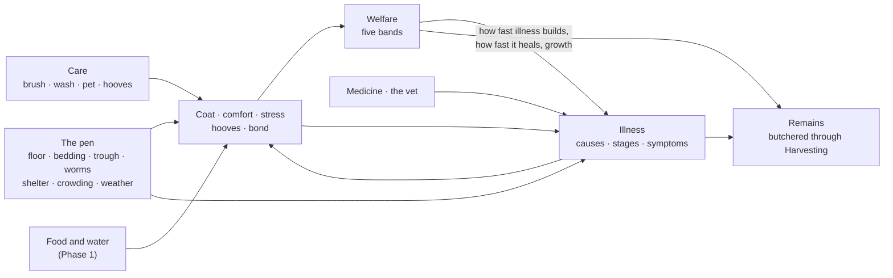

# 04 — Care, Welfare and Health

[← Animals](README.md)

Phase 2 makes keeping an animal well more than feeding it. An animal has a **coat** (hygiene), **comfort**, **stress**,
**hooves** and a **bond** with its owner (affinity). Its pen has a **floor** that gets soiled, **bedding** that gets
spent, a **trough** whose water fouls and, on a pasture, **worms** in the ground. Out of all that comes its **welfare**,
in five bands that change how it lives. And when its care slips, it can fall **ill**: with one of nine illnesses, each
with causes, stages and symptoms. The keeper treats it with medicine (brewed in Alchemy, or a plain remedy bought from a
merchant), or sends for the **veterinarian**. When it dies, or is slaughtered, it is **butchered through Harvesting**,
and how it lived shows in what it gives.

Everything here is data (the species' care, the illnesses, the medicines, the tools: [chapter
02](02-Species-Foods-and-Nutrition.md)) and every number is a setting of the rules (the tables at the end). Every action
is checked and done by the server.



## Care actions

Each species takes its own care actions. They sit on the **Care** tab of the pen's window, one card each. A card shows:

* whether the action can be done now, or why not (*brushed 2 hours ago*, *too young*);
* the tool it needs, and whether you carry one (a worn-out one is noted);
* the water it takes for this animal, and how much you carry;
* a **With soap** switch, when the action takes soap and you carry some.

**To all here** does the action to every animal in the pen that can take it now (it shows when two or more animals live
there).

| Action | Needs | Does (for a typical species) | Again after | Too much of it |
|---|---|---|---|---|
| **Brush** | a brush (a rabbit: a soft brush) | coat +18, comfort +10, spirits +2, bond +2, a quarter of the lice build-up brushed out | 8 h | more than 2 in 24 h: comfort −8 and stress +4 for each one past that |
| **Wash** | water (litres by size, below); soap optional (×1.5 on the cleaning) | coat +30 and comfort +5 (both by the share of water that came) | 24 h | more than 2 in 72 h: comfort −10 each |
| **Pet** | bare hands | spirits +3, bond +3, stress −3 | 1 h | more than 3 in 6 h: stress +6 each |
| **Clean hooves** | a hoof pick | hooves +60, comfort +5 | 24 h | more than 2 in 24 h: stress +4 each |

* **How good the tool is.** Bare hands work at ×1. A tool works at 0.6 + 0.6 × its quality × (0.5 + 0.5 × what is left
  of it): a new soft brush ×0.96, a new curry comb ×1.08. A **worn-out** tool (no uses left) stays in the bag and still
  works, at a flat ×0.4, and you are told: *Your soft brush is worn out: it does a poor job.* Each animal done wears it
  by one use.
* **Too much of it.** Repeats within the action's *Overuse Hours* are counted (the count fades with time). Past *Overuse
  After*, each extra repeat does the harm shown, and the action itself gives less (÷ (1 + repeats past it)). The animal
  says so: *It has had enough of that for now.*
* **Handling.** Petting and hoof care stress a skittish animal, and one that does not know you: +6 × (1 − its
  temperament) × (1 − bond/100).
* **The bond grows only with its owner**, and by at most 8 points a game day from care, medicine and meals from its
  hand together (*Affinity Per Day*). A bond is not bought by petting or hand feeding all day. It **fades** by 0.5 a day
  once its owner has neither cared for it nor spent time by its pen for 48 game hours. Care, a meal from the owner's
  hand, a dose and mucking out its pen all count as its owner's care. Since Phase 4 its owner's time near its pen also
  deepens the bond (a little a day), and a deep bond eases its owner's handling and unlocks its species' perks
  ([chapter 06](06-Breeding-Genetics-and-Behaviour.md#the-bond-with-the-owner)).
* **Washing in the cold** chills: below the action's *Chill Below*, comfort −3 per °C (at most 10 °C counted; a hen's
  and a rabbit's wash already counts it in its comfort loss), and the cold builds up toward an infection. *It shivers:
  it is too cold to be wet.*
* **The pig's wash** is a wallow on a hot day: above 22 °C it gains 2 comfort per °C. *The cool water is a relief in
  the heat.*
* **Care that is wrong for the species** can still be done, but it does harm. A wet hen shivers and squawks, and a
  rabbit is not bathed: it panics. *This does it no good.* A goat hates a wash (spirits −6, comfort −4, stress +6)
  but it still cleans it.
* **The water.** A wash wants its litres for an average adult × the animal's size. It is refused when you carry less
  than 30 % of that, and it fails (everything given back) when less than 30 % could be poured from your container.
* **Boarded animals** are not cared for by hand: the boarding stable grooms them and trims their hooves.
* **Who may.** An animal's owner, and those who may care for others' animals in that pen (a tenant and those they let
  in). Others may look.

### Each species' care

| Species | Its care | Wash water | Comes clean on its own |
|---|---|---|---|
| Chicken | Pet; Wash (wrong for it: coat +12, comfort −20, stress +18) | 1 L | dust-bathes in fresh bedding |
| Duck | Pet; Wash | 1 L | preens in a pond |
| Rabbit | Brush (a soft brush only); Pet; Wash (wrong for it: coat +10, comfort −25, stress +25) | 1 L | |
| Sheep | Brush; Wash (soap; harm from the 2nd in 72 h); Pet; Clean hooves | 5 L | |
| Goat | Brush; Wash (it hates it); Pet; Clean hooves | 4 L | |
| Pig | Brush; Wash (a wallow in the heat); Pet; Clean hooves | 6 L | |
| Cow | Brush (a brush or a curry comb); Wash (soap); Pet; Clean hooves | 8 L | |
| Horse | Brush; Wash (soap); Pet; Clean hooves | 8 L | |

Washing chills a hen below 22 °C, a duck below 10, a rabbit below 30 (always, in practice), a sheep or a horse below 14,
a goat below 16, a pig or a cow below 12. Each species has its own reaction to each action (*Daisy leans into the comb
and sighs.*; an animal with no name is *the cow*: *The cow leans into the comb and sighs.*).

A species can have care actions of its own: each action has an id (*brush*, *wash*, *pet*, *clean_hooves*, or anything
else), and its family gives it its default label, words and icon ([chapter 02](02-Species-Foods-and-Nutrition.md#care)).

## Tools and supplies

| Tool or supply | What it is used as | Quality | Uses | Price | Item |
|---|---|---|---|---|---|
| Soft brush | brushing (any coat, a rabbit's too) | 0.6 | 150 | 12 | `animal:tool/soft_brush` |
| Curry comb | brushing (not a rabbit's) | 0.8 | 200 | 25 | `animal:tool/curry_comb` |
| Hoof pick | hoof care | 0.7 | 250 | 15 | `animal:tool/hoof_pick` |
| Pitchfork | mucking out | 0.75 | 300 | 30 | `animal:tool/pitchfork` |
| Shovel | mucking out | 0.6 | (the farm's own wear) | — | the farm's `agri:tool/shovel` |
| Soap | a wash (used up) | — | — | — | crafting's soap (`craftstock:Supply:soap`) or a bottle of soft soap (`potion:soft_soap`) |
| Straw | bedding (used up) | — | — | — | the farm's straw mulch (`agri:amend/straw_mulch`) |

The four tools of animal husbandry are items of its own (*Care tool · brush*). Their uses are their durability. The best
tool you carry for a job is the one used: by quality × (0.5 + 0.5 × what is left of it).

## Hygiene: the coat

Every animal settles toward a **resting level**: how clean it keeps itself in its pen without help. Above it, it gets
dirtier; below it, it grooms itself back.

* **Resting level** = the species' own (50-60) × (1 − 0.6 × floor dirt / 100) × (1 − half the mud on it), + up to 25 for
  a dust-bather in fresh bedding (a hen), + 25 for a bather in a pond (a duck), − up to 30 for loose droppings (an upset
  stomach). Mud is rain on an open pen.
* Above its resting level, it loses the species' *Hygiene Loss Per Hour* (0.3-0.7; faster on a dirty floor; slower while
  its owner is away). Below it, it regains its *Self Groom Per Hour* (0.5-1).
* A digestive illness costs it 1 a game hour more (loose droppings).
* So an ungroomed animal in a clean pen rests at about 55, which is clean enough. A dirty floor, mud or illness push it
  down. Brushing and washing lift it to 80-100, and it settles back over the following days.
* At the boarding stable it settles at 65.

A coat below 50 itches (comfort −0.2 a point). Below 40 it starts to count toward an infection and toward lice. Below 30
the animal looks dirty (*Its coat is caked with dirt.*); above 85 it *looks clean and well kept*.

## Hooves

Sheep, goats, pigs, cows and horses have hooves (hens, ducks and rabbits do not). New animals arrive with sound hooves
(100).

* They wear by the hour: a horse 0.10, a cow or a sheep 0.08, a goat 0.07, a pig 0.04. They wear faster on a dirty floor
  (up to ×2) and slower while the owner is away.
* **Below 50** they hurt (comfort −0.4 a point). **Below 40** they count toward an injury and toward hoof rot. **Below
  30** it limps (*It limps on cracked hooves.*).
* A hoof pick brings them back (+60). At the boarding stable they settle at 80 (the stable trims them).
* So a hooved animal wants its hooves cleaned every few weeks: on a clean floor a horse's start to hurt after about
  three weeks, a cow's or a sheep's after about four, a goat's after a month, a pig's after seven weeks. A dirty floor
  brings that sooner.

## Comfort and shelter

Comfort settles toward where its surroundings put it, over about 6 game hours. That target is 100, less:

| What | How much |
|---|---|
| Cold | 2.5 a °C below the species' comfortable range |
| Heat | 3 a °C above it |
| Rain on it | 20 × how much it minds rain × (1 − shelter); a storm × 1.5 |
| Crowding | up to 25 (see below) |
| A dirty floor | 0.25 a point of dirt |
| No bedding in a bedded pen | up to 15 × how much it misses bedding |
| Sore hooves | 0.4 a point below 50 |
| A dirty coat | 0.2 a point below 50 |
| Illness | each stage's own (−5 to −30) |

* **The temperature it feels.** In the cold, a shelter's warmth helps (never above the comfortable minimum), and wind
  chills an animal in the open (0.3 °C a m/s). In the heat, shade takes up to 5 °C off. The same temperature decides
  the *cold and wet* and *heat* causes of illness.
* **Crowding** starts when the room in use passes the species' *Crowded From* share of the pen (0.75-0.85), and is at
  its worst 0.4 above that. A pen filled to its last place is already fairly crowded.
* **At the boarding stable** comfort settles at 60 (less its illnesses).
* **What bothers it shows.** Below comfort 60 a sign says why: *It huddles against the cold.*, *It pants in the heat.*,
  *It stands miserable in the rain.*, *It is jostled in a crowded pen.*, *It picks its way through a filthy pen.*, *It
  has nothing dry to lie on.*, *It shifts its weight off sore hooves.*, *Its coat is caked and itchy.* Below 35 with no
  single reason: *It looks uncomfortable.*

### Shelter by kind of pen

| Kind | Shelter (roof and walls) | Warmth in the cold | Bedded | Ground cleans itself |
|---|---|---|---|---|
| Pasture, Pond | 0 (open to the weather) | 0 | no | yes (dung goes in about 72 game hours, faster in rain) |
| Sty | 0.7 | +3 °C | yes | no |
| Hutch | 0.8 | +3 °C | yes | no |
| Coop | 0.9 | +4 °C | yes | no |
| Barn, Stable, Magical | 1 | +5 °C | yes | no |
| Hive | 1 | +2 °C | no | no |

Shade is as the roof. Each pen can set its own (*Shelter and bedding* in its inspector:
[chapter 01](01-Overview-and-Setup.md#pens)). The pen's text says *Open to the weather.* or *Roofed and sheltered.*, and
the weather now (*It is cold and wet.*, *It is hot.*, *Mild weather.*).

### Comfortable range, and what bothers each species

| Species | Comfortable | Minds rain | Misses bedding | Crowded from | Wants company of its kind |
|---|---|---|---|---|---|
| Chicken | 8-26 °C | 0.8 | 0.6 | 80 % | 2 others |
| Duck | 4-26 °C | 0.1 | 0.4 | 80 % | 1 other |
| Rabbit | 5-24 °C | 0.9 | 0.8 | 75 % | content alone |
| Sheep | −5-22 °C | 0.3 | 0.4 | 85 % | 2 others |
| Goat | 0-26 °C | 0.9 | 0.5 | 80 % | 1 other |
| Pig | 8-24 °C | 0.3 | 0.6 | 80 % | content alone |
| Cow | −5-24 °C | 0.3 | 0.5 | 85 % | 1 other |
| Horse | −5-25 °C | 0.4 | 0.6 | 85 % | 1 other |

## Stress

Stress settles toward a target, as in Phase 1. Phase 2 adds to that target:

* discomfort: 0.2 a point of comfort below 60;
* crowding: up to 20;
* loneliness: up to 15 (fewer others of its kind in the pen than it wants; none at the boarding stable);
* its illnesses (malnutrition from Moderate +5, chronic stress from Moderate +8);
* its welfare band (Excellent −5 to Critical +15);
* its temperament: a skittish animal up to +5, a calm one down to −5.

Its spirits (happiness) gain (comfort − 60) × 0.15, its band's and its illnesses'. Handling (petting, hoof care,
medicine) and mucking out add a little stress at once. Above stress 35 a sign says what bothers it most (*It calls for
others of its kind.*, *It is wary of being handled.*...). At 60 or more *it startles at every sound*.

## Welfare

Welfare (0-100) is worked out after every step:

```text
W = (0.25 Health + 0.20 Nutrition + 0.15 Hygiene + 0.15 Comfort + 0.15 Happiness + 0.10 Affinity) / sum of the weights
    − 0.15 × (stress above 40)
W is never more than health + 25 (a dying animal is never Average), and stays within 0-100.
```

The weights are the reference formula's, and they are settings (*Rules ▸ Welfare*), as are the stress penalty, the calm
level and the health cap.

| Band | From | Illness builds | Heals (health and illness) | Grows | Stress | Spirits | Production ([ch. 05](05-Production.md#how-fast-the-production-cycle)) |
|---|---|---|---|---|---|---|---|
| Excellent | 90 | ×0.7 | ×1.25 | ×1.05 | −5 | +4 | ×1.15 |
| Good | 75 | ×0.85 | ×1.1 | ×1 | −2 | +2 | ×1.05 |
| Average | 50 | ×1 | ×1 | ×1 | 0 | 0 | ×1 |
| Poor | 25 | ×1.3 | ×0.85 | ×0.92 | +8 | −4 | ×0.8 |
| Critical | 0 | ×1.7 | ×0.6 | ×0.8 | +15 | −8 | ×0.5 |

* The band of one step drives the next.
* **The owner is told** *Daisy is in a bad way.* when its band falls to Critical or its health below 30, at most once a
  game day, and only while they are in the world: no warning is used up while they are away, so one who comes back is
  told at once (a day after the last warning at the earliest). Its record's event log keeps the first warning of a
  spell, not each day's. The animal shows *It needs help.* (for
  either reason), and the window's Welfare gauge names the band.
* What it takes, with the defaults: a cow alone on a pasture with grass, hay and water, never groomed, is **Good**
  (about 76). Daily care (brushing, a clean pen, good food) keeps animals Good (about 86). An owner who also pets them
  makes them **Excellent** (about 93) after a week or so.
* An Excellent animal looks content (calmer idling, more lying in the sun).

## The habitat: floor, bedding, trough, worms

| | What changes it | What it does |
|---|---|---|
| **Floor dirt** (0-100) | 0.9 a game hour for a fully stocked pen (a messy pig ×1.3, a rabbit ×0.7), by the room in use; the remains of a dead animal add more. Bedding takes up to 60 % of it. Open ground (a pasture, a pond) cleans itself (in about 72 game hours, faster in rain) | Soils coats, wears hooves, costs comfort; from 35 it counts toward infection and hoof rot |
| **Bedding** (0-100) | Spent 0.8 a point of mess. A new bedded pen starts at 60 | Missed by its animals as it goes (comfort); fresh, dry bedding lets hens dust-bathe |
| **Trough water dirt** (0-100) | The animals foul it (0.15 a game hour at full stocking for a 100 L trough), and a dirty floor too (0.2 at dirt 100). Open water grows algae above 18 °C. A bigger trough fouls slower (×100 / litres, 0.25-2). Rain and a refill dilute it; a dry trough is clean | From 25 it counts toward infection (foul water) |
| **Worms in the ground** (a pasture, 0-100) | Built up from dung, stocking and warmth (none below 4 °C), dying off over about 150 game hours (48 in frost) | Counts toward worms and lice (×0.4 for an animal that does not graze there) |

The pen's text tells them in words:

* the floor (or the ground): *clean* (below 10), *a little soiled*, *soiled: it wants mucking out* (35), *filthy* (65);
* the bedding: *Fresh bedding.* (70), *The bedding is flattened.* (35), *The bedding is spent.*, *No bedding.*;
* the water: *clear*, *a little murky* (15), *murky* (40), *foul* (70).

The fence look shows dung patches and straw by those levels.

**Mucking out** (**Muck out** in the right column) needs a **pitchfork or a shovel** and the right to tend the pen.

* It forks out 75 % of the floor's dirt with an average tool (a new pitchfork 79 %, a worn-out one 30 %; never more than
  95 %). It also takes out some of the worm eggs (30 % of that share).
* In a bedded pen only the soiled share of the old bedding goes. With the straw switch on (it shows while you carry
  straw: *with straw mulch (3)*), fresh straw goes down: one straw for every 5 m² of fresh bedding. Bedding is never
  less after straw than before.
* It gives **manure**, the farm's `agri:amend/manure` for its soil: 0.08 an m² of filthy floor forked clean. Fractions
  carry over to the next time.
* It disturbs the animals a little (stress up to +3, at most once in 6 game hours). It counts as care for every animal
  there (*The pen was mucked out by Ann.*, or *Fresh straw was laid by Ann.* when only straw went down), and as its
  owner's care for the cleaner's own animals.
* It is refused just after another (15 game minutes). On a clean floor (dirt below 3) it is also refused:
  * when there is nothing to do: no bedding, or fresh bedding (90 or more): *The pen is clean.*;
  * within 6 game hours of fresh straw, as straw alone is laid at most that often: *Fresh straw was laid 2 hours
    ago.* Meanwhile **Muck out** is not offered;
  * when the bedding wants straw and none was brought (none carried, or its switch off): *The floor is clean: carry
    straw and tick it beside Muck out to lay fresh bedding.* The straw switch beside **Muck out** shows only while straw
    is carried, as *with straw mulch (3)*.
* The tool wears by one use for every 20 m² of pen.
* A fully stocked pen wants mucking out about every 2-3 days. A herd that is never brushed nor has its hooves cleaned
  needs it every 2 days.

**Water.** *Fill the trough* never empties it: poured water mixes with what is there. Water from a swamp carries dirt in
(45), a lake's 20, a river's 12, any other none. Fouled water (*a little murky* or worse) is changed with **Scrub the
trough**. It tips the water out and leaves the trough empty and clean: fill it again after. It needs no tool. On public
land only a keeper of an animal in the pen may do it, so a stranger cannot empty it. Nor can a stranger foul it, however
little at a time: once the trough would be murky enough to scrub out (dirt 15, *Tip Out Above*), only a keeper of an
animal there may pour in water dirtier than the trough's, even a few drops into a big trough (*Only a keeper of an
animal here may pour such water into it.*). Anyone may pour in water that leaves the trough below that, or water no
dirtier than the trough's (well water into murky water, swamp water into fouler water), and a dry trough takes any
water. One who may not scrub the trough is told only *The water is still murky.*, not to scrub it.

## Illnesses

No illness comes at random. Each has **causes**, measured every step from what the animal lives through. While a cause
lasts, its **build-up** grows; when the build-up reaches the illness's onset, the illness takes hold. A clean, well fed,
watered and groomed animal stays well (tested for a month, for every species).

| Cause | What it is |
|---|---|
| Poor feeding | nutrition below 35 |
| Thirst | hydration below 20 |
| Something poisonous it ate | toxins above its tolerance |
| Bad food | an upset stomach above 20 |
| A dirty pen | floor dirt from 35 to 95 (none at the boarding stable) |
| Foul water | trough water dirt from 25 to 90 (when there is water) |
| A dirty coat | hygiene below 40 |
| An open wound | its own injury |
| Cold and wet | colder than its range, worse in the rain unsheltered (and a wash in the cold) |
| The heat | hotter than its range |
| Crowding | as for comfort |
| Being kept alone | fewer others of its kind than it wants |
| Constant stress | stress above 55 |
| Neglected hooves | hooves below 40 |
| Worms in the pasture | the ground's worms |
| Sick pen-mates | a catching illness in the pen |
| Fights in a crowded pen | crowding × (1 − temperament) × stress |

### How an illness comes, goes and comes back

* **Build-up.** Each game hour the illness's causes add their sum (each × its weight). That is × the species'
  susceptibility, × the welfare band, ÷ the breed's hardiness, × the owner-away pace. It settles over the illness's
  *Exposure Hours*, the same whatever the step length (a pen stepped in many short steps, as frequent requests step
  it, falls ill as one stepped hour by hour). A build-up is dropped only once nothing builds it and it has faded to
  almost nothing. The onset is a little different for each animal (±15 %, from its
  genes). A cause must therefore be strong enough, for long enough.
* **Onset.** It starts at severity 5, with the strongest cause as its cause.
* **Course.** While its causes go on, it worsens (up to its *Worsen Per Hour*). Once they are gone, it follows its
  course: most mend by themselves, but worms and lice never do. A weak lasting cause stops it at Moderate, a strong one
  lets it reach Severe (it stops at 30 + 70 × how strong the cause is).
* **Must be treated.** Above its *Needs Treatment Above* severity it no longer mends by itself.
* **Needs the vet.** Past its *Needs Vet Above* severity, a keeper's medicine only holds it, while a veterinarian is in
  the world and has not seen it yet (see [The veterinarian](#the-veterinarian)).
* **Recovery.** At 0 it is **recovering** for its recovery hours: mild lingering weakness (appetite and growth ×0.9,
  comfort −3), with its own sign (*Its cough is easing.*). Then it is gone, and the animal is **immune** to it for its
  immunity hours. If its causes come back in force while it mends, it **relapses** (at severity 5). An infection or
  worms that come back start in their hidden stage: they are hidden again (from the Health tab and *Look closely* too)
  until they show, and then the owner is told, as the first time. If one its owner knew by name mends again without
  ever showing, the owner is still told it is over (*Daisy has got over its infection.*, and *Over its infection.* in
  its history); the comeback nobody saw stays out of the history.
* **Harm.** Each stage costs health by the hour, as hunger does: ÷ hardiness, held by the owner-away floor. While its
  worst illness is at 40 or more, an animal does not heal. A sick animal eats less: up to its full mark × the stage's
  appetite, never below 20.
* **Death.** An illness is the cause of death when it does the most harm. The record says *Died of infection
  (Severe)*, with its death cause (Illness, Injury, Poisoning, Malnutrition or Dehydration). While its owner is away,
  the owner-away floor holds back the harm of illness (and of hunger and thirst), so an old animal that dies then dies
  *of old age*.
* **Contagion.** A catching illness (infection, worms and lice) gives each pen-mate a build-up of its contagion ×
  severity/100 a game hour (a recovering one 0.3 × its contagion). The remains of an animal it killed go on spreading
  it for 48 game hours. An animal never catches its own; taking the sick one away stops it.
* **Susceptibility.** Each species is more or less prone to each illness (the table at the end); 0 is immune. Hoof rot
  takes only animals with hooves.

### The nine illnesses

| Illness | Kind | Caused by (weight) | Onset / over | Worsens / untreated | Needs treatment above | Needs the vet above | Recovery / immunity | Catching | Named from |
|---|---|---|---|---|---|---|---|---|---|
| Malnutrition | Malnutrition | poor feeding 1 | 6 / 24 h | +2 / −4 | never | never | 48 h / — | no | Mild |
| Dehydration | Dehydration | thirst 1 | 3 / 6 h | +6 / −10 | never | never | 6 h / — | no | Mild |
| Infection | Infection | a dirty pen 1, foul water 1.5, a dirty coat 0.6, an open wound 2, cold and wet 0.8, sick pen-mates 1.5 | 24 / 36 h | +2.5 / −1 | 45 | 80 | 24 h / 120 h | 0.6 | Moderate |
| Digestive upset | Digestive | bad food 1 | 4 / 8 h | +5 / −5 | 60 | never | 12 h / 24 h | no | Mild |
| Worms and lice | Parasites | worms in the pasture 1, a dirty coat 0.5, sick pen-mates 1 | 30 / 96 h | +0.6 / +0.1 | always | never | 24 h / 72 h | 0.4 | Moderate |
| Chronic stress | Stress | constant stress 1, crowding 0.5, being kept alone 0.25 | 16 / 24 h | +3 / −3 | never | never | 12 h / — | no | Moderate |
| Injury | Injury | neglected hooves 0.8, fights in a crowded pen 1.2 | 16 / 24 h | +1 / −2 | 50 | 70 | 48 h / — | no | Mild |
| Hoof rot | Infection (hooves only) | neglected hooves 1.2, a dirty pen 0.8 | 20 / 48 h | +1.2 / −0.5 | 30 | 85 | 36 h / 48 h | no | Moderate |
| Food poisoning | Poisoning | something poisonous it ate 1 | 2 / 4 h | +10 / −6 | never | never | 12 h / — | no | Mild |

*Worsens / untreated*: severity a game hour while its causes go on at full strength, and once they are gone (negative:
it mends by itself).

### Their stages

| Illness | Stage (from) | Health a game hour | What it does | What a keeper sees |
|---|---|---|---|---|
| Malnutrition | Mild (0) | 0 | growth ×0.8 | *Its coat is dull and its hips show.* |
| | Moderate (35) | 0.1 | growth ×0.5, stress +5 | *It is thin and slow to move.* |
| | Severe (70) | 0.3 | growth ×0.2, stress +5 | *It is wasting away and can barely stand.* |
| Dehydration | Mild (0) | 0 | comfort −10 | *Its eyes look dull and its mouth is dry.* |
| | Moderate (40) | 0.3 | comfort −10 | *Its eyes are sunken; its skin stays tented when pinched.* |
| | Severe (70) | 1 | comfort −10 | *It staggers, weak and parched.* |
| Infection | Slight (0) | 0 | nothing yet (also the tail of one that mends) | hidden (only the vet finds it) |
| | Mild (15) | 0.05 | appetite ×0.9 | *It coughs and its nose runs.* |
| | Moderate (40) | 0.3 | appetite ×0.7, comfort −10 | *It is feverish and off its food.* |
| | Severe (70) | 0.9 | appetite ×0.4, comfort −20 | *It burns with fever and breathes hard.* |
| Digestive upset | Mild (0) | 0 | food feeds it ×0.85, coat −1/h | *Its droppings are loose.* |
| | Moderate (35) | 0.2 | appetite ×0.7, food ×0.7, coat −1/h | *It stands hunched and kicks at its belly.* |
| | Severe (65) | 1.2 | appetite ×0.4, food ×0.7, coat −1/h | *It rolls and groans with colic.* |
| Worms and lice | Light (0) | 0 | nothing yet | hidden (only the vet finds it) |
| | Mild (20) | 0.02 | food ×0.8, comfort −5 | *It scratches and rubs against the fence.* |
| | Moderate (50) | 0.1 | food ×0.65, comfort −5 | *Its coat is patchy and it is thin despite eating.* |
| | Severe (80) | 0.4 | food ×0.5, comfort −5 | *Its gums are pale and it tires at once.* |
| Chronic stress | Mild (0) | 0 | appetite ×0.9 | *It paces and will not settle.* |
| | Moderate (40) | 0.05 | appetite ×0.8, stress +8 | *It nips at others and picks at its food.* |
| | Severe (70) | 0.2 | appetite ×0.8, stress +8, growth ×0.7 | *It trembles and hides in a corner.* |
| Injury | Mild (0) | 0 | moves ×0.85, comfort −5 | *It favours one leg.* |
| | Moderate (30) | 0.1 | moves ×0.6, comfort −15 | *It limps badly.* |
| | Severe (65) | 0.5 | moves ×0.3, comfort −30 | *It cannot bear weight on the leg.* |
| Hoof rot | Mild (0) | 0 | moves ×0.85 | *One hoof smells foul.* |
| | Moderate (35) | 0.1 | moves ×0.6, comfort −15 | *It limps on a swollen, foul-smelling hoof.* |
| | Severe (70) | 0.4 | moves ×0.4, comfort −15 | *The hoof is rotting and it will not stand.* |
| Food poisoning | Mild (0) | 0 | appetite ×0.6 | *It drools and trembles.* |
| | Moderate (40) | 0.2 | appetite ×0.4 | *It staggers and retches.* |
| | Severe (70) | 0.6 | appetite ×0.2 | *It convulses.* |

An animal that moves below ×0.7 limps (its body is lame); one whose visible stage costs health, or whose health is below
40, looks sick (it lies down more, stands head-down, coughs now and then).

## What a keeper sees, and when an illness is named

The numbers stay with the server. A keeper sees what a watchful person would:

* **Signs**, for everyone: the symptoms of the illnesses that show (the first of each, then the others, at most six),
  then the coat, the hooves, what bothers it, *It needs help.*
* **Gauges** on the Overview tab, in coarse levels: Clean, Comfort, Calm, Hooves (when it has them) and Welfare with its
  word, next to Phase 1's Fed, Watered, Health, Spirits and Condition.
* **Look closely** (Inspect) adds words for its coat, comfort and hooves, its welfare, and, for its owner, the illnesses
  known by name (*Known illness: infection (Moderate), being treated.*).
* **When an illness first shows** (it reaches a visible stage), its owner is told a symptom, not its name: *Daisy: It
  coughs and its nose runs.* When it reaches its worst stage: *Daisy is getting worse.* When it is over: *Daisy is well
  again.* (or, once named, *Daisy has got over its infection.*).

**Look it over** (Examine, on the Care and Health tabs; again after 15 game minutes) is the careful look. Every illness
that shows, from its *Named from* stage (the illness's *Diagnose From*), is **named** (the health history notes who
found it). The answer reads, for each:

* named: *Infection (Moderate): A fever that spreads to pen-mates. It likely comes from foul water. Treat with: Healing
  draught, Restoration elixir, Healing salve, Panacea, Antiseptic wash, Vinegar wash.* Then, when they hold: *It needs a
  veterinarian.* (only while there is one), *The treatment is working.*, *It is recovering.* A named illness that has
  fallen below the stages that show (treated, or mending) is still told (*Infection (Slight): ... The treatment is
  working.*);
* showing but too early to name: *Something is wrong (it scratches and rubs against the fence); it is too early to say
  what.*;
* nothing that shows: *It seems healthy.*

Then come *Its hooves are overgrown and cracked.*, *Its coat is filthy.*, *It is too thin.* and *Its welfare: Good.*
The **Health** tab then lists the named illnesses with their stage, *being treated*, *recovering* and *needs the vet*.
A hidden stage (a slight infection, light worms) is found only by the veterinarian.

**A sick hen, step by step.** A coop of three or four hens has not been mucked out for about a week (six hens: four or
five days). One hen's owner is told *Hetty: It coughs and its nose runs.* (the window's signs say so too). *Look it
over* says only that something is wrong: it is too early. About ten game hours later (ten real minutes at the default
day) it is feverish: *Look it over* names an infection from a dirty pen, and lists what treats it. Some sixteen game
hours after that, only the veterinarian can turn it (while there is one). By the time it can be named, every hen in
the coop has caught it. The keeper mucks out the coop (the cause) and treats each hen that shows it: a vinegar wash
every 6 game hours, its interval, or an antiseptic wash or a healing draught. A wash asked for sooner is not given
(nothing is used up), and the keeper is told when it may be: *Too soon for another dose: Hetty can have the vinegar wash
again in 2 hours.* Three or four hens all mend even when washed only twice a day; of six, washed twice a day, four
die, and washed every 6 game hours, none. The Health tab says *being treated*. The fever eases (its history says
*Infection is easing (Mild)*), it mends (*Its cough is easing.*), and the hens are well again, immune for a while.

## Medicine

Medicine is given from the **Health** tab: each medicine you carry is listed with **Give**. A drench or a remedy in the
feed can also be given to the whole pen (**Give to all here**). A wash or a salve is put on one animal at a time (*You
put the healing salve on Daisy.*; the others: *Daisy takes the antidote.*).

* **Doses by size.** An animal takes as many doses as it eats (a hen about 0.2, a sheep 1.5, a cow 4.4, a horse 5.2).
  One item holds the medicine's *Doses Per Item*. You need that many items, or it is refused: *Daisy needs 3 of it (you
  have 1).* A pen needs the sum of its animals' doses.
* **Strength from quality.** A brewed bottle keeps its strength and purity. Its quality (0-1) makes the dose ×0.4
  (worthless) to ×2 (perfect). A bottle bought from a merchant counts as its tier's typical quality: a Standard one
  ×1.2. Plain remedies (charcoal, wormwood, vinegar, lavender) are always ×1.
* **What it does.** It takes its severity off an illness it acts on at once, then more each game hour for its hours.
  It also clears toxins, eases an upset, gives health, comfort, calm, food or water, each × its strength. Being dosed
  stresses a skittish animal (4 for a drench or a wash, 1 in the feed).
* **Doses together.** A dose given while another works on the same illness (the veterinarian's treatment counts as
  one) takes its own share off at once, unless it is too soon (below). The hourly work does not add up: each game hour
  gets the strongest dose working then. The strongest works to its own end; then the next, when it lasts longer, goes
  on at its own pace to its own end, and so on. So a weaker dose never stretches a stronger one, given once or again
  and again: after the veterinarian, a vinegar wash every 6 hours leaves the vet's 5 a game hour working to the end of
  the visit's 24 hours, then the washes' 2 an hour to the last wash's end. Nor does a stronger dose waste a weaker one.
  This holds exactly however many doses work at once: the vet, then a Standard healing draught (3 an hour), then the
  washes, each to its own end. An illness keeps up to 8 such steps; past that, the weakest, which would work last, is
  let go. A medicine that does nothing by the hour (only at once) leaves nothing working: the illness is not *being
  treated* by it.
* **The wrong medicine** does nothing for the illness: *It does not seem to help.* That (and *This is beyond your
  medicine*) is judged only by the illnesses that have shown: a medicine still works on one that does not show yet,
  but the answer never gives it away.
* **On a filthy coat** (hygiene below 30) a wash or a salve works ×0.6.
* **Too soon.** The same medicine again within its interval (*Again after* in the table) of its last dose that did its
  good is too soon. A dose too soon never puts off the next: the interval still counts from the last one that did its
  good. Each animal keeps its last dose of every medicine the game has (however low *Keep Doses* is set), so doses of
  other medicines in between change nothing.
  * **A medicine with no overdose** (— after the slash in the table's last column) is then not given at all: nothing is
    used up, and the keeper is told when it may be: *Too soon for another dose: the cow can have the vinegar wash again
    in 3 hours.* The wait is rounded up, so a keeper who comes back when told may give it: a moment after a wash, *in 6
    hours*; with a little over an hour left, *in 2 hours*; under an hour, *in less than an hour*; past 47 hours, in days
    (*in 3 days* with 49 hours left).
  * **A medicine with an overdose** (a share after the slash) is given, and does **no more good at once**: it takes
    nothing off an illness at once, clears no toxins, eases no upset, and gives no health, comfort, calm, food or
    water. Only its harm is done: the stress of being dosed, any sting or unease it brings, and toxins of that share of
    the animal's tolerance × its strength (the same harm to a hen as to a cow): *Too much, too soon: the dose makes it
    unwell.* Its hourly work still counts, as for doses together, to its own end.
* **Give to all here** leaves out each animal that had that medicine too lately, whether it has an overdose or not: no
  items are taken for it, and the answer says so (*5 animals take the traveller's broth.*, with *One had it too lately
  and was left out.*, or *2 had it too lately and were left out.*). When every animal had it too lately, it is refused
  with the soonest wait: *Too soon for another dose: the first of them can have the traveller's broth again in 3
  hours.* (*it*, when there is only one).
* **Beyond your medicine.** Past an illness's *Needs Vet Above*, while a veterinarian is in the world, a dose takes it
  no lower than that and only holds it: *This is beyond your medicine: send for the veterinarian.*
* Medicine given by its owner, when it helped, adds 1 to the bond (at most once per interval).

| Medicine | Item | How | Doses an item | Acts on: at once / a game hour, for | Besides | Again after / overdose |
|---|---|---|---|---|---|---|
| Antidote | `potion:antidote` | drench | 2 | food poisoning 40 / 8 for 6 h; digestive 0 / 1 for 6 h | clears half its toxins | 6 h / — |
| Charcoal | `ingredient:charcoal`, `craftstock:Fuel:charcoal` | in the feed | 1 | food poisoning 15 / 2 for 6 h; digestive 5 / 2 for 6 h | toxins −35 %, upset −15 | 4 h / — |
| Healing draught | `potion:healing_draught` | drench | 2 | infection 0 / 2.5 for 12 h; injury 0 / 1.5 for 12 h | health +8 | 6 h / — |
| Restoration elixir | `potion:restoration_elixir` | drench | 2 | infection 10 / 3 for 16 h; injury 5 / 2 for 16 h | health +15 | 8 h / — |
| Healing salve | `potion:healing_salve` | on the skin | 3 | injury 10 / 3 for 24 h; hoof rot 10 / 3 for 24 h; infection 0 / 0.5 for 12 h | comfort +8 | 6 h / — |
| Willowbark draught | `potion:willowbark_draught` | drench | 2 | injury 0 / 0.5 for 12 h | comfort +15, stress −10 | 6 h / 0.5 |
| Calming tonic | `potion:calming_tonic` | drench | 2 | chronic stress 10 / 4 for 12 h | stress −25 | 8 h / 0.5 |
| Lavender tincture | `potion:lavender_tincture` | drench | 2 | chronic stress 5 / 2 for 12 h | stress −12 | 6 h / — |
| Ginger tonic | `potion:ginger_tonic` | drench | 2 | digestive 15 / 6 for 8 h | upset −30 | 6 h / — |
| Traveller's broth | `potion:travellers_broth` | in the feed | 2 | malnutrition 0 / 2 for 24 h; dehydration 10 / 8 for 4 h | satiety +20, hydration +30 | 4 h / — |
| Panacea | `potion:panacea` | drench | 2 | every illness 30 / 5 for 24 h | health +20, clears half its toxins | 12 h / 1.2 |
| **Vermifuge** | `potion:vet_vermifuge` | drench | 2 | worms and lice 20 / 6 for 12 h | | 24 h / 1.5 |
| **Antiseptic wash** | `potion:vet_antiseptic` | on the skin | 3 | infection 5 / 3 for 12 h; hoof rot 10 / 4 for 12 h; injury 0 / 1 for 12 h | | 6 h / — |
| **Electrolytes** | `potion:vet_electrolytes` | drench | 2 | dehydration 30 / 10 for 4 h; digestive 0 / 1 for 6 h | hydration +40 | 3 h / — |
| Wormwood | `ingredient:wormwood` | in the feed | 1 | worms and lice 5 / 2 for 12 h | | 24 h / 0.6 |
| Vinegar wash | `ingredient:vinegar` | on the skin | 2 | infection 5 / 2 for 12 h; hoof rot 5 / 2 for 12 h | comfort −3 (it stings) | 6 h / — |
| Lavender | `ingredient:lavender`, or the farm's lavender sprigs `agri:produce/lavender` | in the feed | 1 | chronic stress 3 / 1 for 12 h | stress −8 | 6 h / — |

`potion:<outcome>` is any bottle of that Alchemy outcome, of any tier. The three in bold are Animal Husbandry's own
veterinary outcomes. **Every illness can be treated without brewing**:

* worms with wormwood;
* infection and hoof rot with a vinegar wash;
* poisoning and an upset with charcoal;
* stress with lavender.

A light injury mends with rest. Dehydration and malnutrition are cured by water and good food.

**Items a medicine takes**, for an adult of each species' first breed (a young one takes fewer):

| Species | 2 doses an item (the drenches, broth, vinegar wash) | 3 (healing salve, antiseptic wash) | 1 (charcoal, wormwood, lavender) |
|---|---|---|---|
| Chicken, duck, rabbit | 1 | 1 | 1 |
| Sheep, goat | 1 | 1 | 2 |
| Pig | 2 | 1 | 3 |
| Cow | 3 | 2 | 5 |
| Horse | 3 | 2 | 6 |

## The veterinarian

The city's veterinarian is an NPC (**Tools ▸ SimpleMovements ▸ Animals ▸ Create Veterinarian In City**:
[chapter 01](01-Overview-and-Setup.md#the-veterinarian-and-the-keepers-goods)). Talking to the vet only tells you
things:

* what the vet treats;
* what a visit costs for each kind of animal;
* which illnesses grow past a keeper's medicine;
* the remedies that need no brewing;
* a folk hint for each veterinary medicine (*A pinch of salt and a spoon of honey in clean water.*), never a recipe.

The visit itself is sent for from the pen: **Send for the vet (fee)** on an animal's Health tab (**Send for the vet
(free)** when the vet asks nothing for it). That works for one at the boarding stable too, from any pen's window.

* **The fee**: 15 a visit + 8 × the animal's size (by what it eats) + 5 % of its breed's value, in the vet's currency
  (empty: the default currency). It is the fee shown that is paid: if it changed meanwhile, nothing is done (*The
  veterinarian asks 62 now.*) and the window shows the new one. It is taken before anything else, and given back if the
  visit fails. The purse is saved at once. A vet whose three fee settings are all 0 is free, and is still sent for
  (its own window lists its fees as *free*).

  | Chicken | Duck | Rabbit | Goat | Sheep | Pig | Cow | Horse |
  |---|---|---|---|---|---|---|---|
  | 18 | 18 | 18 | 29 | 31 | 37 | 60 | 75 |

  (an adult of the first breed, with the defaults *Base Fee* 15, *Fee Per Size* 8, *Fee Of Value* 0.05.)
* **The visit**: the vet finds every illness, the hidden ones too, and names it. The vet takes 40 off each at once
  (*Vet Immediate*), then treats it at 5 a game hour for 24 game hours (*Vet Per Hour*, *Vet Hours*). An illness the vet
  has seen can then be turned by a keeper's medicine as well. One brought to 0 starts mending (*Recovering from
  infection* in its history). The answer: *The veterinarian sees to Daisy.*, then *The veterinarian examines Daisy.*,
  *Infection: treated.* (or *on the mend*), *Mind foul water.*, or *Nothing wrong with it.*
* **Once every 8 game hours** for the same animal (*The veterinarian saw Daisy 3 hours ago.*). Online, a player may send
  for the vet at most once every 2 real seconds (*Wait a moment before sending for the veterinarian again.*).
* **Who may**: its owner, and those who may care for others' animals there. When someone else sent for the vet, the
  owner is told.
* **Only when there is one.** The first enabled veterinarian in the loaded scenes is the city's. With **no veterinarian
  in the world**, nobody can be sent for (*There is no veterinarian in the city.*), and a keeper's medicine can cure
  every illness: nothing is ever gated, and *It needs a veterinarian.* is never said. With one, an infection past 80, an
  injury past 70 and hoof rot past 85 need the vet.

## Health and care histories

Each animal keeps:

| History | What it holds | Kept |
|---|---|---|
| **Health history** | each illness's course: *It coughs and its nose runs.*, *It got worse: It is feverish and off its food.*, *Found to have infection (Moderate)*, *Given antiseptic wash*, *Seen by the veterinarian*, *Infection is easing (Mild)*, *Recovering from infection*, *Over its infection*, *Infection came back*, *Died of infection (Severe)*; a death no illness caused, *Died (of thirst)* (*starved*, *of old age*...); *Slaughtered* | the last 32 |
| **Care history** | what was done and by whom: *Brushed by Ann.*, *Washed by Ann.*, *Fed hay from Ann's hand.*, *The pen was mucked out by Ann.* (*Fresh straw was laid by Ann.* when only straw went down), *Looked over by Ann.*, *Given vermifuge by Ann.*, *Seen by the veterinarian, sent for by Ann.* | the last 24 |
| **Days** | each game day's means of Phase 1 (fed, watered, nourished, health, mood) and of Phase 2: coat, comfort, welfare (and its lowest), illness, how often it was cared for (and by its owner) | 14 days |
| **Life record** | slow averages (over about 20 game days) of its welfare, nutrition, health, coat, comfort and illness, and its hours ill and starving: what its remains are judged by (its products are judged by each cycle's own means: [chapter 05](05-Production.md#how-good-quality-and-tiers)) | its whole life |
| **Doses** | its last dose of each medicine that did its good: when, how strong (to tell when the next may do good again; a dose too soon is not kept) | one per medicine, for every medicine the game has, however low *Keep Doses* (64) is set (past the larger of the two, the one dosed longest ago is let go) |

**The History tab** (**Show its history**) asks the server for it: the last 12 health entries, newest first (what a
dose or the vet did reads above the dose or the visit), the last 8 care entries, and how its last 5 days went
(*Yesterday: fed well, clean, content, healthy.*).

* **What the health history shows** is what a keeper saw. An entry made before the illness showed (its onset, a hidden
  stage) is never shown. Until the illness is named, entries speak of its symptoms; from the look that named it on,
  they name it.
* **Who may read it**: its owner (of an animal of theirs anywhere: in another pen, at the boarding stable), and those
  who may care for others' animals in its pen. Others see *Its history is for its keepers.*

## Slaughter and butchering

Animals are butchered through the **Harvesting** system, like a hunted creature
([Harvesting 06 — farm animals](../Harvesting/06-Built-in-Creatures.md#farm-animals-cow-horse-goat-pig-chicken-duck)).
Every built-in species has an anatomy: chicken, duck, rabbit, sheep, goat, pig, cow, horse.

* **Slaughter** (Overview tab, its owner only, a living animal in this pen; click twice within 4 seconds): it dies as
  *Slaughtered*, nobody is told, and its history says so once (*Slaughtered by its owner.*). The rules can forbid it
  (*Allow Slaughter*).
* **Butcher** (its owner only, a dead animal whose species has an anatomy): the remains are laid out as a Harvesting
  **carcass by the fence**. It lies at the corner of the outline farthest from the feeder and the trough, 0.8 m outside,
  the same spot on every machine, drawn in the coat of its species' first breed (a white hen stays white): *You lay out
  Daisy for butchering. Its carcass lies by the fence: butcher it there.*
  The owner then works it in the carcass window like any carcass. The remains of an animal that died at the boarding
  stable are laid out at a pen where its owner keeps animals.
* **Only its owner** may work the carcass, whatever the land (*This carcass is not yours.*). Carers may still clear an
  animal's remains, treat it and care for it. **Clear the remains** stays for a species with no anatomy, or for a keeper
  who does not want to butcher.
* **The record goes once the carcass lies there**, so nothing can be butchered twice. If the carcass cannot be laid out,
  nothing changes and the owner is told why.
* **Carcasses are not saved**, as in Harvesting. One left unworked rots away after 120 real minutes (*Carcass Minutes*),
  and a restart loses one not yet harvested.

**How it lived shows in what it gives.** The carcass is made from the animal's remains report:

* **Rearing** (× the quality of every piece, 0.3-1.5; 1 is as a wild animal). Its life record's welfare (45 %),
  nutrition (30 %), health (15 %) and coat (10 %) put it between 0.45 (the worst kept) and 1.15 (the best). Then it
  loses:
  * 0.35 × the worst illness at death;
  * 0.2 when it starved or was malnourished;
  * 0.3 when it was poisoned;
  * up to 0.15 more for a life of illness;
  * up to 0.1 for hours starving.

  Its production-quality gene moves it by ±0.03. The Harvesting window says *Well raised* (1.05 or more) or *Poorly
  kept* (0.8 or less), and how it died (*Slaughtered*, *Died of infection (Severe)*, *Starved to death*).
* **Lean meat** from poor nutrition (and ×0.7 when it starved to death).
* **Poison** in the flesh when it was poisoned.
* **Taint** from an infection or worms that shows: 0.8 × its severity / 100. Hoof rot stays in the hoof and does not
  taint the meat (its *Taints Carcass* is off), and an illness still hidden taints nothing. A taint above 0.12 makes its
  meat and organs not fit to eat (as a visible infection or worm load does). It is at least 0.15 when such an illness
  killed it.
* **A soiled gut** from a digestive illness.
* **The hide**: worn by a lifetime's dirty coat, and (a tannery hide) by poor rearing; flawed by worms and lice.
* **The hours it has lain dead** spoil it as they would have (a slaughtered animal butchered at once is fresh).

So a well-raised cow, slaughtered, gives more and better meat and a better hide than a neglected one that died of an
infection (tested in `HarvestRearingTests`).

## Items, and where to get them

| What | Where |
|---|---|
| Care tools (soft brush, curry comb, hoof pick, pitchfork) | any merchant with **Animal Goods** (the veterinarian's shop has them) |
| Straw, soap | the same (straw is the farm's straw mulch; soap is crafting's) |
| Feed, young animals in crates | the same (every feed; a crate of each species' first breed) |
| Medicine | the same: a Standard bottle of every potion a medicine names, the veterinary ones too, and the plain remedies (charcoal, wormwood, vinegar, lavender) |
| A shovel | the farm's merchants (the farm's tool) |
| Brewed medicine | the Alchemy stations: the three veterinary recipes are in [Alchemy 05 — Veterinary medicines](../Alchemy/05-Default-Chemistry.md#7-veterinary-medicines-animal-husbandry); the other potions are Alchemy's own |
| Manure | mucking out gives it (for Agriculture's soil) |
| Everything at once, to test | **Animals ▸ Give Me A Care Kit (Play Mode)**, or **Care kit** in the pen inspector: one of each tool, 5 straw, 3 soap, 2 Standard bottles each of antidote, healing salve, vermifuge, antiseptic wash, electrolytes, ginger tonic and calming tonic, and 2 of each plain remedy |

The Animal Goods component (*Animal Goods (Merchant)*, next to a Merchant) adds the goods as the scene wakes, the same
on every machine. Its switches (*Tools*, *Supplies*, *Feed*, *Livestock*, *Medicine*, all on), *Extra* item ids,
*Unlimited* (on) and *Quantity* (20 when limited) set what it sells. What the merchant lists already is not listed
twice.

## Multiplayer: what the server checks

Everything here runs where the rules run (offline, the host, the server), through the same plan, take and commit as
Phase 1 ([chapter 03](03-Scripting-Multiplayer-Saving-Tests.md)). A client sends only its choice.

* **Who and where**: the player comes from the connection; rights come from Housing; ownership from the record; reach
  from the server's positions.
* **Care**: the action must be the species' own (by id), not done lately, the animal old enough, not boarded. The tool
  is the best one in the player's server-side bag (its quality and wear read there, then worn there), the water comes
  from the player's own container, the soap from the player's bag. Cooldowns and overuse follow the farm clock.
* **Mucking out**: the fork or shovel and the straw are the player's own; the manure is given by the server. Scrubbing
  the trough on public land needs an animal of one's own in the pen, and so does pouring in water dirtier than the
  trough's once that would leave it murky, however little at a time.
* **Medicine**: the item is the player's own, and each copy's quality is read from its code on the server (a bottle's
  strength and purity). The doses come from the server's record of the animal, and so does whether a dose is too soon
  (its last dose of that medicine that did its good). A dose too soon of a medicine with no overdose is refused before
  anything is taken; a pen's dose leaves out the animals that had it too lately and takes items only for the rest.
* **The veterinarian**: the fee is the server's. A different fee than the one shown is refused, and the money is taken
  from the server's wallet and given back if the visit fails. Online, one visit every 2 real seconds per client. Whether
  there is a vet is the server's.
* **Slaughter and butchering**: the owner's key is the server's. The carcass is laid out and spawned by the server,
  and only the server decides who may work it (a client's prompt may still show: owner keys never leave the server).
* **What is shown**: coarse levels and words only. Never a severity, a build-up, toxins, genes or an owner key. Named
  illnesses, the care cards and the vet's fee go only to the animal's owner and carers. Hidden health entries are never
  sent. A player's name, as other players read it in histories and messages, loses `<`, `>`, backslashes, control
  characters, line and paragraph separators (which would start a line of their own), invisible format characters
  (zero-width spaces, direction marks and overrides, a byte-order mark; not the joiners emoji and some scripts are made
  of, nor the tags of a flag such as England's), any half of a character made of two, and at its start anything blank,
  invisible or a lone accent; at its end a space, a blank letter or a joiner (but a joiner after a virama, part of a
  Malayalam chillu or a Devanagari half form). It is cut to 32 characters (an emoji counts as two) only where a whole
  character ends: an emoji, a flag, an accented letter, a Hangul syllable, a Thai or Lao letter and its SARA AM, a
  halfwidth katakana and its sound mark, or a sign written before its letter is kept whole or left out whole. A name
  with nothing visible left (only spaces, marks, such characters or letters that show as nothing, like the Hangul filler
  or blank Braille) is no name: a player's is not shown (*Brushed.*, not *Brushed by Ann.*). An animal's name is cleaned
  the same way, at *Max Name Length* (24), and naming one with nothing visible is refused (*That is not a name.*).
* **Retries and floods**: a request's token makes it done once; the token bucket and bounded texts (a care id is the
  request's text, at most 120 characters) apply as in Phase 1; the expected fee is clamped to 0-1 000 000 000.

## The default numbers

### Each species

| Species | Coat: loses / regains a game hour | Resting coat | Mess | Hooves wear | Prone to | Vet's fee |
|---|---|---|---|---|---|---|
| Chicken | 0.5 / 0.7 | 50 (+25 dust-bathing) | 1 | — | infection ×1.2 | 18 |
| Duck | 0.6 / 0.85 | 55 (+25 in a pond) | 1.3 | — | infection ×1.2 | 18 |
| Rabbit | 0.3 / 0.5 | 60 | 0.7 | — | digestive ×1.4, chronic stress ×1.3 | 18 |
| Sheep | 0.45 / 0.65 | 55 | 0.8 | 0.08 | worms and lice ×1.4 | 31 |
| Goat | 0.35 / 0.5 | 55 | 0.8 | 0.07 | worms and lice ×0.8 | 29 |
| Pig | 0.7 / 1.0 | 50 | 1.3 | 0.04 | infection ×1.1, worms and lice ×0.9 | 37 |
| Cow | 0.45 / 0.65 | 55 | 1.1 | 0.08 | hoof rot ×1.1 | 60 |
| Horse | 0.45 / 0.65 | 55 | 1 | 0.10 | digestive ×1.2 (colic), injury ×1.1 | 75 |

Unlisted illnesses are ×1. Hens, ducks and rabbits never get hoof rot (no hooves). A duck and a pig mind mud less
(×0.6, ×0.5).

### The rules (Animal Rules)

| Group | Setting | Default | What it does |
|---|---|---|---|
| Care | Worn Tool Factor | 0.4 | How well a worn-out tool still works |
| | Examine Cooldown Hours | 0.25 | Before an animal can be looked over again |
| | Keep Care Log | 24 | Care history entries kept |
| | Affinity Per Day | 8 | Most bond care, medicine and meals from its hand give in a game day |
| Habitat | Dirt Per Hour At Capacity | 0.9 | Floor dirt of a fully stocked pen a game hour |
| | Bedding Absorbs / Bedding Soiling | 0.6 / 0.8 | Share of the mess bedding takes up; bedding spent per point of mess |
| | Pasture Clean Hours | 72 | Open ground clears itself of dung in this (rain hastens it) |
| | Trough Fouling Per Hour / Trough Dirt Fouling | 0.15 / 0.2 | Fouling of a 100 L trough by a full pen, and by a filthy floor |
| | Algae Above / Algae Per Degree | 18 °C / 0.04 | Algae in open water in the warmth |
| | Tip Out Above | 15 | Water dirt from which the trough can be scrubbed out; on public land a stranger may not pour in water dirtier than the trough's that would leave it at or above this |
| | Worm Rate / Worm Fade Hours / Frost Fade Hours | 1 / 150 / 48 | Worms in a pasture's ground |
| | Remains Mess Per Hour / Remains Contagion Hours | 2 / 48 | Dead animals' remains soil the pen and spread a catching illness |
| | Clean Cooldown Hours / Clean Share | 0.25 / 0.75 | Mucking out again; the share of dirt forked out |
| | Straw Per Square Metre / Bedding Cooldown Hours / Fresh Bedding | 0.2 / 6 / 60 | Straw for fresh bedding; straw alone again; a new bedded pen's bedding |
| | Disturb Stress / Disturb Hours | 3 / 6 | Stress mucking out gives, at most once in so many hours |
| | Manure Item / Manure Per Square Metre | `agri:amend/manure` / 0.08 | What mucking out gives |
| Comfort | Comfort Hours | 6 | How fast comfort settles |
| | Cold Penalty / Heat Penalty / Wind Chill | 2.5 / 3 / 0.3 | Comfort a °C outside the range; °C of chill a m/s of wind unsheltered |
| | Rain Penalty / Crowding Penalty / Dirt Penalty / Bedding Penalty | 20 / 25 / 0.25 / 15 | |
| | Hoof Pain Below / Hoof Pain | 50 / 0.4 | |
| | Dirty Coat Below / Dirty Coat Penalty | 50 / 0.2 | |
| | Boarding Comfort / Hygiene / Hooves, Boarding Hoof Hours | 60 / 65 / 80, 48 | Where a boarded animal settles |
| | Discomfort Stress / Crowding Stress / Loneliness Stress | 0.2 / 20 / 15 | |
| Welfare | Welfare (weights, stress penalty 0.15 above calm 40, health cap 25, bands 90 / 75 / 50 / 25, what each band does) | the tables above | |
| | Tell When Critical, Needs Help Below Health, Needs Help Every Hours | on, 30, 24 | |
| Health | Health Enabled | on | Off: no illness builds up, and illnesses do nothing |
| | Exposure Scale | 1 | × how fast every illness builds up |
| | Keep Health Log | 32 | Health history entries kept per animal |
| | Keep Doses | 64 | Medicines whose last dose each animal keeps, to tell when the next may do good again. Never fewer than the game's medicines: set lower, each animal still keeps the last dose of every one, so none is forgotten |
| | Illness Heal Block Above | 40 | No healing while the worst illness is this bad |
| | Affinity Fade Per Day / Affinity Neglect Hours | 0.5 / 48 | |
| | Life Hours / Ill From | 480 / 15 | The life record's averaging; from what severity an animal counts as ill |
| Veterinarian | Vet Required | on | Illnesses past their Needs Vet Above need the vet (while there is one) |
| | Vet Cooldown Hours / Vet Immediate / Vet Per Hour / Vet Hours | 8 / 40 / 5 / 24 | |
| Remains | Allow Slaughter | on | |
| | Rearing Min / Rearing Max | 0.45 / 1.15 | The worst and the best raised |
| | Rearing Welfare / Nutrition / Health / Hygiene | 0.45 / 0.30 / 0.15 / 0.10 | |
| | Illness Penalty / Starvation Penalty / Poison Penalty | 0.35 / 0.2 / 0.3 | |
| | Carcass Minutes | 120 | Real minutes a laid-out carcass lasts |
