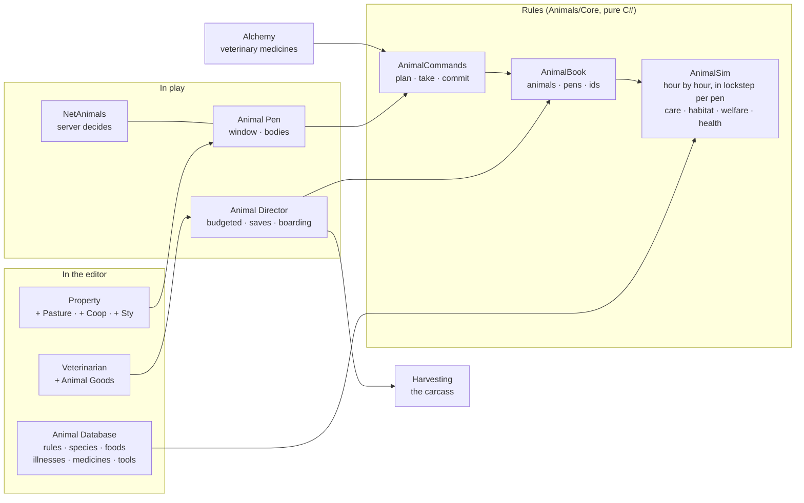

# Animal Husbandry

**Scripts:** `Animals/Core/*` holds the rules, as plain C# with no MonoBehaviour:
* species, breeds, diets and foods;
* the animal's record and the world's save;
* the simulation of life: growth, hunger, thirst, nutrition, toxins, health, mood and grazing;
* care, hygiene, hooves, comfort, stress and welfare;
* the pen's floor, bedding, trough and ground;
* the illnesses, the medicines and the remains;
* production (eggs, milk, wool), its quality and the product ledger;
* breeding, inheritance and kin, relationships between animals, and the bond with the owner;
* trading (crates and changing hands, an animal's worth), pen upgrades, the three machines and upkeep;
* the registry of a world's animals and pens;
* the validated commands;
* what a player sees;
* the item codes;
* the built-in content.

The other folders hold:

| Folder | What it holds |
|---|---|
| `Animals/Items/*` | Feed, livestock crates, care tools and products (food and material) |
| `Animals/Runtime/*` | The Animal Database, species and food assets, the Animal Pen, the Animal Director, the items made at runtime, the inventory and Housing bridges, the veterinarian, the merchant's animal goods, the veterinary medicines in Alchemy, the carcass for Harvesting, the sounds, the bodies and the art |
| `Animals/UI/*` | The pen's window and the veterinarian's window |
| `Networking/Runtime/Animals/NetAnimals.cs` | Multiplayer |
| `CustomEditor/Animals/*` | Menus, validation, the Animal Pen inspector, the Edit Mode tests |

Every animal is a **persistent individual**. It has its own id, owner, species, breed, sex, genes, age and history, and
it lives on the land of a rented house, in a **pen** placed next to the house's garden. The player's care decides how it
grows and how it does:

* **It lives by the farm clock.** Every pen is simulated in game hours, round robin and within a budget. A pen nobody
  is near lives on like any other: an animal left for a week has lived that week, meal by meal. While its owner is
  logged out its needs grow more slowly, and hardship cannot take its health below a floor.
* **Hunger is not nutrition.** A food fills an animal by its size, feeds it by its five nutrients (energy, protein,
  fibre, minerals, vitamins), pleases it or not by the species' diet (favourite, preferred, normal, neutral, poor,
  harmful, toxic), and may do more besides (toxins, upset stomachs). Nutritional condition is judged over days, so a
  full animal can be badly nourished, and one good meal does not undo a week of poor ones.
* **Growth follows care.** Each species has its own stages, from newborn to adult and senior. A well fed, healthy animal
  grows at full pace; a starved one barely grows.
* **Care is the species' own.** Brush, wash, pet, clean hooves, each with its tools, water and supplies, its cooldown,
  and harm when there is too much of it or it is wrong for the species (a bathed rabbit panics). A coat gets dirty,
  hooves wear, a pen's floor gets soiled and its trough fouls; mucking out cleans it, lays straw and gives manure.
* **Welfare is not a number on a screen.** It is worked out from health, nutrition, hygiene, comfort, happiness and the
  bond with its owner, less stress, in five bands. A Critical animal falls ill faster and heals slower; an Excellent one
  the other way round.
* **Illness has causes.** Nine illnesses (malnutrition, dehydration, infection, digestive upset, worms and lice, chronic
  stress, injury, hoof rot, food poisoning) build up from what the animal lives through: a dirty pen, foul water, a
  filthy coat, crowding, the cold, sick pen-mates. Each has stages and symptoms a keeper can see, a careful look names
  it, and a well-kept animal stays well.
* **Medicine and the vet.** Potions brewed through Alchemy (three veterinary ones of its own) and plain remedies sold by
  a merchant, in doses by the animal's size, as strong as the bottle is good, with overdoses. The city's veterinarian
  finds what does not show yet, for a fee, and cures what a keeper's medicine can only hold.
* **Neglect has consequences.** Starvation, thirst, poor feeding, poison and illness all wear health away, and an animal
  can die of them. Its record stays, with the cause and its health and care history.
* **Living animals give.** Hens and ducks lay eggs, cows and goats give milk, sheep grow wool, in cycles whose pace
  multiplies how they live (welfare, illness, genes, age, nutrition, comfort: no one thing done well is enough). Each
  lot's quality is judged over its whole cycle by a configurable formula (nutrition, welfare, genetics, health,
  environment, and hygiene), in six tiers from Poor to Special. What is made waits at the animal until collected - by
  hand, with a milking pail or with shears - and every copy remembers its quality and, in the world's product ledger,
  the animal, cycle and life it came from. Eggs and milk are food, wool is Crafting's wool fibre, and merchants pay by
  quality.
* **Animals have families.** A well kept pair of their owner's own can be bred: she carries their young (the chance by
  their fertility, welfare, age and kinship), who are born in the pen, suckle from their mother, inherit their parents'
  traits a little either way with configurable mutations, and know their parents and grandparents - so a line can be
  bred toward better animals. Close kin are not bred, and inbreeding weakens.
* **Animals have bonds.** Pen-mates grow close and miss each other when parted, rival males fret, and the bond with the
  owner grows with care, meals from the hand and time by the pen - unlocking each species' perks (greeting, following,
  calm handling, coming when called, a ribbon) without ever standing in for welfare. Each species behaves its own way:
  grooming, keeping company, shying from strangers or coming to look.
* **Animals are a trade.** An owner crates an animal they raised and sells it to any merchant, who pays its worth by
  its stage and grade, or trades it to a player, who lets out the very animal, its history and family with it. The
  transfer is validated and done once. Pens are improved for more room, comfort, cleanliness and production, and fitted
  with a feed hopper, an automatic waterer and egg trays that do the daily rounds while the keeper is away. Both cost
  upkeep by the day, paid as it falls due or ahead; unpaid, a pen falls into disrepair and its machines stop. Breeds are
  bred for something: a Leghorn lays more, a Merino grows more wool. Wool's quality carries into Crafting.
* **How it lived shows in its remains.** Its owner may slaughter it, and butcher a dead one through Harvesting: the
  carcass is laid out by the pen, and how it was raised, how it died and what ailed it decide how much it gives and how
  good it is.
* **Habitats are real places.** A pasture, a coop, a sty, a hutch, a barn or a stable. Each has a feeder (food wilts),
  a trough (rain fills it, the sun dries it, the animals foul it), a floor, shelter (a roof keeps off rain and cold) and
  a size (each species needs its own space, and too many crowd it). A pasture grows grass that grazers eat, and worms in
  a soiled one.
* **Ownership is checked everywhere.** The tenant and those they let work the garden may tend a property's pens, keep
  animals there and care for the animals in them. Anyone may look. Only an animal's owner names, moves, slaughters and
  butchers it. An owner who loses the pen (the lease ended) has their animals boarded until they bring them home.
* **It is cheap.** Animals are data. Bodies exist only near a player, and pictures go only to those near.
* **The server decides everything.** Every action is validated with the player's own items, tools, money and position,
  retries are never done twice, and clients see only what can be seen.

| Chapter | What it covers |
|---|---|
| [00 — Architecture, Requirements and Phased Plan](00-Architecture-and-Plan.md) | The repository analysis, dependencies, architecture, requirements, data model, persistence, offline simulation, security, performance, the phases, acceptance criteria and tests; Phases 2, 3, 4 and 5: what was built, their acceptance criteria, known issues and what comes next |
| [01 — Overview and Setup](01-Overview-and-Setup.md) | Setup in a few minutes, pens on a house's land, the veterinarian and the keeper's goods, the pen's window, acquiring and feeding animals, butchering, the menus and validation |
| [02 — Species, Foods and Nutrition](02-Species-Foods-and-Nutrition.md) | The Animal Database, the rules, authoring species, breeds, diets, foods, care and susceptibility, illnesses, medicines and tools, how nutrition, growth and harm work |
| [03 — Scripting, Multiplayer, Saving and Tests](03-Scripting-Multiplayer-Saving-Tests.md) | The API, the commands and requests, the network relay and what the server checks, the save (version 5), the editor tools and the Edit Mode tests |
| [04 — Care, Welfare and Health](04-Care-Welfare-and-Health.md) | Care actions and tools, hygiene, hooves, comfort and shelter, stress, welfare, the pen's cleanliness and mucking out, the nine illnesses, diagnosis, medicine, the veterinarian, the histories, slaughter and butchering, where to get things, and the default numbers |
| [05 — Production](05-Production.md) | What each species gives, the production cycle and its rate, the quality formula and tiers, storage, collecting (by hand, milking, shearing), the products as items, the product ledger and traceability, authoring products, the rules, multiplayer, scripting, saving and tests |
| [06 — Breeding, Genetics, Behaviour and the Bond](06-Breeding-Genetics-and-Behaviour.md) | Breeding and who may be bred, pregnancy, birth and nursing, inheritance and mutations, kin, relationships between animals, the bond with the owner and its perks, behaviour, the window, authoring, the rules, multiplayer, scripting, saving and tests |
| [07 — Trading, Habitat Upgrades and Automation](07-Trading-Upgrades-and-Automation.md) | Crating and selling animals, changing hands, an animal's worth, pen levels, the feed hopper, the automatic waterer and egg trays, upkeep and disrepair, breed specialities, Cooking, Crafting and Alchemy, the window, the rules, multiplayer, scripting, saving and tests |

