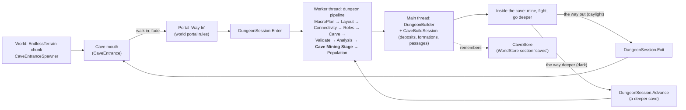

# Caves 01 — Overview and Setup

## 1. What a cave is

A cave is a **dungeon** generated from a cave profile. That profile has natural floor styles only (caverns, now and then
a great den, a fungal hive or chasm islands), narrow winding tunnels, drops and climbing roots between levels, and cave
floor modifiers (flooded, overgrown, dark, molten, frozen) from the second level down. Its **Custom Stages** list holds a
**Cave Mining Stage**: that stage makes it a cave to explore and mine.

The Cave Mining Stage runs on the dungeon's worker thread right after the **Analysis** stage (walking and wall
distances exist) and before **Population** (creatures, chests and props keep clear of what it placed). It decides, as
data:

* the **depth** of every chamber,
* the **special chambers** (rich veins, crystal grottos, guarded hoards),
* the **deposits** (which resource, where, in veins),
* the **standing rock formations**.

When the dungeon is built, the stage's **build session** (`CaveBuildSession`) builds them. It also builds rock and
hanging formations batched per mesh chunk, dresses the way out and the way deeper as natural passages, makes the
creatures tougher with depth, and restores the cave's memory.

## 2. Setting up (new project or existing one)

### 2.1 One click

**Tools ▸ SimpleMovements ▸ Caves ▸ Create Cave Setup…** asks for a folder inside `Assets` (it starts in
`Resources/SimpleMovements/Dungeons`) and creates:

| Asset | What it is |
|---|---|
| `Cave_DungeonProfile` | The cave: `CaveDefaults.ApplyProfile` (Deep Caves type, natural styles, cave sizes, tunnels, drops, climbs, modifiers, guardian chambers, nests, ambushes, gardens, **Keep Generated 4**) |
| `Cave_MiningStage` | The Cave Mining Stage, listed in the profile's Custom Stages |
| `Cave_Resources` | A Resource Table with the 38 built-in deposits (every mineable material of the Crafting Database) |
| `Cave_DungeonTheme` | Deep Caves colours, cold crystal light, dark damp air |
| `Cave_DungeonLoot`, `Cave_DungeonProps` | The built-in loot and props (chests, urns, barrels, mushrooms, stalagmite props…) |
| `Cave_DungeonEncounters` | The world's mobs from **EndlessTerrain ▸ Mobs** of the open scene; rarer ones (Rarity Level 4+) only from the second level, the rarest (7+) from the third. Empty when the scene has no EndlessTerrain; the caves then use stand-in creatures until you add mob prefabs (the table's inspector has *Import mobs from the world*) |
| `Cave Dungeon Manager.prefab` | A Dungeon Manager for caves: its **Exit Portal Action is Next Dungeon**, so the lowest level's way leads to a deeper cave; the way out is always the entrance |

It then offers to add the profile and the manager to **EndlessTerrain ▸ Cave Entrances** in the open scene.

### 2.2 By hand

1. Make a Dungeon Profile a cave: create a **Cave Mining Stage** asset (*Create ▸ SimpleMovements ▸ Caves ▸ Cave
   Mining Stage*), add it to the profile's **Custom Stages**. Optionally give it a **Resource Table** (*Create ▸
   SimpleMovements ▸ Caves ▸ Resource Table*, or *Caves ▸ Create Resource Table…*). Without one it uses the built-in
   resources. `CaveDefaults.ApplyProfile` (called by the setup) gives a profile the cave layout settings. Any profile
   works, but caverns are where deposits go (Deposits ▸ Caves Only).
2. World entrances: on **EndlessTerrain ▸ Cave Entrances** add the profile to **Cave Profiles** (several = each
   entrance picks one from its seed) and optionally a **Dungeon Manager** prefab.
3. Hand-placed entrance: add a **Cave Entrance** component to an empty GameObject (or use *Add Cave Entrance Here*). Set
   **Profile**. +Z (the blue arrow of its gizmo) faces out of the cave.

### 2.3 Existing scenes and saves

* Existing scenes load unchanged. **Cave Entrances** is new on EndlessTerrain, enabled but with no profile, so no cave
  appears until you add one.
* Existing `OreDeposit` components in the world keep working as before. Their new fields default to the old
  behaviour: Yield Kind *Ore*, no name, no minimum pick.
* Portals are unchanged unless a cave entrance sets the new options (`OwnDungeonTypeOnly`, `RequestLabel`).
* The world save gets a new section, `caves`. Old saves simply don't have it.

## 3. The loop, step by step

1. **Explore.** Cave mouths stand on the terrain where the planner put them (§05.1). From afar they look like a rock
   outcrop or a hillside opening, and they open downhill.
2. **Find an entrance and go in.** Walk into the tunnel. The screen darkens and the cave's name shows ("Whispering
   Grotto — Going into the cave…"). A moment later, still inside, the server sends the group through the mouth's
   portal. Walking back out before that cancels it.
3. **The cave is generated** on a worker thread from the entrance's seed (the same entrance always gives the same cave),
   or it is taken from the kept generations if it was entered recently. Its first levels are built, a level per frame
   budget, and the players arrive at the entrance passage. The light comes back.
4. **Enemies and resources.** Creatures from the encounter table roam its chambers, tougher on deeper levels. Deposits
   sit in the walls and on open floor, more and rarer deeper down. Rich veins are chambers full of ore; crystal grottos
   glow; guarded hoards have an elite and its guards.
5. **Fight** with the normal combat system.
6. **Mine.** Hit a deposit with a pickaxe: every hit adds the pick's Tool Damage, and each *Work per Lump* breaks one
   lump off into the inventory (a gem now and then from seams that carry one). Some loose stones can be gathered by hand
   (Interact) first. A worked-out deposit shows bare rock and grows back after its regrow time.
7. **Inventory → crafting.** Lumps are the Crafting Database's stock items (hematite, coal, limestone, rough garnets…).
   Each keeps its seam, so the ore bench, the bloomery, the crucible and the lapidary use them like any other.
8. **Leave and return.** The passage of daylight at the entrance leads out; players come back in front of the mouth.
   Entering again finds the cave as it was left: mined seams still mined (and growing back), slain creatures still gone
   (until *Creatures Return Minutes*), opened chests open.

## 4. Menus

| Menu | Does |
|---|---|
| *Tools ▸ SimpleMovements ▸ Caves ▸ Create Cave Setup…* | Everything in §2.1 |
| *… ▸ Add Cave Entrance Here* | A Cave Entrance where the Scene view looks (selected cave profile, else the first in the project) |
| *… ▸ Create Resource Table…* | A Resource Table with the built-in deposits |
| *… ▸ Validate Cave Setup* | Checks every cave profile (encounters, kept generations, theme, every resource id against the Crafting Database, depth coverage, the bottom), every Cave Entrance in the open scenes and EndlessTerrain's Cave Entrances |
| *… ▸ Help* | Opens this guide |

Inspectors: the **Cave Mining Stage** and the **Resource Table** show *what each depth holds* (the most likely deposits
of an ordinary chamber per band) and their problems. The **Cave Entrance** shows its problems and the cave's name; in
Play mode it has *Rebuild Mouth* and *Send The Local Player In*. The **Cave Instance** on a built cave's root shows
its record (visits, deposits remembered, creatures slain, lumps mined), the depth under the local player and *Forget
This Cave*.
