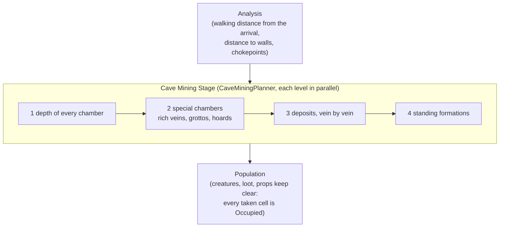

# Caves 02 — Generation, Chambers and Formations

## 1. The cave profile

Caves reuse the dungeon generator's natural layouts: the **Caverns** style (cellular-automaton chambers joined by
routed tunnels), with now and then a **Den** (one great cavern), a **Hive** or **Chasm Islands**. `CaveDefaults.ApplyProfile`
sets them up:

| Setting | Cave value | Why |
|---|---|---|
| Styles | caverns 1.4, den 0.15, hive 0.08, islands 0.06, everything built 0 | natural levels only |
| Size classes | Small 48² cells × 1–2 levels, Medium 64² × 2–3, Large 80² × 3–4, Huge 96² × 4–6 | from a shallow cave to a deep system |
| Caves | tunnels 2–3 cells wide, winding 1.15, chamber spacing 9, fill noise 0.24, ceilings 3.2–13 m | narrow passages and large chambers |
| Connections | dead ends 25–50 %, loops 10–35 %, secrets 6 % | branching, dead ends, the odd hidden way |
| Links | drops 40 %, climbing roots 40 %, extra stairs 30 % | natural ways between levels |
| Floor modifiers | 35 % from the second level (flooded, overgrown, dark, molten, frozen) | deeper is stranger |
| Roles | mini-boss 0.35, treasure 0.7, nest 0.4, ambush 0.35, garden 0.3, arena 0.25 | guardian chambers, nests, hidden hoards |
| Build ▸ Keep Generated | 4 | a cave entered again is not generated again (06 §2) |

Everything else (connectivity, the main path, validation and repair, population budgets) is the dungeon generator's own.
See the [Dungeon guide](../Dungeon/README.md).

## 2. The Cave Mining Stage in the pipeline



The stage's settings are copied to plain data (`CaveRules`) on the main thread when the profile is compiled
(`DungeonStageAsset.Prepare`). A generation keeps the copy it started with, so editing the asset during play never
changes a cave midway. Every random choice comes from the dungeon's seeded streams (`ctx.Random("CaveDeposits", floor)`
and the like): the same seed always gives the same cave.

## 3. Depth

Every place in a cave has a **depth score** (`CaveDepth.Of`):

```
depth = level × Per Level (1)
      + share of the way from the level's arrival to its farthest point × Across Level (0.6)
      + caves down a chain of deeper caves × Per Deeper Cave (2)
      + (difficulty − 1) × Per Difficulty (0.6)
      capped at Max Depth (8)
```

| Band | Depth | Typical |
|---|---|---|
| Shallow | < 1 | the first level of an ordinary cave: coal, limestone, clay, sand, bog iron, red iron, green copper |
| Medium | 1 – 2.5 | tin, brassy copper, lead, calamine, black iron, rock salt, borax, the first gems |
| Deep | 2.5 – 4 | nickel, native silver, gold-bearing quartz, most gemstones |
| Abyssal | ≥ 4 | orichalcum, mythril, aquamarine, emerald, ruby, sapphire, diamond |

Harder caves (far from the world's start: their entrance's difficulty) and the deeper caves of a chain start deeper, so
their first level may already be Medium or Deep. Band starts and every factor are on the stage (**Depth**).

## 4. Special chambers

Chosen per level before the deposits (`CaveChamberSettings`):

| Chamber | When | What it changes |
|---|---|---|
| **Rich Vein** (area tag `Rich Vein`) | a level has one or two with *Rich Vein Chance* (0.6), in plain cavern chambers of at least 40 cells, preferably off the main path and at dead ends | ×4 deposits, counted 0.8 deeper, resources weighted by their *Rich Vein Affinity* (ores more, stone less) |
| **Guarded** rich vein | below the first level, *Guarded Chance* (0.4) of a level's first rich vein (if the level has no boss or mini-boss yet) | it becomes a **mini-boss** chamber: an elite and its guards (Population), the ways in close while they fight |
| **Crystal Grotto** (tag `Crystal Grotto`) | from the Medium band, *Grotto Chance* (0.35, doubled from the Deep band), a chamber of at least 28 cells | ×3 deposits, counted 1.0 deeper, gem-weighted (*Grotto Affinity*); glowing crystal clusters on its walls and floor, a few real lights |
| **Hoard** | boss, mini-boss and treasure rooms | ×1.6 deposits, counted 1.5 deeper, rarer resources favoured |

Area tags reach a network client with each level, so a client's copy builds the same grotto crystals.

## 5. Deposits

For every cavern chamber and natural tunnel the planner:

1. collects the free cells: plain cave floor that is not taken, not a landing, lock, shaft, chasm or doorway, not on a
   chamber's boundary (where its openings and gates are), at least *Clear Of Arrival* (6) cells' walk from the level's
   way in;
2. splits them into **wall spots** (next to rock, under 1.6 cells from a wall) and **floor spots** (open ground,
   off the main path's chokepoints, with open ground all round);
3. computes the chamber's target count: *Per Hundred Cells* (1.4) × (1 + *More Per Depth* (0.12) × depth) × the special
   chamber's factor × its size;
4. places **veins** until it reaches the target. Each vein is one resource, picked by *weight × suitability to the
   depth* (and the chamber's affinity). Its first deposit goes on a free spot, the next ones within the resource's
   *Vein Spread*. Every deposit keeps *Spacing* (1.7 cells) from all others.

A wall deposit faces out of its wall at a height a pick swings at (*Wall Height* 0.25–1.35 m, never above the ceiling).
At build time it is set on the exact wall the mesher draws: `CaveWalls.WallPoint` repeats the mesher's contour rule (a
point jittered along the line between the cell centres by a position hash of the level's build seed), so it is the same
on the server and on every client. A floor deposit is a mound of rock on open ground.

Each deposit is a `Placement` of kind **Resource**: `Entry` = its resource (index in the table), `Link` = its seam (20
bits, kept in every lump), `Group` = its vein, `Wave` = wall (1) or floor (0), `Scale` = its size, `Tier` = its rarity.
Its cell is flagged **Occupied**.

## 6. Rock formations, and why nothing ever blocks a way

**Standing formations** (stalagmites, columns, boulder piles, crystal clusters in grottos) are chosen by the stage:
*Standing Per Hundred Cells* (2.4; fewer in fighting rooms, more in grottos) on open ground at least *Min Wall Distance*
(1.6 cells) from walls, off chokepoints. Their cells are flagged **Formation** and **Occupied**.

The guarantee: **a blocker (a standing formation or a floor deposit) only stands on a cell whose eight neighbours are
all open floor, and no two blockers are closer than 2.3 cells**. Every blocker is therefore an island inside a ring of
free cells, and two rings never merge. Any path that went through a blocker's cell can step round it through its ring,
so a way can never be closed. The headless checks confirm it on 500+ levels (07 §2). Blockers also keep off chamber
boundaries, so gates and doorways stay clear.

The shapes are built later, from the level's grid and **build seed** (`CaveFormationMesher`, worker thread). That is
the same everywhere: a client gets the grid with its Formation cells and the build seed with each level.

| Kind | Where | Look |
|---|---|---|
| Column | a formation cell under a ceiling up to *Column Max Ceiling* (9 m), 35 % | floor to ceiling, narrow in the middle |
| Boulder pile | *Boulder Share* (25 %) | a lumpy boulder, often with a smaller one beside |
| Crystal cluster | formation cells in a grotto (75 %) | a cluster of six-sided crystals on a rock base, glowing |
| Stalagmite | the rest | a tapering, bent cone, often with a stalactite above it |
| Stalactite | *Stalactites Per Hundred Cells* (7) where the ceiling is at least *Stalactite Min Ceiling* (4.2 m) high | hanging, never lower than *Head Room* (2.6 m) above the floor |
| Rubble | *Rubble Per Hundred Cells* (5), along walls | small walk-over stones on the cave floor |
| Wall crystals | grotto walls, *Grotto Crystals Per Hundred Cells* (9) | crystal clusters growing from the wall |
| Grotto light | up to *Grotto Lights* (3) per grotto, 3 m apart | a real point light in the floor's crystal colour |

Each standing formation gets a simple eight-sided prism as its **collider**. The colliders of a mesh chunk are one mesh,
cooked on a job thread and assigned **before the level's NavMesh is baked**, so creatures path round formations. Hanging
formations and rubble have no collider.
