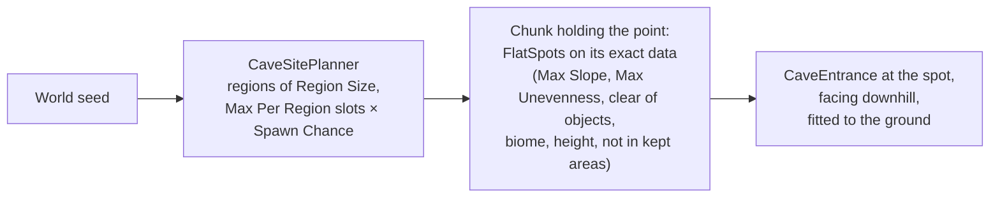
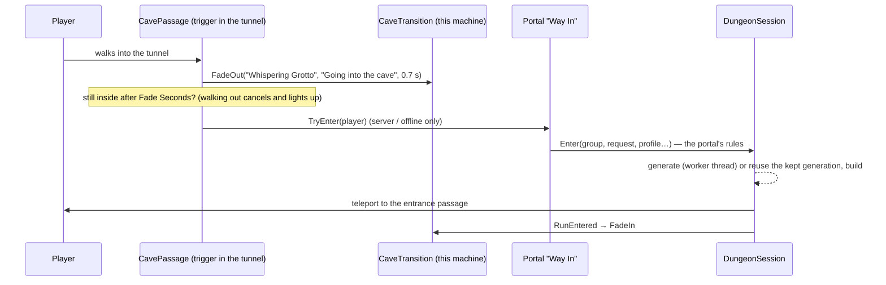

# Caves 05 — Entrances, Transitions and Persistence

## 1. Cave mouths in the world

**EndlessTerrain ▸ Cave Entrances** (`CaveEntranceSettings`) decides where caves appear. Each terrain chunk has a
`CaveEntranceSpawner`, started with its portal and mob spawners once the chunk is ready.

* **Where:** the world is cut into square regions (*Region Size* 520). Each region has up to *Max Per Region* (1) caves,
  each slot used with *Spawn Chance* (0.6), at a point hashed from the world seed, at least *Min Distance Between*
  (180) from every other cave. This is a pure function of the seed, so there are no duplicates and no dependence on
  loading order. The same seed always gives the same caves, and every cave always leads to the same cave system.
* **The spot:** the chunk holding the point looks within *Search Radius* (32) for dry ground no steeper than *Max Slope*
  (24°) and no rougher than *Max Unevenness* (2.6), clear of trees and rocks (*Object Clearance*), in an allowed biome
  and height. It is never inside a world area without portals or objects (towns, the hub city). The search stays inside
  the chunk, so only that chunk's data decides it, and trees and rocks the game removed since (chopped, mined) still
  count: the spot depends on the world seed alone - the same on every machine, before or after the removals reach it,
  and every time the chunk loads. No spot means no cave there. `EndlessTerrain.FindCaveSites(min, max, list)` gives the
  planned points for map markers and quests.
* **Facing:** on a slope the mouth faces downhill, so it opens out of the hillside with its hill rising behind. On flat
  ground it uses the planned facing.
* **What lies behind:** decided by the planned site, never by the spot found for it (the cave's seed comes from the
  site's planned point): one of *Cave Profiles* (picked from the cave's seed), *Size* from *Near Size* (Small) near
  *Difficulty Origin* to *Far Size* (Large) at *Far Distance*, *Difficulty* growing per kilometre from the origin (then
  the world's difficulty rule, `WorldSpawnHooks.ApplyPortalDifficulty`). A harder cave counts deeper (02 §3).
* **Players:** *Sharing* (separate visits or a shared one), *Max Players*, *Bring Party Within* (10 m: parties go in
  together).

The mouth is generated (`CaveMouthBuilder`, *Mouth Width / Height / Depth*): an arch of boulders round the opening, a
short tunnel that darkens ring by ring into a black curtain, boulders along the tunnel's sides and roof, a hill rising
behind and loose boulders about. Every rock's foot and the tunnel's floor follow the terrain (`LoadedTerrain`). Nothing
covers the opening; the headless checks cast sight lines into 120 generated mouths (07 §2). The rock has a mesh
collider and a carving `NavMeshObstacle`, so world mobs walk round it. Its material is the cave theme's cave wall
material (*Use Theme Material*) or *Rock Color*.

Cave mouths are **scenery**: every machine builds the same mouths from the same seed. Going in is decided where the
rules run (06 §3). A mouth is a child of its chunk: it goes with the chunk and comes back identically with it.

Hand-placed: a **Cave Entrance** component (*Tools ▸ … ▸ Caves ▸ Add Cave Entrance Here*) with a *Profile*. The same
mouth is built when play starts. *Build Mouth* off keeps only the way in, for a mouth modelled in the scene.

## 2. Going in: the transition

* `CavePassage` is a trigger box filling the tunnel, from just inside the opening to past the rock closing its end:
  however far in a player walks, they stay in it (only walking back out of its front cancels). When this machine's
  player enters, the screen darkens with the cave's name (`CaveTransition`, drawn with IMGUI, so it needs no canvas).
  After *Fade Seconds*, if they are still inside, the server (offline: this machine) sends them through the mouth's
  **Portal** (child *Way In*, its own trigger off). The portal's rules apply: groups and parties, shared runs, player
  limits, the re-entry cooldown, dungeon scenes, the Hub World's dungeon scenes. Players are recognised as the portal's
  own trigger would (their Combat Entity; the Player tag as a fallback), in the world and inside a cave alike.
* Refused (full, cooldown) = the light comes back at once; no second try until the player steps out and in again.
* The screen **never stays dark**: a run that fails, is refused or takes longer than 25 s (`CaveTransition.MaxDarkSeconds`)
  lights up. A network client hands its player to the server, which takes it by locking its controls: while they are
  locked the screen stays dark, however long the cave takes to make. It lights up once its copy of the cave is built
  and the player stands in it, once it is moved back to the world, once the server lets go of it where it stood (the
  visit failed), or after `CaveTransition.RefusedAfterSeconds` (6 s) when the server never took it (refused: it does not
  tell clients).
* Players come back **in front of the mouth** (its *Way Out Point*: on the mouth's centre line about 3 m out, on the
  ground, clear of the trigger and the rock, with room for their party round them), facing out - wherever in the tunnel
  they stood when they went in (`Portal.ReturnPoint`).

Inside, the dungeon's entrance and exit portals become **natural passages** (*Way Out and Way Deeper ▸ Natural
Passages*, when the theme has no portal prefab of its own). The **way out** is a rock tunnel climbing towards daylight
(a warm light and a bright curtain: *Daylight*, *Daylight Intensity*). The **way deeper** is a dark tunnel going down.
They stand against the chamber's back wall with the same fade (*Fade Seconds*, *Passage Sound*). "Leaving the cave",
"Back to the surface", "Deeper down — Whispering Grotto — Depth 2". The tunnel stays level for its first metre and only
then climbs or descends, so the player always walks on the level's own floor.

## 3. Names

A cave's name ("Whispering Grotto", "Starless Delve") comes from its seed (`CaveDefaults.NameFor`) or the entrance's
*Cave Name*. It travels as the dungeon request's label, so a network client's copy shows the same name. Deeper caves of
a chain add "— Depth N".

## 4. What a cave remembers

The cave itself (tunnels, chambers, formations, deposits) is never stored: it comes back identically from its seed.
What players changed is kept per cave in `CaveStore` (section `caves` of the world's `WorldStore`, written with the rest
of the world), where the rules run:

| Kept | Comes back | Setting (Cave Mining Stage ▸ Between Visits) |
|---|---|---|
| each mined deposit's state (lumps taken, stones gathered, lumps ever given, work on the next lump, how long worked out) | grows back by its regrow time, counted in play time, the absence included | *Regrow Scale* (1; 0 = never) |
| slain creatures (their placements are left out of the build) | after *Creatures Return Minutes* (45; 0 = never in this world) | |
| opened chests (stand open), broken containers (shown broken at once, no debris) and items picked up from the ground (left out; a room's reward too, even while its guards are still away) | after *Loot Return Minutes* (0 = never) | |
| visits, lumps mined, first and last visit | | |

*Keep State* off = nothing is kept. Time is **play time**: what grows back does so while someone plays, never while the
game is closed or paused; a seam worked out in an earlier session goes on growing back where it was. A record remembers
the layout it was made for (a fingerprint of every placement: what, where, which entry and resource). If the cave behind
an entrance changed (an edited profile or resource table, another world), the old record is dropped instead of being
applied to the wrong deposits. The caves left longest ago are forgotten beyond `CaveStore.MaxCaves` (96), never one a
visit is going on in. `CaveStore.Enabled = false` turns it off for the whole game (tests, a game with its own saves).
What was picked up or broken is remembered at once (checked every frame, and once more as the visit ends).

Revisiting is also fast: with *Build ▸ Keep Generated* (4 for caves) the last generations of each profile are kept, so a
cave entered again skips generation and meshing and only builds (06 §2).

In a network session, dungeon seeds are keyed with the server's secret (so clients can't regenerate a dungeon). A
cave's record therefore lives as long as the server process, in memory (it is not written to the world save): a server
restarted with a new secret makes new caves.

Two separate visits of one cave going at once (two groups, *Separate Runs*) share its record: each keeps its own copy's
state, the last one kept wins, and one lump count per seam serves both, so no lump is ever given twice.
