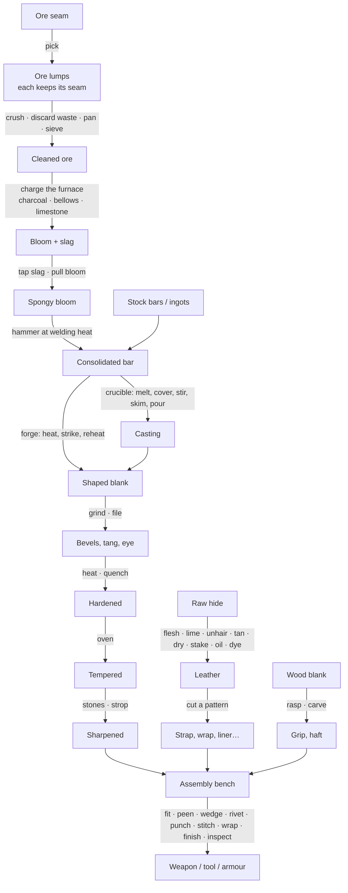
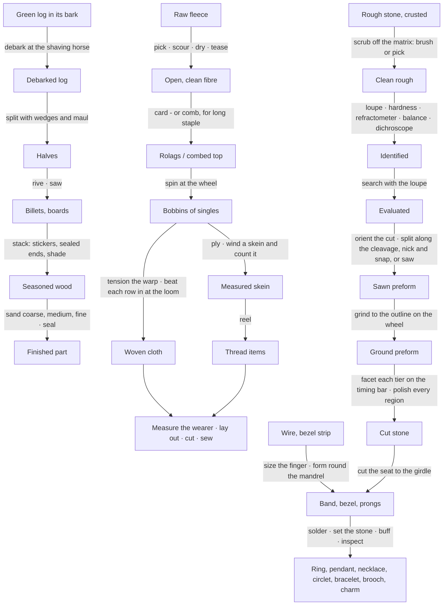

# 01 — Overview and Setup

## Two-minute setup

1. **Tools ▸ SimpleMovements ▸ Project Setup ▸ Create Crafting Database (Resources)** — the project's rules, filled
   with the built-in content (`Resources/SimpleMovements/Settings/CraftingDatabase`). Without it the built-in content is
   used as it is.
2. **Tools ▸ SimpleMovements ▸ Crafting ▸ Create Design Templates** — a weapon or armour asset per design
   (`Items/Crafting/Templates`): the attacks, models and sounds a crafted dagger, axe or breastplate copies. Assign your
   own art to them later; crafted items keep copying them.
3. **Tools ▸ SimpleMovements ▸ Crafting ▸ Create Test Station** — a station with every tool in the open scene. Walk up
   to it and press Interact: every material is free there and the window shows the numbers.
4. For a real game: **Create Smithy / Smeltery / Tannery / Leatherworks / Woodshop / Tailor's / Armourer / Complete Workshop**, **Create Ore Deposit**,
   and **Create Stock Items** (bars, ore, hides, blanks, fuel, supplies, agents, fasteners as item assets) to put in
   merchants, loot tables and starting inventories.

The station needs a collider (the menus add one) so the Player Interactor finds it. Ore deposits are mined with a
weapon whose tool type is **Pick Axe** (its Tool Damage breaks the rock), or a few loose stones gathered by hand.

**Multiplayer**: with Fish-Net in the project, the menus also give the station a NetworkObject and a `NetCraftStation`
(an existing station: *Make Networked* in its inspector). The server then runs it and every player sees the same
workshop and the same crafted items - see [08 — Multiplayer](08-Multiplayer.md).

## Normal stations and the test station

| | Normal station | Test station |
|---|---|---|
| Tools | what you tick in **Tools** (presets: Smithy, Smeltery, Tannery, Leatherworks, Woodshop, Tailor, Armourer, Everything) | everything |
| Materials | the player's own (and the station's **Free Supplies**; **Free Fuel** gives a woodpile and charcoal heap; **Water Source** water for the vats) | every stock material free |
| What the window shows | what can be seen, heard and felt, plus the station's **Instruments** | everything, plus the numbers: composition, phases, hardness by region, stresses, geometry, the evaluation |
| Time | runs (also while nobody is there, with **Run While Away**) | runs, and can be skipped (+10 s … +30 min) |
| Finished items | come out untried: their quality shows once tried (Inspect) | come out tried |

### Station settings

| Field | What it does |
|---|---|
| Station Name, Database, Interaction Point, Range | as for other stations |
| Tools | Forge, Anvil, Quench Tank, Oven, Grinder, Files, Polishing, Whetstone, Ore Bench, Furnace, Crucible, Fleshing Beam, Vats, Frame, Rack, Leather Bench, Assembly Bench, Ashes; the woodshop's Chopping Block, Sawhorse, Steam Box, Drying Stack, Finishing Bench, Shaving Horse; the tailor's Spinning Wheel and Tailor Table and the Fibre Bench; the Loom; the lapidary's Gem Bench and Faceting Machine; the Jeweller's Bench. Presets: Smithy, Smeltery, Tannery, Leatherworks, Woodshop, Tailor (wheel, loom, table), Armourer, **Spinnery** (fibre bench, wheel and loom), **Lapidary** (gem bench, faceting machine), **Jeweller** (jeweller's bench, assembly, polishing, files) |
| Test Station | see above |
| Instruments | Thermometer (a pyrometer: degrees), Calipers (mm), Scale (grams; a gem's carats), Loupe (hairline cracks, inclusions; a gem's evaluation), Magnet (steel stops sticking at its hardening heat), Test File (roughly how hard), Assay (what a metal or ore is made of; names it), Streak Plate (an ore's streak), Refractometer (a gem's refractive index), Hardness Points (scratch tests), Dichroscope (a gem's pleochroism and axis), Moisture Meter (wood's moisture). The editor's presets give a lapidary the gem kit, a woodshop the moisture meter, a fibre bench a thermometer and a balance |
| Tool Quality | how good the station's tools are (1 ordinary; 0.5 worn and blunt; up to 2 a master's): sharper drawknives and saws, faster cards and combs, a faceting machine that holds its angle, laps that polish faster, steadier stitching irons |
| Quench Medium, Quenchants | what the tank holds (water, brine, oil, frostwater, dragon's blood…) |
| Vats | how many vats a tannery has |
| Free Fuel, Water Source, Free Supplies | what costs nothing here. Without Free Fuel the fire burns what is in the bag: charcoal, coal, coke - or **any wood** as firewood (planks, logs, offcuts, wooden blanks; anything named as a wood or after one, never a finished item). The fuel menus show how much of each fuel you have |
| Designs | the designs assembled here (ids). Empty = every design this station's tools can make: the Assembly area lists only those, and the server refuses the rest (a design needs an assembly or leather bench; its metal parts an anvil or crucible; its leather a leather bench; its cloth a tailor's table or leather bench; its wood a woodworking tool). Plate armour (metal on leather) needs an **Armourer** (a smithy with a leather bench and tailor's table) or a complete workshop |
| Run While Away, Seed, Conditions Interval, Max Steps Per Frame, History Kept | the simulation |
| Persist Workshop, Station Id | the workshop is saved to `persistentDataPath/Crafting/Stations/<id>.json` and continues after a restart |

Condition sources on the station (the same components alchemy uses: `AlchemySurroundings` reads the weather and the
clock) set the ambient temperature and humidity: wet weather slows drying, a cold smithy cools metal faster.

## From ore to a weapon

A short session at the test station, making a hatchet:

1. Put a **Bronze bar** in the crucible (Crucible ▸ Into the crucible), light the forge (Forge ▸ Add fuel) and work the
   bellows in a steady rhythm until the melt runs bright; **Cover it** with borax, **Stir**, **Skim**.
2. Choose the **Axe head** mould, press on the crucible and lift the pointer to tilt it: a steady, unbroken stream
   fills the mould soundly. Quench the casting to cool it.
3. Put an **Ash blank** on the station. At the assembly bench, **Start** a *Hatchet*, **Fit** the head. If the haft is
   too thick for the eye, rasp its end (Grind ▸ Rasp ▸ Tang) until it goes in. Drive the wedge (hold and release).
4. Grind the bevels (Grind ▸ Coarse wheel ▸ Left/Right bevel; drag along the edge; dip it when it gets hot), then sharpen
   on the medium stone, both faces, strokes into the edge, then light trailing strokes to take the burr off.
5. **Finish**, then **Try it (inspect)**: its quality, edge, heat treatment and assembly are shown. **Take** it.

A steel blade goes through the forge and anvil instead of the mould, and through the quench tank and the oven before
the stones: see [02 — Simulation Rules](02-Simulation-Rules.md).

## From the log, the fleece and the rough stone

Every step leaves its mark on the next: bark left on wet wood rots it and slows its drying, a gouge costs width, a
split off the heart gives an uneven pair, wood seasons only as dry as the air allows; felted or greasy fibre spins
lumpy, combed fibre spins a strong worsted, a balanced ply hangs straight, a miscounted skein reels fewer threads, a
lumpy yarn is harder to beat in evenly and a skipped pick is a flaw the tailor must cut round; crust left on a rough
stone blurs its readings and hides its flaws, a misread refractive index gives the wrong cutting chart, a split off its
measure steps the face, a preform never ground comes out lopsided, uneven facets cost the cut and no polish mends them,
a table laid on a cleavage flakes, a seat cut wide never holds its stone.

### The timing bar

Sawing, splitting, faceting and the loom's beat share one mechanic: an indicator runs along a bar and back, the bar
carries one or more targets with nested zones (**Perfect**, **Excellent**, **Good**, **Poor**; beyond them a **Miss**),
and you strike when the indicator is on a target. The score is the real distance from the target's ideal point - 100%
on the white mark, falling continuously through each zone's edge score - not a fixed value per zone; it shows as a
percentage with its grade. Below the damage threshold the work is harmed (a chip, a crack, a skipped pick, lost weight).
Harder or more brittle stones and lumpier yarn narrow the zones and speed the indicator; practice widens them; a tired,
trembling hand moves the hit. Some bars carry two targets: a narrow one that gives the most, and a wide, safe one that
gives less. Every zone width, the edge scores, the damage threshold, the speed and how much difficulty and practice
change them are set in **Crafting Database → Simulation → Timing bars**.

## The window

* **Left** — your materials the station takes (with **Put**, or **All** for up to twenty at once, each still a piece of its own), and the pieces
  on the station: click one to work it; **Take** puts it in your inventory (a worked-piece item, or the finished item);
  hot metal must cool first.
* **Next** — in the right column, under what the piece looks like, a line says what comes next for it, read from its state (*"Clean the
  crust off it (it blurs the tests and hides flaws)"*, *"Card it - or comb it, for a smooth worsted"*, *"Sew the
  side seams"*), with **Go** to open that work area at that place. It only says what the state shows: optional steps
  are named as such, and nothing is suggested where the piece's path is the player's own choice.
* **Tabs** — a station with many work areas (more than eight, of more than one craft) groups them by craft: a first
  row picks the craft (Smithing, Leatherwork, Woodwork, Tailoring, Jewellery, and Assemble), the second shows its
  areas.
* **Practice** — the subtitle shows the player's rank in the craft being worked (*"Tailoring: Journeyman tailor, 42%
  to expert"*); a button for work done by routine shows the rank it needs, greyed, until the player has it (chapter 04,
  *Practice*).
* **Middle** — the work areas this station has, each a surface drawn from the real state:

| Area | How it is worked |
|---|---|
| Forge | feed the fire (the menu shows how much of each fuel you have; any wood burns as firewood), click the bellows in a steady rhythm (frantic pumping only tires the arm), set the air vent; drag along the piece to choose what goes in, click the coals; Out. **Flux**: drag over the hot piece to sprinkle it — the share of it you covered is what the flux protects. **Fold**: drag the far end back over the bar, then hammer it down. **Weld**: drag the partner (left column) onto the piece, then hammer the weld in while the heat meter is in the welding band — the blows you land in the setting zones are what set it; a weld barely set delaminates. Bury it in the ashes to anneal |
| Anvil | hold on the bar to raise the hammer (longer = harder, until the arm wavers), above or below the line tilts the blow (a bevel), release to strike; tools: flat face, cross peen, straight peen, fuller, horn, hardy, drift, flatter, dishing stake, straightening; **turn it over** (the section and the bar flip, so the face that was down is now up) and **on its face / edge** (the section turns a quarter); cut it with the chisel (strike along the line); rivets and the buckle are hammered too. When the piece is meant for a design's part, its **target shape is dashed in green** over the side view (thickness) and the top view (width), with ticks for the shortest and longest it may be, and the section box shows the target section where the hammer is: you see how far it still has to be drawn out and where it is too thick |
| Quench | drag the hot piece into the tank (edge first, point first, flat; how deep you let go is the depth); keep dragging inside to move it (up and down, side to side, circles); drag it out to lift it; light the oven and temper; **clay**: paint it on the piece with the brush, segment by segment — thick on the spine, thin or none on the edge (the coat is what you painted); **ashes**: rake the ashes over it — the deeper it is buried, the slower it cools |
| Grind | wheel, file, brush or polish; side (click it on the section, or the list: bevels at an angle, faces, edge line, spine, tang, eye). The big drawing is the **cross-section** of the piece where the pointer is, magnified, with the wheel touching the side being ground and the **target** shape dashed over it; the strip below shows the whole length — where it is still thick, where it is at the target, where it went too far. Drag along the piece; higher presses harder; dwell takes more off; the stretch just ground glints; dip it to cool; coat it |
| Sharpen | stone; face; drag strokes across the stone — the pointer's height is the angle held (the gauge shows it against the bevel's angle: too steep blunts, too low only scratches the face); drag on the blade to choose the stretch of edge; the section shows the bevels and the burr; strips along the blade show how keen each stretch is, where the burr is, and how honed it is; turn to the other face when the burr is raised along the whole edge |
| Ore | hold and release on a fragment to crush it; right-click to throw out waste rock; **rinse**: swirl in the pan (steady circles wash cleanly, a jerky hand loses ore with the mud); **sieve**: drag back and forth on the sieve — an even, thorough shaking lets everything smaller than the mesh through, a few lazy shakes only the smallest; **brushes** (tool buttons Hammer / Soft / Stiff / Wire brush): press on a stone and scrub back and forth over it — brown specks are dirt, a grey ring the weathered rind of rock; the soft brush takes loose dirt (caked clay only slowly), the stiff one dirt and clay, the wire one also knocks the rind off (and scratches a little ore away). Slower than washing, one stone at a time, but nothing is lost to the water |
| Furnace | drag the ore from the bench into the mouth to charge it; hold on the charcoal heap to shovel fuel in, on the mouth to scoop flux in, on the tap hole to let the slag run; pump the bellows; drag the bloom out of the bottom |
| Crucible | tools along the top: **Tongs** (drag a piece in; drag a solid one back out — molten metal cannot be lifted out, pour it), **Cover** (drag the flux over the melt — the share covered is what is protected from the air), **Stir** (stir in circles; the steadier, the better it mixes), **Skim** (drag the dross off the top to the edge), **Pour** (choose a mould — the stock ones, then one in the shape of each design's metal part, e.g. *Hatchet: Hatchet head*; the casting comes out in that shape and meant for that part. Press on the crucible, lift the pointer to tip it and carry it sideways so the stream lands in the **pouring cup** - the clay funnel at the mould's end, marked by a pulsing ring, an arrow and a dotted line straight up from it (before you tip, a faint marker shows where a stream would land; while pouring the landing ring turns green in the cup, red off it): the faster it runs the further it arcs, and your hands drift. Metal that misses splashes on the sand and is lost; the cavity fills along its outline; tip it back as soon as it is full — keep pouring and it runs over the top (flash to file off); stop early and the casting is short) — from the crucible or from the furnace's liquid metal |
| Tannery | three places, each showing only its own controls. Above the work, the hide's **path** (Flesh > Lime > Unhair > Tan > Stretch & dry > Stake > Finish: green done, gold next with how far it is) and its state in words, with what to do next. The **beam**: the tool buttons (flesh, scrape the hair, stake, slick, skive, oil/wax, dye) — the hide is shown flesh side up (pink border: pink glistening patches are flesh left) for fleshing and skiving, grain side up (tan border: dark strokes are hair) for the rest; the tool is drawn under the pointer, the stroke leaves a trail and the cells it worked flash; the result is said in words. The **vats** (tubs with their liquor and a strength gauge; the hide is drawn soaking, its colour turning as it tans, with two bars under the tub for how far the tan has reached its surface and core): hold the bucket over a vat to pour the agent chosen (a dose a second), circle the paddle to stir, hold on the plug to drain, drag the hide in and out; the fire under a vat heats it. The **frame** (drag each side's handle: the lacing is grey when slack, gold when taut, red when overdrawn; a bar shows how dry it is) and the drying rack |
| Cut | lay a pattern on the hide (right-click or scroll turns it): green where it fits, red where it runs off, red rings on scars and holes that would go into the part; click to mark it, then trace its dashed outline with the knife — the line is green on it and red off it, a bar shows how much of the outline is cut |
| Carve | wood with a knife (and a saw, a bit): choose what it is for (grip, haft, scales — the target shape is dashed over the wood), then the cut — **Width** and **Thickness** (drag the knife along the blank where wood should come off: the top view for width, the side view for thickness), **Round** (draw it along the corners), **Bore** (drill the tang hole: circle steadily on the end), **Saw** (shake back and forth along the line). Long, steady strokes take curls off cleanly; a deep or wavering cut splits the wood |
| Woodshop | seven places. **Debark** (shaving horse): pull the drawknife right to left along the log with its edge in the bright band under the bark - the depth gauge is blue when it skims, green at the cambium, red when it gouges the wood; turn the log (wheel or right-click) for its other faces. **Split log** (chopping block): drag a line across the log's end where the wedge goes - through the heart and along a ray or the check - then drive the wedge with the maul (hold and release, full blows square on the wedge) until it parts. **Rive**: the billet from the side with its grain drawn along it - click a grain line at the end to set the froe, drive it with the mallet (hold and release, two good blows), then lever the split along: hold and move right *staying on the grain line as it wanders*; off it the split cuts the fibres, where the line runs out of the side the split runs out with it, and rushing it lets it run off on its own. **Saw**: click to mark the cut, press on the mark and stroke up and down, keeping the blade on the line (wandering leaves a torn, crooked end). **Steam & bend**: drag the piece by its clamped end into the steam box (about an hour per 25 mm of thickness: the white gauge), out again and, at once, drag its free end round the form, steadily - the gauge over the form is the strain on the outside fibres; the strap holds them; choose the form (tight, medium, gentle) and where along the piece it bends; it cools fast (the orange gauge). **Dry**: click under the board to lay stickers evenly, hold on each end to seal it with wax, drag the cover over the stack, drag the board onto the stack; drag it off when seasoned. **Finish**: coarse, medium, then fine paper, stroked along the grain (jumping from coarse to fine leaves the coarse scratches); then the brush - dip it in the pot, lay long, straight strokes (short loaded strokes run, damp wood clouds) - with a varnish, an oil, the resin sealer (the hardest film) or wax (rubbed in: it sheds water but wears). The Dry place reads the moisture meter if the station has one, and says how far this air can season it |
| Tailor | nine places. **Weave** (needs a loom and a bobbin of yarn): hold on the warp beam and let go with the tension needle in the green band (too tight puckers the cloth, too slack sags), set the width and how close to beat, then click the loom for each beat when the marker is on the timing bar's target - 100% packs the row true, off it the row lies askew, a bad miss skips a pick (a flaw across the cloth); a journeyman beats in 2 rows a beat, a master 3; *Cut it off the loom*: a length of wool, linen, canvas, cotton or silk cloth (by the fibre), as many rows as were beaten, ready to lay out, cut and sew. **Ply**: pick two bobbins of yarn, treadle, and feed the strands back at a pace that keeps the ply twist in its band (it balances the singles' twist). **Skein & reel**: hold on the niddy-noddy and turn it round its centre: each full turn winds a run of wraps (1.5 m each) off the bobbin and counts them (the blue gauge is the turn; a turn in under half a second, or a slipping hand, loses count of some); when the bobbin is empty the skein is tied off at what was counted (or *Tie off the skein* sooner), then *Reel off as thread*: one thread item per 20 m counted. An apprentice tailor can *Wind & count by routine*. **Measure**: from each gold dot drag the tape to its ring and let go on it; the next item started (or the item picked) is made to these measurements; an apprentice can *Measure by routine*. **Lay out**: chalk the patterns on the cloth before cutting (no overlaps; the blue gauge is the cloth used; amber is across the grain); a cut on the chalk is cleaner. **Spin** with a batch from the fibre bench picked: the batch is spun (the draft slider sets thick or fine) into a bobbin of yarn. **Spin** (needs a spinning wheel and fibre in the bag - the menu shows how much of each you have; one fibre per bobbin): click the pedal about once a second (the wheel's speed, blue; a heavy wheel keeps turning some ten seconds after the last treadle, slowing gently, so a steady rhythm keeps it at speed) and draw the fibre out of the hand to the right at an even pace: the twist is the wheel against the draft - keep the green bar between its two ticks (red left of them: drafting too fast, under-twisted and weak; red right: too slow, kinked); the evenness is the draft's; a full bobbin is a hank of coarse, even or fine thread in the inventory. **Thread the needle** (needs that thread in the bag): bring the thread's end through the trembling eye, left to right; catching the edge frays it (snip it); an apprentice tailor can *Thread it (practised)* at once. **Cut cloth**: lay the pattern on the cloth along the grain (its arrow green, the cloth's white; amber is across it - weaker), pin it, then cut round it snip by snip with the shears (right-click finishes). **Sew**: pick the item and a seam; with the needle threaded, click along the chalk line left to right, as long as the white mark; hold as long as you pull the thread (firm, not puckered). Each click lays a run of stitches: one for a novice, 2 for a journeyman, 3 for a master (the white mark lengthens with the run); a needleful lasts 40 stitches, up to 80 for a master. The thread goes into the item with the first stitches, and how it was spun is how strong the seams are |
| Fibre bench | five places. **Pick**: click each burr and seed out of the fleece (a click on clean fibre pulls good fibre out with it), then *Done picking* (a journeyman tailor can *Pick by routine*). **Scour**: drag the fire gauge to heat the bath (a thermometer shows it in degrees; without one, warm, steaming, simmering), *Put it in*, let it soak still (stirring hot wool felts it), *Lift it out*, set the rinse water near the bath's heat and click the rinse tub for each rinse (hot wool into cold water felts too), *Hang to dry*. **Tease**: drag across each matted lock, slowly (torn fast the fibres break); *Done teasing* (or, from Journeyman, *Tease by routine*). **Card**: drag the top card across the bottom one, always the same way, lightly (the pressure gauge: heavy strokes knot neps). **Comb**: draw the fibre off the tines to the right, straight and steady: the short fibre stays behind as noil. *Lay a batch on the bench* takes one fibre item from the bag as a batch |
| Lapidary | ten places. **Clean**: hold and scrub over the brown crust (the brush is slow but never harms the stone; the pick is quick but marks bare stone, and chips a brittle one worked roughly) - crust left on blurs the refractometer, reads light on the balance and hides inclusions from the loupe (a journeyman jeweller can *Clean by routine*, with the brush). **Test**: the loupe; a hardness point (pick it, draw it lightly across the stone - scratched means the point is harder); the refractometer (hold the stone still on the prism until the gauge fills); the balance (click to weigh in water, click again when the needle rests); the dichroscope (drag slowly round the ring). **Identify**: the readings beside the gem book; name it. **Evaluate**: hold and move the loupe over the stone, the wheel focuses through its depth - what lies in focus under the loupe shows and is found (an expert can *Search it by routine*: methodically, at every depth). **Orient**: drag the gold circle (the finished stone) clear of the flaws, the wheel sizes it, choose the cut, tilt the table across the axis (the blue line, if the dichroscope was read) and off the cleavage (the red line); the expected yield and worth are shown. **Split**: draw the line, choose the technique - *along the cleavage* (a stone that cleaves: the line on its faint cleavage lines) or *nick and snap* (no cleavage, not too tough: never a clean break) - and strike on the timing bar: the indicator is the blow's force, the white mark the force that parts this stone; off it the face steps and weight is lost, far off it shatters. Corundum and other tough stones without a cleavage must be sawn. **Saw**: draw the line, then make each stroke on the timing bar (a narrow target gives most, a wide one is safer; more feed pressure means fewer strokes and a faster bar); the cut's steadiness is the strokes' average, every miss jumps the blade (chips, lost weight); keep the drip on. **Grind**: the stone turns against the wheel; hold in the panel to press it (higher presses harder) while the part outside the gold outline passes the wheel and ease off before the wheel cuts in (red); steady pressure grinds a true outline; facet once less than 15% is left. A preform never ground is ground freehand on the lap: lopsided. **Facet**: set the quill on the protractor (drag or wheel; the cutting chart for the stone's refractive index, once read or known, gives the angles), then click the lap on the timing bar - accurate hits cut symmetrical facets at the angle, poor ones uneven facets, a miss botches one (chips, weight; *Recut this tier*). Up to 6 facets of a tier are cut one by one, the rest following the same setting: 5 for a journeyman, 4 for an expert, 3 for a master. **Polish**: the compound; hold and move over the stone so every region (the 3 × 3 shading) comes up bright, lightly and not too fast, watching the heat; stop where it is bright (past it the edges round) - polish never mends a bad cut |
| Jeweller | six places. **Size**: try the sizer's rings on the finger until one fits (an apprentice can *Size by routine*). **Form**: pick the wire or strip, what to form (band, bezel, prong head, bail, chain) and its size (*Size to the stone* for a bezel); hold and release to tap round the mandrel, each part once or twice, then tap the seam closed; *Done*. **Seat**: pick the setting and the stone; hold the burr in the middle, still, and let go when the gold seat meets the white girdle. **Solder**: brush flux along the seam, hold the torch on the metal and let go the moment the solder flashes. **Set**: push the bezel or each prong over the stone - one side, the opposite, then a quarter round. **Finish**: hold the piece on the buffing wheel (lightly), then on the steam jet to clean it, *Inspect & finish* |
| Assemble | pick what to make in three menus - **category** (Weapons, Tools, Shields, Armour, Clothing, Jewellery), **group** (weapons by family: swords, daggers, axes, maces and hammers, spears and polearms, bows, thrown, staffs, fist; armour by material: plate, leather, padded; clothing by where it is worn; *All* lists the whole category) and the **design** itself - then start it, fit each part into its place, then work each joint: click on the beat to punch and stitch (the rhythm sets the spacing and the tension) - the pricking iron punches 4 holes a beat, the awl lays 1 stitch a beat (2 for a journeyman, 3 for a master), and when the holes are all punched the work moves on to stitching, and when a joint is done, on to the next; hold and release to rivet, peen or wedge; Finish; Try it |

### By hand, in 3D

Eight of the areas can also be worked with your own hands at the real work place: press the area's **by hand** button
(or the *By Hand* key, **H**). The window steps aside, the view moves to the anvil (the forge, the tank...) and the mouse becomes the
hand. The piece is there as it really is — its shape segment by segment, each segment glowing at its own heat, the
bevels you ground, the bends you hammered — and changes as you work it. *Put Down* (**right-click** or **Q**) puts the
tool down and brings the window back; **Escape** goes back to the game. The work goes on as it is either way.

**The keys are input actions.** Everything worked by hand here and at the alchemy station (the spoon, the bellows, the
filter, the mortar) reads the actions of a **Station** map (`StationControls`): `StationWork`, `StationPutDown`,
`StationNextTool`, `StationQuick`, `StationTurnOver`, `StationFire`, `StationFaceEdge`, `StationFeedFire`,
`StationVentClose` / `StationVentOpen`, `StationConfirm`, `StationByHand`, `StationChoice1`–`StationChoice10`, and the
values `StationPoint` (where the hand is), `StationScroll` and `StationMoveHand` (a gamepad stick moves the hand). Add
the map to your input actions asset to choose the keys there; any action missing is created at start with the default
keys in the table below. They are rebindable in *Settings ▸ Key Bindings* (their own section), saved with the other
keys, and every hint on screen shows the key actually bound — for a gamepad, its buttons. While the hands are at work
the player's gameplay keys are off, so R, F, Q, Tab or Space never also cast, dash or open the inventory.

The keys below are the defaults.

| Work place | How it is worked |
|---|---|
| Anvil | move the mouse along the bar to aim (the hammer hangs over the spot); hold the left button to raise the hammer — the longer, the higher and harder, until the arm wavers; while holding, move the mouse up or down to tilt the face (a bevel); release to strike — the sparks fly, the view jolts, the anvil rings. **1–0** or the wheel: the tool; **F**: on its face / edge; **T**: turn it over; **R**: into the fire and back |
| Bellows | hold the left button and pull the mouse down to squeeze the bellows, let go (or move up) to let them fill; **Space** is a quick squeeze; a steady rhythm builds the draft. **R**: the piece into the coals and out; **F**: feed the fire (the fuel chosen in the window); **[ ]**: close / open the air vent |
| Wheel (file, brush, polish) | hold the left button to press the blade to the spinning wheel (sparks stream off it); move the mouse sideways to slide it along — the part under the wheel is what is ground; higher on the screen presses harder; the wheel turns the angle. **1–7**: the side; **Tab**: the next tool; **Space**: dip it in the tank before the temper runs |
| Whetstone | hold and draw the blade across the stone; the mouse's height is the angle you hold — keep it steady, the steadier the keener. **Tab**: the other face; the wheel: the next stone |
| Quench tank | hold the left button to plunge the hot piece into the liquid and keep it moving — up and down, side to side or round; release to lift it out. **1–3**: edge first, point first, flat |
| Crucible | hold the left button and raise the mouse to tip the crucible over the mould; the stream thickens as you tip; keep it steady and unbroken until the mould is full (a stop and restart leaves a cold shut); releasing pours what is in. The mould's cavity has the outline of what it casts and fills along it from the clay pouring cup. Move the mouse sideways to carry the crucible: a marker on the sand shows where the stream will land (amber off the cup, green in it); your hands drift a little, so hold the aim. What misses the cup splashes on the sand and is lost |
| Ore bench | a stone of the lump on the bench in 3D, as it is: ore in veins through the rock, a dull weathered rind, patches of dirt and caked clay. Hold the left button and **scrub back and forth** over it with the brush (dust falls, the scrubbed surface comes up fresh); hold **Space** and move the mouse to turn it in the hand, the **wheel** spins it, **T** turns it over. **1–3** (or **Tab**): soft, stiff, wire brush; **F**: the next stone of the lump. A tired arm scrubs less hard |
| Carving bench | the wood is clamped on the bench, the knife in the hand. **1–4**: width, thickness, round, bore; hold the left button and draw the knife along the wood (moving the mouse) — the length and steadiness of the stroke is the cut; for the bore, circle on the end. The target shape shows as a ghost over the wood, the shavings fall |

The bottom of the screen shows what the work place tells you (the heat colour, how the blow landed, how the edge
catches the light, how the fire burns), a meter (the blow's force, the draft, the pressure, the angle, how full the
mould is) and how tired the arm is. The same hand-skill models measure what you do as in the window, and it reaches the
workshop as the same requests, so it works the same in a network session (the server checks it).

### The window or the hands: which to use

Both are the same workshop and the same requests, but they are not the same work:

| | The window | By hand, in 3D |
|---|---|---|
| Pace | careful: a hand stroke in the window does **60 %** of the work of one at the real wheel, file or knife for a novice, up to **90 %** for a master (the player's practice in that craft, chapter 04) | the full pace (`handWorkPace`) |
| What you see | diagrams: the magnified section, the target dashed over it, strips along the length, exact spans to choose | the real piece, its glow, the sparks and the sound: you judge by eye and ear |
| Good for | the fine finishing: the last passes of a bevel, a precise edge, a delicate weld, learning what each tool does | the rough work: hogging off steel, drawing out, a long grind, carving the bulk of a grip |

A novice is safer in the window (the target shows when to stop); an experienced smith roughs out by hand and finishes
in the window, or does it all by hand. *Simulation Settings ▸ Hand-work pace / Window pace (novice, master)* tune it.

### A tired arm

Every stroke tires the arm (a full hammer blow most, a light stroke little); it recovers slowly while you keep working
and properly once you stop for a couple of seconds (about half the tiredness goes in twenty seconds). A bar in the top
right of the work surface (and *Arms* in 3D) shows it, and the hint line says how it feels. A tired arm is:

* **weaker** — the hammer cannot be lifted as high (the blows land lighter; in 3D the hammer rises less), the bellows
  puff less, the wheel and the stone are pressed less hard, a stitch is pulled less tight;
* **less precise** — blows wander off their mark and tilt, strokes wobble;
* **slipping** — past about half tired, now and then the hammer glances off (*"The hammer slipped: a glancing
  blow"*: off its mark, tilted, weak — in 3D it twists aside) or the knife skids and digs in (a split in wood). The
  more tired, the more often; practice makes it rarer; a rushed blow slips more.

The chance is seeded, so the same hands doing the same thing slip the same way (replays and tests stay exact). In a
network session the server keeps its own model of the arm (it tires with the blows it lets through and rests in real
time) and holds every blow's force to what that arm has left.

### While working

While a station's window (or its 3D work) is open the player **stands at it**: the move keys, jumping, dashing and rolling do nothing (`MovementStateMachine.ReadDeviceInput` reads a neutral input while `InputBindingStore.GameplayInputBlocked`), in a network session too. A station's window (and the 3D work) owns the screen and the keys: the hotbar, the abilities bar and the rest of the
HUD are hidden, **Tab** does not open the inventory and the number keys do not switch the hotbar — they choose tools.
Closing the window (or **Escape**) gives them back. A panel that should behave like this implements `IExclusivePanel`.

On a normal station everything is done with the hands: there are no "do it" buttons (they are only at a test station,
for trying things quickly) — fluxing, folding, welding, rinsing, sieving, covering, stirring, skimming, claying,
burying in the ashes, filling and dosing the vats are each a small action as above.

* **Right** — what the selected piece looks, sounds and feels like and what the instruments say; the fires, the
  furnace, the crucible, the tank, the oven and the vats; what just happened. At a test station also the numbers and
  the time buttons.
* **Journal** (top right) — your mastery of each craft, metals, ores, heat colours, quenches, what you have made and
  how, insights, recent work.

The player's hands tremble a little (more as they tire, less with practice): the same input never gives exactly the
same blow, but the tremble is seeded, so replays stay exact.
