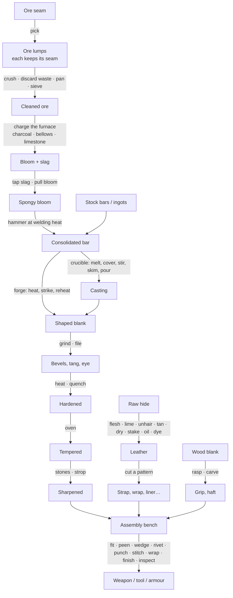

# 01 — Overview and Setup

## Two-minute setup

1. **Tools ▸ SimpleMovements ▸ Project Setup ▸ Create Crafting Database (Resources)** — the project's rules, filled
   with the built-in content (`Resources/SimpleMovements/Settings/CraftingDatabase`). Without it the built-in content is
   used as it is.
2. **Tools ▸ SimpleMovements ▸ Crafting ▸ Create Design Templates** — a weapon or armour asset per design
   (`Items/Crafting/Templates`): the attacks, models and sounds a crafted dagger, axe or breastplate copies. Assign your
   own art to them later; crafted items keep copying them.
3. **Tools ▸ SimpleMovements ▸ Crafting ▸ Create Test Station** — a station with every tool in the open scene. Walk up
   to it and press Interact: every material is free there and the window shows the numbers.
4. For a real game: **Create Smithy / Smeltery / Tannery / Leatherworks / Complete Workshop**, **Create Ore Deposit**,
   and **Create Stock Items** (bars, ore, hides, blanks, fuel, supplies, agents, fasteners as item assets) to put in
   merchants, loot tables and starting inventories.

The station needs a collider (the menus add one) so the Player Interactor finds it. Ore deposits are mined with a
weapon whose tool type is **Pick Axe** (its Tool Damage breaks the rock), or a few loose stones gathered by hand.

**Multiplayer**: with Fish-Net in the project, the menus also give the station a NetworkObject and a `NetCraftStation`
(an existing station: *Make Networked* in its inspector). The server then runs it and every player sees the same
workshop and the same crafted items - see [08 — Multiplayer](08-Multiplayer.md).

## Normal stations and the test station

| | Normal station | Test station |
|---|---|---|
| Tools | what you tick in **Tools** (presets: Smithy, Smeltery, Tannery, Leatherworks, Everything) | everything |
| Materials | the player's own (and the station's **Free Supplies**; **Free Fuel** gives a woodpile and charcoal heap; **Water Source** water for the vats) | every stock material free |
| What the window shows | what can be seen, heard and felt, plus the station's **Instruments** | everything, plus the numbers: composition, phases, hardness by region, stresses, geometry, the evaluation |
| Time | runs (also while nobody is there, with **Run While Away**) | runs, and can be skipped (+10 s … +30 min) |
| Finished items | come out untried: their quality shows once tried (Inspect) | come out tried |

### Station settings

| Field | What it does |
|---|---|
| Station Name, Database, Interaction Point, Range | as for other stations |
| Tools | Forge, Anvil, Quench Tank, Oven, Grinder, Files, Polishing, Whetstone, Ore Bench, Furnace, Crucible, Fleshing Beam, Vats, Frame, Rack, Leather Bench, Assembly Bench, Ashes |
| Test Station | see above |
| Instruments | Thermometer (a pyrometer: degrees), Calipers (mm), Scale (grams), Loupe (hairline cracks, inclusions), Magnet (steel stops sticking at its hardening heat), Test File (roughly how hard), Assay (what a metal or ore is made of; names it), Streak Plate (an ore's streak) |
| Quench Medium, Quenchants | what the tank holds (water, brine, oil, frostwater, dragon's blood…) |
| Vats | how many vats a tannery has |
| Free Fuel, Water Source, Free Supplies | what costs nothing here |
| Run While Away, Seed, Conditions Interval, Max Steps Per Frame, History Kept | the simulation |
| Persist Workshop, Station Id | the workshop is saved to `persistentDataPath/Crafting/Stations/<id>.json` and continues after a restart |

Condition sources on the station (the same components alchemy uses: `AlchemySurroundings` reads the weather and the
clock) set the ambient temperature and humidity: wet weather slows drying, a cold smithy cools metal faster.

## From ore to a weapon

A short session at the test station, making a hatchet:

1. Put a **Bronze bar** in the crucible (Crucible ▸ Into the crucible), light the forge (Forge ▸ Add fuel) and work the
   bellows in a steady rhythm until the melt runs bright; **Cover it** with borax, **Stir**, **Skim**.
2. Choose the **Axe head** mould, press on the crucible and lift the pointer to tilt it: a steady, unbroken stream
   fills the mould soundly. Quench the casting to cool it.
3. Put an **Ash blank** on the station. At the assembly bench, **Start** a *Hatchet*, **Fit** the head. If the haft is
   too thick for the eye, rasp its end (Grind ▸ Rasp ▸ Tang) until it goes in. Drive the wedge (hold and release).
4. Grind the bevels (Grind ▸ Coarse wheel ▸ Left/Right bevel; drag along the edge; dip it when it gets hot), then sharpen
   on the medium stone, both faces, strokes into the edge, then light trailing strokes to take the burr off.
5. **Finish**, then **Try it (inspect)**: its quality, edge, heat treatment and assembly are shown. **Take** it.

A steel blade goes through the forge and anvil instead of the mould, and through the quench tank and the oven before
the stones: see [02 — Simulation Rules](02-Simulation-Rules.md).

## The window

* **Left** — your materials the station takes (with Put), and the pieces on the station: click one to work it;
  **Take** puts it in your inventory (a worked-piece item, or the finished item); hot metal must cool first.
* **Middle** — the work areas this station has, each a surface drawn from the real state:

| Area | How it is worked |
|---|---|
| Forge | feed the fire, click the bellows in a steady rhythm (frantic pumping only tires the arm), set the air vent; drag along the piece to choose what goes in, click the coals; Out; flux it; fold and weld; bury it in the ashes to anneal |
| Anvil | hold on the bar to raise the hammer (longer = harder, until the arm wavers), above or below the line tilts the blow (a bevel), release to strike; tools: flat face, cross peen, straight peen, fuller, horn, hardy, drift, flatter, dishing stake, straightening; turn it over; cut it; make rivets, bend a buckle |
| Quench | click the tank to plunge it (edge first, point first, flat; depth); drag inside to keep it moving (up and down, side to side, circles); lift out; light the oven and temper; clay the spine; bury it in the ashes |
| Grind | wheel, file, brush or polish; side (bevels at an angle, faces, edge line, spine, tang, eye); drag along the piece; pressing toward its centre presses harder; dwell takes more off; dip it to cool; coat it |
| Sharpen | stone; face; drag strokes across the stone — the pointer's height is the angle held; drag on the blade to choose the stretch of edge; the edge glints where it is still dull, the section shows the bevels and the burr |
| Ore | hold and release on a fragment to crush it; right-click to throw out waste rock; swirl in the pan to wash; sieve |
| Furnace | charge it, feed it, pump the bellows, flux it, tap the slag, pull the bloom |
| Crucible | put metal in, cover, stir, skim; choose a mould; press on the crucible and lift to pour (from the crucible or from the furnace's liquid metal) |
| Tannery | tools (flesh, scrape the hair, stake, slick, skive, oil/wax, dye) worked as strokes over the hide; vats (fill, dose, drain, heat, stir, put the hide in); the frame (tension on each side); the drying rack |
| Cut | lay a pattern on the hide (right-click or scroll turns it), click to mark it, trace its outline with the knife |
| Assemble | start a design, fit each part into its place, then work each joint: click on the beat to punch and stitch (the rhythm sets the spacing and the tension), hold and release to rivet, peen or wedge; Finish; Try it |

* **Right** — what the selected piece looks, sounds and feels like and what the instruments say; the fires, the
  furnace, the crucible, the tank, the oven and the vats; what just happened. At a test station also the numbers and
  the time buttons.
* **Journal** (top right) — metals, ores, heat colours, quenches, what you have made and how, insights, recent work.

The player's hands tremble a little (more as they tire, less with practice): the same input never gives exactly the
same blow, but the tremble is seeded, so replays stay exact.
