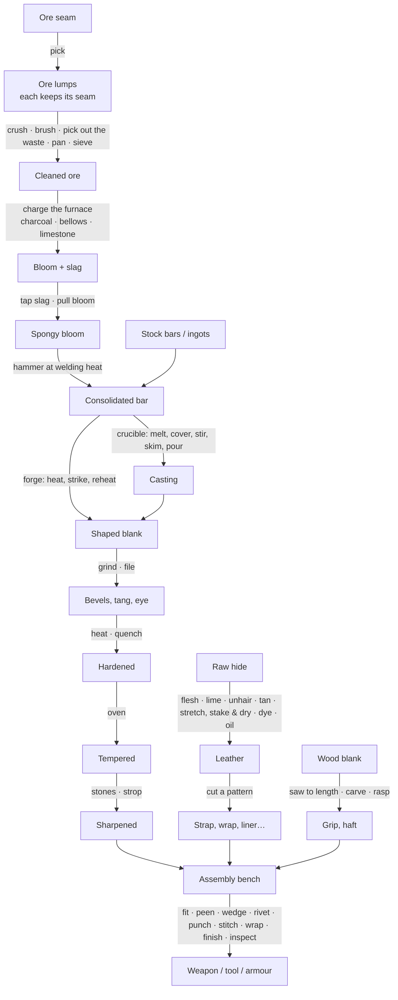
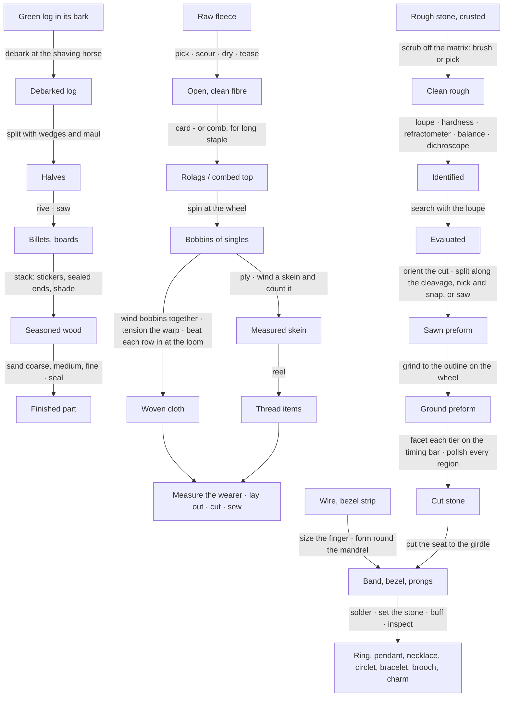

# 01 — Overview and Setup

## Two-minute setup

1. **Tools ▸ SimpleMovements ▸ Project Setup ▸ Create Crafting Database (Resources)** — the project's rules, filled
   with the built-in content (`Resources/SimpleMovements/Settings/CraftingDatabase`). Without it the built-in content is
   used as it is.
2. **Tools ▸ SimpleMovements ▸ Crafting ▸ Create Design Templates** — a weapon or armour asset per design
   (`Items/Crafting/Templates`): the attacks, models and sounds a crafted dagger, axe or breastplate copies. Assign your
   own art to them later; crafted items keep copying them.
3. **Tools ▸ SimpleMovements ▸ Crafting ▸ Create Test Station** — a station with every tool in the open scene. Walk up
   to it and press Interact: every material is free there and the window shows the numbers.
4. For a real game: **Create Smithy / Smeltery / Tannery / Leatherworks / Woodshop / Tailor's / Armourer / Spinnery /
   Lapidary / Jeweller's / Complete Workshop**, **Create Ore Deposit**, and **Create Stock Items** (bars, wire and strip,
   ore, hides and cloth, wooden blanks and logs, rough gems, fuel, supplies, agents, quenchants, fasteners as item
   assets) to put in merchants, loot tables and starting inventories.

The station needs a collider (the menus add one) so the Player Interactor finds it. Ore deposits are mined with a
weapon whose tool type is **Pick Axe** (its Tool Damage breaks the rock), or a few loose stones gathered by hand.

**Multiplayer**: with Fish-Net in the project, the menus also give the station a NetworkObject and a `NetCraftStation`
(an existing station: *Make Networked* in its inspector). The server then runs it and every player sees the same
workshop and the same crafted items - see [08 — Multiplayer](08-Multiplayer.md).

## Normal stations and the test station

| | Normal station | Test station |
|---|---|---|
| Tools | what you tick in **Tools** (presets: Smithy, Smeltery, Tannery, Leatherworks, Woodshop, Tailor, Armourer, Spinnery, Lapidary, Jeweller, Everything) | everything |
| Materials | the player's own (and the station's **Free Supplies**; **Free Fuel** gives a woodpile and charcoal heap; **Water Source** water for the vats) | every stock material free |
| What the window shows | what can be seen, heard and felt, plus the station's **Instruments** | everything, plus the numbers: composition, phases, hardness by region, stresses, geometry, the evaluation |
| Time | runs (also while nobody is there, with **Run While Away**) | runs, and can be skipped (+10 s … +30 min) |
| Finished items | come out untried: their quality shows once tried - at the bench (*Try it*), or later from the bag at a bench where such things are made (*Try that*); only then does the journal note it | come out tried |

### Station settings

| Field | What it does |
|---|---|
| Station Name, Database, Interaction Point, Range | as for other stations |
| Tools | Forge, Anvil, Quench Tank, Oven, Grinder, Files, Polishing, Whetstone, Ore Bench, Furnace, Crucible, Fleshing Beam, Vats, Frame, Rack, Leather Bench, Assembly Bench, Ashes; the woodshop's Chopping Block, Sawhorse, Steam Box, Drying Stack, Finishing Bench, Shaving Horse; the tailor's Spinning Wheel and Tailor Table and the Fibre Bench; the Loom; the lapidary's Gem Bench and Faceting Machine; the Jeweller's Bench. Presets: Smithy, Smeltery, Tannery, Leatherworks, Woodshop, Tailor (wheel, loom, table), Armourer, **Spinnery** (fibre bench, wheel and loom), **Lapidary** (gem bench, faceting machine), **Jeweller** (jeweller's bench, assembly, polishing, files) |
| Test Station | see above |
| Instruments | Thermometer (a pyrometer: degrees), Calipers (mm), Scale (a balance: grams; a gem's carats and specific gravity), Loupe (hairline cracks, inclusions; a gem's evaluation), Magnet (steel stops sticking at its hardening heat), Test File (roughly how hard), Assay (what a metal or ore is made of; names it), Streak Plate (an ore's streak), Refractometer (a gem's refractive index), Hardness Points (scratch tests), Dichroscope (a gem's pleochroism and axis), Moisture Meter (wood's moisture). The window's subtitle names every one the station has (a test station: *every tool and instrument*). The editor's presets give every station a magnet and a test file, a lapidary or a jeweller the gem kit (loupe, balance, refractometer, hardness points, dichroscope) and calipers, a woodshop the moisture meter, a fibre bench a thermometer and a balance, an ore bench (the smeltery) a streak plate and a balance |
| Tool Quality | how good the station's tools are (1 ordinary; 0.5 worn and blunt; up to 2 a master's): sharper drawknives and saws, faster cards and combs, a faceting machine that holds its angle, laps that polish faster, steadier stitching irons |
| Quench Medium, Quenchants | what the tank holds at first (water, brine, oil, frostwater, dragon's blood…), and what it can be filled with again here (Quench ▸ *Fill the tank*: the quenchant's item is used up, water is free; empty = only the first). The editor's presets with a tank keep water, brine and quenching oil (`CraftThermal.PresetQuenchants`; a test station every quenchant): water and brine crack a blade of hardening steel quenched bare, oil hardens it whole - a tank that can only hold harsh quenchants is warned of in the inspector |
| Vats | how many vats a tannery has |
| Free Fuel, Water Source, Free Supplies | what costs nothing here. Without Free Fuel the fire burns what is in the bag: charcoal, coal, coke - or **any wood** as firewood (planks, logs, offcuts, wooden blanks; anything named as a wood or after one, never a finished item) - what is named as firewood (kindling, offcuts, branches, sticks) first, then the cheapest, and the forge or the furnace says what went on (*"On the fire as firewood: pine plank blank."*). The fuel menus show how much of each fuel you have |
| Designs | the designs assembled here (ids). Empty = every design this station's tools can make: the Assembly area lists only those, and the server refuses the rest (a design needs an assembly or leather bench; its metal parts an anvil or crucible; its leather a leather bench; its cloth a tailor's table or leather bench; its wood a woodworking tool). Plate armour (metal on leather) needs an **Armourer** (a smithy with a leather bench and tailor's table) or a complete workshop |
| Run While Away, Seed, Conditions Interval, Max Steps Per Frame, History Kept | the simulation |
| Persist Workshop, Station Id | the workshop is saved to `persistentDataPath/Crafting/Stations/<id>.json` and continues after a restart |

Condition sources on the station (the same components alchemy uses: `AlchemySurroundings` reads the weather and the
clock) set the ambient temperature and humidity: wet weather slows drying, a cold smithy cools metal faster.

**Craft Station Visuals** (the menus add it) draws the fire, the glow, the sparks, the steam and the sounds at the
station's points (*Forge / Anvil / Quench / Furnace / Grinder / Vat Point*; metal burning throws its sparks in the fire,
or the furnace, where it burns) and says where each work place worked by hand in 3D stands: the anvil's, the forge's,
the wheel's and the tank's points, and *Whetstone / Carving / Ore Bench / Mould Point* (the top of the bench the stone,
the blank or the ore lies on; the level of the mould's sand). Under *Worked by hand* give each work place the station's
own model of it (the anvil on its stump, the wheel, the tank...): its mesh renderers are hidden while the hands work
there, where the work place brings its own, standing on the floor - the station's particle systems and these visuals'
own effects never are. Without a model set, what of the station's own stands right where the work place is built (its
middle inside the work place, no bigger than a few times it) is hidden instead, the log says once that the model is
better set, and the station's inspector warns of a point set without its model. A work place without a point is built
just clear of the station - of all its colliders, its children's too - between it and the player (the forge, the anvil
and the tank without one in the row their effects use), its furniture down to the floor under them. The menus fill all
of it.

## From ore to a weapon

A short session at the test station, making a hatchet (its head cast in bronze, its haft of ash):

1. Put two **Bronze bars** on the station (**Put**: at a test station every stock material is free) and each in the
   crucible (Crucible ▸ Into the crucible), light the forge (Forge ▸ Add fuel) and work the bellows in a steady rhythm
   until the melt runs bright; **Cover it** with borax once it has melted, **Stir**, **Skim**. Blow it no hotter than it
   needs to run: a melt held far too hot takes up gas (a porous casting).
2. Choose the mould **Hatchet: Hatchet head** - the pattern mould of the hatchet's own head, its 26 mm eye in it (what
   is cast there is meant for that part). It takes 616 g of bronze: two 315 g bars fill it, a few grams going to the
   dross (the stock *Axe head* mould takes some 1050 g, four bars, and is not the hatchet's shape). With too little metal
   a red tick on the FILL bar shows where it runs out. Press on the crucible and lift the pointer to tip it, carrying it
   sideways so the stream lands in the pouring cup: a steady, unbroken stream in the FLOW bar's green band fills the
   mould soundly; tip back as soon as it is full. Quench the casting to cool it (Quench ▸ Plunge, Lift out: bronze does
   not harden, it is only dipped to cool).
3. Put an **Ash blank** on the station: a stave 2.2 m long and 40 mm square. In **Carve**, choose what it is for
   (*Hatchet: Haft* - the haft's shape, 380-480 mm long and about 32 mm square, is dashed over it), **Saw to length** at
   about 430 mm (click to mark the cut, press on the mark and saw up and down; then pick the piece you keep) and shave
   it to the dashed shape (*Shave the width*, *Shave the thickness*: a bite past 1.4 mm splits it). The end that goes
   into the head is framed in gold, *EYE END 26 MM*: rasp it down (Grind ▸ *Shape: Rasp* ▸ Tang, holding on that end)
   until it is no more than 3 mm thicker than the eye - 26 to 29 mm, a little tight is a good drive. At the assembly
   bench, **Start** a *Hatchet* and fit the head, then the haft (**Place**, the piece, **Fit it**; a haft still too
   thick is refused with how much: *"It will not go on: the haft is 6 mm too thick. Rasp it down."*). The guide now
   reads *"Head on the haft: drive the wedge home"*: hold under the joints to raise the hammer, let go in the green band
   of the blow meter, until the gauge beside it reads *home* (0.6-1.3; past its band the haft splits).
4. Grind the bevels on the fitted head (pick it under the hatchet in the piece list, or **Go** on the guide's *Grind and
   sharpen its edge: grind the bevels first*; Grind ▸ *Grind: Coarse wheel* ▸ Left/Right bevel at 15°: hold on the edge
   and move along it, the two bevels in turn, until the strip is green; press lighter as it gets hot - a fitted head
   cannot go in the tank), then sharpen it on the medium stone: each face with strokes into the edge until its bar
   fills, then light trailing strokes to take the burr off.
5. **Finish** it: at a test station it comes out tried, so its quality, edge, heat treatment and assembly show on the
   right at once, with every note on it (at a normal station **Try it** shows them). **Take** it. (Taken untried from a
   normal station, it can be tried later from the bag: *Try that* at a bench where hatchets are made.)

A steel blade goes through the forge and anvil instead of the mould, and through the quench tank and the oven before
the stones: see [02 — Simulation Rules](02-Simulation-Rules.md).

## From the log, the fleece and the rough stone

Every step leaves its mark on the next: bark left on wet wood rots it and slows its drying, a gouge costs width, a
split off the heart gives an uneven pair, wood seasons only as dry as the air allows; felted or greasy fibre spins
lumpy (drafted fine, lumpier still), combed fibre spins a strong worsted, a balanced ply hangs straight, a miscounted
skein reels fewer threads, a lumpy yarn is harder to beat in evenly and a skipped pick is a flaw the tailor must cut round; crust left on a rough
stone blurs its readings and hides its flaws, a misread refractive index gives the wrong cutting chart, a split off its
measure steps the face, a preform never ground comes out lopsided, uneven facets cost the cut and no polish mends them,
a table laid on a cleavage flakes, a seat cut wide never holds its stone.

### The timing bar

Sawing, splitting, faceting and the loom's beat share one mechanic: an indicator runs along a bar and back, the bar
carries one or more targets with nested zones (**Perfect**, **Excellent**, **Good**, **Poor**; beyond them a **Miss**),
and you strike when the indicator is on a target. The score is the real distance from the target's ideal point - 100%
on the white mark, falling continuously through each zone's edge score - not a fixed value per zone; it shows as a
percentage with its grade. Below the damage threshold the work is harmed (a chip, a crack, a skipped pick, lost weight).
Harder or more brittle stones and lumpier yarn narrow the zones and speed the indicator; practice widens them; a tired,
trembling hand moves the hit. Some bars carry two targets: a narrow one that gives the most, and a wide, safe one that
gives less. Every zone width, the edge scores, the damage threshold, the speed and how much difficulty and practice
change them are set in **Crafting Database → Simulation → Timing bars**.

## The window

* **Left** — your materials the station takes (with **Put**, or **All** for up to twenty at once — it reads **+20** when you
  have more — each still a piece of its own), and the pieces on the station: click one to work it; **Take** puts it in
  your inventory (a worked-piece item, or the finished item). Hot metal and hot ore must cool first, and a piece inside a
  working place — the furnace (ore smelts there; a casting put back in comes out with the tongs), the quench tank, the oven, the ashes, a vat, the steam box — is
  taken out first (a blade lifted out of the tank is a quench your journal learns from). The window says so at once and
  leaves the work in hand on the piece as it is; so it does while work of several presses is under way on it
  (*"Finish cutting the tier of facets first."*). The parts fitted to an assembly are listed under it, indented: the areas that
  finish a part in place (**Grind**, **Sharpen**) can pick one — a blade in its hilt, a head on its haft — the others
  open on the assembly. The lists are updated in place, so a click is never lost while something heats or cools.
* **Messages** — two lines under the work surface say what the station answered (a refusal says why; work your hands did
  faster than real hands can is granted only in part, and says so: *"Too fast: 4 of those 6 strokes counted."*), what
  was learnt and when the arm gets worse; each stays long enough to read (6 s, longer for a long one) unless a newer one
  replaces it, and every one also goes into *What happened* (refusals dimmed), with what the station shows happening, in
  sentences (*"Something pings as it cools."*, *"Off the wheel: long streaks with a few forks."*, *"The batch is all
  spun."*) - never an id or a name the tests have yet to tell; a piece made and a shovel of fuel are not logged (the
  areas say them in their answers). A piece taken into the bag says where it came from the same way (*"Rived from an
  ash blank."*, *"A batch of raw wool."*). In a network session the answer comes a
  round trip later, once your copy of the workshop shows what the work did (an answer that never comes is
  *"No answer from the station."* after 10 s). Under them, the area's hint (how it is worked) and, at its end, the arm.
* **The pointer** means the same in every area: **right-click puts down or aborts what the hands are doing** (it never
  commits, never destroys, never acts as a left click); **the wheel turns or adjusts** what is in hand, a notch at a
  time; everything else is a left click or a button. Only the left button works the surface (the middle one does
  nothing, and a second button never ends or fires the first one's stroke). Strokes are measured by the way the hand
  went, not by the frame rate, from the first pixel (there is no drag threshold). Every area's hint ends with what
  right-click does there: *puts down* where the hands just let go, and in a few its own act - the anvil and the assembly
  bench *lower the hammer*, the crucible *tips back*, the wheel *lifts it off*, the stone *drops a stroke*, the cutting
  table *lifts the knife*, the carving bench *lifts the tool*.
* **Colours** mean the same in every area: on a meter, green is the safe or ideal band, amber barely or not yet, red
  harm, blue too cold or too slow to take, grey does nothing yet; the white tick is the value; gold is what the hands
  picked or aim at; the design's target is dashed green; metal glows as its heat does. Every meter and gauge is named on
  the surface, in one lettering (capitals, a reading in its units: *MM*, *°C*, *×3*).
* **Irreversible actions** ask first: at a test station **Scrap** and **Clear all** take a second click within
  2.5 s (*"Click Scrap again to throw this piece away."*); *Clear all* is there only where the station's rules run
  (offline, or the host). At any station, **Scrap** gives up an item nothing has gone into yet (a design started by
  mistake: nothing fitted, added or worked), asked twice too (*"Click Scrap again to give up this item: nothing has gone
  into it yet."*); the measurement it took waits again for the next item started.
* **Size** — at 1920 × 1080 the work surface is shown pixel for pixel; on a smaller or wider screen the whole window
  scales down to fit (again whenever the window is resized).
* **Visits** — another station (or another player) starts with fresh work areas, so nothing held in the window moves
  between stations; closing the window and opening it again at the same station keeps them and opens the area you
  left. Work of several presses still under way when the window closes (a tier of facets half cut, a saw half through,
  the rivets being made...) is said to be left unfinished (*"You stopped cutting the tier of facets before it was
  done."*).
* **Next** — in the right column, under what the piece looks like, a line says what comes next for it, read from its state (*"Clean the
  crust off it (it blurs the tests and hides flaws)"*, *"Card it - or comb it, for a smooth worsted"*, *"Crown seam:
  punch and stitch it (12 of 20 stitches)"*), with **Go** to open that work area at that place - named as its button reads
  (*Tailor → Lay out*, *Woodshop → Steam & bend*, *Finish leather → The bench*). The line keeps its place: with no step it
  says so, dimmed (*"Next: nothing in particular."*). It only says what the state shows: optional steps
  are named as such, and nothing is suggested where the piece's path is the player's own choice (a bar of steel; wire
  and strip, or a part meant for a jewellery design, are told to go round the mandrel). **Go** shows only when this
  station has that area *and* that place; otherwise the line says so (*"Lapidary → Facet: not at this station"*), or
  the step itself says where to take the piece (*"Take it to a tailor's table to lay out and cut its patterns"*), and
  a step done in the left column (*"Take it: it is done"*) has no Go. It follows the piece where it is and what the
  station has: clean ore goes to the furnace (an unroasted sulfide to be roasted there first; the step says whether it
  gives a bloom to pull or metal to run off), calamine to the crucible with molten copper under a cover (a furnace would
  only boil its zinc away), ore in the furnace is smelting, ore in the crucible gives its metal to the melt; a copper
  matte or lead carrying silver goes back into the furnace, to be roasted or cupelled; with nothing picked, it says what
  the furnace holds once its charge is spent (metal to run off into a mould, a bead to lift out with the tongs, a bloom
  to pull); the bloom pulled is closed up at a forge before it is anything (*"Close the bloom up: strike it with flat
  blows while it is at welding heat, until it is a sound bar (struck cold, it crumbles)"*: the **Anvil**, or the
  **Forge** for another welding heat; from a smeltery, which has no forge, *"Take the bloom to a forge..."*), and the
  step goes once it is a sound bar; a bar whose forge weld is still open is told to set it (*"Set the weld: strike the
  seam shut with the flat of the hammer while it is at welding heat"*: the **Anvil** while it is that hot, else back to
  the **Forge**). A log is debarked (with a shaving horse) and split, or rived when it is
  too narrow to split; green split stock is split on into billets before it seasons (*"Split the half again with the
  wedges, into quarters - green wood is split before it seasons"*), and stock meant for a part is split or rived while
  each half would still hold the part (*"Rive it with the froe: the short haft wants 27 x 27 mm, it is 58 x 58 mm"*);
  green wood is seasoned in the stack, a part meant for a curve (a scythe's snath) steamed and bent to it at the
  Woodshop's Bend; a blank meant for a wooden part whose length is off by as much as the finished item would note (a
  stock blank: the 2.2 m ash stave meant for a haft of 380-480 mm) is sawn to length first, before it is bent (*"Saw it
  to length (the haft wants 380-480 mm, it is 2200 mm)"*: **Carve** ▸ *Saw to length*, or the Woodshop's Saw where there
  is only a sawhorse), and one too short is told to use a longer blank; seasoned, a part still wider or thicker than its
  shape (by the evaluator's own measure) is carved to it (*"Carve it to its shape: shave its width down to the dashed
  outline"*: **Carve** ▸ *Shave the width*), a grip bored for its tang (**Carve** ▸ *Bore the slot*), and then sanded
  through the grits and sealed, if the woodworker likes (*"Sand the haft through the grits, coarse to fine, and seal it
  (optional: ...)"*: **Woodshop** ▸ *Finish*); a hide goes along the tannery's path at the place that does each step (the beam, the vats,
  the frame: out of a vat that is not doing what it needs, *LOOSE* past 70% in the lime, *CORE* past 75% in the tan,
  staked while it is damp as it dries), a dried one that dried stiff is worked supple (bark-tanned, oiled - staked dry,
  its grain cracks; of another tannage, staked) and cut at a leather bench, a cut part
  goes into an item, cloth goes to a tailor's table (or, where there is none, to a leather bench's Cut); a bobbin too
  short for the cloth part an item here still wants is told to have another wound on at the loom (*Wind on*). For an
  item: its parts in order (a wooden part with the length it is judged by, *"Fit its parts: haft first (wood, 380-480 mm
  long)"*; a wooden part fitted at a length the item would note is taken off again first: *"Staff: too long (2200 mm,
  wants 1700-2000 mm) - take it off, saw it to length and fit it again"* - taken off, it is still meant for that part,
  so its own line sends it to the saw; a set of buckles or rivets short of what the design takes asks for another set; the thread
  with the parts where the bench sews with the item's own thread), then its joints, each by its work and how far it has
  come (*"Head on the haft: drive the wedge home"*, *"Boss riveted on: set the rivets (2 of 4)"*) - jewellery is
  soldered before the stone goes in (the torch's heat cracks stones) and the setting's seat is cut to the stone first; a
  cord no seam takes is named at the end; a part left off that is optional (a grip wrap) holds nothing up. Before
  *Finish it*, a blade or a head that is not yet keen is sent to **Grind** (no bevels yet) or **Sharpen**, where the
  station has the wheel or the whetstone - **Go** then picks the fitted part itself (of three throwing knives, the one
  still dull); once finished, *"Try it to see what it is"*.
* **Tabs** — a station with many work areas (more than eight, of more than one craft) groups them by craft: a first
  row picks the craft (Smithing, Leatherwork, Woodwork, Tailoring, Jewellery, and Assemble), the second shows its
  areas.
* **Practice** — the subtitle names the station's instruments (*"Instruments: calipers, balance, loupe, magnet, test
  file, refractometer, set of hardness points, dichroscope"*; at a test station *every tool and instrument*) and shows
  the player's rank in the craft being worked (*"Tailoring: Journeyman tailor, 42% to expert"*); a button for work done
  by routine shows the rank it needs, greyed, until the player has it (chapter 04, *Practice*).
* **Middle** — the work areas this station has, each a surface drawn from the real state:

| Area | How it is worked |
|---|---|
| Forge | feed the fire (hold on the heap to shovel; the menu shows how much of each fuel you have; any wood burns as firewood), click the bellows in a steady rhythm (the BLAST gauge; a steady rhythm is light work and leaves the hammer arm rested for the weld, frantic pumping only tires it; clicks quicker than five a second go to the fire together), set the air vent (its slider shows how open it is). **Into the fire**: click the coals where it should lie - low in the coals is the heart of the fire (hottest, hotter still in front of the tuyere while the bellows blow), high is the edge; the HEAT column at the hearth's side shows what each place can bring it to, green where that is the piece's welding heat, red where it would burn it, and the line under the pointer says it in words. Drag along the bar first (two stretches or more) to frame only part of it; *Whole piece* puts all of it in (a piece lying in the fire on a framed stretch is laid in all along at once). In the fire it lies at its depth, the stretch in the coals buried in them: click it anywhere to take it out; drag it to move it deeper or shallower - it moves as far as the hand moves, the dashed line and the info line say where it would lie, and drawn up out of the coals it comes out - or click the coals. *Turn it*: the face down in the coals runs ahead of the face up while it heats (the FACE UP / DOWN gauges) - a face that ran hotter warps it in the quench. **Flux** (welding fluxes only, borax or sand): *Sprinkle flux…*, then hold over the hot bar (a red heat at least) and move along it - each stretch takes what falls on it, a bare one scales and will not weld; several strokes, *Done fluxing* (or right-click) puts the pot down. **Fold**: grab the far (right) end and lay it over onto the near end (the green mark); let go short of it and it springs back. **Weld on a bar**: click the other bar in the row along the top (dimmed: in the fire, too cold, or not the same length - cut it to length first). Then **set the seam** with the flat of the hammer while it is at welding heat: hold on the bar and let go to strike; each blow closes the seam where it lands by how hard it is struck and how ready that stretch is - its heat against the welding band, its flux, its clean faces (the HEAT, FLUX and CLEAN gauges for the stretch under the hammer; the SEAM strip under the bar shows what is set). Back into the fire between heats, fluxed again; a seam that cools far below forging heat still open stays open (layers that gape apart). The hammer comes up again 0.4 s after a blow |
| Anvil | a bar still in the fire is taken out onto the anvil with a click (the tongs, as the Forge takes it out: the surface reads *IN THE FIRE: CLICK TO TAKE IT OUT*); one in the tank, the oven or the ashes is lifted out at the Quench. Hold on the bar to raise the hammer (longer = harder, until the arm wavers: the BLOW gauge turns red), drag up or down while holding to tilt its face - within a few pixels of where you pressed it strikes flat, further a wedge shows the bevel it forges on the edge side of the face that is up; release to strike. The hammer is drawn as wide as the tool bears (the faint band: where the blow still reaches) and comes up again 0.4 s after a blow (a press sooner waits for it). Tools (the tabs, or the wheel): flat face, cross peen (drawing out / spreading), fuller, horn (*Bend: far end up / down* - the arrow shows the way), hardy, drift, flatter, dishing, straightening, and the **hot chisel**: it stays where it is set (strike well away from it to set it there) and is driven through blow by blow, cutting as the hardy does - the CUT gauge and a notch show how far through it is (on the last stretch too). **Turn over** (the section and the bar flip) and **on its face / edge** (the section box turns a quarter). The side view shows the thickness magnified (*SIDE ×3*, less for a thick piece, so it never runs into the top view). *Rivets…* / *Buckle…*: from a small rod only (not a flat bar, a blade or a piece meant for another part), asked twice - the whole rod goes into them - then firm blows. A stretch too cold to forge is marked red under the side view and named, in the metal's own terms: steel tears below a dull red; a soft metal (copper, brass, silver, gold) is worked cold and hardens - anneal it when it stiffens; a hardened stretch barely moves. The hardy's cut is drawn as a notch up from the anvil's face, the chisel's down from the top (from above, a groove across the bar). **For**: what the bar is to become, any design's metal part (as the carving bench's menu for a blank; a casting in a part's mould or a part fitted to an item has it already) - its **target shape is then dashed in green** over the side view (thickness) and the top view (width; the view fits the target's widest point as well as the bar), with ticks for the shortest and longest it may be (too long: cut it on the hardy or with the chisel), and the section box shows the target section - a sword's blade double-edged, as it is forged and quenched. A bloom says to close it up at welding heat with flat blows first (it is a bar once its pores are shut and its slag is out); a metal piece meant for nothing yet says so (*say what it is for (For)*). A weld's seam still open shows as the SEAM strip on the anvil's face under the bar, and the line says how much is set (flat blows at welding heat close it here too). **Wood** takes only *Straighten* (any other tool is refused before the hammer rises): steamed hot from the steam box it straightens as hot iron does, cold it mostly springs back |
| Quench | only what the station has is drawn: the tank (its quenchant named), the oven, the ash box, the bench. Drag the hot piece from the bench - or straight from the forge's fire, shown at the bench's end - and let it down into the tank: **upright, point first** (the far end goes in first; how low you let go is how much of it goes under - the label shows it; once it hangs over the tank it can be raised again, the tongs over the bench, to dip only its far end - a bit, a blade's tip) or **flat** (all of it at once: it warps). In the tank take hold of it - the piece or its tongs, wherever they are drawn - and keep it moving: it moves only as the hand moves, never jumping to the pointer; up and down along it or round is right; side to side warps it; held still a vapour jacket clings to it and it stays soft (the line names what your hand does). It hangs inside the tank, never through its floor. Drag it up until it is out and let go to lift it out. *Fill the tank*: empties it and fills it with another of the station's quenchants (its item is used up; water is free; asked twice; not with a piece in it). A blade of hardening steel still to harden (or in the fire for it) over a harsh quenchant - water, brine (`CraftThermal.HarshFor`) - is warned of first, in orange: it may crack there; fill the tank with the oil the station keeps, or clay its spine and leave its edge thick (`CraftLook.HarshQuench`; the 3D tank says the same). **Oven**: the dial (100-650 °C: a tempering oven, the station holds it there too) shows the heat it is set to; hold on the FIREBOX to kindle it at the dial's heat (again to rake the fire out: the firebox reads *KINDLING* or *RAKING IT OUT* while it is held, the bar under it how long); drag the piece into it; hold on the oven to take it out (it reads *TAKING IT OUT*, the bar beside it); the piece is drawn in the chamber, its temper colours showing; the oven's own temperature only with a pyrometer (else at its heat, warming or cooling). **Clay** (cold, on the bench): *Paint clay…*, hold and move along the spine - thicker where you go over it more, up to the slider's thickness; *Wipe off* takes it away; *Done claying* puts it on (right-click too). Only clay that goes on uses a clay item: wiping it off is free, and with no clay in the bag the brush still wipes. The painted coat is the spine's: the edge is left bare and hardens (it is slowed only through the steel). The clay stays drawn on the spine until it is brushed or ground off. **Ashes**: drag it onto the ash box and rake the ash over it (back and forth: the ashes read *COVERED*, the bar beside it how far) - the deeper it is buried, the slower it cools; hold on the ashes to dig it out (*DIGGING IT OUT*). The fill menu names each quenchant (*Brine (none)*, *Quenching oil (2)*). The area's last words go once the piece is somewhere else |
| Grind | the tool - only those that work the piece picked, wheels first (*Grind*, *File*, *Polish*, *Descale*; for wood *Shape*: the rasp and the knife, which take the bark off where they cut, and the sanding papers start again after them); for a wheel or a file the side (click its picture - its number is the 3D key - or the list) and the angle (5-35° a side; the wheel turns it a degree a notch). The big drawing is the **cross-section** where the pointer is, magnified (a double-edged blade's bevels on both its edges), the **target** dashed over it and the gold line where the tool bites, the angle written by it. **Hold on the blade where the wheel should bite: move along it to grind a stretch, stay to take more off; higher on the blade presses harder** (0.7 to 1.3 × the pressure set: the PRESS gauge); right-click lifts it off. The wheel (or the file) is drawn against the side it works - the edge for the bevels and the edge line, the spine for the spine and the tang, flat across the blade for the faces, a polish or a brush as a pad on it. What was just ground glints. The **strip** under the blade judges each stretch as the item will be judged (its legend is under it): yellow still to grind (wider or thicker than the design too: grind the bevels on, or the faces), green at the design (both bevels met in the middle at the angle its section carries there - its own, steeper toward a point or on a narrow blade - and no wider or thicker than it), orange off it (met at another angle, or met a little narrow or thin), red too narrow or thin to put back (more than 12 % under), blue where heat drew the temper. A stretch the hammer left a little thin or narrow still wants its edge: it stays yellow until its bevels meet, an orange line along the strip's top marking the undersize (*UNDERSIZE* in the legend), and the line says it cannot be put back but the edge is wanted all the same - neither it nor a stretch past the design is said to be *ground* too far. A bar with no purpose yet is pointed to the anvil's *For*, which gives the strip a design to judge by. The **HEAT** gauge by the section is red from where a hardened edge's temper runs and dark at the end, where the wheel cannot hold it (the heat in °C under it with a pyrometer); **Dip to cool** keeps it in the tank until it is cool (a fitted part cannot go in: press lighter and let it cool; nor a piece still hot enough to harden - a dip would quench it: quench it at the tank, in the Quench area, or let it cool in the air). A polish or a brush works the whole surface: the strip and the panel show its scratches against the grit in hand (green once the next finer grit here takes them on - the line names it; deeper than it reaches, go back a grit) and the scale. Sizes in mm and scratches in µm only with calipers or a loupe. Coat it last (oil or wax, on a piece in the hands or fitted: grinding, brushing and heat take it off); wood has no coat row or dip here - it is sanded and oiled at the finishing bench. A reason the work stopped that is the area's own (too hot for the wheel) goes as soon as it no longer holds |
| Sharpen | stone; face; pressure (the wheel turns it - the PRESS gauge's green is light enough to take a burr off, its red chips a hard edge). Drag strokes across the stone: the pointer's height is the angle held (5° at the bottom, 35° at the top; the gauge shows it against the bevel's angle, grey, and the design's, green - hold it at the bevel's angle or a little above: lower, the stone only rubs the bevel's shoulder). A stroke counts once it has run a fifth of the stone and turns back (a wiggle is no stroke; no more than three a second count) and goes to the station as it is made; right-click drops the stroke under way. Drag on the blade to choose the stretch of edge. The strip along it shows how keen each stretch is and the burr (white); the bars over it how far each face is honed. Hone a face with edge-leading strokes (a push toward the edge - the arrow on the stone says which way for the face chosen) until its bar fills, then the other; take the burr off with light trailing strokes or the strop, drawn spine first (edge leading, the edge cuts its leather and dulls); then a finer stone - the line under the controls says what is next and, at the end, why it stops there (the stone, an unsteady hand, or a soft metal). Held well above the bevel and the design's angle (more than 3°), the line says to hold it lower: the stone hones a steeper edge than the item wants (with calipers, the honed angle is in the first line). Only an edge is honed: where the grind strip is green (the bevels met, a flat of 0.3 mm at most) the hair of flat left is worn away by the strokes before the faces hone - the line says so; a thicker flat sends you back to the wheel (the stone wears it only slowly), a square bar is not honed at all |
| Ore | the stones lie on the tray where they lie on the bench, each as big as it is (a blow's pieces round the stone they came from; a stone thrown out leaves the others where they lie); tools along the top: **Hammer** (hold on a stone and let go over it to strike it - let go elsewhere and the hammer is lowered, its ring turning red as the hand leaves the stone: the BLOW bar over the stone shows the blow as it would land - in its grey band it only chips, in the 2, 3 and 4 bands the stone splits into that many, no more bands than the bench has room for pieces; a tired arm lands lighter, and held so long that the arm wavers the bar sinks and the words say let go; the hammer needs a moment to come up between blows; once the bench holds 48 stones a blow only chips), **Soft / Stiff / Wire brush** (press on a stone and scrub back and forth over it — brown specks are dirt, a grey band round it the weathered rind; each side of the stone remembers what a brush took from it, as the station counts it, so a side scrubbed stays clean and scrubbing it again sends nothing; the BRUSHED bar over it is how far this brush has been over the stone (from the window a careful share of what is drawn counts each going-over - go over it again for the rest); a brush that has been all over a stone is refused before it starts; the soft brush takes loose dirt and caked clay only slowly, the stiff one dirt and clay, the wire one also knocks the rind off and scratches a little ore away; nothing is lost to the water), **Pick out** (drag a stone onto the waste heap, top right, to throw it out — the last one too; let go anywhere else to put it back). **Pan** (bottom right): press in the water and swirl round in wide, steady circles at an even pace — the TURNS and EVEN bars show how far and how evenly (EVEN in the amber: some ore went out with the mud; in the red, a jerky swirl, more); at least one whole turn washes anything; a jerky hand loses ore with the mud; the **Water** slider is the flow: strong is quick but carries ore off with the rock, gentle is slow and keeps the heavy grains. **Sieve**: drag back and forth on it, a hand's width each way — while the pointer is on the sieve (or the **mesh** slider moves) the stones a thorough shaking of your hands lets through are ringed white (dotted: even a few lazy shakes do; a stone only just under the mesh may stay), and while you shake the white rings show what this shaking lets through so far; pointing at a stone tells its size and how rich it looks. Ore in the furnace or the crucible is not worked here; ore lifted out hot cools on the bench first. Stones are drawn by how much ore shows in them against the richest of that ore, with specks of it. The wheel turns to the next tool; right-click lowers the hammer or puts a stone back (scrubbing, swirling and shaking count as far as they went) |
| Furnace | drag the ore — or a casting to melt down, roast or cupel (a copper matte, lead carrying silver) — from the bench into the mouth to charge it; hold on the charcoal heap to shovel fuel in, on the mouth to scoop in the flux chosen (the **Flux** menu offers only what works in a furnace — limestone, the arcane flux, a bone-ash cupel — with how many you have), on the tap hole to let the slag run (it is crusted dark while the furnace is too cold for the slag to run, and glows once it can); pump the bellows; drag the bloom out of the bottom once it is big enough to grip (a little iron gathered stays until there is more); drag a **bead** of metal too small to pour (the silver left on the cupel) out with the tongs, and a casting put in back out. Bars: **AIR** (the bellows' draft), **FLAME** (what the air makes of the fire with the vent and the fuel, over what it does: **SMELT** in the green - ore gives up its metal -, **ROAST** in the amber - sulfides roast -, **CUPEL** in the red - lead goes into a cupel, a matte's sulfur burns, little metal comes), **SLAG** (green while it is safe; past its tick, red, it chokes the draft), **DRAFT** (how freely the air comes through: choked by slag left untapped and by fine ore packing the charge - sieve the fines off and charge lumps). The metal at the bottom is drawn grey once it has frozen. Right-click puts down what is in hand |
| Crucible | tools along the top: **Tongs** (drag a piece from the bench in — metal, or an ore whose metal a crucible can melt out (green copper ore, tin stone, native silver, gold-bearing quartz) or boil into copper (calamine); never iron ore, and a sulfide (brassy copper ore, galena) roasts and smelts in the furnace; drag a solid one back out; a melt that has frozen in the crucible is knocked out as a cake — drag it out), **Cover** (hold and sweep over the melt — the share covered is what is protected from the air: one whole sprinkle covers it whole; the **Cover** menu offers only fluxes that cover a melt, borax), **Stirring rod** (wide, steady circles in the melt; a melt left streaky casts weaker), **Skimmer** (press in the middle of the melt and drag slowly out over the rim: a slow skim takes little metal; the rock of an ore floats as slag and comes off without metal; the crust left in a crucible poured empty is scraped out the same way), **Pour** (choose a mould — the stock ones, then one in the shape of each design's metal part, e.g. *Hatchet: Hatchet head*; the casting comes out in that shape and meant for that part. Press on the crucible and carry it sideways until the ring sits in the **pouring cup** - the clay funnel at the mould's end, marked by a pulsing ring and a dotted line up from it (before the stream runs, the ring shows where one in the FLOW bar's green band would land; it turns green in the cup) - then lift the pointer to tip it into the green band; while pouring the landing ring turns green in the cup, red off it: the further it is tipped the further the stream arcs, and your hands drift. Let go and it tips back with its lip still over the cup, so a stream held in the cup and tipped back as soon as the mould is full loses nothing. The bars under the mould: **FILL** (the red tick: where the metal there is runs out — the casting comes out short), **FLOW** (keep the stream in the green band: in the blue, slower, it freezes short; in the red, faster, it churns and traps air), **STEADY**. Metal that misses splashes on the sand and is lost; the cavity fills along its outline (a fastener mould's cavities one after another - a sluggish melt freezes before the last); tip back — or let go — as soon as it is full: the cup takes the last of the stream, but pour on and it runs over the top (flash to file off); stop early and the casting is short (stopped and tipped again, the new metal meets the old half frozen: a cold shut). Afterwards the area's words say first what came of it and why - short, a cold shut, pores, dross (or the furnace's slag), flash, streaks of a melt not stirred even, the cavities filled, the metal lost - then only what is wrong for the next pour). The pour is checked before you start (an empty, unmelted or frozen crucible says so at once). From the furnace's liquid metal (source: *from the furnace*) only the pour is done; a station with a furnace and no crucible shows this area as **Casting**. Right-click tips the crucible back |
| Tannery | three places, each showing only its own controls. Under the work, the hide's **path** (Flesh > Lime > Unhair > Tan > Stretch, stake & dry > Finish: green done, gold next with how far it is; a step this station cannot do is shown *(not here)*, greyed, with where to take the hide) and what to do next, then its state in numbers (flesh, hair, tan of the surface and the core, wet, stiff, grain, oil, wax, dye; how thick - in words, in mm with calipers; the scars it was born with apart from the work's damage, told by what did it: the *knife*'s scores and holes, *torn* by the frame, the rest as *damage*; *rotting!* only while a cell spoils, *it starts to smell* before). A hide tanned with its hair on makes worse leather (it takes neither slicker nor dye): the windows say so where it matters. Cloth has no path here: it takes only oil, wax and dye, and is cut at a tailor's table. The **beam** (a leather bench: *The bench*): the tool buttons (flesh, scrape the hair, stake, slick, skive, oil/wax, dye) - flesh side up (pink border) for fleshing and skiving, grain side up (tan border) for the rest. Press anywhere on the hide and stroke: off the hide the stroke ends, a long one goes in parts, and the cells it really works flash. The **PRESS** gauge under the hide (**DEPTH** for skiving) is the pressure against what the cells under the tool can bear - green, then red, and the knife turns red past it: the fleshing knife scores clean or thin skin, the hair knife scuffs the grain (at any pressure where hair the lime has not loosened holds; bare grain only past the green), the skiving knife's line is where one pass goes through the thinnest cell (its depth reads in mm a pass; going back over a place in one stroke cuts up to twice as deep). **EDGE** shows the fleshing knife's angle (steep bites sooner and takes more, flat is gentler and slower). The wheel turns the pressure - mid-stroke too: each stretch of the stroke is worked at the pressure it was drawn with. With the staking blade, blue cells are too wet to stake (they stiffen again) and red too dry (bark grain cracks). Oil, wax and dye are used by what the leather takes in - one item (a flask, a cake, a pot) covers about 12 cells, and what is left in the one opened is used first (the player's open pot at this station, the woodshop's too: the beeswax opened for a hide waxes a bow stave); the menus show how many you have. Each stroke's words are read from the cells it worked. The **vats**: tubs of liquor in their own colours (water blue, lime milky, bark brown, vinegar amber), each numbered low in the tub (**VAT 1**...), with a **STRENGTH** gauge (**STR** on a narrow tub; green under the case-hardening line, red past it while the soaking hide's core is raw - there its outside closes -, all green once the core is tanned) and a **HEAT** thermometer (green where the liquor works best - lime from about 30 °C, where it is at its fastest, a tanning liquor from its best warmth to its most -, gold where hot water hardens tanned leather, orange where a tanning liquor harms a half-tanned hide, red past the soaking hide's shrink temperature: it shrinks, and a raw one cooks); under a tub, bars for the work in it (**TAN** - the surface's - and **CORE** with a mark at the least tanned place, **LOOSE** hair and **GRAIN** in lime, **HARD** and **SHRUNK** in hot water, **BURN** in acid; **SCALE** and **ETCH** for metal in a pickle). **Hands**: drag the hide (or, into a vinegar pickle, a metal piece) from the bench into a vat, from one vat to another, or out; click what soaks in a tub to pick it. **Bucket**: hold it over a vat - each second pours a dose, counted over the tipped bucket (a tick a dose), no more than you have or than full strength takes (a vat holding another liquor refuses it at once); water fills an empty vat at one dose and thins a liquor (into plain water an agent makes the liquor). **Paddle**: circle in a vat - every two turns stir it, as well as the circles were steady. **Plug**: hold a moment to drain. The fire under the vat chosen is a slider: what it brings the vat to, in the workshop panel's words (cool, warm, hot, simmers; °C with a thermometer); the line under the vats says what the liquor is like, as the workshop panel does, and warns when it is too hot or too strong for the hide in it, or lets a raw hide rot (plain water, a spent liquor: lime, a tanning liquor and a pickle keep it). The path names the vat a hide soaks in and the bar to watch (*LOOSE* past 70%, *CORE* past 75%). **Frame & rack** (*The frame* or *The rack* where there is only one): drag the hide onto the frame (laced in slack; the frame holds one hide) or the rack (four hides hang side by side); on the frame drag each handle out along its **PULL** gauge of what that edge can take - grey slack (it puckers as it dries: every side must be in the green to dry flat), green taut (it dries flat), amber overdrawn (the edge thins as it dries), red it tears (a side sent again unchanged never tears again); pull opposite sides alike or it dries out of square. The **DRY** bar has a gold band: stake it then, as it dries (the staking blade, slicker, oil and dye work the hide where it hangs; a hide too narrow in its place on the rack to stroke is worked close up, over the frame); a blue mark is the wettest place, the black line where it is dry. A press on another hide in the frame or on the rack picks it, whatever is in hand. Right-click puts down what the hands hold (a stroke not sent, a pour not poured, a handle let go as it was). A hide is always drawn with its top row (its north edge, a pattern's top) at the top: the top handle pulls the top edge |
| Cut | lay a pattern on the hide - only leather patterns are listed, each with the thickness its designs want (cloth is cut at the tailor's table; at a leather bench with no tailor's table, here, with cloth's patterns and an arrow for the pattern's grain - green along the bolt's, amber across it, weaker; a part already cut is fitted, not cut again): the footprint is centred on the pointer, green where it fits, red where it runs off, red rings on scars and holes and amber ones on the work's own marks (knife scores, tears, rot) - all would go into the part; the line under it says what leather is under it (how thick - mm with calipers -, tanned, dried, its hair still on, its scars and marks counted) and whether that suits the pattern; *Show thickness* shades the hide (green suits the pattern, blue thinner, amber thicker); the wheel or *Turn it* turns it, and it snaps onto a matching chalk mark (amber outline: the cut would go through other chalk). Click to mark it (that click does not cut, however it wobbles), then cut round its true outline with the knife, in as many presses as it takes (right-click lifts the knife): the blade sways as the hands tremble (more when tired) - green where it ran on the line, red off it - and the line is cut only where the moving blade runs along it (solid green as far as it is; a dab cuts only where it lands): the **CUT ROUND** bar is the share of the outline cut. It comes out by itself once cut all round, or *Cut it out* from 90% (the rest tears: each hundredth left costs 2.5% of its cleanness). How clean: how close the blade ran, never cleaner than the hands' practice (a novice 90%, a master 96%; cloth cut here counts the tailor's practice) - along its chalk 5% cleaner, and the words on the cut are the part's own. *Chalk it* chalks the marked pattern to cut later (leatherwork practice on leather, tailoring on cloth); *Rub out the chalk* and *Lift the pattern* (once the cut has started) ask twice. A cut started on a hide waits for it while another piece is picked |
| Carve | wood with a knife, a bit and a saw, at a station with files and knives (the woodshop has them): choose what it is for (grip, haft, scales) — the shape the part is judged by is dashed in green over the blank, from above (its width) and from the side (its thickness), each view to its own scale, with ticks at the shortest and longest it may be; beside them the section under the pointer, what it has against what it wants. The tab decides the cut: **Shave the width** works on the view from above, **Shave the thickness** on the view from the side (the other view is dimmed and refuses the knife), **Round it** on either - drag the knife along where wood should come off. The knife's setting (its slider, or the wheel) and a slower stroke bite deeper: the info says how deep it bites now (at the window's careful pace for your practice), and that past 1.4 mm, or with a shaky stroke, the wood splits along the grain (sooner in a wood that cleaves). A stroke is steady as far as it keeps to its own line, so a straight stroke down a taper is steady. **Bore the slot**: press near the end the tang goes into and draw circles from there, round and even - they are counted round their own middle, wherever they are drawn (a drag or a back-and-forth turns nothing), and the STEADY bar beside TURN shows how evenly (in its red, uneven circles split the wood) - each turn bores the slot wider and a stretch deeper from that end than it already goes (bored here or at the 3D bench); the end view shows the slot against what the blade's tang needs (the design's tang before the blade is made). **Saw to length**: click where to cut (it is cut exactly there), press on the mark and saw up and down - the woodshop's saw and its rule. A haft's end that goes into a head's eye is marked with the eye's size. Right-click lifts the knife (that stroke takes nothing) or the saw (the kerf stays: pressed on the mark again, it goes on in its kerf). A mark on a piece cut since, elsewhere, is gone (*"It has been cut since it was marked: mark it again."*). Sanding and finishes are at the Woodshop's Finish |
| Woodshop | seven places. Work begun on a piece - a wedge half driven, the froe in, a kerf, stickers and seals - stays with that piece while another place, area or piece is picked (once the piece is cut elsewhere, it is dropped with a word); right-click puts down what the hands hold (a raised maul or mallet comes down without striking, a pull or a bend is let go, the saw rests in its kerf). **Debark** (shaving horse): pull the drawknife right to left along the log with its edge on the bright line under the bark - the DEPTH gauge (the workshop's own depths) is grey where it only skims, green where it peels, red where it gouges (a dry log gouges sooner); two pulls bare a face, then turn the log (the wheel, or Turn the log; the wheel waits for a pull under way to end): a green log peels in one round of its four faces, a dry one's tight bark takes two. **Split log** (chopping block, a log or a piece 60 mm or more across and 40 mm thick: a thin board is rived, or ripped with the saw): its end stands on the block as it is - a round, a half, a quarter; drag a line right across it where the wedge goes, across the side the wedges part (a half's from its flat face out: a line along it is refused) - the halves are as even as the line divides the end; through the heart along a ray, or the check, it splits straight, and a line that misses the heart crosses the rays - then drive the wedge with the maul (hold, and let go on the wedge: full blows, square) until it parts. The larger dimension is halved, so a log goes round, halves, quarters, billets. **Rive**: the billet from the side at its real size, its grain drawn along it - click a grain line at the end to set the froe (the middle line halves it; off the middle the halves are uneven and the split runs out more), drive it in with the mallet (hold and let go: two good blows), then lever the split along from its end: hold and move right *staying on the grain line as it wanders*, at an even pace (PACE). A piece too small to split, or a round log too big to rive, is sent to the other place before any work. **Saw**: *Across* - click to mark the cut (it is cut exactly at the mark; its lengths either side read in mm), press on the mark and stroke up and down: a stroke counts by its length and rhythm (a jiggle does little), a wide board takes more strokes than a stick, and wandering off the line or drifting out of square tears the end (lifted and pressed on the mark again, the saw goes on in its kerf: lifting it does not straighten the cut); the two lengths at a mark near an end are written a row apart; *A taper (rip)* - click where the line starts and where it ends (its width there), then saw along it: both edges are ripped to the taper (a kite shield's board from a long linden plank). **Steam & bend**: drag the piece by its clamped end into the steam box - it heats through (HEAT), then soaks (SOAK; about an hour of process time per 25 mm once it is hot); steam wets it a little and never dries it - drag it out and bend it at once: it stays soft (SOFT) about 45 s per 25 mm of thickness. Drag its free end round the form at an even pace; STRAIN is how hard this form strains its outside fibres at the pull's fastest pace so far - what the bend is judged by - with the pace now as a thin tick (amber from 0.8, torn past 1: a yank past it is said at once, and right-click lets the piece spring back unbent): a gentler form, the strap or a full soak help. Forms: tight 6 cm, medium 12, gentle 25, a snath's 60; Bend from sets the clamp; the info says the bend the part wants (a scythe's snath 25°) and has. **Dry**: click under the board to lay stickers - one under each end, the rest evenly between (four or more: STICKERS past its tick) -, hold on each end of the board to seal it with wax (SEALED; a seal stays with the piece, so a board stacked again is still sealed, and a fresh saw cut is bare), drag the cover's handle over the stack (COVER: the stack's cover shades every board in it, whenever it is pulled), then drag the board onto the stack - the message names each shortfall; each board there shows how dry it is (DRY: the tick is dry enough for a fit, 20%); drag it off when seasoned; thick stock seasons slowly (a whole log about six times as long as its billets: the info says so). **Finish**: coarse, medium, then fine paper, stroked along the grain, each pass counted - a paper only clears the scratches of the grit before it (a strip under the board shows where the paper in hand bites, green, where its scratches are too deep for it, grey, and where it has done all it can, bright; SURFACE how rough it is on the whole; the words say where it does not bite). Then the brush or the cloth - click the pot (the finish's colour) and lay long, straight strokes: a varnish builds a film (thick runs, over a wet coat wrinkles), the resin sealer the hardest film, an oil soaks into the grain (no film), wax is rubbed in (thick or uneven smears; it wears); each dries at its own pace (spirit varnish 1 hour, tung oil 6, oil varnish 8, linseed 10). One item of a finish lays about two full-length coats (from the player's open pot of it at this station, which the tannery's oils and waxes share). The Dry place reads the moisture meter if the station has one, and says how far this air can season it |
| Tailor | nine places, in two rows of tabs: the yarn's (**Spin**, **Ply**, **Skein & reel**, **Weave**: the wheel and the loom) and the cloth's (**Measure**, **Lay out**, **Thread needle**, **Cut cloth**, **Sew**: the tailor's table) - only those the station has the tools for. The meters along the top of the surface are labelled. **Spin** (a spinning wheel): treadle about once a second with the quick-action key (Space by default: the foot keeps the wheel going while the hand drafts) or a click on the pedal (WHEEL: a heavy wheel keeps turning some ten seconds after the last treadle, so a steady rhythm keeps it at speed; below the red mark it is too slow to draft) and draw the fibre out of the hand to the right at an even pace, back to the left to wind on: the twist is the wheel's turns against the length drawn - keep the TWIST in its green band, where the yarn stays well twisted (amber either side: a little under- or over-twisted, it reels a coarser thread; red beyond: left, drafting too fast, under-twisted and weak - it pulls apart; right, too slow, and holding the hand still kinks it), the gold mark on it the bobbin's own twist so far; the evenness is the draft's pace along the yarn; the arm tires with the time spent drafting. A full BOBBIN is a bobbin of yarn on the station, spun from the batch picked (or the first of the chosen fibre lying there - not one in the fibre bench's bath); with none on the station, one fibre item from the bag is laid on the bench as a batch and the bobbin spun from it (the rest of it spins next). The draft slider shows the metres a 30 g bobbin gives: finer draws the same fibre much further (and takes as much longer to spin), weaves a thinner cloth and wants well-prepared fibre (raw fleece drafted fine spins lumpy); a bobbin is spun at one draft. Each batch keeps its own half-filled bobbin while another is spun. **Ply**: pick two bobbins of the same fibre, treadle, and feed the strands back at a pace that keeps the twist in its band (it balances the singles' twist, 80% of it the other way: the yarn hangs straight); the ply goes on the shorter bobbin, the other keeps what is left (no longer a counted skein); a full bobbin on its way to the station keeps the two it was plied from. **Skein & reel**: hold on the niddy-noddy and turn it round its centre, one way round (back and forth winds nothing): each full turn winds a run of wraps (1.5 m each) off the bobbin and counts them; the TURN gauge is amber while a turn is too quick to count and green once it may finish (a turn finished in under half a second loses count of some, and so does a tired hand that slips - each told by its cause: the gauge flashes red); when the bobbin is empty the skein is tied off at what was counted, then *Reel off as thread*: one thread item per 20 m counted. A half-wound skein is kept with its bobbin while another is picked (plied, woven or wound onto meanwhile, it starts again). An apprentice tailor can *Wind & count by routine*. **Weave** (a loom): the yarn picked (or the first on the station); *Wind on* winds other bobbins of the same fibre and plies onto it, for a length longer than one bobbin weaves (a row takes 12 m of yarn a cell of width; a length is 30 rows at most). Set the width, then hold on the warp beam and let go with the TENSION needle in the green band (too tight puckers the cloth, too slack sags): from then on the warp's yarn and width are fixed; click the loom for each beat when the marker is on the timing bar's target - 100% packs the row true and sound, off it the row lies askew and looser (a weaker cloth, more often flawed), a bad miss skips a pick (a flaw across the cloth); a journeyman beats in 2 rows a beat, a master 3. The cloth is as sound as its yarn: a weak - kinked, loosely twisted, lumpy - yarn weaves a weaker cloth, and the words and the cloth's look say so. While the warp is on, its yarn is not plied, wound or reeled. *Cut it off the loom*: a length of wool, linen, canvas, cotton or silk cloth, as many rows as were beaten (with nothing beaten it only takes the warp off), worded as the cloth keeps it (beaten no truer than the weaver's practice); refused, the rows stay on the loom. **Measure**: from each gold dot drag the tape to its ring and let go on it - its end sways with the hand's tremble (more as the arm tires): let go as it crosses the ring; each mark turns green (careful), amber (rough) or red (slipped), and the ACCURACY gauge has the fit's bands - below about 42% a measure fits worse than none, above 80% the item is made to measure, never truer than the tailor's practice (a novice 90%); the item picked takes the measurements if it is a garment (a design with cloth parts: its fit counts), else the next garment started - a shield or leather armour started meanwhile does not take it; an apprentice can *Measure by routine*. **Lay out** (a length of cloth only: leather is laid out at the leather bench, and a part already cut is fitted, not laid out again): chalk the patterns on the cloth before cutting (no overlaps; the gauge is the cloth used; amber is across the grain); the patterns the items on the station still want come first in the menu, with how many; *Rub out the chalk* asks twice. **Thread needle**: bring the thread's end through the trembling eye, left to right; catching the edge frays it, and a frayed end is fatter - it needs more room (snip it); with the thread in the bag, or from the item picked once its thread is all in it; an apprentice tailor can *Thread it (practised)* at once; with an item picked it says how the thread suits its cloth (a heavier cloth wants a stronger thread: too weak, the seams are weak). **Cut cloth**: lay the pattern on the cloth along the grain (its arrow green; amber across it - weaker); it snaps onto its own chalk within a cell, at the turn it was chalked (a cut on the chalk is cleaner) and its outline turns amber when it would cut through other chalk; click to pin it (that click does not cut), then cut round its dashed outline - the cells' own edges, the chalk's line - snip by snip with the shears (press and release, each snip from the gold ring, three cells at most): a side of the outline counts as cut when the shears pass near its middle, and the part comes free when the whole outline is cut; *Cut it free* from 90% round (the rest tears: each hundredth left uncut costs 2.5% of the cut's cleanness). The cut's cleanness is how close the shears kept to the line, how even the snips and how much was cut rather than torn, never cleaner than the tailor's practice (a novice 90%, a master 96%, as at the leather Cut table). While pinned on the cloth picked the pattern cannot be turned or changed (on another length the pattern in hand is laid); a part already cut is not cut again; *Unpin* asks twice once there are snips; the pinned cut stays with its cloth while another piece is picked. **Sew**: pick the item and a seam (the menu shows each seam's stitches, e.g. *Quilting 12/40*); with the needle threaded, click along the chalk line left to right, as long as the white mark; hold to pull the thread: the PULL gauge shows the tension the stitch gets (the arm's strength in it) against the seam's best (green) and where it cuts the cloth (red: each stitch pulled into it cuts, whatever the others). Each click lays a run of stitches: one for a novice, 2 for a journeyman, 3 for a master; a needleful lasts 40 stitches, up to 80 for a master. The SEAM gauge shows how far it is sewn: it holds from four-fifths and is strongest sewn all along; a seam whose parts are not fitted, a padding not yet laid in, a finished item, or a seam sewn all along takes no stitches (it says why). The stitches go to the seam they were sewn on, the item's thread with the first of them - a pull pierces the holes it needs as it draws the thread, one request, so every stitch made reaches the station even as the window closes or the item is taken - and how it was spun is how strong the seams are. Each place's latest words come first in the line under the controls. Closing the window keeps the warp on the loom, a half-wound skein, a half-filled bobbin and a cut under way for when it is opened at this station again (it says so); working at another station starts them afresh |
| Fibre bench | five places, each worked on the batch picked (else the first lying on the bench); the meters along the top are labelled. **Pick**: click each burr and seed out of the fleece (a click on clean fibre picks nothing and pulls good fibre out with it; the CLEAN gauge is how much of the dirt it came with is out - a speck or two always stays); what was picked goes to the batch with *Done picking*, on leaving the place or the area, or when another batch is picked, and the bench is drawn again from what is left in it (a journeyman tailor can *Pick by routine*). **Scour**: drag the fire gauge to heat the bath (a thermometer shows it in degrees, marked where the grease starts to lift and where it all lifts - about 35 and 62 °C, silk near boiling; without one, warm, steaming, simmering), *Put it in* (it says when you have no soap: water alone lifts little grease), let it soak still (stirring hot wool felts it; the SOAK gauge counts the minutes, its green band nearly all the grease the heat can lift), *Lift it out*, set the rinse water near the bath's heat (the green band: hot wool rinsed much colder felts) and click the rinse tub for each rinse - the SOAP gauge empties (two rinses clear a scour's soap), *Hang to dry*. The fleece stays in the bath whatever else is picked, and is off the bench and the wheel till it is hung up to dry; it soaks only while you are at the bench (the station grants no longer a soak than the real time it had), and closing the window says it waits there. **Tease**: drag across each matted lock, slowly (torn fast the fibres break); felted fibre hardly opens however it is pulled, wet fibre only part way; *Done teasing* (or, from Journeyman, *Tease by routine*). **Card**: drag the top card across the bottom one, always the same way: the PRESS gauge is how deep its teeth go into the fibre - grey barely touching (it aligns nothing), green light and right, amber a few knots (neps), red heavy (neps and broken fibre); a stroke the other way undoes some of the aligning; the strokes go to the batch they were made on. **Comb**: press by the tines and draw the fibre off to the right along the faint line level with where you took hold, steady and not too fast: the LAST PASS gauge is how true it was (straight from its green band); the short fibre stays behind as noil (the discs in the comb). *Lay a batch on the bench* takes one fibre item from the bag as a batch. The right button puts down what the hands hold (a gauge, a card, a lock, the comb) without sending anything |
| Lapidary | ten places (each only where the station has its tools: a jeweller's bench with the gem kit cleans, tests, names and searches stones, and its polishing wheel polishes them). **Clean**: pick the brush or the pick and drag over the brown crust - only the tool on the crust works it, not over the clean middle or off the stone (the brush is slow but never harms the stone; the pick is quick but marks bare stone, and chips a brittle one worked roughly; a steady, even stroke takes more off) - the paler shading shows what the stroke will leave, and the columns of *CRUST ROUND THE STONE*, sector by sector, are clean once down in the green band at their foot; crust left on blurs the refractometer, reads light on the balance and hides inclusions from the loupe (a journeyman jeweller can *Clean by routine*, with the brush). **Test**: pick the test - the loupe (*Look*); a hardness point (pick the point, draw it lightly across the stone: scratched means the point is harder, so the readings bracket its hardness); the refractometer (hold the stone still on the prism until the gauge fills); the balance (click to weigh in water, click again when the needle rests); the dichroscope (drag slowly round the ring). **Identify**: the readings beside the gem book (every stone, in two columns); *Name it*, once - the name sticks, right or wrong, and the bench never says which. **Evaluate**: hold and move the loupe over the stone, the wheel focuses through its depth - what lies sharp under the loupe is found (a steadier hand reaches further; a thick crust hides what is under it); the loupe's ring is drawn where the hand's tremble puts the look; SEARCHED shows how much of the stone, at every depth, the loupe has truly gone over - only where its ring passed, at the depths in focus, nothing under a thick crust - so 100% means what is there has been found (an expert can *Search it by routine*). **Orient**: drag the gold outline (the finished stone, as long as the cut) clear of the flaws, the wheel sizes it, choose the cut, tilt the table onto the axis (the blue line, if the dichroscope was read) and 8° or more off the cleavage (the red line); the expected yield and worth are shown; *Mark it out* (once the stone is ground to its outline the plan is fixed). **Split**: draw the line (it is cut where it is drawn, whichever way; a line that misses what is left of the stone shows red and is not taken), choose the technique - *along the cleavage* (a good or perfect cleavage only: the line on its faint cleavage lines) or *nick and snap* (no cleavage worth following, not too tough: never a clean break) - and strike on the timing bar: the indicator is the blow's force, the white mark the force that parts this stone; off it the face steps and weight is lost, far off it shatters. Corundum and other tough stones without a cleavage must be sawn. **Saw**: draw the line, then make each stroke on the timing bar (a narrow target gives most, a wide one is safer; more feed pressure means fewer strokes and a faster bar, and past the red mark a brittle stone chips); every miss jumps the blade (chips, lost weight); keep the drip on. **Grind**: the stone turns against the wheel; hold in the press panel to press it (higher presses harder, as at the smith's wheel: *HARD* and *LIGHT* down its left side, its meters named over them - PRESS, which rises with the hand, HEATED, LEFT) while the part outside the gold outline passes the wheel and ease off before the wheel cuts in (red); steady pressure grinds a true outline; pressed hard and dry (the PRESS gauge's amber) it heats, and HEATED is the heat the stone has taken - it never goes out of it, and a sensitive stone cracks at its red; facet once less than 15% is left. A preform never ground is ground freehand on the lap: lopsided. **Facet**: pick the tier (the menu shows each one's state; a tier already cut is recut, at a little weight), set the quill on the protractor (drag or wheel; the cutting chart for the stone's refractive index, once read or known, gives the angle), then click the lap on the timing bar - accurate hits cut symmetrical facets at the angle, poor ones (or hits off to either side in turn) uneven facets, a miss botches one (chips, weight; recutting the tier grinds the botch away). Up to 6 facets of a tier are cut one by one, the rest following the same setting: 5 for a journeyman, 4 for an expert, 3 for a master. **Polish**: the compound (a jar from the bag charges the lap for the stone; another compound charges it afresh, and one you have none of is refused; one softer than the stone is said, pass by pass) and the lap speed; hold and move over the stone so every region (the 3 × 3 shading) comes up bright - only the time on the stone polishes. The pressure is the hand's own, wherever it is held: the wheel sets it (or press the PRESS gauge, higher harder); from the green the lap polishes at its full rate, in the red it heats the stone, and a table laid on a cleavage flakes above its mark (its green is then as hard as it safely takes); thin marks beside PRESS and HEAT show the pass under way, as it is judged. Stop where it is bright (past it the edges round) - neither polish nor heat mends a bad cut. Right-click puts down what the hands hold and never strikes, cuts, names or reads |
| Jeweller | six places. **Size**: try the sizer's rings on the finger until one fits: the fewer the tries, the truer the measure; the size goes into the ring being made (or waits for the next ring started; only a ring is sized to a finger - an apprentice can *Size by routine*). **Form**: pick the wire or strip, what to form (band, bezel, prong head, bail, chain) and its inside (the slider; *Size to the finger* a band, to the measured finger, *Size to the stone* a bezel or a head, with as many prongs as the piece holds its stone in); press and release on the metal round the rim to tap it round the mandrel (the TAP gauge is the blow as it would land - a tired arm taps lighter -, green where it bends the metal; a tap off the metal taps nothing), each part once or twice, then tap the seam at the top closed; *Done* - only the length the part needs is used, the rest goes back on the bench. **Seat**: pick the stone; the setting is the one picked or the one fitted to the piece picked; hold the burr in the middle, still (LEVEL is the hand's drift by the second), and let go when the gold seat lies in the green ring round the girdle - every seat starts a little under its stone's girdle (a setting formed far off the stone's size is refused). **Solder**: brush flux along the seam (drag over it), then hold the torch on the metal - it glows as hot metal does at the forge, cherry red where the solder runs (at the solder's own flow point: silver a little below gold) - and let go when the heat is in the green - the better fluxed and the closer the seam, the sooner it takes; past the red the metal pits; a stone already in the piece feels the heat. **Set**: hold and let go to push the bezel or each prong over the stone - one side, the opposite, then a quarter round - firmly, but past the red mark a brittle stone chips; each push counts as it is made, up to what the seat and the collar allow. The stone is set once SECURE reaches its green - the inspection and the finished piece judge it by the same line; *IT CANNOT HOLD* when the seat or the collar is too wide for it ever to get there (start a new setting). **Finish**: hold the piece on the buffing wheel (only the time on it counts; BUFFED is what these hands can give), then on the steam jet to clean it, add a pendant's cord, *Inspect & finish* - if the wheel has not had the time for the whole buff, the piece waits, unfinished, to be buffed a little longer. Right-click puts the tool down and never taps, cuts, heats or pushes |
| Assemble | pick what to make in three menus - **category** (Weapons, Tools, Shields, Armour, Clothing, Jewellery), **group** (weapons by family: swords, daggers, axes, maces and hammers, spears and polearms, bows, thrown, staffs, fist; armour by material: plate, leather, padded; clothing by where it is worn; *All* lists the whole category) and the **design** itself - and **Start** it (an empty one of the same design already on the bench is picked instead; one started by mistake is given up with **Scrap**, at any station, while nothing has gone into it). The bench works on the item picked in the list (a part of it picked works on it too; a loose piece picked is offered for the place it fits). The surface shows each part's place (click one to pick it: what is fitted, how many, what is still empty; a set's rivets already set drawn peened over, ringed green, apart from those still to set - "3 SET, 7 LEFT"), each joint with its progress (the bar's length) and how well the work done on it so far is made (green good, amber fair, red weak: a seam a quarter sewn well reads green), and under them the work. **Place** + part + **Fit it**: the part menu lists the pieces of that kind - those that will go on first, the rest saying why not (a slot too tight, no tang, the wrong pattern); a supply's place lists the threads, paddings or solders with how many you have and their strength, and *Fit it* adds what the item still takes (never more; what is added stays in); another fastener set goes in with the one there. The part menu says why each piece will not go on as it is now (a part cooling is relabelled), and after a part goes on the next empty place is picked among all of a part's places. **Take off** asks first (press it twice) when it undoes work: the rivets drilled out and lost, the stitches cut, the leather marked. **Joint** + work: punch on the beat (the pricking iron 4 holes a beat through leather, a punch 1 hole a beat for a rivet, the needle pierces cloth as it sews), stitch on the beat (1 stitch a beat, 2 for a journeyman, 3 for a master) with the **Pull** (the wheel sets it: best 60%, over 90% cuts the leather; it starts at 40% and starts there again for work with another best - a mark on the PULL meter shows what the last beat really pulled, its tremble in it and a tired arm's less), wind a wrap (best 65%); a clasp or buckle sewn onto cloth is sewn with the needle; the beats come from the right and are answered as they cross the line, once each (early, late or off the beat shows); every beat goes to the station at once. Hold and let go to strike with the hammer: the blow meter shows the joint's green band (light through leather, firmer through wood, firmest metal on metal) - every hammer joint is best struck in it (a light blow bounces, a hard one splits the haft, dents the guard, bends the tang) - and, a moment after each blow, a mark where it landed ("THE LAST: A LITTLE LIGHT"); the gauge beside it the rivets set, the pommel's spread (good 1.0-1.4), a guard's slot closed, a wedge or a socketed head driven (home 0.6-1.3, red past it: the haft or shaft splits); a spear's head is driven home, then its pin's hole punched and the pin set; right-click lowers the hammer. The work moves on only when a step can go no further (the holes all punched: to stitching; the joint made: to the next). **Finish** (the rivets or studs left over in its set come off onto the bench), **Try it**; *Try that* tries an untried item from your bag (only those made at this bench are listed) |

### By hand, in 3D

Eight of the areas can also be worked with your own hands at the real work place: press the area's **by hand** button
(or the *By Hand* key, **H**). The window steps aside, the view moves to the anvil (the forge, the tank...), seen from
the side of the station you stand on - the other side when a wall stands close on yours and that side has the room;
something standing in its way draws the view nearer (the station's own anvil, wheel or tank steps aside for the work
place's - the model set for it under *Worked by hand*, else what of the station's own stands right where the work place
is built - and so does your own body), and the mouse becomes the hand: there is no cursor - what it carries moves the
way it moves on the screen. The piece is
there as it really is — its shape segment by segment, each segment glowing at its own heat, the bevels you ground (on
both edges of a double-edged blade), the bends you hammered, the eye you drifted, the fuller's groove, a dish, a cut
half made, the cracks that show, its scale, polish and temper colours, a glassy skin of molten flux, a burnt stretch
dull and dark — and changes as you work it. *Put Down* (**right-click** or **Q**) puts the
tool down and brings the window back; **Escape** goes back to the game. The work goes on as it is either way.
The work place starts with what the window chose (the tool and face, the stone, the side and angle, the entry into the
tank, the brush, the cut, the stretch of the piece framed for the fire or the stone - even only its first segment), and
what you choose by hand comes back to the window's controls when you put the tool down. The knife does not saw by hand:
a window set to *Saw to length* starts it shaving the width, and keeps its saw unless you choose another cut there. The
tool is not taken up while a stroke is under way on the drawing or the area has work of several presses going
(*"Finish what your hands are doing first."*), and a button already held when it is taken up only counts once it has
been let go.

**The keys are input actions.** Everything worked by hand here and at the alchemy station (the spoon, the bellows, the
filter, the mortar) reads the actions of a **Station** map (`StationControls`): `StationWork`, `StationPutDown`,
`StationNextTool`, `StationQuick`, `StationTurnOver`, `StationFire`, `StationFaceEdge`, `StationFeedFire`,
`StationVentClose` / `StationVentOpen` (*Less* / *More*), `StationConfirm`, `StationByHand`,
`StationChoice1`–`StationChoice10`, `StationPrevChoice` / `StationNextChoice`, and the values `StationPoint` (where the
hand is), `StationScroll` and `StationMoveHand` (a gamepad stick moves the hand). Add the map to your input actions
asset to choose the keys there; any action missing is created at start with the default keys in the table below. They
are rebindable in *Settings ▸ Key Bindings* (their own section), saved with the other keys, and every hint on screen
shows the key actually bound — for a gamepad, its buttons. While the hands are at work the player's gameplay keys are
off, so R, F, Q, Tab or Space never also cast, dash or open the inventory.

**A key means the same at every work place** (keyboard and mouse / gamepad):

| Key | What it does everywhere |
|---|---|
| left button / right trigger (*Work*) | the hand: hold it to raise the hammer, press the blade to the wheel, draw a stroke, tip the crucible, scrub, cut |
| right-click or **Q** / B (*Put Down*) | puts the tool down - what the hands did is sent - and the window comes back; **Escape** goes back to the game |
| **Tab** / right shoulder (*Next Tool*) | the next tool in hand: the hammer's, the wheel or file, the stone, the brush, the knife's cut |
| **1–0** and **, .** / the d-pad's left and right (*Choice*, *Previous* / *Next Choice*) | the work place's choices: the hammer's tools, the wheel's side, the face on the stone, the entry into the tank, the stone on the ore bench, the knife's cut (a gamepad steps through them) |
| **[ ]** and the mouse wheel / the d-pad's down and up (*Less* / *More*) | adjust what is in hand: the air vent, the wheel's angle, the press on the stone, how much goes into the tank, the knife's setting, the stone turned in the fingers, the way the horn bends |
| **Space** / A (*Quick*), **T** / Y (*Turn Over*), **R** / X (*Fire*), **F** / left shoulder (*Face or edge*, *Feed the fire*) | the work place's own action; Turn Over turns the piece over (on the anvil, in the coals), the stone, or the face on the whetstone |

The keys below are the defaults.

| Work place | How it is worked |
|---|---|
| Anvil | the bar lies as the window's top view draws it (its first end on the left, the edge away from you with the left face up). Move the mouse along the bar to aim (the hammer hangs over the spot); hold the left button to raise the hammer — the longer, the higher and harder, until the arm wavers. It comes up again only as soon after a blow as the window's hammer (0.42 s: a press sooner - or one while the last blow is still falling - waits for it), so the station never refuses an honest blow; the *Blow* meter shows the blow as it would land, full (green) at a full blow, red once it is held so long that the arm wavers. While holding, move the mouse well up or down to tilt the face (a bevel): a hand that drifts a little (2 % of the screen's height) still strikes flat; with the flat face the *Tilt* meter shows how far it leans - in its grey band the blow is flat, past it (amber) the line says the blow forges a bevel, the bevel is shaded on the bar where it will be and the hammer leans toward it. Release to strike — the sparks fly, the view jolts, the anvil rings (this blow's own ring, from the station's answer). **1–0**, **, .** or **Tab**: the tool (the hot chisel last: it stays where it was set until it is struck well away); over the horn **[ ]** or the wheel: whether the far end bends down (toward you) or up (away, a bend toward the edge with the left face up - the window's way); **F**: on its face / edge; **T**: turn it over; **R**: into the fire and back (as deep, and as much of it, as the forge was set to). Setting a weld, the second meter is the stretch under the hammer against the welding heat (amber where it barely takes, green where it sets well) and the line says how much is set, and where it lacks flux or is scaled. In the fire the line tells its heat (in °C with a thermometer) and what that heat is good for - not yet a forging heat, a forging heat, a welding heat, hot enough to burn it - and a weld's seam still open. Wood takes only *Straighten* (steamed hot it straightens; cold it mostly springs back - the line says so after each blow, as the window's does) |
| Bellows | hold the left button and pull the mouse down to squeeze the bellows, let go (or move up) to let them fill; **Space** is a quick squeeze once they have filled again; a steady rhythm builds the draft and leaves the arm fresh for the hammer (squeezes quicker than five a second go to the fire together, as the window's do). The *Draft* meter is the draft the fire gets: its own through the air vent (the grey band) and what the bellows' air adds above it - none at all with the vent shut (the line says so); the line says how the rhythm goes (steady, slow, hurried, frantic: little air and a tired arm). **R**: the piece into the coals and out; **T**: turn it over in the coals (the line says when the face down runs hotter, and how much of a weld's seam is set); **F**: feed the fire (the fuel chosen in the window); **[ ]** or the wheel: close / open the air vent a tenth at a time (the second meter) |
| Wheel (file, brush, polish) | hold the left button to press the blade to the spinning wheel (sparks stream off it); the hand carries the blade sideways — moved right, it slides right and the wheel bites nearer its first end; the part under the wheel is what is ground (by the stretches' real lengths), the face whose bevel you grind leaning to the rim at the angle; higher on the screen presses harder: 0.7 to 1.3 × the pressure set in the window, as there (the meter shows the range). **[ ]** or the wheel: the angle, 5–35° a side; **1–7** or **, .**: the side; **Tab**: the next tool (only those that work the piece: a rasp and a knife for wood); **Space**: dip it in the tank until it is cool (under 100 °C, 4 s at the most; it is in the tank meanwhile, not at the wheel), again to lift it out; a piece left in the tank comes out too. Nothing is sent the tool cannot do now (in the tank, too hot for the wheel or the file, a wheel in an eye): the line says why; a refusal (it skates) stops the wheel until the next press. A fitted part cannot be dipped (press lighter and let it cool), nor wood, nor a piece still hot enough to harden - a dip would quench it (quench it at the tank, or let it cool in the air): the line says so |
| Whetstone | the blade lies across the stone, its point away from you, the face you hone down on the stone and its spine raised by the angle, the edge pointing the way that leads it (right for the left face, left for the right); the stretch framed lies over the stone. Hold and draw it along the stone in long strokes (right on the screen, right on the stone); the mouse's height is the angle you hold (5–35°: the meter's green is the design's angle, the grey mark the bevel's) — keep it steady, the steadier the keener. Each pass goes as it is made (a fifth of the stone at least, three a second at the most, the stroke under way when you let go): a wiggle is no stroke. **[ ]** or the wheel: how hard it is pressed (the second meter: green, light enough to take the burr off; red, a hard edge chips); **T** (or **1** / **2**, **, .**): the other face; **Tab**: the next stone. Only the stretch framed in the window is honed. Nothing is sent while it is in the tank, too hot for the stone (150 °C) or has no edge yet; the line says what to do next, as the window's does |
| Quench tank | hold the left button to plunge the hot piece into the liquid — or to take hold of a piece already in the tank, as the window left it — and keep it moving: up and down along it or round (side to side warps it; held still a vapour jacket clings and it stays soft). How it moves is judged over the last 0.6 s by distance and time (the window's rule), whatever the screen's rate. Release to lift it out; putting the tool down lifts out only what the hand holds. It hangs in the tongs by its tang: upright, point down, or flat, slanting in the far part first, as much of it under the surface as is set; the liquid lets the part under it show. **1** / **2** (or **, .**): upright, point first / flat (it warps); **[ ]**: how much of it goes in. Before it goes in, a blade of hardening steel over water or brine is warned of, as in the window (fill the tank with oil, or clay its spine) |
| Crucible | before a pour the line says what stops it, as the station would (a mould chosen; the melt melted, nothing still melting in it; metal to pour - not an empty crucible, and from the furnace at least 20 g, less is a bead for the tongs), else how the melt glows; a press checks it again. A melt too small for the mould is not stopped: it pours, and the casting comes out short - the *Mould* meter's red tick shows where it runs out. Hold the left button and raise the mouse to tip the crucible over the mould; the stream thickens as you tip (the second meter, *Flow*, with the window's FLOW bands: green the rate that fills well, blue slower - it freezes short -, red faster - it churns and traps air); keep it steady and unbroken (a stop and restart leaves a cold shut; one stream stopped early only leaves it short) and let go to tip it back as soon as the mould is full - it tips back with its lip still over the cup, so the last of the stream falls in; kept tipped, the cup fills and the metal runs over the top (flash to file off). The pour ends once the stream has died away. The mould's cavity has the outline of what it casts and fills along it from the clay pouring cup; the *Mould* meter is green when it is full, its red tick where the metal there runs out. It is laid out as the window draws it, the crucible on the left and the mould on the right: move the mouse sideways to carry the crucible; a marker on the sand shows where the stream will land (amber off the cup, green in it; before it runs, where one in the green band would land), and the stream runs from the crucible's lip down to it, as far out as it is tipped; your hands drift a little, so hold the aim. What misses the cup splashes on the sand and is lost. The verdict (from the casting itself) shows in the message line; the work place stays for the next mould |
| Ore bench | a stone of the lump on the bench in 3D, as it is - at its own size (a pebble drawn larger, the brush covering as much of it as it would of the real one: a pebble is gone over in a stroke or two, a cobble takes a while): ore in veins through the rock, a dull weathered rind, patches of dirt and caked clay (lighter the cleaner it is). Hold the left button and **scrub back and forth** over it with the brush (dust falls, the scrubbed surface comes up fresh) - as briskly as the hand moves, whatever the screen's rate. Each going-over (until the hand lifts, or the brush or the stone changes) goes to the station as one: what the brush went over, counted by what it takes there, so scrubbing the dirty patches cleans the dirt as the stone shows. Each brush goes over each part of the stone once: the soft brush never shifts more than its share of caked clay however long it scrubs (the second meter, *Gone over*: how far this brush has gone over it). The *Clean* meter is the station's own dirt share (the stone lighter by all the brushes took off it; green: 5 % or less, clean enough to smelt). Off the stone the brush hovers where the hand is, so the stone is found again. Hold **Space** and move the mouse to turn it in the hand, **[ ]** or the wheel spin it, **T** turns it over. **Tab**: soft, stiff, wire brush; **1–0** or **, .**: the stone. Not while the lump is off the bench or hot. A tired arm scrubs less hard |
| Carving bench | the wood is clamped on the bench, the knife in the hand. **Tab**, **1–4** or **, .**: width, thickness, round, bore; hold the left button and draw the knife along the wood — where the stroke starts and stops is the stretch cut, how straight it went is how clean: the knife rides as far off the stroke's own line as the hand is, and the *Straight* meter shows how straight the stroke runs (the last one's after it), red where it tears and splits the wood, green where it shaves clean; **[ ]** or the wheel: the knife's setting (the window's *Knife*: how deep it bites in a half-second stroke - past 1.4 mm, or shaky, it splits). For the bore the knife is put by and a brace and bit stand at the end nearer the hand; hold the left button and circle the hand, round and even - wherever it is and from wherever it pressed: the circles are counted round their own middle - and the bit turns with it; each turn bores a stretch deeper from that end (three quarters of the length at the most), until the slot takes the tang. The *Steady* meter shows how evenly it turns (uneven circles split the wood). The design's outline lies over the wood, from the blank's own end (its width; its thickness when the blank is on its side to thin it), with marks across at the shortest and the longest the design allows - or, for a round grip, its diameter. The line says what the design wants under the knife (width × thickness, and its length), or the slot against the tang; the shavings fall |

The bottom of the screen shows what the work place tells you (the heat colour, how the blow landed, how the edge
catches the light, how the fire burns), the choices in hand with their keys (the tool, the side, the stone, the face,
the entry, the cut - which of how many, stepped through), its meters with their bands (the blow's force and the tilt,
the draft and the air vent, the press, the angle, how full the mould is and how fast it runs, how clean the stone is,
how straight the knife runs and how evenly the bit turns) and how tired the arm is (a word on its bar; its words come to
the line when it gets worse). Every row keeps its place, a meter with nothing to show too: long words shrink to fit it.
Over it, on a dark band as wide as its words, a line shows what the station answered: a refusal's reason in red (too fast, too hot, the
wrong tool for wood, nothing melted), a note on work granted only in part, what a blow, a pour, a stroke or a going-over
did - and what happens to the piece in hand meanwhile (a crack pings, it burns, the oil flares, the temper runs, it
slumps in the fire; at the forge the fire burning out, at the crucible the fumes off the melt), the bad news in red
with a jolt. What it says goes into the window's *What happened* too (refusals dimmed), as the window's own messages
do. The same hand-skill
models measure what you do as in the window, the same checks are made before anything is sent, and it reaches the
workshop as the same requests, so it works the same in a network session (the server checks it, and its answers come
to the same line).

### The window or the hands: which to use

Both are the same workshop and the same requests, but they are not the same work:

| | The window | By hand, in 3D |
|---|---|---|
| Pace | careful: a hand stroke in the window does **60 %** of the work of one at the real wheel, file or knife for a novice, up to **90 %** for a master (the player's practice in that craft, chapter 04) | the full pace (`handWorkPace`) |
| What you see | diagrams: the magnified section, the target dashed over it, strips along the length, exact spans to choose | the real piece, its glow, the sparks and the sound: you judge by eye and ear |
| Good for | the fine finishing: the last passes of a bevel, a precise edge, a delicate weld, learning what each tool does | the rough work: hogging off steel, drawing out, a long grind, carving the bulk of a grip |

A novice is safer in the window (the target shows when to stop); an experienced smith roughs out by hand and finishes
in the window, or does it all by hand. *Simulation Settings ▸ Hand-work pace / Window pace (novice, master)* tune it.

### A tired arm

Every stroke tires the arm (a full hammer blow most, a light stroke little) - a stroke by the time the hand works at
it, a movement every tenth of a second, not by how often the screen samples it, so a fast display tires it no faster;
it recovers slowly while you keep working and properly once you stop for a couple of seconds (about half the tiredness
goes in twenty seconds). A bar at the end of the hint line under the work surface (and *Arms* in 3D) shows it - green
while fresh, gold once it tires (from 35%), orange when it is heavy (60%), red and trembling when it is spent (85%), the
steps its words change at - and when it gets worse the message line says how it feels, in the words of the work in hand
(the blows of the hammer, the maul, the mallet; the hand's own work everywhere else: *"Your arm is tiring: the hand
works lighter and less true."*). The arm is the player's for the session, at every station:
closing the window does not rest it at once — it rests while the window is closed as it would at the bench. A tired
arm is:

* **weaker** — the hammer cannot be lifted as high (the blows land lighter; in 3D the hammer rises less), the bellows
  puff less, the wheel and the stone are pressed less hard, a stitch is pulled less tight;
* **less precise** — blows wander off their mark and tilt, strokes wobble;
* **slipping** — past about half tired, now and then the hammer glances off (*"The hammer slipped: a glancing
  blow"*: off its mark, tilted, weak — in 3D it twists aside) or the knife skids and digs in (a split in wood). The
  more tired, the more often; practice makes it rarer; a rushed blow slips more.

The chance is seeded, so the same hands doing the same thing slip the same way (replays and tests stay exact). The
station also keeps its own model of each player's arm (it tires with the blows it lets through and rests in real time)
and holds every blow's force to what that arm has left - offline, on the host and for a network client alike (a test
station holds nobody's).

### While working

While a station's window (or its 3D work) is open the player **stands at it**: the move keys, jumping, dashing and rolling do nothing (`MovementStateMachine.ReadDeviceInput` reads a neutral input while `InputBindingStore.GameplayInputBlocked`), in a network session too. A station's window (and the 3D work) owns the screen and the keys: the hotbar, the abilities bar and the rest of the
HUD are hidden, **Tab** does not open the inventory and the number keys do not switch the hotbar — they choose tools.
Closing the window (or **Escape**) gives them back. A panel that should behave like this implements `IExclusivePanel`.

On a normal station everything is done with the hands: there are no "do it" buttons (they are only at a test station,
for trying things quickly) — fluxing, folding, welding, rinsing, sieving, covering, stirring, skimming, claying,
burying in the ashes, filling and dosing the vats are each a small action as above.

* **Right** — what the selected piece looks, sounds and feels like and what the instruments say (once a metal or an
  ore is assayed, the assay's readout under it, an element a line; the assay kit's row with its **Assay** button only
  at a station that has the kit); what comes next; the fires, the furnace, the crucible, the tank, the oven and the
  vats; what just happened. At a test station also the numbers and the time buttons.
* **Journal** (top right) — your mastery of each craft, metals, ores, heat colours, quenches, what you have made and
  how, insights, recent work.

The player's hands tremble a little (more as they tire, less with practice): the same input never gives exactly the
same blow, but the tremble is seeded, so replays stay exact.
