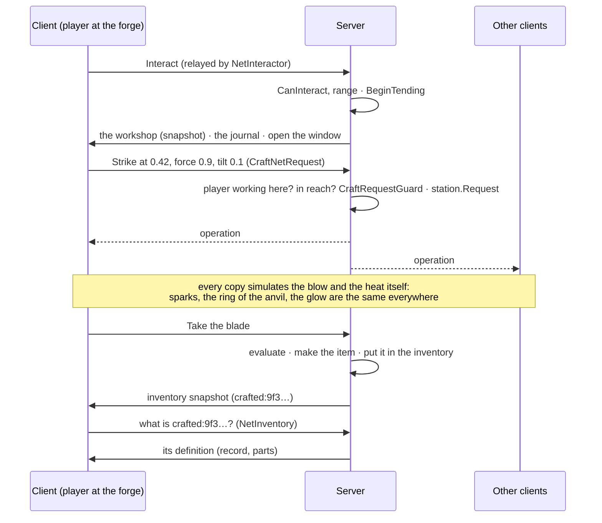

# 08 — Multiplayer

In a network session (Fish-Net, see [Networking](../Networking/README.md)) crafting is **server-authoritative**: the
server runs every workshop and alchemy preparation, takes the materials, evaluates what was made, gives the items and
keeps each player's journal. A client only shows what the server says and sends what its player does. Whatever a
player makes - a sword, a breastplate, a half-forged blade, a tanned hide, a potion - other players see it in their
hands, worn, lying on the ground and in trades.

## Setting it up

| What | How |
|---|---|
| A crafting station | It needs a NetworkObject and a `NetCraftStation` on its root. *Create Smithy / Smeltery / … / Test Station* add both when Fish-Net is in the project; on an existing station press **Make Networked** in its inspector (or *Network ▸ Make Selected Prefab Networked ▸ Crafting Station* for a prefab). |
| An alchemy station | The same with `NetAlchemyStation` (inspector **Make Networked**, *Create Alchemy Station*, or *… ▸ Alchemy Station* for a prefab). |
| Players | Nothing new: the player prefab's `NetInventory` and `NetInteractor` (from *Make Selected Prefab Networked ▸ Player*) carry everything. |
| Items | Stock and potion assets go in the Item Database as usual (*Build Item Database*). Items made at runtime need nothing (below). |

A station **without** its network component still works for the host's own player, but a client's player is told the
station is not set up for multiplayer; a client never runs a station on its own.

## Who decides what

* **The workshop runs on the server.** Clients keep a copy that follows it: the simulation is deterministic, so the
  server sends only the operations players make (numbered) and its clock - 10 times a second while someone works
  there or a fire burns, twice a second otherwise - and every copy simulates the rest. A checksum now and then checks
  that a copy still shows the same thing; a copy that differs (or joins late, or misses a packet, or falls more than
  5 minutes behind after a test station's *Wait*) gets the whole workshop again. Payloads are compressed and cut into
  parts, so a workshop of any size fits.
* **One player at a time** works a station (the server keeps who; the others see "Someone is working here"). The
  server ends the visit when that player walks away, dies or leaves.
* **Requests** are what the minigames measured: a blow's position, force and tilt; seconds on the wheel; strokes on the
  stone; a pour's steadiness. The server checks each one: the player is the one working here, within reach, alive, and
  a `CraftRequestGuard` bounds what it claims:
  * **real time** - blows of the hammer, pumps of the bellows, seconds of grinding, filing, brushing and polishing,
    seconds of rinsing, whetstone strokes, stitches and punches, the samples of a drawn path, pours and cuts all come
    from allowances that refill in real time (a client claiming a minute of grinding at once grinds for the seconds
    that really passed);
  * **the hammer** must be raised to strike hard: a blow's force is held to what the time since the last one charges;
  * **the hands** are never steadier than the player's practice (their journal on the server) allows: whetstone
    wobble, pour steadiness, the timing of stitches have a floor; blows whose tilt never trembles are noticed over a
    dozen strikes, and from then on the server adds the hands' tremble itself;
  * **shape** - ids, paths and numbers are checked (short ids, finite numbers, bounded counts).
  Honest players never meet these limits. Alchemy has the same with an `AlchemyRequestGuard` (stirring, the bellows,
  filters, and grinding in the mortar take real time).
* **Materials and items** only change on the server: the inventory the client sees is the server's
  (`NetInventory`), so a client cannot invent stock or keep what it put on the anvil.
* **The journal** lives with the character on the server (`persistentDataPath/Crafting/Journal/<character>.json`
  there) and is sent to the player while they work a station; a client never reads or writes its own copy, so it
  cannot teach itself metals, heat colours or insights.

## Items made at runtime

| Id | What | Where it comes from |
|---|---|---|
| `crafted:<id>` | a finished weapon, tool, shield or piece of armour | made and saved on the server; clients ask for its definition (the record: numbers, maker, quality, parts) |
| `craftpiece:<id>` | a worked piece (an unfinished assembly carries its parts) | the same |
| `craftstock:<kind>:<id>` | runtime stock (a test station's free bars, ores, hides…) | every machine makes it from the rules |
| `potion:<outcome>#<tier>#<colour>`, `ingredient:<preset>` | alchemy bottles and ingredients without an asset | every machine makes it from the rules |

When a client meets an id it does not know - in its inventory, on another player, on the ground, in a trade window -
`ItemDatabase.Item` raises `RuntimeItemMissing`; the player's `NetInventory` asks the server, which answers with the
definition (`IRuntimeItemSource.Export`); the client builds the item (`Import`, never saved on the client) and
`RuntimeItemDefined` makes the inventory, the other players' equipment, world items and the trade window show it.
If the item changes on the server (it was tried), the clients that have it get the new definition.

Runtime items are given a **model** built from what they are (`CraftModels`): a bar or a blade from its segments -
length, width, thickness, bevels, bend - a hide or a strap from its cells, a weapon from its parts in place (pommel,
grip, guard, blade; a head on its haft). It is used on the ground and, for crafted weapons whose design template has
no model of its own, in the hand. A template's own model and visuals always win.

## Limits

* The journal is kept by **character name** on the server, like the alchemy journal: two characters with the same name
  share it. Runtime items are kept by their id (`persistentDataPath/Crafting/Items` on the server).
* Results show a round trip after the action (the server decides); the minigames themselves are local and immediate.
* A client cannot work a station while it is not connected to the server that runs it.
