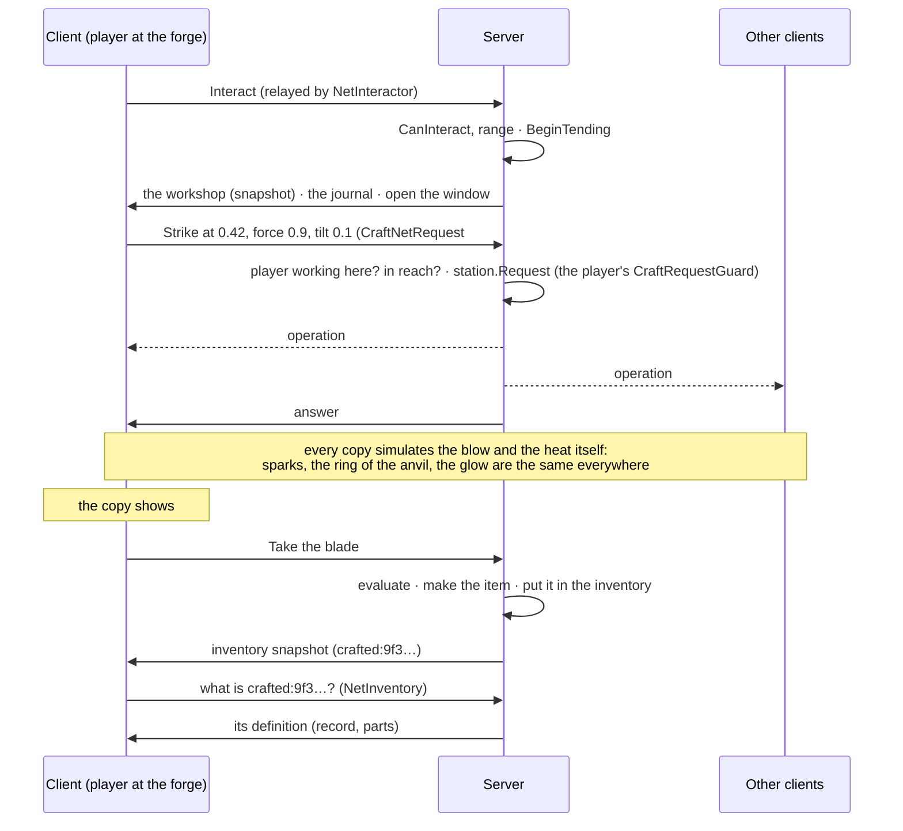

# 08 — Multiplayer

In a network session (Fish-Net, see [Networking](../Networking/README.md)) crafting is **server-authoritative**: the
server runs every workshop and alchemy preparation, takes the materials, evaluates what was made, gives the items and
keeps each player's journal. A client only shows what the server says and sends what its player does. Whatever a
player makes - a sword, a breastplate, a half-forged blade, a tanned hide, a potion - other players see it in their
hands, worn, lying on the ground and in trades.

## Setting it up

| What | How |
|---|---|
| A crafting station | It needs a NetworkObject and a `NetCraftStation` on its root. *Create Smithy / Smeltery / … / Test Station* add both when Fish-Net is in the project; on an existing station press **Make Networked** in its inspector (or *Network ▸ Make Selected Prefab Networked ▸ Crafting Station* for a prefab). |
| An alchemy station | The same with `NetAlchemyStation` (inspector **Make Networked**, *Create Alchemy Station*, or *… ▸ Alchemy Station* for a prefab). |
| An ore seam | An `OreDeposit` needs a NetworkObject and a `NetInteractable` (*Make Selected Prefab Networked ▸ Interactable*, or both on it in its scene): the server breaks the lumps off and every player sees the seam worked out, its loose stones gathered and grown back. Without them the server still breaks the lumps off when a client gathers there, but the client keeps showing the seam as it was (the console says so once). |
| Players | Nothing new: the player prefab's `NetInventory` and `NetInteractor` (from *Make Selected Prefab Networked ▸ Player*) carry everything. |
| Items | Stock and potion assets go in the Item Database as usual (*Build Item Database*). Items made at runtime need nothing (below). |

A station **without** its network component still works for the host's own player, but a client's player is told the
station is not set up for multiplayer; a client never runs a station on its own.

## Who decides what

* **The workshop runs on the server.** Clients keep a copy that follows it: the simulation is deterministic, so the
  server sends only the operations players make (numbered) and its clock - 10 times a second while someone works
  there or a fire burns, twice a second otherwise - and every copy simulates the rest. A checksum now and then checks
  that a copy still shows the same thing; a copy that differs (or joins late, or misses a packet, or falls more than
  5 minutes behind after a test station's *Wait*) gets the whole workshop again. Payloads are compressed and cut into
  parts, so a workshop of any size fits.
* **One player at a time** works a station (the server keeps who; the others see "Someone is working here"). The
  server ends the visit when that player walks away, dies or leaves.
* **Requests** are what the minigames measured: a blow's position, force and tilt; seconds on the wheel; strokes on the
  stone; a pour's steadiness. The window and the 3D work places measure strokes the same way for every player
  (`CraftStroke`: a pass is a real stroke, never more than three a second), so a host and a client count the same
  strokes. The server checks a client's: the player is the one working here, within reach, alive. Then the station runs
  it - and **every** request, a client's, the host's own player's or an offline player's alike, is first bounded by that
  player's `CraftRequestGuard` (one per player, kept by the station for the session), so the same hands give the same
  result everywhere. A **test station** checks nobody's hands: its quick buttons send whole bundles of work at once -
  but a player on another machine sends no more than twenty requests a second there either, and every request's shape
  (below) is checked at every station.
  * **real time** - every kind of work has its own allowance, refilling in real time: blows of the hammer (rivets,
    peening and wedges are blows too), pumps of the bellows, seconds of grinding, filing, brushing and polishing
    (times the stretches of the piece they work: the tool is on one place at a time), seconds of rinsing and brushing ore, scrubbing a rough stone, passes on the whetstone, card and comb strokes,
    stitches and pushes, beats of the reed, hits on the faceting bar, seconds on the jeweller's buffing wheel, strokes
    of the sandpaper, the samples of a drawn path, pours, and cuts one at a time (a pattern cut out, the anvil's cut, a
    fold or a weld begun, a sawn end, a board ripped to its taper, a split with the maul, a riving, a bend, a scouring
    bath, a stone sawn). Each is sized to the largest single request honest hands send - a whole weave of 30 rows, a
    tier of facets (charged the hits the hands made on the bar, three to six by the player's rank in the rules' own
    settings - for the tier's own facets, `CraftWorkshop.TierFacets`, whatever count the request claims), a run of stitches (the needle's pierce and pull are half a stitch each - its pull that pierces as it
    draws, one request, a whole one), a brisk scrub of an ore stone
    (up to a stone and a half a second), a sanding stroke in the window's own measure. The loom's and the scouring
    bath's (a fleece's soak: a minute a second) fill from the moment the player starts working here, so the rows beaten
    and the minutes soaked before the first request count;
  * **all or nothing** - work that comes as one bundle (a weave, a tier of facets, a blow) is granted whole or refused,
    and a refusal uses up nothing, so the next try is not held back by it; work that adds up (seconds on the wheel,
    strokes, stitches, the samples of a stroke) gets what is left, and the answer says what counted (*"Too fast: 4 of
    those 6 strokes counted."*); counts are capped (50 a request). Work the guard let through that the station then
    refuses (no yarn for that row, a mould already full, a tier the lapidary would not cut) is given back - what it took
    of the allowances, and the hammer's rise (`CraftRequestGuard.Refund`) - so the retry is not held back either; the
    request still counts in the pace of twenty a second;
  * **the hammer** must be raised to strike hard: a blow's force is held to what the time since the last one charges,
    and to what the arm has left - the guard tires and rests its own model of the player's arm with the blows it lets
    through, so nobody keeps striking full blows with a spent arm;
  * **the hands** are never steadier than the player's practice (their journal where the rules run) allows - their
    practice in the craft of that request (a master smith's hands are a novice's at the loom; sawing, coating or
    brushing wood is woodwork, a pour from the furnace smithing like one from the crucible): whetstone wobble, pour
    steadiness, the timing of stitches, the index of a facet, a seam's gap have a floor (`CraftRequestGuard.FloorOf`, for
    a window that shows what the hands will do). The guard only clamps: it adds no tremble to what honest hands did.
    Blows whose tilt never trembles are noticed over a dozen strikes, and from then on the guard adds the hands' tremble
    itself - to the blows, the cleaving chisel, the faceting quill and the seat burr;
  * **practice** is where the rules run: a client only names its tool (a stitching request's needle or pricking iron)
    and the server multiplies the run of stitches, holes or woven rows from the journal it keeps; work done **by
    routine** comes one at a time and only for known routines, and the server refuses it below the rank it needs and
    does it at the quality the player's practice gives; experience is added on the server, so a client cannot practise
    itself into a master. The full pace of the hands in 3D (`d` = 1 on a request) counts only while the station knows
    the player is at a 3D work place (`CraftRequestKind.HandsOn`, sent when a tool is taken up and put down), and only
    for the work of that place (`CraftStation.WorkingByHand(player, kind)`: at the wheel the grinding goes at the full
    pace, a blow sent meanwhile at the window's);
  * **the later crafts** the same way: drawknife strokes, a split with the maul (from the arm), picking, teasing,
    carding and combing strokes, one bobbin at a time at the wheel (30 g of fibre a bobbin), the loupe's looks as a drawn
    path, a chisel blow on a gem, the hits of a tier, the burr, the mandrel and the tape never steadier than practice; a
    knife, a sleeker or an oiling pad pressed no harder than fully;
  * **only at a test station** - stopping the station's clock (*Suspend*, *Resume*) and throwing a piece away (*Scrap*)
    are refused everywhere else, but for one thing: an item nothing has gone into yet (nothing fitted, added, worked or
    buffed: a design started by mistake) may be given up at any station, one at a time (its measurement waits again for
    the next item started). A cut of wood in one go (*Split*) is a test station's quick bench alone too: at a real
    station wood is sawn stroke by stroke, so its ends get their roughness from the saw's wander, a client's or not;
  * **shape** - at every station, a test station too: ids and numbers are checked (a kind and a place that exist,
    short ids, finite numbers, bounded counts, a list of at most 1024 numbers), and each kind checks its own list: x,y
    pairs for a stroke over the hide and the wheel's touches, three numbers a look through the loupe, one a segment for
    a clay coat, a sector for cleaning a rough stone, a region for polishing one, a beat for each row woven (a weave
    without them is refused). A stroke longer than a request carries keeps its first part (the station cuts it before a
    client sends it, and says so).
  Every refusal says why in a few words of the workshop (*"Too fast: the hammer has not come up yet."*,
  *"Too many strokes too fast: give the arm a moment."*), and so does every request granted only in part. Honest players
  never meet these limits: the window and the 3D work places pace themselves to them (the hammer comes up again 0.42 s
  after a blow; the bellows send five pumps a second at most, a quicker pump's air going with the next). A setting is
  held to what its control can be set to (the oven to its dial: off, or 100-650 °C). Alchemy has the same with an `AlchemyRequestGuard` (stirring, the bellows, filters, and
  grinding in the mortar take real time).
* **Materials and items** only change on the server: the inventory the client sees is the server's
  (`NetInventory`), so a client cannot invent stock or keep what it put on the anvil. **Take** is refused (with the
  reason) for a piece inside a working place - the furnace, the quench tank, the oven, the ashes, a vat, the steam box:
  it is taken out first, so a quench is always lifted out (and learnt from) before the blade goes into the bag. The
  window reads that (and the heat) from the workshop - a client's copy too - before it sends anything, so a Take that
  would be refused leaves the work in hand on the piece as it is.
* **Answers** - the window sends what the hands did with `CraftStationUI.Send(request, answered)`, and the work areas
  word what happened from `answered` (ok, reason). Offline and on the host it is called at once. On a client the request
  carries a number (`CraftRequest.seq`, `CraftNetRequest.seq`) and the server answers every one - done or not, and why,
  also when it never reached the station (malformed, not the player working here, out of reach, refused by the guard) -
  with the numbers of the operations it made, right after the packet that carries them (the same reliable channel, in
  order). The client raises the answer (`CraftStation.Answered`) only once its copy of the workshop has applied those
  operations (or a snapshot past them), so whatever the area reads in `answered` is the result; the events those
  operations raised on the copy come with it (`CraftStationUI.AnswerEvents`: the ring of that blow, not the others'). An
  answer that does not come within 10 seconds, or before the window closes, is answered *"No answer from the station."*
  - the outcome is then unknown, not refused (the server may well have done the work), so the work it carried is not
  kept for another try. A setting the hand turns (the forge's or the furnace's air vent, a vat's fire, the oven, the
  drying stack's cover) is answered at once: only its latest value goes, at most ten times a second
  (`CraftSettingQueue`), and the last one before the player stops working here - offline and on the host too, so a
  slider dragged never uses up the pace of requests the guard keeps for the work. A refusal's reason, and the note on
  work granted only in part, show in the window's message line and stay, dimmed, in *What happened*. The 3D work places
  send their requests and take their answers the same way - numbered on a client in a range of their own, answered once
  the copy shows what they did - and their answers come to the line over the bottom of the screen (and into *What
  happened*); only a setting turned there (the air vent) goes unnumbered, with the other settings. What the hands do
  next goes after what they did, in turn: a piece lifted out of the quench tank is out for the hand from the moment it
  is lifted, so a press before the copy shows it out plunges it again (after the lift). A request with no number (a setting) is answered, when
  refused, with a message - the same words again only after a moment (`CraftStation.RepeatInterval`). The window's arm
  is the player's own for the session (closing and reopening the window does not rest it), as the guard's model of the
  arm is. A test station's *Clear all* is offered only where the rules run (offline or on the host): a client's copy of
  the workshop cannot be cleared.
* **The journal** lives with the character on the server (`persistentDataPath/Crafting/Journal/<character>.json`
  there) and is sent to the player, compact, when they start working a station and then only when something in it
  changed (at most once a second); a client never reads or writes its own copy, so it cannot teach itself metals, heat
  colours, insights or practice. What the player learns there - a new rank and what it unlocks, an insight, a metal
  recognised - goes to their window whole as it happens, after the answer of the work that taught it, and shows and
  stays in *What happened* as it does offline. An item is noted as made in its maker's journal (the player who finished
  it, by character name) when anyone tries it - the maker's journal on the server, wherever they are in the session;
  one not in it when it is tried on the bench has it noted when they take the item.
* **Coming and going** - opening the window tells the server the player works here; closing it tells it they stopped, at
  once however quickly (a quick open and close never leaves the station taken). A player who leaves the session takes
  their guard with them: whoever comes next starts with their own. So do their open pots: the oil, wax or finish a
  player opened at a station (one pot a player and a supply, shared by the tannery and the finishing bench) is theirs
  alone.

## Items made at runtime

| Id | What | Where it comes from |
|---|---|---|
| `crafted:<id>` | a finished weapon, tool, shield or piece of armour | made and saved on the server; clients ask for its definition (the record: numbers, maker, quality, parts) |
| `craftpiece:<id>` | a worked piece (an unfinished assembly carries its parts) | the same |
| `craftstock:<kind>:<id>` | runtime stock (a test station's free bars, ores, hides…) | every machine makes it from the rules |
| `potion:<outcome>#<tier>#<colour>`, `ingredient:<preset>` | alchemy bottles and ingredients without an asset | every machine makes it from the rules |

When a client meets an id it does not know - in its inventory, on another player, on the ground, in a trade window -
`ItemDatabase.Item` raises `RuntimeItemMissing`; the player's `NetInventory` asks the server, which answers with the
definition (`IRuntimeItemSource.Export`); the client builds the item (`Import`, never saved on the client) and
`RuntimeItemDefined` makes the inventory, the other players' equipment, world items and the trade window show it.
If the item changes on the server (it was tried), the clients that have it get the new definition.

Runtime items are given a **model** built from what they are (`CraftModels`): a bar or a blade from its segments -
length, width, thickness, bevels, bend - a hide or a strap from its cells, a weapon from its parts in place (pommel,
grip, guard, blade; a head on its haft). It is used on the ground and, for crafted weapons whose design template has
no model of its own, in the hand. A template's own model and visuals always win.

## Limits

* The journal is kept by **character name** on the server, like the alchemy journal: two characters with the same name
  share it (and an item's maker is named the same way). Runtime items are kept by their id
  (`persistentDataPath/Crafting/Items` on the server).
* Results show a round trip after the action (the server decides, and the window words them when the answer comes); the
  minigames themselves are local and immediate.
* A client cannot work a station while it is not connected to the server that runs it.
