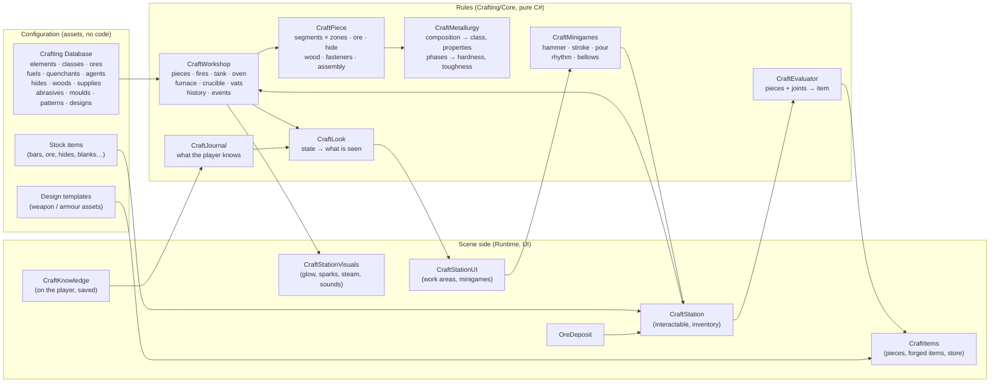

# Smithing, Metallurgy and Leatherworking

**Scripts:** `Crafting/Core/*` (the rules: no MonoBehaviour), `Crafting/Items/*` (stock, worked-piece and crafted item
types), `Crafting/Runtime/*` (the station, ore deposits, the player's journal, visuals, generated art, the item factory),
`Crafting/UI/*` (the station window and its hands-on work areas), `CustomEditor/Crafting/*` (menus, inspectors, Edit
Mode tests).

A physical, experimentation-based crafting system. There are no recipes, no progress bars and no "craft" button:
players break ore out of a seam, crush, wash and sieve it, smelt it in a bloomery under charcoal and bellows, hammer
the bloom at welding heat until its slag runs out, melt metals together in a crucible and pour them, heat bars in a
forge whose fire they feed and blow, forge them on the anvil blow by blow, quench them in water, oil or brine, temper
them in an oven, grind bevels on a wheel, sharpen them stroke by stroke on whetstones, flesh and lime and tan hides in
vats, stretch, dry, stake, oil and dye them, cut patterns out of them, and put the parts together — fitting, peening,
wedging, riveting, punching and stitching by hand. Every piece carries its own state (shape segment by segment, heat,
phases, hardness, grain, stresses, scale, cracks, the leather's tannage cell by cell…) and its history; what an item
becomes, and how good it is, follows from that alone.

Two kinds of station:

* a **normal station** — what players use: only what can be seen, heard and felt (heat as colours, sparks, the ring of
  a cold blow, the glint of a dull edge), plus whatever instruments that station has (a pyrometer, calipers, a balance,
  a loupe, a magnet, a test file, an assay kit, a streak plate);
* a **test station** — for designing content and checking the rules: every tool and instrument, free supplies of every
  material, the numbers behind everything (temperatures, phases, hardness by region, composition, the evaluation),
  time can be skipped and items come out already tried.

The built-in content: 16 elements (iron, carbon, copper, tin, zinc, lead, silver, gold, nickel… and mythril, starmetal,
orichalcum), 36 material classes decided by composition, 13 ores, 4 fuels, 5 quenchants, 7 vat agents, 7 hides, 6
woods, 19 supplies, 16 abrasives, 15 moulds, 10 leather patterns and 18 designs (dagger, arming sword, greatsword,
battle axe, spear, mace, pickaxe, hatchet, leather cap, jerkin, studded armour, plated bracers, plated gloves, boots,
plate helm, breastplate, belt, round shield).

| Chapter | What it covers |
|---|---|
| [01 — Overview and Setup](01-Overview-and-Setup.md) | Two-minute setup, normal and test stations, the station settings, a walkthrough from ore to a finished weapon, the window and its work areas |
| [02 — Simulation Rules](02-Simulation-Rules.md) | Pieces and segments, heat, the fire, phases and transformations, quenching and tempering, forging, surface work and sharpening, ores and smelting, crucible and casting, leather, assembly, evaluation, reproducibility and saving |
| [03 — Authoring Content](03-Authoring-Content.md) | Elements, alloy effects, material classes, ores, fuels, quenchants, agents, hides, woods, supplies, abrasives, moulds, patterns, designs and templates — all data, no code |
| [04 — Discovery and the Journal](04-Discovery-and-Journal.md) | What players know and how they learn it; instruments; insights; final inspection |
| [05 — The Default Content](05-Default-Content.md) | **Spoilers**: every built-in element, class, ore, material and design, with measured example procedures |
| [06 — Scripting and Extending](06-Scripting-and-Extending.md) | `CraftWorkshop`, `CraftStation` requests, the items, events, the hand-skill models, saving, the networking parts |
| [07 — Editor Tools and Testing](07-Editor-Tools-and-Testing.md) | Menus, inspectors, the Edit Mode tests |
| [08 — Multiplayer](08-Multiplayer.md) | Server-authoritative stations, clients following the server's workshop, the bounds on requests, crafted items seen by everyone (in hand, worn, dropped, traded) |

