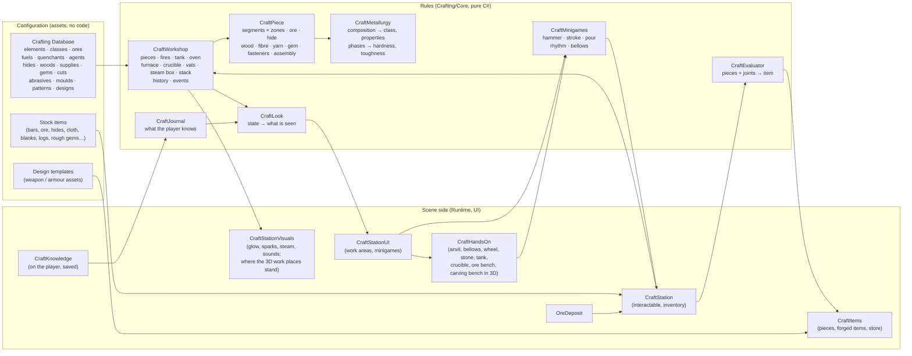

# Smithing, Metallurgy, Leather, Wood, Cloth, Gems and Jewellery

**Scripts:** `Crafting/Core/*` (the rules: no MonoBehaviour), `Crafting/Items/*` (stock, worked-piece and crafted item
types), `Crafting/Runtime/*` (the station, ore deposits, the player's journal, visuals, generated art, the item factory,
the 3D work places), `Crafting/UI/*` (the station window and its hands-on work areas), `CustomEditor/Crafting/*` (menus,
inspectors, Edit Mode tests).

A physical, experimentation-based crafting system. There are no recipes, no progress bars and no "craft" button:
players break ore out of a seam, crush, brush, wash and sieve it, smelt it in a bloomery under charcoal and bellows,
hammer the bloom at welding heat until its slag runs out, melt metals together in a crucible and pour them, heat bars in
a forge whose fire they feed and blow, forge and weld them on the anvil blow by blow, quench them in water, brine, oil or
a fantastic quenchant, temper them in an oven, grind bevels on a wheel, sharpen them stroke by stroke on whetstones;
flesh and lime and tan hides in vats, stretch, dry, stake, oil and dye them and cut patterns out of them; debark, split,
rive, saw, steam and bend, season and finish wood, and carve it; pick, scour, card and spin fibre, ply and weave it,
measure the wearer, lay out, cut and sew cloth; clean, test, name, saw, grind, facet and polish rough stones, and form,
solder and set jewellery - and put the parts together, fitting, peening, wedging, riveting, punching, stitching and
wrapping by hand. Every piece carries its own state (shape segment by segment, heat, phases, hardness, grain, stresses,
scale, cracks, the leather's tannage cell by cell, the wood's moisture, the yarn's twist, the stone's facets…) and its
history; what an item becomes, and how good it is, follows from that alone. Eight of the work areas can also be worked by
hand at a 3D work place (the anvil, the bellows, the wheel, the whetstone, the quench tank, the crucible, the ore bench,
the carving bench).

Two kinds of station:

* a **normal station** — what players use: only what can be seen, heard and felt (heat as colours, sparks, the ring of
  a cold blow, the glint of a dull edge), plus whatever instruments that station has (a pyrometer, calipers, a balance,
  a loupe, a magnet, a test file, an assay kit, a streak plate, a refractometer, hardness points, a dichroscope, a
  moisture meter);
* a **test station** — for designing content and checking the rules: every tool and instrument, free supplies of every
  material, the numbers behind everything (temperatures, phases, hardness by region, composition, the evaluation),
  time can be skipped and items come out already tried.

The built-in content: 16 elements (iron, carbon, copper, tin, zinc, lead, silver, gold, nickel… and mythril, starmetal,
orichalcum), 67 alloy effects, 35 material classes decided by composition, 14 ores, 4 fuels, 5 quenchants, 7 vat agents,
16 hides and cloths (9 hides, 7 cloths), 11 woods, 52 supplies (fluxes, a cupel, threads and yarns, paddings, oils, a
wax, dyes, clay, varnishes, polishing compounds, solders, scouring agents, fibres), 16 abrasives, 15 stock moulds (and
one in the shape of each of the designs' 65 castable metal parts), 31 patterns, 16 gems, 6 cuts and 91 designs: 29
weapons (daggers, swords, axes, maces and hammers, spears and polearms, thrown weapons, bows, a staff, a club, a
cestus), 5 tools (pickaxe, hatchet, sickle, scythe, felling axe), 43 pieces of armour and clothing (plate, leather,
padded, cloth), 4 shields and 10 pieces of jewellery (rings, a pendant, a necklace, an amulet, a circlet, a bracelet, a
brooch, a charm).

| Chapter | What it covers |
|---|---|
| [01 — Overview and Setup](01-Overview-and-Setup.md) | Two-minute setup, normal and test stations, the station settings, a walkthrough from ore to a finished tool, the window and its work areas, working by hand in 3D, the tired arm |
| [02 — Simulation Rules](02-Simulation-Rules.md) | Pieces and segments, heat, the fire, phases and transformations, quenching and tempering, forging and welding, surface work and sharpening, ores and smelting, crucible and casting, leather, carving and the woodshop, the tailor's, fibre and yarn, the timing bar, gems, jewellery, assembly, evaluation, practice, reproducibility and saving |
| [03 — Authoring Content](03-Authoring-Content.md) | Elements, alloy effects, material classes, ores, fuels, quenchants, agents, hides and cloths, woods, supplies, gems and cuts, abrasives, moulds, patterns, designs and templates, the simulation settings — all data, no code |
| [04 — Discovery and the Journal](04-Discovery-and-Journal.md) | What players know and how they learn it; instruments; insights; practice and mastery, craft by craft; final inspection |
| [05 — The Default Content](05-Default-Content.md) | **Spoilers**: every built-in element, class, ore, material, gem, cut and design, with measured example procedures |
| [06 — Scripting and Extending](06-Scripting-and-Extending.md) | `CraftWorkshop`, `CraftStation` requests and their answers, the guard, the guide, the items, events, the hand-skill models, practice, the 3D work places, saving, the networking parts, the conventions of a new work area |
| [07 — Editor Tools and Testing](07-Editor-Tools-and-Testing.md) | Menus, inspectors, validating a database, the Edit Mode tests |
| [08 — Multiplayer](08-Multiplayer.md) | Server-authoritative stations, clients following the server's workshop, the bounds on requests, crafted items seen by everyone (in hand, worn, dropped, traded) |

