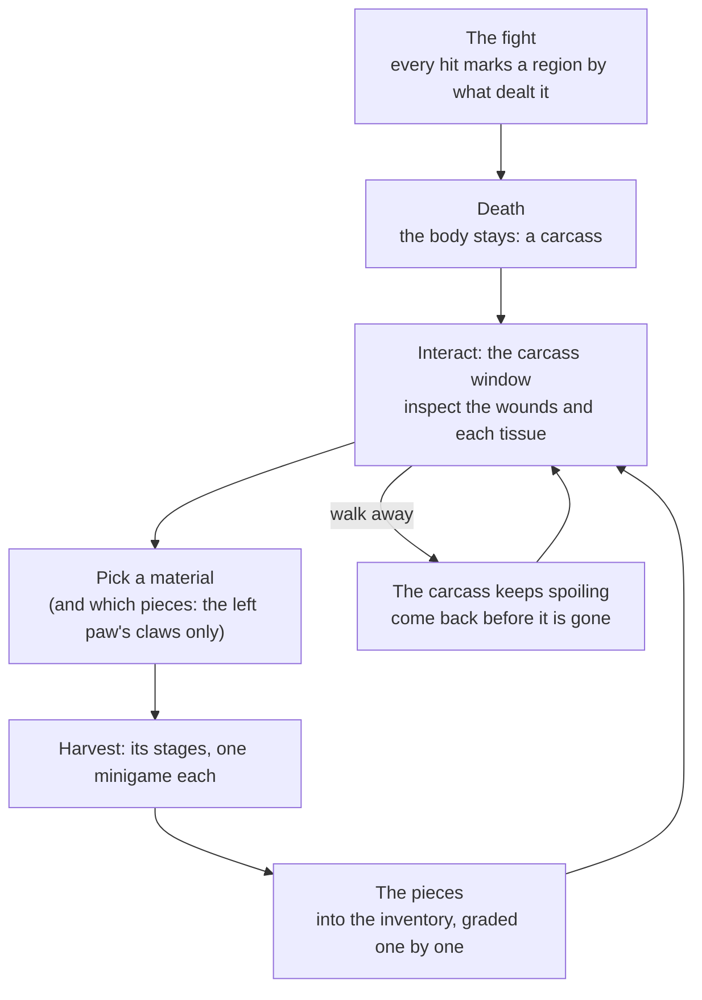

# 01 — Overview and Setup

## Two-minute setup

Nothing is required: with no setup at all, the twelve built-in creatures are used and any mob whose type or name
matches one of them (a mob of type *Bear*, a mob called *Grey Wolf*) becomes harvestable by itself.

1. **The rules (optional).** *Tools ▸ SimpleMovements ▸ Harvesting ▸ Create Harvest Database* creates
   `Resources/SimpleMovements/Settings/HarvestDatabase.asset` with the default rules. Edit it to tune the system (see
   [05 — Authoring Creatures](05-Authoring-Creatures.md#the-harvest-database)).
2. **Your mobs.** Either rely on **Auto Attach** (on by default: a mob whose Mob Profile, type or name matches a
   creature's *Mob Types* gets a Harvestable Creature when it wakes), or select mob prefabs (or mobs in the scene) and
   use *Harvesting ▸ Make Selected Mob Harvestable*: it adds a **Harvestable Creature** next to the Mob Status
   Controller, and a **NetCarcass** when the prefab is a network object, then tells you which creature it found. A mob
   that matches nothing needs an *Anatomy Id* (a popup lists the database's creatures) or its own Creature Anatomy.
3. **Tools.** *Harvesting ▸ Create Tools* makes eight harvesting tools with icons (skinning knife, butcher's knife,
   cleaver, hunting knife, lancet, bone saw, fleshing scraper, pliers) in `Items/Harvesting/Tools`. Give some to the
   player — starting items, a merchant, loot. Without them the player works with whatever blades they carry, or bare
   hands (which can only pull and pry: a hide cannot be opened without a blade).
4. **Try it.** *Harvesting ▸ Create Practice Carcass ▸ Bear* (or a wolf, a deer, a drake, a troll, an eagle, a salmon, a
   giant serpent, a giant spider) puts a body built from primitives at the Scene view's pivot: a carcass from the start,
   with a couple of wounds, that is laid out fresh each time it is emptied. Press Play, walk up to it and press
   **Interact** at it (the prompt offers to *Harvest* the *Bear carcass*).

Optional extras: *Harvesting ▸ Create Creature Anatomy Assets* (editable copies of the built-in creatures),
*Harvesting ▸ Create Items* (an item asset with an icon for every material, to give them your own icons, models and
prices or use them in recipes and quests), *Harvesting ▸ Add Harvested Hides to the Crafting Database* (a Crafting
Database made before harvesting existed lacks the troll hide and the snakeskin).

## From the kill to the last piece



1. **The fight.** Where each hit lands and what dealt it is remembered: the body knows it was shot twice in the ribs,
   burned on the back and clubbed on the head. See [02 — The Fight and the Body](02-The-Fight-and-the-Body.md).
2. **Death.** The mob's body is not removed after its Destroy Delay: it stays as a carcass, with a trigger the
   interaction prompt finds (the colliders of a dead mob are off). It starts spoiling at once — faster in the heat,
   slower in the cold, not at all in frost (the Weather System's temperature where it lies).
3. **Inspecting.** Interact opens the carcass window. The body is drawn on the work surface, coloured by the condition
   of one tissue at a time (*Overall, Hide, Meat, Bone, Tendons, Organs*): green whole, yellow damaged, red ruined, grey
   where it has none. Weak points are ringed, every wound is marked with a cross (a plus past six), and soiled, poisoned
   or tainted flesh is tinted. Point at a part to read it; click it to pick what it gives (click again for the next
   thing it gives).
4. **Choosing.** The right column lists everything the body gives, grouped by how it is taken. Each row says whether it
   can be taken now, how the fight left it and how long it keeps. Players choose what matters to them: the pelt of a
   bear is worth far more than its meat — and the meat waits for the hide to come off anyway.
5. **The work.** *Harvest* starts the material's stages: each is a small game on the work surface (see
   [03 — The Work](03-The-Work.md)). *Stop* gives up (nothing is taken; the material is free again).
6. **The result** shows in the log on the left and in the message line: every piece, its grade and quality, its marks
   ("cracked in the fight", "nicked while skinning"), the experience gained and any level or technique learnt. The pieces
   go into the inventory; what does not fit is dropped by the carcass.
7. **Partial harvesting.** Take only the pelt and the claws and leave — the rest stays on the body, spoiling. Several
   players can work one carcass at once, each on a different material (a material being worked shows *someone is working
   on it*). A carcass is removed after *Carcass Minutes* (30 by default) without work — at least *Keep After Work* (5)
   minutes after the last harvest — or a few seconds after nothing worth taking is left on it.

## The carcass window

```
┌ Bear carcass ─────────────────────────────────────────────────── [Skills] [Close] ┐
│ Adult · 1.1× size · dead 4 min · 22 °C, spoiling · stays 26 min                    │
├──────────────────┬───────────────────────────────────────┬────────────────────────┤
│ What it is       │ Overall  Hide  Meat  Bone  Tendons  ..│ Skinning               │
│ 3 wounds         │        (the body, or the work)        │  [icon] Bear pelt  ▰▰▰ │
│ ■ Piercing wound │                                       │ Butchering             │
│   in the ribs    │                                       │  [icon] Bear haunch    │
│   (Iron arrow)   │                                       │   the hide must come…  │
│ ■ Blow in the    │                                       │ …                      │
│   head (Mace)    │                                       ├────────────────────────┤
│                  │ Ribs  weak point ×1.3                 │ Bear pelt · Hide ·     │
│ Log              │ Hide ▰▰▰▰▰▱▱▱ 62%  Meat ▰▰▰▰▰▰▰▱ 88% │ From the fight: fine   │
│ Bear pelt - Fine │ …                                     │ The work: 1. Open…     │
│ (78%) …          │                                       │ [Harvest bear pelt]    │
└──────────────────┴───────────────────────────────────────┴────────────────────────┘
```

* **Header** — what the creature was (age, size against a typical adult, *elite*), how long it has lain, the air
  temperature and how fast it spoils there, whether it was gutted, and how long it stays. **Skills** opens the player's
  skills: each skill's level and progress, its techniques (learnt ones ticked), the species they know and their last
  harvests.
* **Left** — the creature's description, its wounds (newest first: what, where, with what; with Anatomy's *Read the
  Body* technique, what each did inside: "the heart was pierced"), and the log of this carcass's harvests.
* **Middle** — the work surface. While nothing is worked: the body and the inspection layers, with the part under the
  pointer described below it (each tissue's condition as a bar, its marks, soiling, poison, burns). While a material is
  worked: the current stage, its title (*Stage 2 of 3 · Separate the hide*), the instruction, the tool used and how fit
  it is, what the gauges mean, and feedback as it happens ("A nick in the hide.", "Too hard: it is straining."). The arm in
  the top right empties as the arm tires (rest by letting go). **Accept** ends a scraping stage early, as it is;
  **Stop** gives up the work.
* **Right** — the materials, grouped by method, each with its icon, a count for countable ones (*3/5* claws left) and
  its state: ready (with a bar of how the fight left it and how long it keeps), *taken*, *destroyed in the fight*,
  *spoiled*, *the hide must come off first*, *someone is working on it*, *needs Skinning 15*, or *Something unusual* —
  a rare find the player's Anatomy is not good enough to identify. Below: the selected material's details — its kind,
  method and description, its condition from the fight and its marks, its freshness, the skill it trains (and the
  level it needs), its difficulty, its value once the species is known, and **the work**: every stage with the tool
  that will be used and how fit it is. For a countable material, toggles choose which parts its pieces are taken from
  (*All*, *L. Foreleg 5*, *R. Foreleg 5*…). **Harvest** starts it; **Hack the hide off** (shown while the hide still
  covers what the player wants) strips the hide roughly in one go: the meat, bones and tendons are free, the hide is
  ruined.

The window is an exclusive panel of the inventory (other panels close), frees the cursor, and closes when the player
walks away, dies, or the carcass is gone — the work in hand is lost.

## The Harvestable Creature component

*AddComponent ▸ SimpleMovements ▸ Harvesting ▸ Harvestable Creature*, next to the mob's Mob Status Controller (it is
asked whether to keep the body when the mob dies).

| Field | What it does |
|---|---|
| **Anatomy** | A Creature Anatomy asset. Empty: the database's creature named by *Anatomy Id*, else the one matching the mob (its Mob Profile, type or name). |
| **Anatomy Id** | A database creature by id (`bear`, `wolf`, `giant_spider`…): a popup of the database's creatures. |
| **Age** | *Random* (15% young, 65% adult, 16% old, 4% ancient), or fixed. Young: tender meat, small trophies, smaller yields; old and ancient: tougher meat, bigger horns and claws, more rare finds. |
| **Size Scale** | Size against the anatomy's typical adult (yields scale with it, steeply). 0 = from the mob's height against the anatomy's *Reference Height*. |
| **Rare Finds** | Multiplies the chance of its rare finds (a bezoar, a heartstone). |
| **Elite** | Finer materials and more rare finds. Automatic for dungeon champions, roamers and bosses. |
| **Carcass Minutes** | How long its carcass stays untouched (0 = the database's). |
| **Interaction Point** | Where the prompt shows and the range is measured from (empty = the middle of the body). |
| **Replaces Table Drops** | The Item Drop Manager's Mob / Elite / Boss tables drop nothing for it — its body is its loot (needs the database's *Skip Generic Mob Drops*). Its own *Item Drop On Death* and *Item Spawner* still drop. |
| **Practice Carcass** | A carcass from the start with no mob needed (practice, a hunter's camp, testing): it does not spoil away and is laid out fresh when emptied. **Practice Wounds**: how many wounds it comes with. |
| **Debug Log** | Logs every hit (where, what, how hard, what it did) and every harvest. |

The inspector shows what is wrong (no creature found, no body parts, a network object without a NetCarcass) and, in
Play mode, the live state: alive or a carcass, the age and size, the hits and wounds, how long it has lain, what was
taken, what is being worked — with **Open Carcass Window** (for the local player standing by it) and **Kill**.

Body parts: a mob made harvestable automatically gets a body-part profile made from its anatomy when it has none of its
own (*Add Body Parts*), so hits are located and weak points work. A mob with its own Body Part Controller keeps it; name
its parts in the anatomy's regions (*Body Parts*) so hits on them mark the right region.

## Loot and corpse removal

* **Loot.** A harvestable creature drops nothing from the Item Drop Manager's generic Mob tables (*Replaces Table
  Drops* + the database's *Skip Generic Mob Drops*): its body is the loot. Hand-placed drops — an *Item Drop On Death*
  table on the mob, its *Item Spawner* — still drop as before (a quest item in the bear's stomach is still a quest item).
* **Removal.** The Mob Status Controller asks the creature before removing the body: a creature with a carcass keeps
  it, and removes it itself when it is empty or left alone too long (network-despawned for everyone in a session).
* **Pooled mobs** that revive get a new, unmarked body.
* **In a network session** the body is kept, and the loot tables skipped, only when the mob has a **NetCarcass**
  (clients could not harvest it otherwise): without one the mob dies and drops as it always did.
