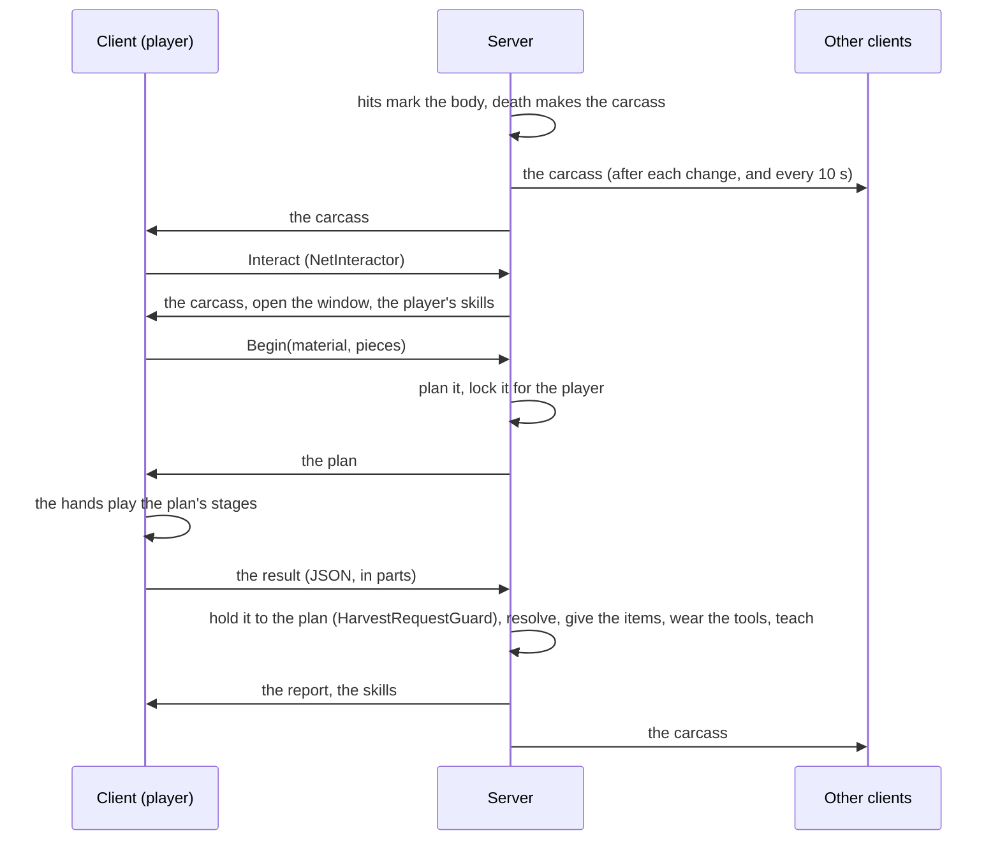

# 07 — Scripting, Editor Tools, Multiplayer and Tests

## Scripting

### The creature (`HarvestableCreature`)

| Member | |
|---|---|
| `Anatomy`, `Condition`, `Carcass`, `IsCarcass`, `IsPractice` | Its body: the anatomy, the state of its tissues (alive: what the fight did so far), the carcass once dead. |
| `MinutesLeft`, `CarcassMinutes`, `CarcassCentre` | How long the carcass stays; where it lies. |
| `Version`, `Changed` | Changes with every change of the carcass (a window redraws on it). |
| `Harvested` *(event)* | A harvest's report for a player on this machine (what the window shows). |
| `AnyHarvested` *(static event)* | Where the rules run (offline, the server): a harvest gave **any** player what the report says — hook quests, achievements and logs here. |
| `WorkerFor(player)`, `PlanFor(player, material, units)` | Who works and with what (skills, tools); the plan of a material's work. |
| `Begin`, `Cancel`, `CancelAll`, `Release(key)`, `Submit`, `StripHide` | The work, as the window drives it (on a network client they become requests to the server). |
| `Remove(delay)` | Removes the carcass (network-despawned in a session). |
| `RulesHere`, `Net` | Whether this machine runs the rules (offline or the server); the network side. |
| `All`, `FindFor(entity)`, `PlayerKey(player)` | Every harvestable creature; the database creature for a mob; how players are known in locks. |

```csharp
// A quest: bring back three wolf pelts of at least Good quality.
HarvestableCreature.AnyHarvested += (creature, player, report) =>
{
    if (creature.Anatomy.id != "wolf" || report.material != "pelt") return;
    foreach (HarvestReportPiece p in report.pieces)
        if (p.Grade >= HarvestGrade.Good) quests.Progress(player, "wolf_pelts", p.count);
};
```

### The rules (`Harvesting/Core`, plain C#)

The whole simulation runs without a scene — for your own UI, an AI that butchers, a simulation or a test:

```csharp
HarvestAnatomyData bear = HarvestDatabase.Instance.Anatomy("bear");
HarvestSettings rules = HarvestDatabase.Instance.Settings;
HarvestCondition body = HarvestCondition.Create(bear, seed: 42);                      // an unhurt adult
body.ApplyHit(bear, rules, new HarvestHit { region = bear.RegionIndex("ribs"), form = DamageForm.Pierce, severity = 0.4f, u = -1, v = -1 });
HarvestCarcass carcass = HarvestCarcass.From(bear, body);
carcass.Tick(rules, 600, 25f);                                                         // ten minutes in the heat

HarvestWorker worker = new HarvestWorker { settings = rules, skills = mySkills, tools = HarvestToolkit.For(player), player = 1 };
HarvestPlan plan = HarvestPlanner.Plan(bear, carcass, bear.MaterialIndex("pelt"), null, worker);
// Play it: one HarvestStageModel per stage (HarvestStageModel.Create(spec, hands)), fed with OnPointer(...) and Tick(dt);
// or build the HarvestTaskResult yourself.
HarvestOutcome outcome = HarvestResolver.Resolve(bear, rules, carcass, result, mySkills);
```

* `HarvestCondition` — a body: its regions' tissues, the pelt's cells, every countable piece, the wounds. `ApplyHit`,
  `Regenerate`, `HideIntegrity`.
* `HarvestCarcass` — a dead body over time: `Tick` (spoiling), `Freshness(material)`, `Availability(...)` (and why),
  `CombatIntegrity` and `CombatMarks` (what the fight left of a material), `Lock`/`Unlock`, what was taken, `IsEmpty`.
* `HarvestPlanner`, `HarvestStageModel` (`HarvestTraceModel`, `HarvestPeelModel`, `HarvestSteadyModel`, `HarvestPullModel`,
  `HarvestSawModel`, `HarvestPryModel`, `HarvestScrapeModel`), `HarvestResolver`, `HarvestRequestGuard`.
* `HarvestSkills` (levels, techniques, species, rare finds), `HarvestSkillData` (one player's), `HarvestTools`,
  `HarvestToolbox`.

### Items, skills, tools

* `HarvestItems.ItemFor(anatomy, material)` — the item of a material: the database's bound asset, else the item made at
  runtime with the id `harvest:<creature>/<material>` (every machine makes the same item from the same id; saves, the
  network and the Item Database resolve it). `HarvestItems.Codes(item, count, quality, marks)` — the per-copy values.
* `HarvestedItemInfo.QualityOf(stack)`, `HarvestItemCode.TryDecode(code, out quality, out marks)` — the quality and
  marks of the next copy of a stack.
* `HarvestKnowledge.For(player)` — a player's skills (`Data`, `Gain`, `Export`/`Import`, the `Learnt` event).
* `HarvestToolkit.For(player)` — the tools a player has right now; `HarvestToolkit.Wear(player, toolId)`.

## How it ties into the rest

| System | How |
|---|---|
| **Combat** | The creature intercepts every hit (`IDamageInterceptor`, to count the killing blow's overkill) and reads `DamageInfo`: form, element, body part, point, critical, area, periodic, weapon or ability. |
| **Body parts** | `BodyPartController` locates hits (now also along long bodies: a part's *Length Range*); harvestable mobs without body parts get a profile made from their anatomy (`HarvestBodyParts`). |
| **Mob death** | `MobStatusController` asks `IDeathRemovalHandler`s before removing a body: the creature keeps it. |
| **Loot** | The Item Drop Manager skips its Mob tables for an `IMobLootProvider` that replaces them. |
| **Inventory** | Pieces go in with one value per copy (`InventoryManager.AddItem(item, count, codes)`); what does not fit is dropped with its values. |
| **Merchants** | Harvested items are `IItemInstanceValue`s: merchants pay for each copy by its quality (`MerchantPricing`). |
| **Crafting** | A hide with a *Craft Hide* becomes a raw hide piece of the crafting system (`HarvestHides`), every cell as it came off — holes, burns, tears, nicks, flesh left on, rot — ready for the fleshing beam. |
| **Alchemy** | Materials with alchemy releases are `IAlchemyIngredient`s: organs, glands and fat go into vessels and give their substances. |
| **Food** | Edible materials are consumables (`HarvestedFoodSO`): one copy per bite, sating by quality; spoiled or poisoned ones hardly. |
| **Weather** | The carcass spoils at the Weather System's temperature where it lies. |
| **Experience** | A share of the harvesting experience goes to the character's `ExperienceManager`. |
| **Interaction** | The carcass is an `IInteractable` (verb *Harvest*); the window is an `IExclusivePanel` of the inventory. |

## Editor tools

*Tools ▸ SimpleMovements ▸ Harvesting*:

| Menu | |
|---|---|
| **Create Harvest Database** | The project's database (also *Project Setup ▸ Create Harvest Database (Resources)*). |
| **Make Selected Mob Harvestable** | A Harvestable Creature (and a NetCarcass for network prefabs) on the selected mobs or mob prefabs; says which creature each one is. |
| **Create Practice Carcass ▸ …** | A practice body of a bear, wolf, deer, drake, troll, eagle, salmon, giant serpent or giant spider at the Scene view's pivot. |
| **Create Creature Anatomy Assets** | Editable copies of the built-in creatures, registered in the database. |
| **Create Tools** | The eight harvesting tools, with drawn icons. |
| **Create Items** | An item asset (with its icon) for every material of every creature, bound in the database. |
| **Validate Harvest Database** | Logs every problem: each creature, the item bindings, the hides the tannery lacks, the substances alchemy does not know. |
| **Add Harvested Hides to the Crafting Database** | Adds the built-in hides the creatures give that the project's Crafting Database lacks. |
| **Help** | Opens this documentation. |

Inspectors: the **Harvest Database** (summary, problems, buttons for the assets above), a **Creature Anatomy** (*Start
From*, a drawing of the body by tissue, its weak points and materials, its problems), a **Harvestable Creature** (a
creature popup, its problems, the network hint, and in Play mode its live state with *Open Carcass Window* and *Kill*).
The **Project Validator** checks the database and offers to add missing hides to the Crafting Database; *Make Selected
Prefab Networked ▸ Mob* adds a NetCarcass to harvestable mobs, and the network prefab check reports one that has none.

## Multiplayer

With Fish-Net in the project, a harvestable mob needs a **NetCarcass** next to its Harvestable Creature (on its network
prefab) — *Make Selected Mob Harvestable* and *Make Selected Prefab Networked ▸ Mob* add it. A practice carcass in a
scene needs a NetworkObject and a NetCarcass too. Without one, in a session the mob dies and drops loot as before.



* **The server decides everything**: where hits landed, the carcass, every plan, every result, the items (into the
  player's server-side inventory, replicated as usual), the skills, the tools' wear. A client never adds an item or
  teaches itself anything.
* **Every client keeps a copy** of the carcass (sent after each change, at most every *Send Interval* — 0.25 s — and
  every 10 s to set its clock right; a client that starts watching the mob gets it at once). The copy spoils on its own
  between updates, so the window's timers run smoothly.
* **The plan comes from the server**, so the client plays exactly the work the server will check — the same stages, the
  same pieces, the same tools.
* **Bounds** on what a client sends: the player must be alive and by the carcass (the server's positions, plus *Range
  Tolerance*); rate limits (starting work 5 a second, stripping 1, asking for the carcass 1); ids of at most 64
  characters, at most 256 pieces, results of at most 256 KB in at most 8 parts; and the guard's checks (the planned
  stages and pieces, every measure 0-1, the server's tools, the hide's size, rushed work made rough).
* **Players who walk away, die or leave** free what they were working on (checked every second); their window closes.
* **Skills** are kept and saved by the server, which sends each player their own after every harvest.

## Tests

*Window ▸ General ▸ Test Runner ▸ Edit Mode*:

| Suite | What it checks |
|---|---|
| `HarvestingCoreTests` | The built-in content is valid; mob types match whole words; hits mark bodies by form and element (slashes cut hides and tendons, points reach organs, blunt blows break bones, fire burns hides and drakes shrug it off, poison spoils meat, explosions spread, gut shots soil); trolls regenerate unless burned; the hide comes first; spoiling with warmth; locks; the resolver (a perfect pelt, fight and harvest damage told apart, better hands, skill that does not do the work, stale organs and wrong tools, pieces graded one by one, bones cut out first ruin meat, fragile glands, gutting); levels; item values; rare finds; size and age. |
| `HarvestingMinigameTests` | Every built-in material can be planned, inside the work surface, the same way every time; skill and tools widen the margins; no blade, no cut; plans follow the chosen pieces; hidden finds are not drawn; each game played by scripted hands (careful hands do clean work; careless ones tear, spill, snap, splinter and crack); the server's check of a result; careful play is never taken for rushing. |
| `HarvestingNetworkTests` | The carcass reaches clients whole and keeps in step; the server's plan reaches the client and holds what it plays; both sides plan the same; results, reports and skills survive JSON. |
| `HarvestingRuntimeTests` | Every material is an item made from its id; pieces keep their quality and marks; skinned hides become tannery hides of the right size; body parts come from the anatomy and lead back to it; materials feed substances alchemy knows; each tool preset does best what it is made for. |

## Known limitations

* Harvested pieces keep the freshness they had when taken (*spoiling*, *spoiled*): they do not keep spoiling in the
  inventory.
* Like brewed potions, a stack's per-copy values do not survive a merchant's resale: copies bought back from a merchant
  carry no value and count as unknown quality (60%, *Good*). A player-to-player trade keeps them.
* The practice carcass's body and the generated icons are placeholders built from primitives: give creatures your own
  models (any mob is harvestable) and bind item assets with your own icons (*Create Items*).
