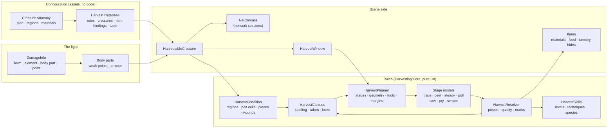

# Mob Looting, Butchering and Harvesting

**Scripts:** `Harvesting/Core/*` (the rules: no MonoBehaviour — anatomies, how hits mark a body, the carcass and its
spoiling, the planner and the seven minigame models, the resolver, skills, tools, the built-in creatures),
`Harvesting/Items/*` (harvested materials, food and harvesting tools), `Harvesting/Runtime/*` (the Harvestable Creature
component, the Harvest Database, Creature Anatomy assets, the player's skills, items made at runtime, hides for the
tannery, body parts from anatomies, generated icons), `Harvesting/UI/*` (the carcass window and its work surface),
`Networking/Runtime/Mobs/NetCarcass.cs` (multiplayer), `CustomEditor/Harvesting/*` (menus, inspectors, Edit Mode tests).

A creature killed in a fight does not drop a bag of loot: its **body stays**, exactly as the fight left it, and what it
gives is **harvested** — piece by piece, by hand, by players who choose what to take.

* **The fight marks the body.** Every hit is located on a region of the body (a weak point takes more damage) and marks
  it by what dealt it: a sword opens the hide and cuts the tendons, an arrow through the ribs ruins the heart, a mace
  cracks the skull and the teeth but leaves the pelt whole, fire burns the fur, poison spoils the meat, an explosion
  tears up everything. A careful hunter who kills cleanly gets better materials than one who hacks a bear to pieces.
* **Each material has its own work.** Skinning (open the hide along its lines, then peel it off), butchering (follow
  the seams between the muscles, trim the fat), drawing out tendons, sawing bones free and scraping them clean, lifting
  organs out without nicking the gut, working claws and teeth loose, sawing horns off — seven small hands-on games
  combined differently for every material, all played on one work surface, each with a gauge and a line of advice.
  Poor work tears the hide, leaves meat on the bone, snaps the sinew, splinters the bone, bursts the gall bladder.
* **Skills** — Skinning, Butchering, Anatomy, Bone Harvesting, Tendon Extraction, Organ Harvesting and Trophy
  Extraction — widen the margins, steady the hands, waste less, reveal rare finds and read the wounds. They never do the
  work for the player.
* **Tools** — skinning knives, butcher's knives, cleavers, lancets, bone saws, scrapers, pliers — each fit for some work,
  dulled by use; a dagger skins after a fashion, bare hands can only pull and pry.
* **Quality** follows from everything: the damage of the fight, the hands' work, how fresh the body still is (warm
  weather spoils it fast, frost stops it), the tools, the skills, the creature's age and rank (its size decides how much
  it gives). Every piece keeps its own quality and its own story ("Cracked in the fight", "Nicked while skinning") and is
  worth what it is.
* **Creatures are data.** A Creature Anatomy describes a body — its plan (four legs, two legs, wings, fins, a serpent's
  coils, a spider's shell), its regions and the materials it gives. Twelve are built in (bear, wolf, deer, boar, rabbit,
  sheep, drake, troll, eagle, salmon, giant spider, giant serpent); new ones reuse every mechanic.
* **It joins the rest of the game:** materials go into the inventory (or onto the ground when it is full), hides become
  hides for the crafting system's tannery with every hole where it was, organs and glands are alchemy ingredients, meat
  is food, merchants pay by quality, and the whole system runs server-authoritative in a network session.

| Chapter | What it covers |
|---|---|
| [01 — Overview and Setup](01-Overview-and-Setup.md) | Two-minute setup, the workflow from the kill to the last piece, the carcass window, the Harvestable Creature component, loot and corpse removal |
| [02 — The Fight and the Body](02-The-Fight-and-the-Body.md) | Regions and body parts, weak points and natural armour, how weapons, abilities and elements mark each tissue, severity, the wounds |
| [03 — The Work](03-The-Work.md) | The seven minigames (controls, gauges, what goes wrong), the work of every kind of material, the order of work, partial harvesting and coming back later |
| [04 — Skills, Tools and Quality](04-Skills-Tools-and-Quality.md) | The skills and their techniques, experience, species knowledge and rare finds, the tools, how quality and yields are worked out, spoiling |
| [05 — Authoring Creatures](05-Authoring-Creatures.md) | Creature Anatomy assets field by field, the bear and the wolf explained, making a new creature, the Harvest Database's rules |
| [06 — The Built-in Creatures](06-Built-in-Creatures.md) | Every built-in creature: its body, weak points and materials |
| [07 — Scripting, Editor Tools, Multiplayer and Tests](07-Scripting-Editor-Multiplayer.md) | The API, how it ties into the inventory, loot, merchants, crafting and alchemy, the menus and inspectors, the network component, the Edit Mode tests |

