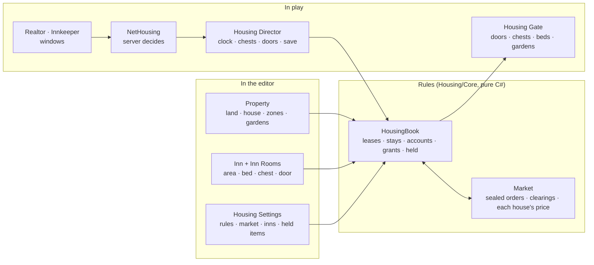

# Housing, Inns and Rentals

**Scripts:** `Housing/Core/*` (the rules, no MonoBehaviour: the housing office's books — leases, stays, accounts,
grants, what is held for players — the market of houses, the inns' prices, the geometry of areas, the save, the views
the windows show), `Housing/Runtime/*` (the Property, Inn, Inn Room and Lockable Door components, the Realtor and
Innkeeper NPC options, the Housing Settings, the director and its clock, the access hooks, the service that pays and
records), `Housing/UI/*` (the realtor's and the innkeeper's windows, the player's own housing page),
`Networking/Runtime/Housing/NetHousing.cs` (multiplayer), `CustomEditor/Housing/*` (the inspectors and Scene view
tools, the menus, the checks that keep the areas truthful, Edit Mode tests). It works with
[Agriculture](../Agriculture/README.md) (a property's gardens are Soil Fields) and with the
[hub world](../HubWorld/README.md) (the city).

The city's players live somewhere: **a room in an inn** by the night, or **a house** by the week or the month — some
with a garden, some with a yard, a workshop or just a house on its plot. Prices follow how wanted places are.

* **You place the houses in the editor.** A Property is a plot of land drawn in the Scene view with the house on it
  (its footprint and floors) and parts of the land with a purpose (a yard, an orchard, a workshop...); its gardens are
  Soil Fields on it. The sizes give its base rent. Areas are **truthful**: two plots may not overlap, a house stays on
  its land, and any other object of the city standing on a plot is reported ([chapter 02](02-Placing-Houses-and-Inns.md)).
* **A realtor lets the houses.** The realtor's window lists them — where each is, what it asks, by the week or the
  month, its house and land, its garden, whether it is free — and takes the player's **sealed order**: a few houses in
  order of preference, an offer for each, paid in advance and binding (taking something back takes two and a half
  days). Every six hours the market clears: each free house goes to the best offer, each order wins at most one, and
  **each winner pays what they offered** — not more because someone else bid, not less ([chapter 03](03-The-Market.md)).
* **Prices are speculation done right.** Each house's asking rent follows its own demand: it rises towards what
  someone else has offered for it — binding, prepaid offers that cannot be pulled out of the way — and never past it;
  it falls while it stands empty; it asks more than its base rent only while an offer stands behind it. A tenant's
  renewal rests only on an offer that could take the house, and that offer is held to take it if they leave: an alt
  that pushed a rent pays for the house, with no way out. Interest that costs nothing — window shopping, alts, orders
  placed and pulled — moves nothing. Checked in simulation against the exact competitive prices and against alts
  trying every way out. A sitting tenant keeps their home unless someone offers clearly more than the protection they
  chose, and their rent never jumps.
* **Innkeepers let rooms by the night.** Pay for some nights, get a free room with its bed and chest; the price follows
  how full the inn has really been lately ([chapter 04](04-Inns-Access-and-Belongings.md)).
* **Only the tenant uses their place** — its doors, chests, beds and gardens — and those they let in, each with the
  rights they were given (enter, garden, chests, beds, or manage: letting others in). Nobody else can touch them; the
  server checks every action.
* **Nothing a player leaves behind is lost by default.** When a stay or lease ends, what is in the chests is **held**
  for its owner, claimable at any innkeeper or realtor: free for the first days, then (if you set a fee) for a fee, and
  kept until claimed unless you set a limit.
* **Gardens sleep.** Only gardens near a player are loaded and simulated; the others are saved and wake up — caught up
  with the real weather and seasons of the time they slept — when someone comes near. Abandoned gardens keep living
  in the background ([chapter 05](05-Gardens-Time-Saving-Multiplayer.md)).
* **It holds up online.** Server-authoritative; leases count real days online (time stops while the server is down);
  one save per world written atomically; characters are told apart by a lasting key; a player's money and requests
  are checked twice.

| Chapter | What it covers |
|---|---|
| [01 — Overview and Setup](01-Overview-and-Setup.md) | Five-minute setup, what a player does, the components, the settings |
| [02 — Placing Houses and Inns](02-Placing-Houses-and-Inns.md) | The Property inspector and its Scene view tools (land, house, zones, gardens), inns and rooms, truthful areas and every check |
| [03 — The Market of Houses](03-The-Market.md) | Orders, clearings, pay-what-you-offer, sitting tenants and protection, renewals, how prices move and why fake interest does not move them, moving, leaving |
| [04 — Inns, Access and Belongings](04-Inns-Access-and-Belongings.md) | Stays and their prices, letting people in and what they may do, doors, what is held and how it is claimed |
| [05 — Gardens, Time, Saving, Multiplayer, Scripting and Tests](05-Gardens-Time-Saving-Multiplayer.md) | Sleeping gardens and catch-up, the housing clock, the world save, identity, the network component, the API, the tests |

