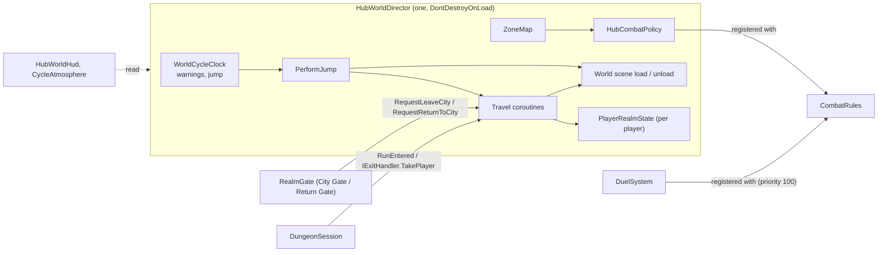
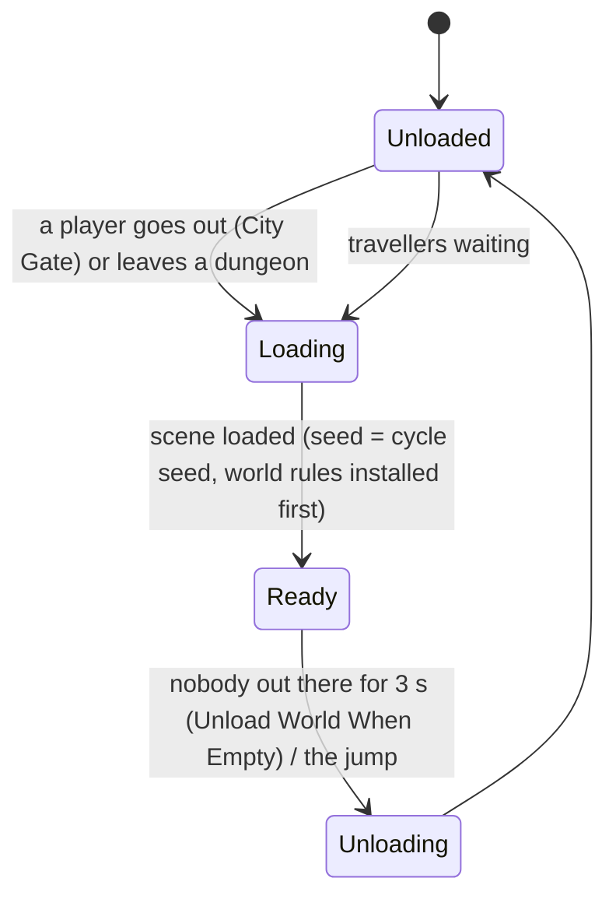
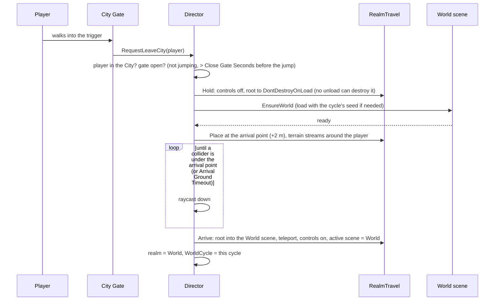

# Hub World 01 — Architecture

**Scripts:** `HubWorld/Runtime/HubWorldDirector.cs`, `RealmScene.cs`, `RealmTravel.cs`, `RealmGate.cs`,
`PlayerRealmState.cs`, `HubCombatPolicy.cs`; `Procedural/Dungeon/Runtime/DungeonSession.cs` (`DungeonRun`),
`DungeonScenes.cs`; `Essentials/ScenePhysics.cs`; `Essentials/Ability/Core/CombatRules.cs`.

---

## 1. Realms and scenes

```
City Scene (permanent, never regenerated)            ← RealmScene (City), HubWorldDirector, City Gate
    │
    └── City Gate ──────────────►  World Scene (loaded with a new seed every cycle)   ← RealmScene (World)
                                      ├── exterior copy of the city (outer walls, sealed inside)
                                      ├── Return Gate ──────────────► City Scene
                                      ├── TerrainGenerator / EndlessTerrain / WeatherSystem
                                      ├── mobs (world spawners)
                                      └── World portals ─────────────► Dungeon Scene (one per group, created at runtime)
                                                                          └── exit portals ──► World (same cycle) or City (cycle over)
```

| Realm | Scene | Lifetime | Combat | Abilities |
|---|---|---|---|---|
| **City** | the City scene (first in Build Settings) | loaded for the whole game | no PvP, no mobs; duels only | only shown (validated, put on cooldown, nothing hit) |
| **World** | the World scene (or a modifier's variant) | loaded with the cycle's seed when someone goes out; unloaded when empty and at every jump | mobs; PvP in dangerous rings | normal |
| **Dungeon** | a scene created for the run (`DungeonScenes`) | from entering until the group leaves | mobs; PvP only if enabled | normal |
| **Transit** | the player is held in `DontDestroyOnLoad` (on a network server: frozen in their current scene) | while the destination loads | none | only shown |

Each player's realm, zone and the cycle they went out in are on a `PlayerRealmState` component, written only by the
director.

## 2. The director (the authority)



* Clients **ask** (a gate's trigger calls `RequestLeaveCity`), the director **decides** (gate open? player in the city?)
  and **acts** (moves the player, loads the world). Nothing else moves players between realms.
* The rules themselves are plain classes (`HubWorld/Core`): `WorldCycleClock`, `CycleSeeds`, `ZoneMap`, `LootLossRule`,
  `DuelBook`, `CycleRules` — no MonoBehaviours, covered by Edit Mode tests, reusable on a server.
* Presentation reads state and never changes it: `HubWorldHud`, `CycleAtmosphere`, `RealmScene.SetHidden`.

## 3. Which scenes are loaded



* The **City** is loaded at start (it is the first scene; *Load City On Start* loads it when the game starts elsewhere)
  and never unloaded.
* The **World** is loaded on demand. Before loading, the director sets `TerrainGenerator.SeedOverride` (the cycle's
  seed), `WorldAreas` (the city's levelled, kept-clear circle) and `WorldSpawnHooks` (zone strength, modifiers), so the
  terrain generates the right world from its first chunk. The terrain keeps per-process static caches, so **one world
  exists per process**: at the jump the old one is unloaded first, then the new one is loaded when needed — the players
  are all in the city or in dungeons at that moment, so nobody waits in an empty world.
* The City's interior and the World's exterior copy of the city stand at the same place. On this machine, while the
  local player is outside the city, the City's objects are switched off (`RealmScene.SetHidden`; roots with a camera,
  event system, screen canvas or a player stay on). The city keeps existing for everyone else.

> **Single process vs. dedicated servers.** *Unload World When Empty* is right for local play. A dedicated world server
> (later stages) keeps the World loaded and runs the City in another process — then nothing overlaps.

## 4. Travel between scenes



The player's **top-level object** moves with everything under it. Keep the player's camera and UI under the player, or
in `DontDestroyOnLoad`, or as roots of the City scene with a camera / canvas (those are never switched off).

## 5. Dungeons in their own scenes

With *Dungeons In Own Scenes* (default), `DungeonScenes.Enabled` is on and every `DungeonRun` gets:

| What | How |
|---|---|
| a **scene** | `SceneManager.CreateScene("Dungeon N - label", LocalPhysicsMode.Physics3D)` |
| its **own physics** | the scene's `PhysicsScene`, stepped every fixed update by `DungeonScenes`; nothing in it collides with the world or another dungeon |
| a **slot** | a cube of *Slot Size* (2048 m) on a grid around *Slot Origin*; the manager is instantiated at the slot centre |
| a **ScenePhysics region** | the slot cube, so gameplay raycasts / overlaps from inside it reach its colliders |

The group stays at the portal (controls off) while the dungeon generates on a worker thread, then is moved into the
dungeon's scene and placed at the spawn; the scene becomes the active one for the local player (lighting, runtime
objects). When the run ends, `DungeonSession` hands each player to the director (`IExitHandler.TakePlayer`), which moves
them out at once, and only then the scene is unloaded.

**Why slots, if the physics is separate?** Unity's NavMesh, lights and renderers are not per scene. Slots keep each
dungeon's NavMesh and visuals apart from the others and from the world while they share one process. The default slot
origin is below the terrain; a dedicated dungeon host that never loads a world can use `(0, 0, 0)`.

The **classic mode** (*Dungeons In Own Scenes* off, or no hub world at all) is unchanged: one run at a time, built at the
portal's Dungeon Origin under the world, world paused (`DungeonWorldPause`).

### Several groups at once

`DungeonSession` keeps a list of `DungeonRun`s. A run knows its manager, request, scene, participants, where each one
returns to and its checkpoint. The older static API (`DungeonSession.InDungeon`, `Current`, `Participants`,
`Checkpoint`, `Exit(bool)`) answers for the **local player's run**; dungeon components ask for their own run
(`DungeonSession.RunAt(this)`, `RunOf(dungeon)`).

## 6. Physics queries: `ScenePhysics`

Unity's static `Physics.Raycast` / `Overlap…` only see the default physics scene. Every gameplay query that can run
inside a dungeon (combat line of sight and ground snapping, projectiles, weapon hits, traps, forced movement, player
ground checks, interaction, audio occlusion) now calls `ScenePhysics` with the same arguments; it routes the query by
its start position to the physics scene whose region contains it, else to the default one. With no region registered it
calls `Physics` directly.

## 7. What is authoritative (and what is networked)

With Fish-Net, the server's director decides everything below and the clients mirror it. See
[Networking 09 - Hub world sync](../Networking/09-Hub-World-Sync.md).

| Client sends (stage 2+) | Director / server decides | Client shows |
|---|---|---|
| "walk into the City Gate" | gate open, realm change, world load, arrival | veil, new scene |
| "use ability X" in the city | owned and ready (`AbilityCaster`), cooldown, `VisualCast` → `CityAbilityRelay.Relayed` (observers) | cast animation / effects |
| "challenge / accept / decline" | `DuelBook` rules, arena, never-lethal end | prompt, banners, arena ring |
| — | the clock, the jump, loot loss (`LootLossRule` with the server's random), the debuff | warnings, sky, HUD |
| — | zones, PvP verdicts (`HubCombatPolicy`), mob strength, dungeon difficulty | zone label |
| — | world seed (sent to clients: terrain is not secret) | terrain built locally from the seed |
| — | dungeon seed (**never** sent: the client receives revealed content only) | — |

The state to synchronise is small: `PlayerRealmState` (realm, destination, cycle, zone index), the clock (cycle index,
cycle start, duration), the current and next modifier, the shard seed, and `DuelBook.Open`.
