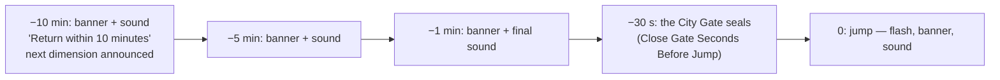
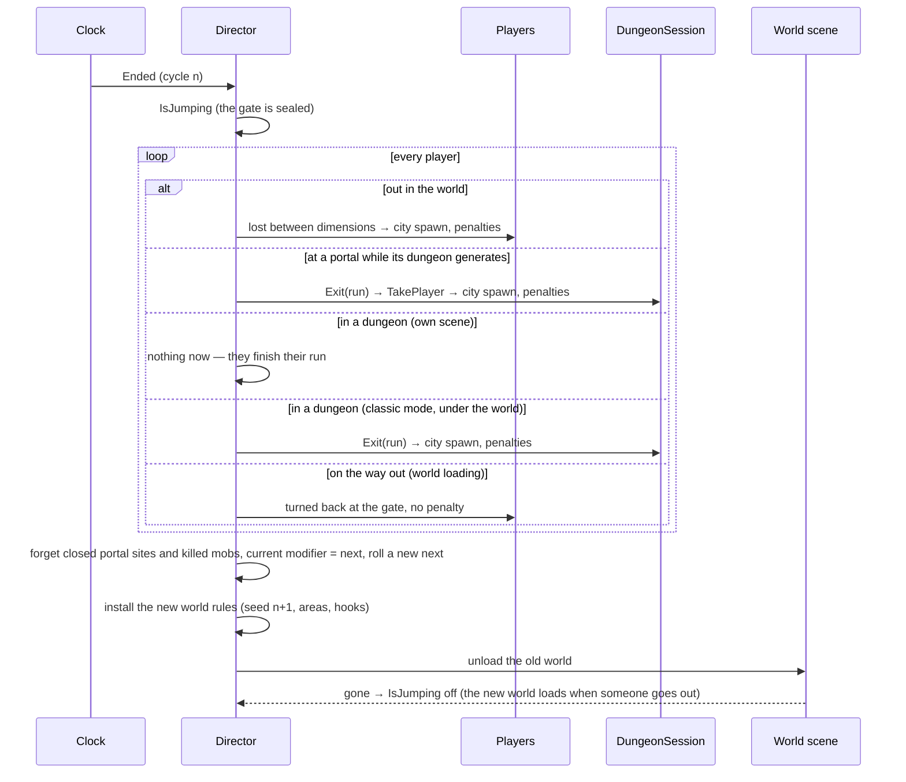
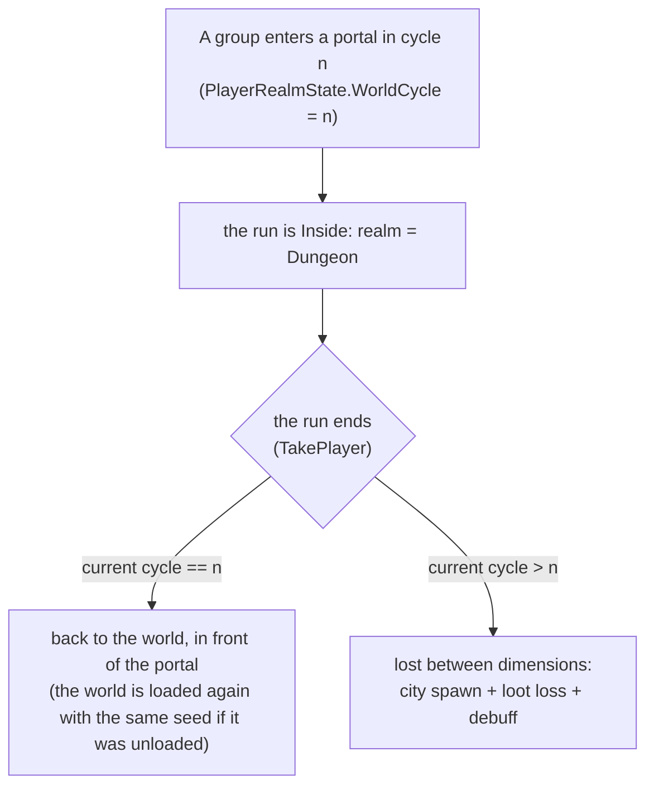

# Hub World 02 — The Dimensional Cycle

**Scripts:** `HubWorld/Core/WorldCycleClock.cs`, `CycleSeeds.cs`, `CycleRules.cs`, `LootLossRule.cs`;
`HubWorld/Runtime/HubWorldDirector.cs` (`PerformJump`, `TakePlayer`), `CyclePenalties.cs`, `CycleAtmosphere.cs`;
`HubWorld/Config/HubWorldSettings.cs`, `DimensionalModifier.cs`.

---

## 1. The clock

`WorldCycleClock` is plain data: a cycle index, the cycle's start, its duration (*Cycle Minutes*, default 90) and the
warning times (*Warning Minutes*, default 10, 5, 1). The director advances it every frame with its time (game time, or
real time with *Use Unscaled Time*) and acts on what it reports:

| Event | When | Director |
|---|---|---|
| Warning | `now ≥ end − warning` (each once per cycle, longest first) | banner, sound (the shortest warning uses *Final Warning Sound*), next modifier announced at the first one |
| Ended | `now ≥ end` | `PerformJump` |

The next cycle starts exactly where the last one ended, so the cadence never drifts. After a gap longer than a whole
cycle (a suspended game) one jump is reported and the new cycle starts at that moment, instead of replaying every missed
jump. Warnings longer than the cycle are ignored.

## 2. Warnings and the sky

`CycleAtmosphere` (on this machine only) drifts the sky of the city and the world toward the rift during the last
*Atmosphere Ramp Seconds* (default 600): fog colour → *Rift Fog Color*, fog density → *Rift Fog Density*, ambient light →
*Rift Ambient Color*, the sun → × *Rift Sun Multiplier*. The curve is gentle at first and strong near the end. It runs
after everything else each frame and blends on top of what the scene or the Weather System set (it remembers what it
wrote, so the blend never accumulates); in a dungeon nothing changes, and on leaving everything is put back. Its
`RiftAmount` (0–1) is public for other effects.

## 3. The jump

## 4. Lost between dimensions

A player out in the world at the jump (or leaving a dungeon after it) is sent to the city's **spawn point** and:

| Penalty | Rule | Setting |
|---|---|---|
| **Loot loss** | every unprotected stack loses `fraction × quantity` items on average: the whole part for sure, the rest by a roll — a single sword is lost with that chance, a stack of 40 arrows loses ~10 at 25 %. Equipped items, the item being dragged and *Protected Items* are never lost. The bag always counts; the hotbar with *Include Hotbar*. Removal goes through `InventoryManager.ConsumeItem` (weight, durability and UI follow). | *Loot Loss ▸ Item Fraction* (0.25), *Include Hotbar*, *Protected Items* |
| **Money loss** | `floor(balance × fraction)` from the player's `CurrencyWallet` | *Loot Loss ▸ Currency Fraction* (0) |
| **Dimensional Disorientation** | a timed debuff through `TimedStatModifiers` (refreshed, not stacked; removed on death like any debuff) | *Disorientation*: duration 300 s, −20 % move speed, +15 % damage taken, −30 % stamina and mana regen, −15 % attack and casting speed |

The player sees a banner ("You were lost between dimensions… Lost 6 items.") and the list of what was lost. The director
raises `PlayerLostBetweenDimensions(player, result)` for your own systems (a death-recap screen, statistics, a save).

The random generator is the director's (seeded from the shard seed): in a networked game the server decides and the
client only shows the result.

## 5. Players in dungeons

`CycleRules.DungeonExitDestination(cycleEntered, currentCycle)` and `PenalisedOnDungeonExit` are the two rules; they
also apply when a returning player's world disappears while they wait for it.

## 6. Seeds

| Seed | Rule | Who knows it |
|---|---|---|
| shard seed | *Shard Seed*, or random per session (0) | the server |
| world seed of cycle *c* | `CycleSeeds.WorldSeed(shard, c)` — deterministic, non-zero, different every cycle | everyone (sent to clients; the terrain is rebuilt from it) |
| dungeon seed | from the world seed and the portal position (as before) | the server only |

`NextWorldSeed` is known a cycle in advance, so a server can prepare the next world (or announce it) before the jump.
The same shard seed always gives the same sequence of worlds and modifiers.

## 7. Dimensional modifiers

*Assets ▸ Create ▸ SimpleMovements ▸ Hub World ▸ Dimensional Modifier*, listed in *Hub World Settings ▸ Modifiers*. Each
cycle rolls one (by *Weight*, against *No Modifier Weight*); the next one is announced in the city from the first
warning on and shown on the HUD.

| Field | Effect |
|---|---|
| *World Scene Override* | loads another World scene for that cycle — other biomes, terrain settings, mob lists (Frozen Dimension, Sunken World) |
| *Force Weather* / *Weather* / *Strength* | the Weather System holds that weather the whole cycle |
| *Tint Atmosphere*, *Ambient Tint*, *Fog Color*, *Fog Density Multiplier*, *Sun Intensity Multiplier* | the world's sky (an Eclipse: sun × 0.2, dark tint) |
| *Mob Strength Multiplier* | on top of the zone's strength |
| *Mob Weights*, *Only Listed Mobs* | reweight or ban mob types; an Invaded World lists only the invaders |
| *Dungeon Difficulty Multiplier* | on top of the zone's difficulty |
| *Dungeon Profiles* | portals lead to these kinds of dungeon (stable per portal) |

Examples:

| Modifier | Settings |
|---|---|
| Frozen Dimension | World Scene Override = a snowy World variant, Force Weather Snow, fog tint pale blue |
| Eclipse | Tint Atmosphere, Ambient Tint dark violet, Sun Intensity × 0.2, Mob Strength × 1.2 |
| Sunken World | World Scene Override = a variant with a high sea level, Force Weather Rain, dungeon profiles Sunken Temple |
| Invaded World | Mob Weights = the invader prefabs × 3, Only Listed Mobs, Dungeon Difficulty × 1.3 |
