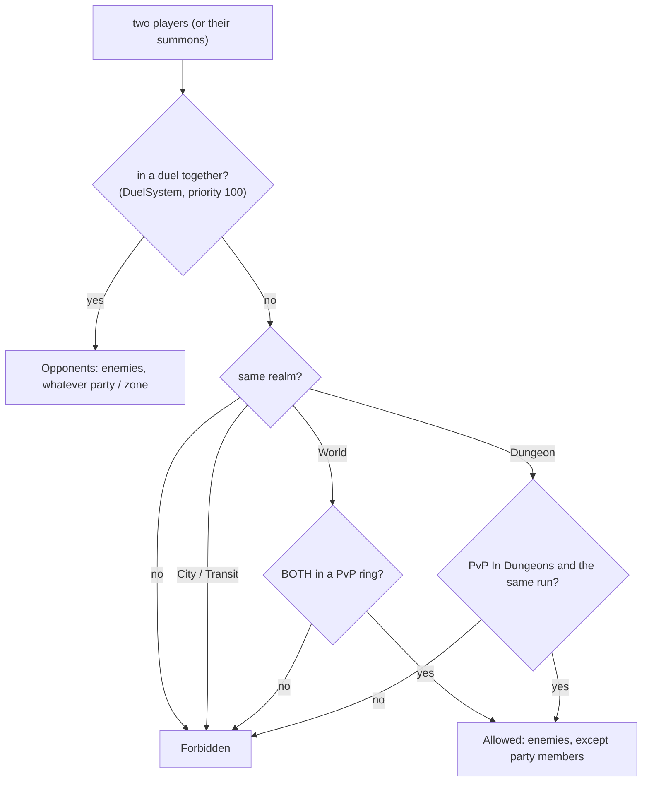

# Hub World 03 — Zones, PvP and Difficulty

**Scripts:** `HubWorld/Core/ZoneMap.cs`; `HubWorld/Runtime/HubCombatPolicy.cs`, `HubWorldDirector.cs` (`UpdateZone`,
`InstallWorldRules`), `CyclePenalties.cs` (`ZoneMobStrength`), `HubWorldHud.cs`; `Procedural/World/Queries/WorldAreas.cs`,
`Procedural/World/Spawnable/WorldSpawnHooks.cs`.

---

## 1. Rings around the city

The world is divided into rings by horizontal distance from *Zone Settings ▸ City Center*. Inside *City Wall Radius* is
the city itself; then each ring runs to its *Outer Radius*; the last ring goes on forever. Default rings:

| Ring | Out to | PvP | Dungeon difficulty | Mob strength | Rewards |
|---|---|---|---|---|---|
| Safe Zone | 600 m | off | 0.8 → 1.2 | 0.7 → 1.0 | × 0.75 |
| Frontier | 1500 m | on | 1.2 → 2.0 | 1.0 → 1.4 | × 1.0 |
| Dangerous Zone | 3000 m | on | 2.0 → 3.2 | 1.4 → 2.0 | × 1.4 |
| The Abyss | 6000 m, then on | on | 3.2 → 4.5, then +0.5 per km (max 8) | 2.0 → 2.8, then growing | × 2.0 |

Values marked *start → end* are interpolated across the ring, so things get harder smoothly instead of jumping at a
border. `ZoneMap.At(position)` returns a `ZoneInfo` (index, name, PvP, distance, depth in the ring, dungeon difficulty,
mob strength, reward multiplier, colour). The director checks every player every *Check Interval* (0.2 s) and stores it
in `PlayerRealmState.Zone`; crossing into another ring shows a banner ("Dangerous Zone - PvP Active").

*Reward Multiplier* is exposed for your loot and XP systems; dungeon loot already scales with difficulty.

## 2. The PvP rule

`HubCombatPolicy` (registered with `CombatRules`) answers for every pair of players — summons count as their player:

*Forbidden* makes them allies **and** closes the harm gate: `CombatEntity.ApplyDamage`, `ApplyControl`,
`ApplyDisplacement`, harmful ability effects (debuffs included) and weapon hits refuse anything harmful between them —
even with friendly fire on, even from an area attack aimed at someone else. Requiring *both* players to stand in a PvP
ring means nobody can be attacked from a safe zone, or attack from one.

## 3. Difficulty and mob strength

| What | How |
|---|---|
| **Dungeon difficulty** | `WorldSpawnHooks.PortalDifficulty`: the portal's ring value × the modifier's multiplier. Portals placed by a `PortalSpawner` get it when they spawn; hand-placed portals with *Use Spawner Difficulty* when entered. It becomes `DungeonRequest.difficulty` (mob budgets, loot tiers). |
| **Mob strength** | `WorldSpawnHooks.MobSpawned`: right after a world mob is created (before its first frame) `ZoneMobStrength` multiplies its max health and the damage it deals by the ring's strength × the modifier's (with *Scale World Mobs*). |
| **Mob types** | `WorldSpawnHooks.MobWeight`: the modifier's weights (0 = absent). |

## 4. The city in the world: levelled and kept clear

The World scene holds an exterior copy of the city at *City Center*. `WorldAreas` gets one circle of radius
max(*City Wall Radius*, *Keep Clear Radius*):

| Rule | Effect |
|---|---|
| Flatten (*Flatten City Ground*) | the height generator levels the ground to *City Ground Height* inside the circle and blends it into the terrain over *Flatten Blend* metres — the walls never float or sink |
| No objects | no trees, rocks or other placed objects (checked by position, so chunks agree) |
| No mobs | world mobs never spawn there |
| No portals | world portals never appear there |

Areas are read on the terrain worker threads, so they are set before the world loads. Coordinates are terrain cells
(world units at *Scale Factor* 1).

## 5. The HUD

`HubWorldHud` (built from code; turn off the director's *Create Hud* to use your own UI):

| Where | Shows |
|---|---|
| top centre | the zone ("Safe Zone", "Frontier - PvP Active", "Dungeon (difficulty 2.3)", "City") and the Dimensional Disorientation debuff when active |
| top right | "Next jump in 1:23:45" (amber under 10 min, red under 1 min), "Dimension: …", "Next: …" |
| upper middle | banners: warnings, the jump, zone changes, duel countdown and results, penalties |
| above the hotbar | short messages (through the player's inventory message line) |
| middle | the duel prompt (Accept [Y] / Decline [N]) |
| full screen | a veil while travelling between realms, a flash at the jump |
