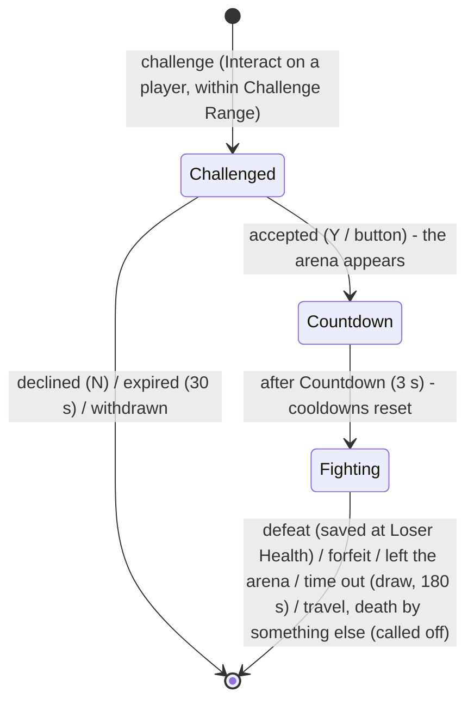

# Hub World 04 — City Abilities and Duels

**Scripts:** `Essentials/Ability/Core/CombatRules.cs`, `AbilityCaster.cs` (visual-only path);
`HubWorld/Runtime/CityAbilityRelay.cs`, `DuelSystem.cs` (`DuelSystem`, `DuelChallengeTarget`, `DuelArena`),
`HubWorld/Core/DuelBook.cs`.

---

## 1. Abilities in the city are only shown

With *City Abilities Visual Only* (default), a player in the city (or travelling) can cast, but nothing is hit - not even
the caster's own buffs (size, stats): the ability goes on cooldown and only its presentation plays. The Console warns once
per player ("... was only shown: abilities used here are visual only") so it is not mistaken for a broken ability:

```mermaid
sequenceDiagram
    participant P as Player
    participant AC as AbilityCaster
    participant CR as CombatRules
    participant R as CityAbilityRelay
    P->>AC: TryCast(slot)
    AC->>AC: owned? ready? not stunned / silenced? (cooldown, charges, global cooldown)
    AC->>CR: IsVisualOnly(caster)?  → yes (HubCombatPolicy: in the city)
    Note over AC: no resource check or cost, no target / range / sight checks
    AC->>AC: cast: animation, cast effect, sound, telegraph; the slot goes on cooldown
    AC->>AC: release: release effect + the ability's Visual Only Effect at the aim point
    AC->>CR: RaiseVisualCast(cast)   (no action runs: no damage, heal, summon, movement)
    CR->>R: VisualCast
    R->>R: players of the same realm within Relay Radius (60 m)
    R-->>R: Relayed(cast, observers)  ← stage 2+: send them the cast
```

* **Validation** is the caster's own: the ability must be in one of the player's slots and ready. Cooldowns are spent,
  so spamming is limited exactly as in combat.
* *Ability Definition ▸ Presentation ▸ Visual Only Effect* (optional) is played at the aim point — a firework for a
  fireball, a shimmer for a heal.
* Weapons swing normally (their animations), but the harm gate refuses their damage in the city.
* A duel turns this off for the two fighters while they fight (their abilities work, on each other only).

## 2. Duels



| Step | Details |
|---|---|
| **Challenge** | Every player gets a `DuelChallengeTarget`, so the Interact key on another player (within *Challenge Range*, 8 m) shows "[E] Challenge to a duel  Name". Also `DuelSystem.Instance.Challenge(a, b, out reason)`. Refused when either is busy, in a dungeon or travelling, or outside the city without *Allow Outside City*. |
| **Answer** | The challenged player sees the prompt: Accept [Y] / Decline [N] (or the buttons). `Accept(player)`, `Decline(player)`. |
| **Arena** | The centre is the midpoint of the two at acceptance; a glowing ring of *Arena Radius* (12 m) is drawn on the ground (*Show Arena*). With *Leaving Arena Loses*, stepping out loses the duel. |
| **Fight** | `DuelSystem` (a combat rule provider, priority 100) says *Opponents* for the pair: enemies everywhere — even in the city, even party members. Everyone else stays protected by the city's rule. |
| **Never lethal** | The duel watches each fighter's `LethalDamage`: a blow from the opponent (or the opponent's summon) that would kill leaves the loser at *Loser Health* (5 %), invulnerable for 2 s, and ends the duel. Death from anything else (a mob, a trap) is a real death and calls the duel off. |
| **End** | Banners for both ("Ana wins the duel!"), both healed and cleansed with *Heal After Duel*, 2 s of invulnerability. `DuelSystem.DuelChanged` for your systems (rankings, rewards). |

*Auto Accept For Other Players* (on the `DuelSystem` component) accepts challenges sent to players that are not this
machine's — handy to test duels alone against a second player object.

## 3. Combat rule providers

`CombatRules` is the extension point both systems use:

```csharp
public interface ICombatRuleProvider
{
    int Priority { get; }                                         // higher is asked first
    PvpVerdict PlayerVersusPlayer(CombatEntity a, CombatEntity b); // Unspecified / Allowed / Forbidden / Opponents
    bool? AbilitiesVisualOnly(CombatEntity caster);               // null = no opinion
}
```

| Verdict | Relation | Harm |
|---|---|---|
| Unspecified | the usual rules (party → factions → team → *Players Can Hurt Each Other*) | the usual friendly-fire rules |
| Allowed | Enemy (party members stay Party) | yes |
| Forbidden | Ally | **never** (the harm gate) |
| Opponents | Enemy, even party members | yes |

`CombatRelations.Get` asks once per pair (summons count as their player). With no provider registered, nothing in the
combat system changes.

## 4. Adding your own rule

```csharp
// A guild war: members of two guilds at war may fight anywhere outside the city.
public sealed class GuildWarRule : ICombatRuleProvider
{
    public int Priority => 50; // above the zones (0), below duels (100)
    public PvpVerdict PlayerVersusPlayer(CombatEntity a, CombatEntity b)
    {
        PlayerRealmState sa = PlayerRealmState.Of(a), sb = PlayerRealmState.Of(b);
        if (sa == null || sb == null || sa.InCity || sb.InCity) return PvpVerdict.Unspecified;
        return Guilds.AtWar(a, b) ? PvpVerdict.Allowed : PvpVerdict.Unspecified;
    }
    public bool? AbilitiesVisualOnly(CombatEntity caster) => null;
}

CombatRules.Register(new GuildWarRule());
```

Keep rules pure functions of state every machine knows (realms, zones, ids), so server and clients agree.
