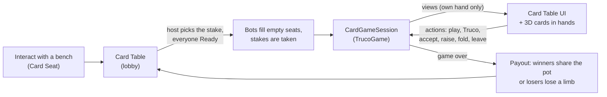

# Minigames 01 — Card Tables and Truco

**Scripts:** `Minigames/CardGames/Core/*` (`PlayingCard`, `CardDeck`, `CardTableView`, `CardGameDefinition`,
`CardGameSession`), `Minigames/CardGames/Truco/*` (`TrucoRules`, `TrucoGame`, `TrucoGameDefinition`),
`Minigames/CardGames/Table/*` (`CardTable`, `CardSeat`, `CardStake`, `CardTableVisuals`, `CardTableUI`),
`Networking/Runtime/Minigames/NetCardTable.cs`, `CustomEditor/Minigames/CardTableEditors.cs` (menus, inspectors),
`CustomEditor/Minigames/TrucoTests.cs`.

A table with benches where four players sit down and play cards: Truco here; blackjack, Texas Hold'em, arm wrestling
and drinking contests use the same table, seats, stakes, bots, window, 3D cards and network
([Minigames 02](02-Blackjack-Poker-and-Contests.md)). Players can bet money, items — or a limb.

---

## 1. Setup (two minutes)

1. *Tools ▸ SimpleMovements ▸ Minigames ▸ Create Truco Table*. It builds a table in the open scene (at the Scene view's
   centre): a table top with its **Center** marker, four benches with a **Card Seat** each (seats 1–4 clockwise;
   teammates face each other), the **Truco** game asset (`Resources/SimpleMovements/Minigames/Truco`), and — when Fish-Net
   is in the project — a NetworkObject and a `NetCardTable`.
2. Replace the cubes with your own table and benches if you like: the **Card Table** component goes on the table's
   root, a **Card Seat** on each bench (with a collider so the Player Interactor finds it), and its *Sit Point* where
   the sitter's feet go — on the floor in front of the bench, facing the table (the Sit animation lowers the hips onto
   the bench).
3. Set the **stakes** on the Card Table (§4) and press Play: walk to a bench, *[E] Sit*.
4. Animations (optional): select the player prefab ▸ *Tools ▸ SimpleMovements ▸ Player ▸ Complete Player Animator
   Controller* adds `IsSitting` and an empty **Sit** state: drag a seated idle onto it.

The inspector of the Card Table lists every problem (missing seats, a stake without an item...) and, in Play Mode,
shows the table live with a **Watch Bots Play** button (bots fill every seat and play a test game).



---

## 2. At the table

* **Sitting**: the player is placed on the seat facing the table, their controls are locked, the Animator's
  `IsSitting` turns on, and the **table window** opens (the cursor is free, clicks never attack).
* **Lobby**: the first player seated is the **host** and picks the stake (when the table offers several). Everyone
  presses **Ready**. When every seated player is ready the game starts: **empty seats are played by bots** (*Bots Fill
  Empty Seats*; off = the game waits for four players), and every player's stake is taken.
* **Cards**: each player's three cards are **in their hand** — on the Humanoid hand bone (the right hand; the left one
  if the right hand was lost to the injury system; in front of the seat without hands), face up for their owner, face
  down for everyone else. Played cards land in front of each seat; the vira and the deck lie in the middle. In the
  window, click a card of your hand to play it.
* **Leaving**: the *Leave* button, or Escape. During a game Escape asks first: **leaving forfeits the game** — your team
  loses (and so does your stake). Dying or being knocked out leaves the table too.
* After a game the result stays a few seconds (*Result Seconds*), then the lobby opens again (press Ready to replay).

The window: scores and what the hand is worth on top, the table in the middle (names, card counts, a ▶ on whose turn
it is, speech bubbles — *TRUCO!*, *Accepted!*, *Fold* — the played cards with the trick's best one lit, the vira and its
manilha), your hand at the bottom, the buttons on the right, the table's log on the left.

---

## 3. Truco rules

**Players**: 4, in 2 teams of 2; teammates sit opposite each other (seats 1 + 3 = *Team A*, 2 + 4 = *Team B*). Play goes
clockwise. The first team to **12 points** wins.

**Deck**: the standard 52 cards (A–K in clubs, diamonds, hearts and spades), no jokers. Each hand is shuffled anew;
three cards each (12 dealt, 40 left), then the top card is turned up: the **vira**.

**Card strength** (`TrucoRules.Strength`: lower = stronger):

1. The four **manilhas** — the rank *after* the vira's in the sequence `4 → 5 → 6 → 7 → 8 → 9 → 10 → Q → J → K → A → 2
   → 3 → 4` (vira 9 → the 10s are manilhas; vira 3 → the 4s) — by suit: **Clubs, Hearts, Spades, Diamonds**. They beat
   everything.
2. Then the other cards by rank, from the end of the sequence: **3, 2, A, K, J, Q, 10, 9, 8, 7, 6, 5, 4**. Suits do not
   matter: two cards of the same rank tie.

**A hand** is up to three tricks. The player after the dealer starts; everyone plays one card clockwise; the strongest
card wins the trick for its team (equal strongest cards of the *same* team still win; of both teams the trick **ties**).
The trick's winner leads the next trick; after a tie, the one who led the tied trick leads again.

**Winning the hand** (`TrucoRules.HandWinner`):

| Tricks | Hand goes to |
|---|---|
| won the first two | that team |
| won the first, tied the second | the first trick's winner |
| tied the first | the second trick's winner |
| tied the first two | the third trick's winner |
| tied all three | nobody (a draw, no points) |
| one each | the third trick's winner; if the third ties, the first trick's winner |

**Truco** (`TrucoBetting`): a hand starts worth **1**. On your turn (before playing) you may call **Truco** (3). The other
team answers — **Accept** (play for 3), **Raise** to **Six** (now your team must answer), or **Fold** (your team gets the
value accepted *before* the call). Raises go on to **Nine** and **Twelve**. The team that made the last accepted call
cannot call again — only the other team may raise further. While a call waits for an answer nobody plays. The winners of
the hand get its accepted value.

Everything above is data on the **Truco** asset (`TrucoSettings`): *Points To Win*, *Hand Values* (1, 3, 6, 9, 12) and
*Call Names*, the *Rank Sequence* (it orders the cards and gives the manilha), the *Manilha Suits* order, the pauses
between tricks and hands, and the bots' *Boldness*.

**Bots** (`TrucoGame.BotDecide`) judge their hand (manilhas count most): they call Truco with a strong hand (sometimes a
bluff, more with Boldness), accept, raise or fold by how strong it is against what is at stake; they keep good cards when
the partner is already winning the trick, beat the best card with the weakest card that does, and open a hand with
their middle card. A human of the answering team answers a call; bots only answer for an all-bot team.

---

## 4. Stakes

*Card Table ▸ Stakes* (`CardStake`): the first one is the default; with *Host Chooses Stake* the host picks one in the
lobby (everyone's Ready is reset when it changes). The seats' prompt shows it (*Sit · Truco · 10 gold each*).

| Kind | Before the game | After it |
|---|---|---|
| **None** | — | just for fun |
| **Currency** | each player pays *Amount* (of *Currency*, empty = the project's default) | the winning team shares the pot |
| **Items** | each player puts in *Quantity* × *Item* | the winning team shares them (what does not fit in a bag falls by the table) |
| **Limb** | each player must still have one of *Limb Parts* (injury system on) | **each loser loses one** of them (*Random Limb*, or the first they still have): `InjuryController.LoseLimb` — the limb drops, the stump bleeds, gloves and held items fall, exactly as in combat ([Player 13](../Player/13-Injuries-and-Treatment.md)) |

* A player who cannot pay cannot press Ready (the button says why). Stakes are taken **all or nothing**: if one player
  cannot pay at the start, everyone gets theirs back.
* *House Covers Bots*: bots put in the stake too, paid by the house, so beating bots wins something (off = only the
  players' stakes are in the pot). The pot is split between the winning team's seats; a bot's share stays with the house.
* A draw, or a table removed during a game, gives the stakes back. **Leaving a game forfeits it** — your team loses its
  stakes (and with a limb stake, its limbs).

---

## 5. Multiplayer

`NetCardTable` (with a NetworkObject on the table; *Minigames ▸ Make Selected Card Table Networked*, or the inspector's
*Make Networked* button) runs the table and the game **on the server**:

* Sitting down is an ordinary interaction (relayed by the player's `NetInteractor`); everything else a seated player
  does is sent to the server (`ServerAct`) and checked there like a local player's action, with a rate limit.
* Every seated player receives **their own view** — their hand and their buttons; everyone else receives the onlookers'
  view (seats, card counts, played cards, scores), late joiners included. **Other players' cards never leave the
  server.**
* Seats name the players by `PlayerIds`, so every machine shows the right body sitting (`IsSitting`) with cards in its
  hand. The server locks the seated player's movement (it travels in the movement snapshot) and places them on the
  seat.
* Each machine has one table window, for its own player; the pause menu stays per machine and does not stop time in a
  network session.

---

## 6. Adding another card game

The table knows nothing about Truco. A new game is two classes:

```csharp
[CreateAssetMenu(menuName = "SimpleMovements/Minigames/Poker")]
public class PokerDefinition : CardGameDefinition
{
    public override int SeatCount => 6;
    public override int TeamCount => 6;               // everyone for themselves
    public override int TeamOfSeat(int seat) => seat;
    public override CardGameSession CreateSession(CardGameSetup setup) => new PokerGame(setup);
}

public class PokerGame : CardGameSession
{
    // Start, Tick, TryAct (PlayCard = 0 plays a card; your own action kinds from 1), WantsBotAction / BotDecide,
    // Forfeit, IsOver / WinningTeam, and FillView: the hand, the board (shared cards), the pot (valueText),
    // the buttons (actions: Check, Bet, Fold...).
}
```

Assign the asset to a table's *Game* and give it as many seats. The lobby, the stakes, the bots' timing, the window,
the 3D cards, the network views and the payouts work unchanged. `CardDeck` / `PlayingCard` give the 52-card deck,
seeded shuffles and card codes for the network.

---

## 7. Tests

*Window ▸ General ▸ Test Runner ▸ EditMode ▸ TrucoTests*: the deck, dealing (3 each, 39 left after the vira), manilhas,
strengths, ties, the hand rules above, calls (accept, raise, who may call), folding (the previously accepted value),
playing only your own cards on your turn, bots playing whole games to 12 (several seeds), and the network view surviving
a round trip.

## 8. Notes

* The cards are generated quads with the rank and suit written on them; the window's cards are drawn the same way.
* A bot's seat can show a body (*Bot Prefab*: any model — only a visual, made on every machine).
* The table's state is not saved: a game in progress ends with the session.
