# 10 — Character Creation, Appearance & Menus

The game now starts on **start screens built from code** (no scene building needed): main menu → character select →
character creation for a new player → the game. The character (race, class, traits, height and appearance) is saved on
this computer, sent to the server when the player spawns, checked there against the creation rules, and shown on every
machine.

```mermaid
flowchart LR
    BOOT["Bootstrap scene<br/>NetBootstrap"] --> MAIN["Main menu<br/>Solo · Host · Join · Server · Settings"]
    MAIN -->|Solo / Host / Join| SEL["Character select<br/>saved characters + 3D preview"]
    SEL -->|no saved character / New| NEW["Character creation<br/>Race · Class · Traits · Appearance"]
    NEW -->|Create| SAVE["Saved (JSON)<br/>CharacterSession.Current"]
    SEL -->|Play| SAVE
    SAVE --> GAME["Game starts"]
    GAME -->|owner sends| SRV["Server: CharacterBuild.Sanitize<br/>applies class, race, traits, points"]
    SRV -->|NetPlayer.CharacterCode| ALL["Every client shows<br/>class, race, height, appearance"]
```

## 1. Setup (once)

1. *Tools ▸ SimpleMovements ▸ Project Setup ▸ Create Character Catalog (Resources)*. It lists every **race** (Character
   Archetype of kind Race) and **class** (Player Class) of the project. Builds read it from `Resources/SimpleMovements/Databases/CharacterCatalog`.
   Without it the editor assembles one from the project (with a warning in builds if nothing is found).
2. Traits come from each class's trait list; a class without one offers the catalog's Traits list, else every trait of
   the Trait Database marked *Available At Creation*.
3. Nothing to add to the player prefab: the character travels in `NetPlayer` (new `CharacterCode` SyncVar), the look is
   applied by a `CharacterAppearance` added to the model (the Animator object) when missing.
4. Press Play in the Bootstrap scene.

`NetBootstrap` options: **Character Screens** (off = the old small OnGUI menu, no character), **Game Title**,
**Auto Use Last Character** (command line / *Play In Editor As*: plays the last character; with none, the screens open).
Without Fish-Net, put an **Offline Start Screens** component in a menu scene (it loads the game scene after the choice).

## 2. The creation screen

| Area | What it does |
|---|---|
| Step tabs | **Race** (cards + full description, height range, bonus points), **Class** (base resources, attributes, starting traits, cheaper / dearer trait types), **Traits** (each row and the detail card show the trait's **Icon**; filters by type, points left, cost with race / class changes, rules: required, incompatible, one active trait), **Appearance** |
| Preview | The player model, live: drag to turn, scroll / *Face* to zoom, **Height** slider (the race's range) |
| Summary | Name field and everything the character gets: resources, attribute totals, race and class bonuses, chosen and granted traits with their effects, **abilities with their descriptions** (racial passives, trait behaviours, class passives, starting skills) |
| Footer | Back, the current problem ("Choose a class", "Not enough points"...), Randomize Look, Previous / Next, **Create Character** |

**Trait icons:** the *Icon* of each Trait asset is shown in its row (40 px) and, larger, in the detail card. A trait
without an icon gets a coloured badge with its initial (red for drawbacks, a colour per trait type), so the list stays
aligned until the art is ready.

Changing race or class drops picked traits that no longer fit (the footer says which). Names are unique per computer
(Catalog ▸ Unique Names). The server re-checks everything (`CharacterBuild.Sanitize`): unknown or forbidden choices are
replaced, illegal or unaffordable traits removed, the name cleaned — a modified client cannot give itself more.

## 3. Appearance

`CharacterAppearanceData`: body type (Male / Female), skin colour, hairstyle + colour, beard, eye shape + colour,
nose shape, eyebrows, head, nose size, eye size, body model, **ears, torso, arms, hands, legs, feet and outfit**. It is
applied by **Character Appearance** on the model:

| Part | Set up with your art | Without options (placeholder) |
|---|---|---|
| Body type | *Male Objects* / *Female Objects* (meshes shown per body), or *Female / Male Blend Shapes* | no change to the body; females get lashes and no beard |
| Hair, Beard, Eyes, Nose | *Styles* lists: each option shows objects of the model, attaches a prefab to a bone (Head by default) and / or sets blend shapes; *Body Types* limits an option (beards: Male Only) | simple shapes on the head (7 hairstyles, 6 beards, 5 eye shapes, 6 noses) so every choice is visible on any model |
| Colours | *Skin / Hair / Eye Targets*: renderers (and material index / colour property); the chosen hair and beard are tinted automatically | the placeholder shapes take the colours |
| Nose / eye size | *Face Sliders*: blend shapes driven 0–1 | placeholder shapes scale |

Replace placeholders part by part: as soon as a part has one option, its placeholder is gone. The inspector shows which
parts are still placeholders; in Play Mode *Preview Random Appearance* tries looks.

### The placeholder body (a model without a body)

A player prefab without a character model (an empty model object, or a capsule) used to show only the face parts:
a floating head. **Character Appearance ▸ Placeholder Body** (Auto by default) now builds a whole person when the
model has no skinned mesh:

| Part | What it is | Hidden by (armour regions) |
|---|---|---|
| Head | skin under the face parts, ears and lips | Face (full helmets) |
| Neck | skin | never |
| Torso | shirt (male or female shape) | Torso (chest pieces) |
| Pelvis, legs | trousers | Legs (leggings) |
| Arms | short sleeves, then skin | Arms |
| Hands | skin, with a thumb | Hands (gloves) |
| Feet | leather boots | Feet (boots) |

* **Skeleton and animation.** If the Animator already has humanoid bones the body is skinned to them. Otherwise a
  humanoid skeleton is built (Hips, Spine, Chest, Upper Chest, Neck, Head, shoulders, arms, hands, legs, feet, toes)
  with a **Humanoid Avatar made at run time** and given to the Animator: your controller's **Humanoid** clips (idle,
  walk, run, jump, attacks) play on it. Generic clips made for another rig cannot.
* **Feet** stand on the CharacterController's bottom; the Animator's object should be at the feet (humanoid animation
  stands the body on it — a warning says so when it is not).
* **Male / Female** change the body's shape; **Skin**, **Shirt** and **Trousers** colours are chosen on the creation
  screen (Appearance ▸ Body ▸ Clothes, shown only for this body). The body has a **Muscular** blend shape, so races with
  *Blend Shapes ▸ Muscular* (the example Barbarian) look stronger; height and build come from the race as before.
* Weapons go in its hands, armour is skinned to or fitted on it (*Fit To Body* works on it), and worn pieces hide the
  part they cover.
* It always animates: the Animator is rebound once the body exists and set to *Always Animate* (with a culling mode
  and the model's own mesh switched off, Unity saw nothing visible and never moved the bones: a T-pose).
* On an existing skeleton it is placed beside the bones (under the model), so it scales with the character.
* Capsule / cylinder stand-ins on the character are hidden while it is shown. Off = never build it; Always = build it
  even next to your own meshes. A model showing a real skinned body never gets it (Auto); a body mesh that is switched
  off (inactive object or disabled renderer) does not count, so turning your model's mesh off gives the placeholder body.

### Your own parts and body models

Every part (hair, beard, eyes, nose, eyebrows, head) and the **Body Models** list take options of your own. An option
can show objects of the model, set blend shapes and / or put a **prefab** on the character:

| Option setting | What it does |
|---|---|
| Prefab + **Attach Mode** Auto / Skinned | A mesh rigged for the character's skeleton (same bone names — Mixamo prefixes and such are ignored — or both Humanoid) is bound to the character's bones: it moves with every animation. Hair, a torso, arms, a whole body. |
| Attach Mode Rigid | On the bone *Attach To* with the position / rotation / scale (hats, horns, a hair mesh without bones). |
| Attach Mode Fit To Body | Any mesh, placed on the bone, then wrapped around the body (Fit Offset) so it bends with it. |
| **Hides** | Body regions hidden while it is shown: a new torso hides *Torso*, a hood *Hair*. For Body Models, *None* replaces the whole placeholder body. |
| **Tint** | The colour it takes: skin, hair, eyes, shirt, trousers (Auto: hair colour for hair, beards and eyebrows). |
| Body Types | Male only / Female only. |

* **Extra, not instead:** with *Placeholder Styles* = Auto (default) your options come **after** the built-in
  placeholder choices while the placeholder body is used (with a model of your own they replace them). Always /
  Never force it.
* **Body Models** (Character Appearance ▸ Body Models): other anatomies — a dwarf body, a muscular body, a full
  character mesh rigged like the player. The creation screen shows a **Body model** card (Appearance ▸ Body) as soon
  as there is one; the first choice is always the default body. The choice is saved and synced like the rest.
* A different body changes the measured size: the Character Body fits the colliders to it again.

### Where each custom model goes

Everything is on the **Character Appearance** component of the player's model (the object with the Animator; select it
in the player prefab). Each list takes options as described above (objects of the model, a prefab, blend shapes):

| You have a model for... | Character Appearance list | Shown on the creation screen as |
|---|---|---|
| Head (whole head mesh) | *Styles ▸ Head Styles* | Appearance ▸ Head ▸ Head shape |
| Face (face mesh, or the face parts) | *Head Styles* for a face mesh; *Eye Styles*, *Nose Styles*, *Eyebrow Styles*, *Beard Styles*; *Face Sliders* for nose / eye size blend shapes | Head, Eyes, Nose, Hair ▸ Eyebrows, Facial Hair |
| Ears | *Body Parts ▸ Ear Styles* | Appearance ▸ Head ▸ **Ears** |
| Eyes | *Styles ▸ Eye Styles* (colour: *Colours ▸ Eye Targets*) | Appearance ▸ Eyes |
| Hair | *Styles ▸ Hair Styles* | Appearance ▸ Hair |
| Torso / chest | *Body Parts ▸ Torso Styles* | Appearance ▸ Body ▸ **Torso** |
| Arms | *Body Parts ▸ Arm Styles* | Appearance ▸ Body ▸ **Arms** |
| Hands | *Body Parts ▸ Hand Styles* | Appearance ▸ Body ▸ **Hands** |
| Legs (and hips) | *Body Parts ▸ Leg Styles* | Appearance ▸ Body ▸ **Legs** |
| Feet (bare feet, boots) | *Body Parts ▸ Foot Styles* | Appearance ▸ Body ▸ **Feet** |
| Clothes worn under armour | ***Outfits*** | Appearance ▸ Body ▸ **Outfit** |
| A whole body | *Body Models* | Appearance ▸ Body ▸ Body model |
| Armour, weapons | not here: the item's *Armor Model* / weapon visuals (section 4) | worn in the game |

* **Ears, torso, arms, hands, legs, feet**: the first choice is always **Default** (the model's own part, or the
  placeholder body's), then your options. A chosen option **replaces** its region: with *Hides* = None it hides the
  matching Body Region (Ears, Torso, Arms, Hands, Legs, Feet) of the model / placeholder body; tick more regions when the
  mesh covers more (a torso with sleeves: Torso + Arms). Ear options also hide the placeholder head's ears and a race's
  pointed ears.
* **Outfits**: the first choice is **None**. Tick in *Hides* what the outfit covers (a shirt: Torso + Arms; a robe: Torso,
  Arms, Legs): the skin under it is hidden, and worn armour that covers **all** of those regions hides the outfit too.
  *Tint* = Shirt / Trousers lets the player colour it with the **Clothes** swatches (shown for such outfits and for the
  placeholder body).
* Your own option is never hidden by its own region, even when its objects are listed in *Body Regions* (Scan Model
  puts them there); armour covering everything it replaces hides it.
* Each of these cards appears on the creation screen only when the list has at least one option. *Randomize Look*
  keeps the body model and the body parts; it picks ears and outfits.
* The parts' meshes bind to the character's skeleton (*Attach Mode* Auto / Skinned) — use meshes rigged like the
  character (same bone names, or Humanoid) — or use *Fit To Body* for any mesh.
* Modular packs with left / right meshes (Arm Upper Left, Arm Upper Right...): put both objects in one option's
  *Objects* (or both in one prefab), so one choice shows the pair.

### Size: body, colliders and everything placed on the body

**Character Body ▸ Fit To Model** (on by default) measures the real body — the placeholder body, else the humanoid
skeleton (feet to the top of the head, shoulder width), else the visible meshes — and sizes the CharacterController,
capsule collider and NavMeshAgent to it (feet kept on the ground, radius from the shoulders). *Model Height* is
measured too. Then one number decides the size: race height, character creation height, traits and the Height stat
scale **the body and the colliders together**, bigger or smaller. It measures again when the body changes (the
placeholder body is built, another body model).

What follows the size:

| | How |
|---|---|
| Model, bones, hitboxes, weapon and armour sockets | they are on the scaled model |
| CharacterController, capsule, NavMeshAgent, step height | resized by the Character Body (feet stay on the ground) |
| Combat measures (hit heights, reach, melee shapes) | the Combat Entity re-measures after each change |
| Eye height (swimming), ground checks | read from the CharacterController every time |
| Feet on the ground | **Ground Feet**: when the character stands still (at the start and after each size change) the soles are measured against the ground under it and the body is lowered or raised to touch it (the hips after the animation, or the model). The controller's skin width is kept at 10 % of its radius. |
| Camera targets and other points outside the model | **Height Anchors**: their height above the feet follows the body (empty = objects named "...Target..." and their children, e.g. ThirdPersonTarget) |

### Race looks

Each race (or class) has an **Appearance** section (Character Archetype ▸ Appearance), applied on top of the player's
choices on every machine:

| Setting | Effect | Example |
|---|---|---|
| Body ▸ Height Range / Default Height | how tall (the Height slider is limited to it) | Dwarf 1.2–1.45 m |
| Body Width | width and depth of the body on top of the height (a Character Body is added when missing) | Dwarf 1.22, Barbarian 1.16, Elf 0.92 |
| Ears | Pointed / Long Pointed (placeholder tips, or your ear prefab / blend shape) | Elf: Pointed |
| Always Beard / Beard On Any Body / Default Beard | beard rules and the beard a new character starts with | Dwarf: always, everyone, Long Beard |
| Skin Tones | the skin colours offered | orcs green, dark elves grey |
| Blend Shapes | blend shapes set on the model by name | Barbarian: "Muscular" 100 |
| Attachments | prefabs on bones | elf ear meshes, horns, tusks |

*Tools ▸ SimpleMovements ▸ Project Setup ▸ Create Example Races (Human, Dwarf, Elf, Barbarian)* creates four races set
up like the table and adds them to the catalog.

**What the player looks like:** the player's own model (the one in the player prefab) with these choices applied —
the same on the creation screen, on the spawned player and on every other machine. Without real art (hair and beard
meshes, ear meshes, blend shapes, a female mesh) the parts are simple placeholder shapes; give the Character
Appearance real options to get a real human, dwarf or elf.

### Modular characters (natural look)

A natural look comes from real meshes. Modular character packs ship one mesh per hairstyle, beard, eyebrows and head,
plus male and female body parts, all on one skeleton. With such a model:

1. Add **Character Appearance** to the model (the object with the Animator) in the player prefab.
2. Press **Scan Model for Parts**: hair, beard ("facialhair"), eyebrow and head meshes become the choices (with
   "Bald" / "None" first), male / female body parts become the body type objects, and every part goes into its
   **Body Region** (what armour hides). Names follow the pack: `Chr_Hair_Male_03` → "Hair Male 03", body type from
   "male" / "female" in the name.
3. Set the colour targets (skin, hair, eyes) and, if the pack has them, face blend shapes for the sliders.

The creation screen then shows those meshes; parts not set up keep the placeholder shapes (now shells that wrap the
head: 8 hairstyles, 6 beards, 6 eyebrows, 5 head shapes, eyes with lids, noses).

## 4. Armour on the body

Worn armour shows on the character when the piece has an **Armor Model** (Armor ▸ Visual & Audio). Armor Visuals ▸
**Attach**:

| Attach | Use it for |
|---|---|
| Auto / Skinned | armour made for the character's skeleton: bound to its bones (names matched even with rig prefixes like `mixamorig:`; Humanoid rigs matched bone by bone) — it bends with the body |
| Rigid | helmets, pauldrons: attached to the slot's bone (pairs mirrored) |
| **Fit To Body** | any mesh (a plain chest plate, boots from another pack): placed like a rigid piece, then **skinned to the body** — each vertex takes the bone weights of the closest point of the body and sits *Fit Offset* out from the skin, so it wraps the body and bends with it |

Also on Armor Visuals:

* **Female Model**: the model worn by female bodies (switches when the body type changes).
* **Hide Mode / Hide Regions**: the body under the piece is hidden so it never pokes through (Auto: helmet → hair and
  ears, chestplate → torso, gloves → hands, leggings → legs, boots → feet). Uses the Character Appearance's Body Regions
  and its hair / beard / placeholder parts.
* **Follow Body Shape**: the body's blend shapes (Muscular, Female, Fat...) are copied onto the piece's blend shapes of
  the same names — and again whenever the look changes.
* Race height and build scale the skeleton, so skinned and fitted pieces follow them.

In builds, Fit To Body reads the meshes: tick **Read/Write** in the import settings of the armour and body models.

## 5. Saves

One JSON file per character in `Application.persistentDataPath/Characters` (the catalog inspector has *Open Folder* and
*Delete All Saved Characters*). Several game windows on one computer share them, so the host and each client can pick a
different character. The save holds the creation choices; level, inventory and position are not part of it.
The appearance text (`a1|...`) gained seven fields for ears, torso, arms, hands, legs, feet and outfit; older saves still
read (the new parts take their default).

## 6. In the game

* **Inventory**: a **Character panel** beside the open inventory (InventoryManager ▸ *Show Character Panel*, *Character Panel
  Side*): name, class, race, level, height, resources, combat stats, traits and abilities **with their descriptions**
  under each row; hover a row for every source. It refreshes when stats, traits or equipment change. *Hide* folds it.
* **Inventory UI Builder** (*Tools ▸ SimpleMovements ▸ Inventory ▸ UI Builder*, *Themed Look* on): rounded panels with
  accent titles, framed slots that light up under the pointer, the selected hotbar slot outlined, hotbar numbers,
  slot names in empty equipment slots. Running it again restyles an existing UI and slot prefab.
* **Pause & settings menu**: rebuilt with the same look (sidebar tabs that highlight the open page, option cards, styled
  sliders, switches and dropdowns): Audio, Graphics, Controls, Key Bindings, Character. A game scene without a menu gets
  it at runtime; a Pause Menu Manager without UI builds it when the game starts (*Build Menu If Missing*);
  *Tools ▸ SimpleMovements ▸ Scene ▸ Build Pause & Settings Menu* saves the same menu in the scene.
* The main menu's **Settings** opens the same settings window before playing.

## 7. Scripts

| Script | Role |
|---|---|
| `CharacterCatalog` | Races, classes, traits and creation rules (Resources asset) |
| `CharacterBuild` | The rules: points, costs, what can be combined, `Sanitize` for the server |
| `CharacterSave`, `CharacterSaveStore`, `CharacterSession` | The saved character, the files, the character of this session |
| `CharacterAppearance`, `CharacterAppearanceData` | The look and its short network form |
| `ProceduralBody` | The placeholder body: humanoid skeleton and avatar, skinned body meshes, clothes colours |
| `SkeletonBinder` | Binds skinned parts and body models to the character's skeleton |
| `CharacterBody` | Size: measures the body, fits the colliders, scales body, colliders and height anchors together |
| `CharacterProfileApplier` | Applies a character to a player (single player: automatically once the player is in the game) |
| `NetPlayer` (`NetPlayer.Character.cs`) | Owner sends the character, server checks and applies it, `CharacterCode` syncs it |
| `FrontEndMenu`, `CharacterCreatorPanel`, `CharacterPreviewStage` | Start screens, creation screen, 3D preview |
| `GameMenuFactory`, `UITheme` | The pause / settings menu from code, the shared look |
| `InventoryCharacterPanel` | The character panel next to the inventory |

## 8. Troubleshooting

| Symptom | Cause / fix |
|---|---|
| Create Character returns to the start menu with a message | Read the message (and the Console, lines starting with `[Start]` / `[Net]`): a scene not in Build Settings, the port used by another game window, a failed connection. |
| The start menu shows behind another creation screen | A scene-built Character Creation UI in the Bootstrap scene: it is hidden automatically; delete it. |
| Created from the main menu's *Characters* button | It returns to the list: pick *Play Solo*, *Host* or *Join* there. |
| Inventory UI Builder: "Transform parent is not allowed be part of a Prefab Asset" | Fixed: building on a prefab asset now builds inside the prefab (saved). |
| Inventory Manager: "the inventory UI is not under a Canvas" while it is | Fixed: the check now also looks through inactive objects (the inventory panel starts closed, and everything in a prefab asset counts as inactive), so it finds the Canvas and building no longer adds another one. |
| The character is only a floating head | The model shows no body: the placeholder body is built now (Character Appearance ▸ Placeholder Body = Auto). A switched-off body mesh (e.g. a Mixamo character's mesh object made inactive) no longer stops it. |
| The placeholder body stays in a T-pose | Fixed (the Animator is rebound and always animates). Still frozen: the controller's clips must be Humanoid, or made for your model's own rig. |
| The character floats above the ground / colliders do not match the body | Character Body ▸ Fit To Model and Ground Feet on: the colliders are sized from the body and the soles are put on the ground (tick Log Changes to see by how much). |
| The jump animation ends in mid-air | Player Animation Controller holds the jump's last airborne frame (85 % of the clip) until landing, then the landing part plays. A Fall / In Air state of your own (named Fall, Falling, InAir, Air or tagged Air / Fall) is left to play. |
| A custom hair / body part is in the wrong place or stretched | It must be rigged for the same skeleton (bone names) or be Humanoid; otherwise use Attach Mode Rigid or Fit To Body. The Console names how many bones were missing. |
| The placeholder body floats or sinks | The Animator's object is not at the character's feet: move the model so its origin is at the feet. |

The older scene-built creation screen (`CharacterCreationUI`, *Build Character Creation Screen*) still works for a
dedicated single-player creation scene.
