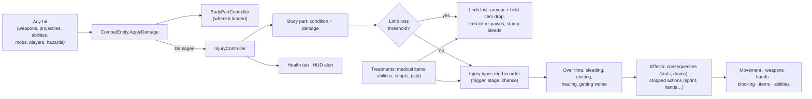
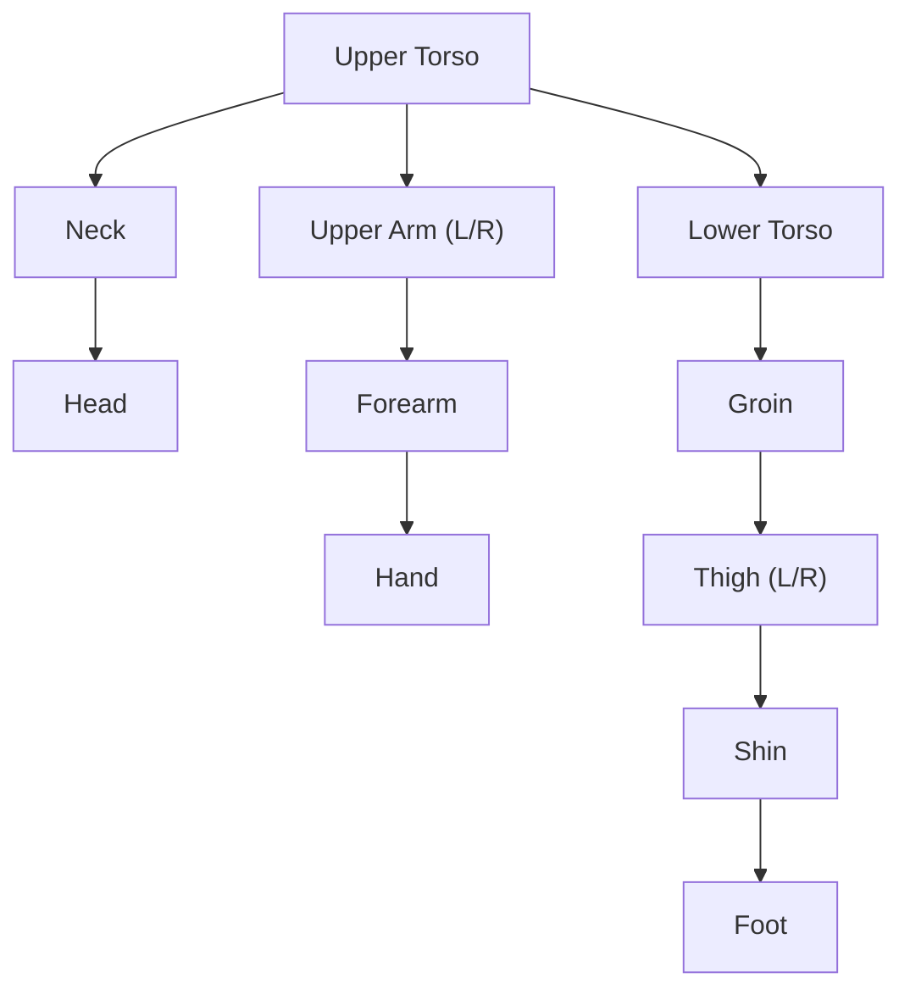

# 13 — Injuries, Limb Loss & Treatment

**Scripts:** `Essentials/Combat/Injuries/*` (`InjurySettings`, `InjuryDefaults`, `InjuryController` and its partial
files, `InjuryState`, `InjuryTreatment`, `MedicalItemSO`, `SeveredLimbItemSO`, `SeveredLimbLink`,
`InjuryAbilityEffects`, `CityInjuryTreatment`, `CityHealer`, `InjuryTypes`), `Essentials/UI/CharacterSheet/InjuryHealthPanel.cs`,
`InjuryUITrigger.cs`, `Essentials/UI/HUD/InjuryHudAlert.cs`, `Networking/Runtime/Status/NetInjuries.cs`,
`CustomEditor/Combat/InjuryEditors.cs` (inspectors and tools), `CustomEditor/Combat/InjurySystemTests.cs`.

A Project-Zomboid-like body: every body part has its own condition and injuries, wounds bleed until they are
bandaged, bones break, untreated wounds get infected, and limbs can be cut off — dropping the armour worn on them and
the item they held — and reattached before a time limit runs out. Players see and treat all of it on the **Health**
tab of the inventory's character panel. Everything is configured in one asset, and nothing is hard-coded: body parts,
injury types, severities, thresholds, effects, bleeding, limb loss, reattachment and treatments are data.

The system is **off** until the project has Injury Settings with *Enabled* on.

---

## 1. Setup (five minutes)

1. *Tools ▸ SimpleMovements ▸ Project Setup ▸ Create Injury Settings (Resources)*. It creates
   `Resources/SimpleMovements/Settings/InjurySettings` filled with the defaults below, **Enabled**.
2. *Tools ▸ SimpleMovements ▸ Player ▸ Injuries ▸ Create Medical Items (Presets)*: bandage, sterile bandage, suture kit,
   splint, disinfectant, antibiotics, burn salve and surgical kit in `Items/Medical/` (with icons and a world model).
   Put some in loot tables, merchants or the player's starting items.
3. *Tools ▸ SimpleMovements ▸ Player ▸ Injuries ▸ Create Severed Limb Items*: one item per body part that can be lost
   (icon, model) in `Items/Limbs/`, assigned to the parts. Optional offline (limbs get an item made at runtime);
   **needed in network sessions** (the limb must be a networked world item with an id in the Item Database).
4. Press Play. Players get an `InjuryController` automatically (*Injury Settings ▸ Players*; mobs too with *Mobs*).
   Open the inventory: the character panel has a **Health** tab.
5. Multiplayer: *Network ▸ Make Networked* on the player prefab adds `NetInjuries` (or add it next to `NetCombatStatus`).

The **Player Setup Validator** (Survival section) and the **Project Validator** (Project assets) check all of this and
offer the fixes. Turn the whole system off with *Injury Settings ▸ Enabled*: no controller is added, the Health tab
disappears, medical items say they have no use.

---

## 2. Body parts

*Injury Settings ▸ Body Parts* (the inspector draws the body diagram the Health tab shows). The defaults are
**17 parts**, every limb split into segments that hang on each other:

| Part | Kind | Lost? (takes along) | Armour that falls with it | While impaired (scaled by the impairment) | Stops |
|---|---|---|---|---|---|
| Head | Head | — | — | *Head Injury*: −25% casting speed, −10% crit, sanity drain, fainting chance | casting from 90% |
| Neck | Neck | — | — | *Neck Injury*: −15% casting speed, −10% max stamina | casting from 95% |
| Upper Torso | Torso | — | Chestplate | *Chest Injury*: −30% max stamina, +25% stamina costs | sprint and roll from 85% |
| Lower Torso | Torso | — | Belt | *Abdominal Injury*: −15% max stamina, +20% stamina costs, hungrier | sprint from 80%, jump / roll from 70% |
| Groin | Groin | — | — | *Groin Injury*: −15% move speed, −20% sprint speed | sprint / jump / roll from 60% |
| Right / Left Upper Arm | Arm | yes (forearm, hand) | (the forearm's and hand's) | *Injured Arm*: −20% weapon damage, −10% attack speed | two-handed weapons from 60%, **this hand** from 95% |
| Right / Left Forearm | Arm | yes (hand) | Bracers | *Injured Forearm*: −15% attack speed, −10% weapon damage | two-handed weapons from 60%, **this hand** from 95% |
| Right / Left Hand | Hand | yes | Gloves | *Injured Hand*: −15% attack speed, −8% crit, slower draw and reload | two-handed weapons from 60%, **this hand** from 90% |
| Right / Left Thigh | Leg | yes (shin, foot = the whole leg) | Leggings | *Limping*: −25% move speed, −25% sprint speed, −35% jump | sprint from 50%, jump / dash / roll from 70% |
| Right / Left Shin | Leg | yes (foot) | — | *Hurt Shin*: −20% move speed, −25% sprint speed, −25% jump | sprint from 55%, jump / dash / roll from 75% |
| Right / Left Foot | Foot | yes | Boots | *Sore Foot*: −15% move speed, −20% sprint speed | sprint from 75%, dash / roll from 90% |

**Cut from the segment that was hit down**: a hard hit on the shin takes the shin and the foot; on the thigh, the whole
leg; on the forearm, the forearm and the hand; on the upper arm, the whole arm.

The old ids still work as **aliases** (*Aliases* on each part): `Torso` finds the Upper Torso, `LeftArm` the Left Upper
Arm, `RightLeg` the Right Thigh — scripts, treatments, abilities and saves that use them keep working. A project
that already has Injury Settings keeps its old 10 parts until you press *Body Parts ▸ Reset Body Parts To Defaults*.

Each part has:

* **Condition** (*Max Condition*, 100 by default, 60 for hands and feet). Hits remove *damage × Condition Per Damage ×
  the part's Condition Damage Multiplier*; it comes back at *Condition Regen Per Second* while the part has no injury.
* **Impairment** 0–1: 1 when lost, otherwise the worst of its injuries' impairment and its lost condition (80% at 0
  condition). The part's **Impaired** consequence runs at that strength (its label is the status line in the
  character panel), and its **Action Rules** stop actions from a given impairment. A missing part uses its **Lost**
  consequence instead (when it has one).
* **Hit Parts** (Body Part Profile part names: `LeftForearm`, or the simple profile's `Arms`) and a **Height Range**: how
  hits find it (§3). **Hit Weight** shares the hits between segments when the profile part is broad.
* **Attached To**: losing the parent loses the child (a hand with its arm); hits on a lost part go to its parent.
* **At Zero Condition**: nothing, lose the limb, stun (the head: 2 s), or kill (through the normal death rules —
  unconsciousness still applies).
* **Limb Loss** (§6), **Armor Slots** (what falls off with it), how it disappears on the model (*Use Humanoid Bone*,
  *Bones*, *Renderers*), and its **Diagram Rect** on the Health tab (only used for parts the body figure does not know).

*Main Hand Side* (Right by default) decides which arm and hand hold the hotbar item; the other side holds the off-hand
slot (shield, second weapon). Rules written with **Hand On This Side** work for both arms.

---

## 3. Hits → body parts → injuries

Every hit that goes through `CombatEntity` — weapon swings and blades, arrows and bullets, abilities and spells, mob
attacks, other players (PvP), traps — raises `Damaged`; the controller handles it (damage over time — bleeding, poison
— never makes new wounds):

1. **Where**: the `BodyPartController`'s part (the **hitbox collider** that was struck, an aimed part, the hit's
   height) → the injury part **named like it** (a hit on the `LeftForearm` hitbox is the left forearm, never the upper
   arm); else the parts listing it in their *Hit Parts* (a simple profile's `Arms`); without one, the parts whose
   *Height Range* holds the hit's height. Several candidates: the **side** of the hit picks left or right, then *Hit
   Weight* (×3 for a part at the hit's height). A lost part passes the hit on to what it was attached to.

   The built-in **Body Part Profile** is now detailed too (*Reset To Detailed Humanoid* / *Reset To Simple Humanoid* on
   a profile): Head, Neck, Upper / Lower Torso, Groin, and per side Upper Arm, Forearm, Hand, Thigh, Shin and Foot,
   each with its own damage multiplier and armour; the old names (`Torso`, `Arms`, `Legs`, `Hands`, `Feet`) are aliases,
   so shields' *Covered Body Parts* still work. *Body Part Controller ▸ Add / Rebuild Hitboxes (Humanoid)* puts one
   trigger collider on each segment's bones (`Hitbox_LeftForearm_...`).
2. **Condition** goes down; the **limb loss** rules are checked (§6); then the *At Zero Condition* rule.
3. **Injuries**: the injury types are tried **in order** (*Max Injuries Per Hit*, 1 by default): the type's **trigger**
   must match (damage kind, delivery, elements, weapon categories, part kinds, critical only, *Min Hit Fraction* = the
   hit's condition damage / the part's max condition), then its **stage** is the strongest whose *Min Hit Fraction*
   the hit reaches, then its **chance** (× *Injury Chance Multiplier*) is rolled. The hit's **damage form** (slash,
   pierce, blunt, bite, claw, crush) scales the chance and how hard the hit counts, and the character's **resistances**
   (traits, race, class, items, buffs) scale both again: slashes cut and bleed, maces bruise and break bones — see
   [Player 14 — Damage Forms & Injury Resistances](14-Damage-Forms-and-Injury-Resistances.md).
4. A type with **Merge Into Existing** makes the injury already on the part worse instead of adding a second; a new hit
   on a bandaged bleeding wound soaks the bandage (it bleeds again).

### The default injury types

Severities (shared by every type, *Severity Levels*): **Minor**, **Moderate**, **Severe**, **Critical**.

| Type (tags) | Caused by | Stages | Bleeds | Heals | Gets worse |
|---|---|---|---|---|---|
| **Burn** (burn) | Fire hits ≥ 8% | Minor Burn · Burn (20%) · Severe Burn (40%) | — | 4 / 8 / 15 min; severe needs treatment | severe → Infection after 10 min |
| **Fracture** (fracture) | physical hits ≥ 22%, 30% | Cracked (Moderate) · Broken (Severe, 35%) · Compound (Critical, 55%) | compound 0.35/s | 7 / 12 / 18 min; broken and compound need a splint / surgery; heals stage by stage | compound → Infection after 7 min |
| **Deep Wound** (wound, bleeding) | physical ≥ 30%, 40% | Severe | 0.9/s, never stops | 10 min once stitched | → Infection after 6 min |
| **Laceration** (wound, bleeding) | physical ≥ 12%, 50% | Moderate | 0.4/s for 2.5 min | 6 min (half speed untreated) | → Infection after 10 min |
| **Scratch** (wound, bleeding) | physical ≥ 4%, 55% | Minor (up to 3 per part) | 0.12/s for 40 s | 2.5 min | — |
| **Infection** (infection) | wounds left open | Infection (Moderate) · Severe Infection | — | needs disinfectant / antibiotics | → Severe after 15 min |
| **Amputation Stump** (stump, wound, bleeding) | losing a limb | Critical | 1.4/s, never stops | once stitched | → Infection after 5 min |
| **Reattached Limb** (reattached) | reattachment | Fresh (80% impaired) → Healing (45%) → Knitting (15%) | — | 4 min per stage | — |
| **Puncture Wound** (wound, bleeding, puncture) | piercing hits ≥ 10% | Puncture (Moderate) · Deep Puncture (Severe, 30%) | 0.3/s for 2 min · 0.7/s until treated | 7 / 10 min; deep needs stitches | → Infection after 7 / 5 min |
| **Bite Wound** (wound, bleeding, bite) | bites ≥ 6%, 70% | Bite Wound (Moderate) · Mauled (Severe, 30%) | 0.35/s for 2 min · 0.8/s until treated | 6.7 / 11.7 min | → Infection after 4 / 3.3 min |
| **Bruise** (bruise) | blunt and crushing hits ≥ 6% | Bruise (Minor) · Deep Bruise (Moderate, 20%) | — | 3 / 5 min, by itself | — |
| **Concussion** (concussion) | blunt hits to the head ≥ 25% | Severe: dizzy spells (stuns) | — | 5 min, by itself | — |
| **Frostbite** (burn, cold) | Ice hits ≥ 10% | Frostnip (Minor) · Frostbite (Severe, 35%) | — | 3.3 / 13 min; frostbite needs treatment | frostbite → Infection after 10 min |

The odds of each type by damage form, and how characters resist them: [Player 14](14-Damage-Forms-and-Injury-Resistances.md).

Each **stage** sets: *Bleeding Per Second* and *Clots After Seconds* (0 = never stops by itself), *Impairment*,
*Condition Loss Per Second* (an infection wears the part down), *Heal Seconds*, *Needs Treatment To Heal*, *Untreated
Heal Rate*, *Worsen After Seconds* and *Worsens Into* (another type — the wound stays and causes it — or the next
stage), its own **Consequence** (stats, health / stamina / sanity per second, hunger / thirst drain, fainting chance)
and **Blocks** (actions it stops by itself). *Heal Stage By Stage* drops a healed injury one stage instead of removing it.

### Bleeding

*Injury Settings ▸ Bleeding*: every bleeding injury adds up (× *Multiplier*, capped at *Max Per Second*). It is dealt
as true, unblockable damage over time, so it knocks the player out and kills through the normal rules (`Unconsciousness`
keeps counting toward the death threshold while bleeding). *Can Kill* off stops it at 1 health. The **Bleeding** status
(less stamina, scaled by how much it bleeds) shows in the character panel; the HUD alert pulses while bleeding.

---

## 4. Effects on the player

| What | How |
|---|---|
| Movement (limping, no sprint / jump / dash / roll / crouch) | Part consequences change Move / Sprint / Crouch Speed and Jump Force (character stats); stopped actions are checked by the movement states (`MovementContext.BodyAllows`), deterministic, so prediction on clients matches the server. How the legs let it move — **limp, hop, crawl** — is §4a |
| Combat | Consequences change Weapon Damage, Attack Speed, Critical Chance, Draw and Reload Speed, Casting Speed...; `WeaponAttacks` stops every weapon attack, `OffHand` the off-hand attack, `Block` raising a guard, `CastAbilities` casting (`CombatEntity.CanCast`) |
| Hands and equipment | `HandRules.Evaluate(main, off, hands)`: a **two-handed weapon needs both hands** (it stays in the hotbar but cannot be equipped); with the main hand unusable the other hand carries a one-handed item and the off-hand item is stowed; with the off hand unusable the shield / second weapon is stowed; with no usable hand nothing can be held. `UseItems` stops using items |
| Survival | Stage consequences: health drain (infections), hunger and thirst drain, sanity, fainting |
| Head / torso | Their consequences (casting, crits, sanity, fainting / stamina) |

Everything goes through `CombatEntity.BodyLimits` (`IBodyActionLimits`) — the injury controller registers itself
there. Your own systems can ask `entity.AllowsAction(BodyAction.Sprint)`, `entity.Hands` or `entity.Locomotion`, or
implement `IBodyActionLimits` (and `IBodyLocomotion`) for other limits (a curse that stops jumping).

### 4a. Limping, hopping and crawling

*Injury Settings ▸ Movement* (`LocomotionRules`). The legs decide **how** the player moves (`BodyLocomotion`, worked out
from the parts' state on every machine, so a client predicts the same movement the server simulates):

| Mode | When | Movement | Stops (default) | While moving |
|---|---|---|---|---|
| **Limping** | a thigh, shin or foot impaired from *Limp From Impairment* (20%) | the leg's consequences slow it; *Limp Amount* grows with the impairment | what the leg's rules stop | from *Pain From Limp* (60%): **Painful Walking** (stamina, a little sanity) |
| **Limping on a stump** | a foot is missing | × *Missing Foot Speed* (0.75), limp 0.9 | sprint, dash, roll | Painful Walking |
| **Hopping** | one leg cannot carry weight: missing (from the shin or the thigh) or impaired from *Leg Useless From Impairment* (95%: a compound fracture) | hops of *Hop Seconds* (0.55 s): it moves during the first *Hop Move Share* (60%) and stands still on landing; average *Hop Speed* (45%) | sprint, jump, dash, roll, crouch | **Hopping** (−1.5 stamina/s) |
| **Crawling** | no leg can carry weight | drags itself with the arms: *Crawl Speed* (20%); ×0.65 with one arm, ×0.3 with none | sprint, jump, dash, roll, crouch | **Crawling** (−2 stamina/s) |

Hopping's bursts are measured on the movement clock (`MovementContext.SimTime`), so a replayed network step moves the
same. A missing leg's *Lost* consequence has no speed penalty of its own: the mode sets the speed.

**The body without legs.** With both legs missing the character's **collider shrinks** to what is left
(*Legless Height*: 55% of standing = from the waist up; 77% with both knees left) with its bottom on the ground, and the
**model is lowered** so the waist rests on the ground (*Lower Model When Legless*; the drop is the Humanoid hips' height,
or *Legless Model Drop*). With a `CharacterBody` it resizes every collider (CharacterController, capsule, NavMeshAgent)
and the camera targets come down; without one the CharacterController is resized. Reattached legs bring it all back.
Turn *Lower Model When Legless* off when your crawl animations already put the hips on the ground.

**Lost parts' hitboxes are switched off** (*Disable Lost Hitboxes*): hits pass where the limb was, and a hit at its height
lands on what it was attached to.

**Animations.** The player's Animator gets (all optional — missing parameters are skipped):

| Parameter | Type | Value |
|---|---|---|
| `LocomotionMode` | Int | 0 normal, 1 limping, 2 hopping, 3 crawling |
| `IsLimping` / `IsHopping` / `IsCrawling` | Bool | the mode |
| `LimpAmount` | Float | 0–1, how badly it limps (blend a normal and a limping walk) |
| `LimpSide` | Float | −1 left leg, +1 right leg (mirror the limp clip) |
| `HopCycle` | Float | 0–1 through the current hop (drive the Hop state's *Motion Time*: the feet land when the movement pauses) |
| `IsLegless` | Bool | both legs missing |
| `MissingLegs` / `MissingArms` | Int | 0–2 (one-legged idles, one-armed attacks and crawling) |

*Tools ▸ SimpleMovements ▸ Player ▸ Complete Player Animator Controller* adds the parameters and empty **Limp** (while
IsLimping and moving), **Hop** (its Motion Time follows HopCycle) and **Crawl** states with their transitions: drag your
clips onto them.

---

## 5. The Health tab (inventory ▸ character panel)

Open the inventory: the character panel beside it has **Stats** and **Health** tabs (only while the injury system is
on and the player has a controller).

* **Body diagram** (front view, the character's right on the left): a figure with each part drawn as its own shape on a
  faint silhouette — head, neck, upper / lower torso, groin, and every arm and leg segment — coloured by its condition
  (green → yellow → red; its % on the head and torso), a pulsing **red dot** on bleeding parts, an **orange dot** on
  other injuries, missing parts dark grey. The figure keeps its proportions whatever the panel's size, and only the
  inside of a shape takes the click. Parts are placed by their id (`LeftForearm`, `Head`...); a part the figure does not
  know (a tail) is drawn as a box at its *Diagram Rect*.
  **Hover** a part: condition, impairment, its injuries, what it does to you. **Click** it: the list shows only its
  injuries (and what the part does). **Right-click** it: treat its most urgent injury (or reattach it).
* **Summary**: bleeding per second, number of injuries, missing limbs with the time left to reattach them, what your
  body cannot do right now, and (placeholder) city treatment.
* **Injuries**: each with its severity colour, name, severity, and live status — bleeding (or stopped), bandaged /
  splinted / stitched, *worsens in*, *heals in*, impairment — and a healing progress bar. **Hover** an injury for
  everything about it (bleeding and when it stops, effects, treatment, healing, what you carry that treats it).
  **Click** it to open the treatment menu: every medical item you carry that fits — *Bandage ×3 — Bandage (2 s)* —
  usable ones highlighted, the others greyed with the reason (*Already treated*, *Needs 2*, *You need a usable hand*).
  Pick one: the treatment is applied over its time (the bar on top shows the progress, **Cancel** stops it; a hit
  interrupts it with *Damage Interrupts Treatment*), and the item is used up only when it finishes.
* **Missing limb** rows: *Reattach within 3:42 · limb in your bag / limb not carried*, with the time bar. Click to
  reattach with a surgical kit (§6).

Everything updates live as you are hit, bleed, heal, are treated, lose or get back a limb. Medical items also work from
the **hotbar or a quickslot**: using one treats the most urgent injury it can (bleeding first). Outside the inventory,
the **HUD alert** at the top of the screen warns *Bleeding / HEAVY BLEEDING · Left Hand lost (3:42) · Broken bone ·
Bandage 60%* (*Injury Settings ▸ Show Hud Alert*).

---

## 6. Limb loss, dropped items and reattachment

**When**: *Body part ▸ Limb Loss*: *Can Be Lost*, and either a **single hit** removing at least *Single Hit Threshold*
of the part's max condition, or the hit that brings it to **0 condition** (*At Zero Condition*), then *Chance*. Only
*Damage Kinds* (Physical by default), *Area Damage Can Sever*, *Only Weapons*. Any source counts: other players, mobs,
mob abilities (also *Injury ▸ Inflict Injury* with *Sever Chance*), traps.

**What happens** (`InjuryController.LoseLimb`):

1. The part and everything attached to it (an arm's hand) are **lost**; their injuries go with them.
2. The **armour** worn on them (*Armor Slots*: the arm's bracers and the hand's gloves) **drops into the world** as
   separate items next to the limb, linked to it (`SeveredLimbLink`).
3. The **item held** by a lost hand drops: the hotbar item for the main hand, the off-hand slot item for the off hand,
   and a **two-handed weapon** for either (it needs both hands).
4. The **limb drops** as a world item (`SeveredLimbItemSO`) the player can pick up. Its copy carries a
   `SeveredLimbRecord`: whose limb, which parts, its **condition** at the loss (it decays by *Limb Decay Per Second*)
   and its **time limit** (*Reattachment ▸ Time Limit Seconds*, 5 min, or the part's own). Its tooltip in the
   inventory shows all of it.
5. It disappears on the character (the Humanoid bone or the listed bones / renderers collapse), the **stump** bleeds
   (the *Amputation Stump* injury), the hands are re-evaluated (§4) and the player is told how long they have.

**Reattaching** (`ReattachLimbTreatment`, in the *Surgical Kit* preset):

* The lost part must not have come off with another (reattach the arm, not its hand).
* The **limb must be the character's own** (*Only Own Limb*) and **carried** (*Limb Must Be Carried*; abilities may also
  use a limb lying within *Ground Range*).
* **Before the time limit**: items and ordinary treatments only work while it runs. **After it**, only treatments with
  **Ignore Time Limit** — abilities (`Injury ▸ Treat Injuries` with a Reattach Limb effect) or, later, city surgeons.
* The limb's condition must be at least *Min Limb Condition* (unless *Ignore Limb Condition*).
* Success: the part (and its hand / foot) is back with *Restored Condition × the limb's condition*, the model shows it
  again, the stump goes, a **Reattached Limb** injury is added (it works badly at first and recovers), the limb item is
  used up, and the hands can hold things again. The fallen armour stays on the ground: pick it up and put it back on.
* *Regrow Without Limb* (an ability) needs no limb at all.

A respawned player gets everything back (*Clear On Respawn*, *Restore Limbs On Respawn*); their limbs left in the world
become leftovers.

**Cleanup** (*Limbs ▸ Cleanup*): so the world does not fill up, a limb lying in the world is **removed** after *Limb
Seconds* (default: its reattachment time limit + 2 minutes; 0 = never) and the armour and items that fell with it after
*Dropped Item Seconds* (10 minutes). Picked up, they stay in the inventory. Its tooltip shows when it rots away; once
it is gone the Health tab says so and only an ability with *Regrow Without Limb* brings the part back. Removal happens
where the rules run (offline, the server) and is a network despawn for everyone.

---

## 7. Treatments

An `InjuryTreatment` is: a **name**, a **target** (injury type ids and / or tags, severity range, body-part kinds, *Skip
Already Treated*), an **apply time**, and **effects** (pick with the dropdown):

| Effect | Does |
|---|---|
| **Stop Bleeding (Bandage)** | Stops a share of the bleeding (*Effectiveness*), faster healing, *Sterile* = no infection |
| **Treat (Splint, Stitch, Disinfect)** | *Label*, *Allows Healing* (broken bones, deep wounds), faster healing, less impairment, *Stops Worsening*, *Stops Bleeding* |
| **Cure** | Removes the injury, or lowers it some stages |
| **Restore Condition** | Gives the part condition back |
| **Reattach Limb** | §6 (*Ignore Time Limit*, *Ignore Limb Condition*, *Regrow Without Limb*, *Restored Condition*, *Skip After Injury*) |

Treatments live in:

* **Medical items** (`MedicalItemSO`, *Assets ▸ Create ▸ SimpleMovements ▸ Items ▸ Medical Item*, or the presets): one
  or more treatments and *Units Per Use*. The item inspector has a *Presets ▸ Medical* menu.
* **Abilities**: the **Injury ▸ Treat Injuries** effect (Most Urgent / Most Severe / All, Max Injuries; strength scales
  with the ability's healing) — a healing spell, a racial regeneration, a *Restore Limb* miracle with Ignore Time Limit.
  **Injury ▸ Inflict Injury** does the opposite for mob attacks (a wolf bite on the legs, a crushing slam that breaks
  bones, a chance to cut a limb off).
* **Scripts**: `ApplyTreatment(treatment, part, injury, TreatmentSource.Script)` (instant) or `BeginTreatment(...)`.

| Preset | Treats | How |
|---|---|---|
| Bandage | wounds, bleeding, burns, stumps | stops 85% of the bleeding, heals ×1.5 (2 s) |
| Sterile Bandage | same | stops 95%, heals ×1.8, no infection |
| Suture Kit | deep wounds, lacerations, stumps | stitched: stops the bleeding, lets it heal, stops infection (5 s) |
| Splint | cracked and broken bones of limbs | splinted: lets it heal, 45% less impairment (4 s) |
| Disinfectant | wounds, burns, stumps / a beginning infection | stops infection / cures it |
| Antibiotics | any infection | lets it heal ×2 |
| Burn Salve | burns | heals ×2, 40% less impairment |
| Surgical Kit | missing limbs; severe fractures, deep wounds, stumps | reattaches a limb in time (8 s); surgery (6 s) |

The *Treatments* page of the Injury Settings inspector lists every medical item and healing ability of the project.

### City treatment (placeholder)

City healers and hospitals are **not implemented yet**. The system is ready for them: *Injury Settings ▸ City
Treatment* (prices, *Can Reattach Expired Limbs*, a note), `TreatmentSource.City`, the `ICityTreatmentProvider`
interface with its registry (`CityInjuryTreatment`), and a stand-in **City Healer** component (*Player ▸ Injuries ▸ Add
City Healer*) that players can interact with — today it only shows the note. Implementing it means writing a provider
(price, payment, `ApplyTreatment(..., TreatmentSource.City)`); nothing else changes.

---

## 8. Editor

* **Injury Settings inspector**: the on/off switch and every problem on top, then pages — *General* (rules, treatment,
  bleeding), *Body Parts* (the diagram, a summary per part, the list), *Injuries* (severities, a readable summary of
  each type and stage, the list), *Treatments* (medical items and healing abilities of the project, *Create Medical
  Item Presets*), *Limbs* (reattachment rules, cleanup, the parts that can be lost with their limb items, *Create
  Severed Limb Items*), *Movement* (limping, hopping, crawling, the legless body, hitboxes), *City* (the placeholder). *Reset ... To Defaults* buttons bring the defaults back.
* **Injury Controller inspector** (Play Mode): every part's condition and injuries live, and test buttons — hit a part,
  add an injury of any type and stage, lose a limb, heal all.
* **Menus**: *Project Setup ▸ Create Injury Settings*; *Player ▸ Injuries ▸* Open Injury Settings, Create Medical Items,
  Create Severed Limb Items, Add Injury Controller To Selection, Add City Healer.
* **Validators**: the Player Setup Validator's Survival section (with *Add Injury Controller* / *Create Injury
  Settings*), the Project Validator (settings problems, missing limb items, no medical items).
* **Tests**: *Window ▸ General ▸ Test Runner ▸ EditMode ▸ InjurySystemTests*.

---

## 9. Multiplayer

The server runs every rule. `NetInjuries` (on the player prefab) sends the state — part conditions, injuries, missing
limbs, the treatment being applied — to everyone who sees the character when it changes (at most every *Send
Interval*); client copies show it (Health tab, missing limbs on the model, the HUD alert) and use it for what they
predict (movement limits, hands). The owner's treatments are sent to the server and checked there like local ones.
Limbs need **limb item assets** (§1, step 3) so they can be networked world items; armour and held items drop like any
dropped item. Limping, hopping, crawling and the legless body are worked out from that state on every machine (the same
collider height and speed on the server and in the owner's prediction); `MovementAnimationHandler` sets the animator
parameters on every copy, so other players see you hop or crawl.

**One HUD per player.** Each machine shows only its own player's injury HUD alert and Health tab: the alert is created by
the controller of the locally controlled player only (other players' copies never make one), and the pause menu is a
single object per game instance — in a network session it does not stop time, and it opens on the machine where Escape
was pressed. A host sees its own HUD, not the clients'.

---

## 10. Extending it

* **New injury type** — add one to *Injury Types* (id, tags, trigger, stages). Treatments find it by id or tag.
* **New body part** (a tail, wings) — add it to *Body Parts* (kind Other), give it *Hit Parts* matching your Body Part
  Profile, rules and a diagram rect.
* **New treatment effect** — derive from `TreatmentEffect` (`Apply`, `Describe`, optionally `CanApply`, `WouldHelp`,
  `ForMissingLimbs`): it appears in the dropdown of every treatment.
* **New limits** — implement `IBodyActionLimits` and assign `CombatEntity.BodyLimits`, or add `BodyAction` values (at the
  end) and check them where the action happens.
* **Scripting** — `InjuryController.For(player)`: `Parts`, `AddInjury`, `ChangeStage`, `RemoveInjury`, `ApplyHit`,
  `LoseLimb`, `ReattachLimb`, `FindLimb`, `ApplyTreatment`, `BeginTreatment`, `QuickTreat`, `HealAll`, `RefreshEffects`, `Allows`,
  `Hands`, `Locomotion`, `BleedingPerSecond`; events `Changed`, `InjuryAdded`, `InjuryRemoved`, `InjuryStageChanged`, `LimbLost`,
  `LimbReattached`, `Treated`, `Message`, `HandsChanged`, static `AnyLimbLost`.

## 11. Notes and limitations

* Severed limbs and their records live in memory: they are not saved with the game (they rot within minutes anyway).
* A limb's time limit is in game seconds (`Time.time`), so pausing with time scale 0 stops it.
* The generated limb and medical models are capsules and boxes — replace the *Severed Prefab* / item prefabs with your
  art.
* Mobs can be injured (*Mobs*), but they have no inventory: they bleed, limp and lose limbs, without dropping equipment.
  Limping / hopping / crawling speeds apply to players' movement; mob AI moves at its own speed (their collider still
  shrinks without legs).
* A limb picked up and dropped again from the inventory is an ordinary item: the cleanup timer only applies to limbs and
  gear that fell off the body.
