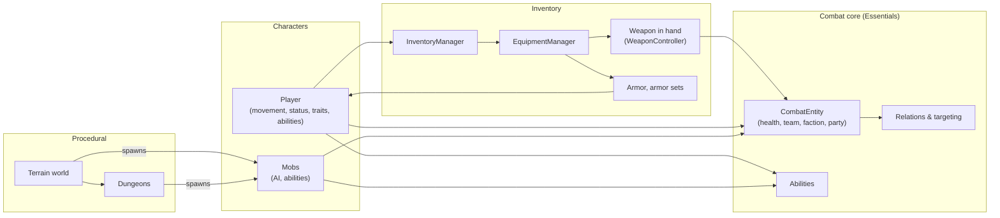
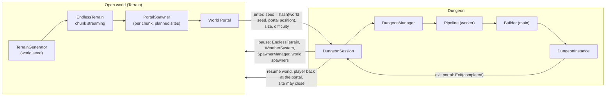

# Simple Movements — Documentation

Guides for every system in `Assets/Scripts/`. Each part has a README with its chapters; the **setup** chapters are
step-by-step, the others explain how the system works and what every setting does.

| Part | Folder | Start with |
|---|---|---|
| **Player** — the player prefab and its scripts: movement and input, stamina and status bars, classes, traits, experience, camera, animation, ability keys, targeting other players, parties, guilds, inspecting, injuries and limb loss | [`Player/`](Player/README.md) | [Player 01 — Setup](Player/01-Player-Setup.md) |
| **Mobs** — creatures and enemies: setup, AI profiles, perception, temperament, combat, abilities, animation, death, spawning | [`Mob/`](Mob/README.md) | [Mobs 01 — Setup](Mob/01-Mob-Setup.md) |
| **Inventory, items, armor and weapons** — inventory UI (slots or grid), items, equipment, armor sets, weapons and attacks, dual wielding, shields and blocking, ranged weapons and ammo, body-part damage, equipment visuals, quickslots, teams / factions / friendly fire | [`Inventory/`](Inventory/README.md) | [Inventory 08 — Setup Guide](Inventory/08-Setup-Guide.md) |
| **NPCs, interaction & merchants** — the player's interaction (key, click, proximity, prompt), NPCs, options and dialogue, merchants (buy / sell, stock, prices, categories and tabs, money), the shop window (slots or grid like the inventory, custom skins, generated fallback) | [`NPC/`](NPC/README.md) | [NPC 03 — Merchant Setup](NPC/03-Merchant-Setup.md) |
| **Terrain** — the endless open world: noise, landforms, mountains, volcanoes, Voronoi biomes, climate, water (oceans, lakes, rivers, waterfalls), erosion, meshes, colliders, textures and shaders, weather (and its effects on players), day and night, objects, world portals and mobs | [`Terrain/`](Terrain/README.md) | [Terrain 01 — Architecture](Terrain/01-Architecture.md) |
| **Dungeons** — multi-floor procedural dungeons entered through world portals: planning, layouts (rooms, BSP, caves, hybrid, maze), connectivity and corridors, roles, heights, validation, population, meshing and build, runtime | [`Dungeon/`](Dungeon/README.md) | [Dungeon 01 — Architecture](Dungeon/01-Architecture.md) |
| **Hub World** — the permanent hub city, the open world regenerated every dimensional cycle (warnings, the jump, loot loss, Dimensional Disorientation, modifiers), dungeons in scenes of their own with their own physics, safe and dangerous zones (PvP, difficulty), visual-only abilities in the city, duels | [`HubWorld/`](HubWorld/README.md) | [Hub World 05 — Setup](HubWorld/05-Setup-and-Configuration.md) |
| **Networking** — Fish-Net multiplayer run locally (host, headless dedicated server, clients on 127.0.0.1): movement prediction, authoritative combat with lag compensation, mobs, inventory, trading, world cycles, stacked dungeon scenes, interest management | [`Networking/`](Networking/README.md) | [Networking 01 — Architecture and local setup](Networking/01-Architecture-and-Local-Setup.md) |
| **Alchemy** — experimentation-based potion crafting: ingredients are made of substances (extraction by grind level, evenness and pH, solubility and saturation per solvent, density and layers, volatility, thermal and pH stability, compatibility, contamination), reactions transform them over time by temperature, concentration, catalysts, stirring, layers, acidity, vessel and surroundings, and the mixture's state decides what is bottled (each bottle's effects follow its own strength and purity); a 3D cauldron showing the real state, an observation-only window outside a test bench; grinding, fire (bellows by hand), spoon-stirring and filtering minigames shaped by the player's stats, filtering, decanting, skimming, evaporation, crystallisation, fermentation and distillation, mid-process additions, failures, a per-player journal of discoveries, the Alchemy Lab | [`Alchemy/`](Alchemy/README.md) | [Alchemy 01 — Overview and Setup](Alchemy/01-Overview-and-Setup.md) |
| **Smithing, metallurgy and leatherworking** — ore deposits that differ, ore cleaning (crushing, sorting, washing, sieving), bloomery smelting (fuel, bellows, flux, slag, blooms, cast iron, cupellation, matte, cementation), crucible alloying and casting, a forge and anvil worked blow by blow, quenching (media, agitation, cracks, warping), tempering, annealing, normalising, differential hardening, grinding, filing, descaling, polishing, coating, whetstone sharpening, hide preparation, liming, tanning, drying, staking, finishing and cutting, hands-on assembly of weapons, tools and armour; every piece's full state and history; normal stations (observation and instruments only) and test stations (everything shown); a per-player journal; final inspection; server-authoritative multiplayer with crafted items seen by everyone | [`Crafting/`](Crafting/README.md) | [Crafting 01 — Overview and Setup](Crafting/01-Overview-and-Setup.md), [Crafting 08 — Multiplayer](Crafting/08-Multiplayer.md) |
| **Harvesting** — mob looting, butchering and harvesting: the fight marks the body (every hit by where it landed and what dealt it: weapons, abilities, elements, weak points), the body stays as a carcass that spoils with the weather, and players take what they choose — hides, meat, fat, tendons, bones, organs, claws, teeth, horns — each through its own hands-on minigames (opening cuts, peeling, cutting free, drawing out, sawing, prying, scraping); seven skills, harvesting tools with edges that dull, quality per piece from the fight, the hands, freshness, tools, skills and the creature; creature anatomies as data (four legs, two legs, wings, fins, serpents, many legs; twelve built in); hides for the tannery, alchemy ingredients, food; server-authoritative multiplayer | [`Harvesting/`](Harvesting/README.md) | [Harvesting 01 — Overview and Setup](Harvesting/01-Overview-and-Setup.md) |
| **Minigames** — tables with benches where players sit and bet money, items or a limb: Truco, blackjack, Texas Hold'em poker, arm wrestling and drinking contests, with bots in empty seats, a table window, cards in the players' hands and networked views | [`Minigames/`](Minigames/01-Card-Games-and-Truco.md) | [Minigames 01 — Card Tables and Truco](Minigames/01-Card-Games-and-Truco.md) · [02 — Blackjack, Poker and Contests](Minigames/02-Blackjack-Poker-and-Contests.md) |
| **Project organisation** — where every generated asset goes (`Assets/Resources/SimpleMovements/...`), moving older ones there, and the recommended layout of the scripts | [`Project-Organisation.md`](Project-Organisation.md) | [Project Organisation](Project-Organisation.md) |
| **Validation & auto-assign** — the Project Validator window (missing scripts, broken and required references, network prefabs, project assets, one-click fixes), automatic filling of empty references, `[AutoAssign]` / `[RequiredReference]`, the Edit Mode tests | [`Validation/`](Validation/README.md) | [Validation — overview](Validation/README.md) |

## How the parts fit together

* The **player** owns the inventory; items in equipment slots and the weapon in hand change the player's stats,
  traits and attacks.
* The **player** and **mobs** are both `CombatEntity`s: weapons, abilities and AI all damage, heal and target them
  through the same combat core (teams, factions, parties, friendly fire).
* The **terrain** and **dungeons** spawn mobs; dungeons are entered through world portals.
* The **hub world** ties them together: the city, the world reloaded with a new seed every cycle, a scene per dungeon,
  zones and the combat rules of the city (see [`HubWorld/`](HubWorld/README.md)).

---

# Procedural generation

Documentation for the two procedural systems in `Assets/Scripts/Procedural/`.

## How the two systems meet

The dungeon reuses terrain infrastructure (`TerrainWorkerPool`, `PlacementRandom`, `MeshColliderBaker`,
`GenerationStats`, `WorldSpawnRegistry`) but no terrain data. It is built far below the world (y = −10 000).

## Editor menus

Everything is under one **SimpleMovements** entry in each menu.

| Menu | Contents |
|---|---|
| *Assets ▸ Create ▸ SimpleMovements ▸ Character* | Player Class, Character Archetype (Race - Class), Archetype Presets (races, class archetypes), Trait, Trait From Preset…, Trait Database |
| *… ▸ Items* | Weapon, Weapon From Template, Armor, Ammo (+ Ammo Preset), Consumable (+ Consumable Preset), Equippable (Accessory), Material, Miscellaneous, Armor Set, Combo Tree, Random Item Spawns (Storage), Item Category, Item Category Database |
| *… ▸ NPC* / *Economy* | Merchant Stock, Merchant UI Skin / Currency |
| *… ▸ Abilities* | Ability Definition, Ability From Preset…, Ability Database, Absorption Settings |
| *… ▸ Combat* | Combat Settings, Faction, Body Part Profile, Elemental Reactions |
| *… ▸ Mobs* / *World* / *Dungeon* | Mob Profile (+ presets) / Biome / dungeon profiles, themes, tables, room templates |
| *… ▸ Hub World* | Hub World Settings, Dimensional Modifier |
| *… ▸ Alchemy* | Alchemy Database, Ingredient, Equipment, Brewed Potion |
| *… ▸ Crafting* | Crafting Database, Stock Material |
| *… ▸ Legacy* | Old ability assets (AbilityEffectSO, PlayerAbilitySO) and the old Player Class template, kept for existing assets — use the entries above for new ones |
| *Tools ▸ SimpleMovements ▸ Project Setup* | Create Combat Settings / Absorption Settings / Ability Database / Trait Database / Item Category Database / Default Currency / Alchemy Database / Crafting Database (Resources) |
| *… ▸ Player* | Add Player Setup Validator To Selection, Auto-Setup All Players In Scene |
| *… ▸ Social* | Create Player Targeting And Party System, Add Player Social (selected player prefab) |
| *… ▸ Scene UI* | Build Character Creation Screen, Build Pause & Settings Menu |
| *… ▸ Inventory* | UI Builder, Auto-Build UI When Missing, Armor Set Wizard, Attack Preview, Grid Inventory |
| *… ▸ Mobs* | Create New Mob, Add Missing Components, Spawnable Mob Helper, Help |
| *… ▸ NPC* | Create Merchant NPC / Talking NPC (or make the selection one), Add Player Interactor To Players, Validate NPCs In Scene, Help |
| *… ▸ Validate* | Validate All Abilities / Players / Traits |
| *… ▸ Dungeon* / *Legacy* | Dungeon tools / Convert Selected Legacy Abilities |
| *… ▸ Minigames* | Create Truco / Blackjack / Poker / Arm Wrestling / Drinking Contest Table, Create Truco Game Asset, Make Selected Card Table Networked |
| *… ▸ Alchemy* | Create Alchemy Station / Test Bench, Create Equipment Presets / Ingredient Items / Potion Items, Open Alchemy Lab, Validate Alchemy Database, Help |
| *… ▸ Crafting* | Create Smithy / Smeltery / Tannery / Leatherworks / Complete Workshop / Test Station, Create Ore Deposit, Create Stock Items / Design Templates, Validate Crafting Database, Help |
| *… ▸ Hub World* | Create Settings Asset, Build City Scene, Make Open Scene The World Scene, Add City / Return Gate, Validate Setup, Help |
| *GameObject ▸ SimpleMovements* | Quick Setup Mob (right-click a model), NPC ▸ Merchant NPC / Talking NPC |

## Reading order

1. The two **Architecture** chapters (macro flowcharts, data flow with feedback loops, dependency graphs).
2. The chapter for the system you are working on (each has micro flowcharts of its algorithms).
3. **Configuration Reference** ([Terrain 18](Terrain/18-Configuration-Reference.md),
   [Dungeon 12](Dungeon/12-Configuration-Reference.md)) before tuning.
4. **Debugging** ([Terrain 19](Terrain/19-Debugging.md), [Dungeon 13](Dungeon/13-Debugging.md)) when something looks
   wrong.

## Flowchart index

| Topic | Macro | Micro |
|---|---|---|
| Terrain generation (whole world) | [Terrain 01 §3–4](Terrain/01-Architecture.md) | — |
| Chunk lifecycle, streaming, LOD | [Terrain 02](Terrain/02-World-Chunks-Streaming.md) | lifecycle state diagram, rings |
| How a height is calculated | [Terrain 04 §3](Terrain/04-Height-and-Landforms.md) | coordinate → height ([03 §3](Terrain/03-Noise.md)), base heights per cell, landform suggestion, massif height |
| Landforms and mountains | [Terrain 04](Terrain/04-Height-and-Landforms.md) | massif pipeline, belts, transitions |
| Volcanoes | [Terrain 05](Terrain/05-Volcanoes.md) | placement, cone/caldera profile |
| Biomes (Voronoi + climate) | [Terrain 06](Terrain/06-Voronoi.md), [08](Terrain/08-Biomes.md) | site assignment, blend weights, climate fitness ([07](Terrain/07-Climate.md)) |
| Water | [Terrain 09 §2](Terrain/09-Water.md) | continent, ocean shaping, **lake placement**, springs, **river trace**, junctions, waterfalls, classification |
| Erosion | [Terrain 10](Terrain/10-Erosion.md) | thermal, hydraulic droplet, seamless tiles |
| Mesh and collider | [Terrain 11](Terrain/11-Mesh-and-Collider.md) | collider baking sequence |
| Textures and shaders | [Terrain 12](Terrain/12-Texturing-and-Shaders.md) | splat weights, tri-planar, shader passes |
| Objects | [Terrain 14](Terrain/14-Object-Placement.md) | per-rule stages, landmarks |
| World portals and mobs | [Terrain 15](Terrain/15-Portals-and-Mobs.md) | site planning, spawn resolution |
| Dungeon (portal → dungeon → world) | [Dungeon 01 §2](Dungeon/01-Architecture.md) | pipeline, threads, data flow |
| Dungeon floors, stairs, drops | [Dungeon 03](Dungeon/03-Macro-Plan.md) | style choice, anchors, stairs, drops |
| Dungeon layouts | [Dungeon 04](Dungeon/04-Layout-Styles.md) | rooms, BSP, cellular-automaton caves, hybrid zones, maze |
| Dungeon connections and corridors | [Dungeon 05](Dungeon/05-Connectivity-and-Corridors.md) | loops, dead ends, kinds, A* step cost |
| Dungeon roles and templates | [Dungeon 06](Dungeon/06-Roles-and-Templates.md) | role assignment, area choice, templates |
| Dungeon heights, validation, analysis | [Dungeon 07](Dungeon/07-Carve-Validate-Analysis.md) | height pass, repair loop, analysis |
| Dungeon mobs, loot, props, portals | [Dungeon 08](Dungeon/08-Population.md) | portal wall, budgets, packs, loot tiers, props |
| Dungeon meshes and build | [Dungeon 09](Dungeon/09-Meshing-and-Build.md) | squares, stairs, tile kit, colliders/NavMesh sequence |
| Dungeon runtime and portals | [Dungeon 10](Dungeon/10-Runtime-Session-Portals.md) | full sequence, portal trigger, states, streaming, respawns |

