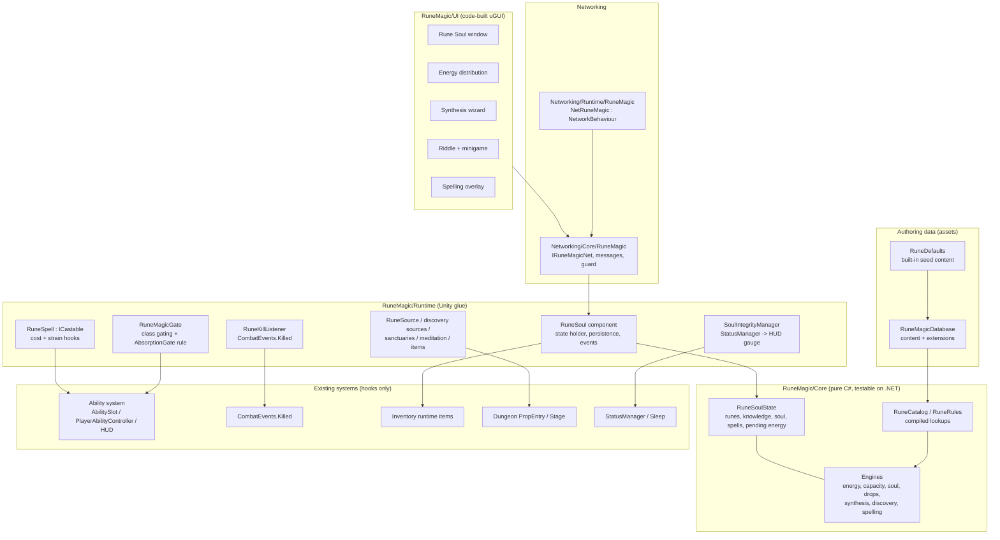

# Rune Magic System — Integration Plan (Phase 0)

**Status:** analysis and plan only. No game code was changed in this phase.
**Repository state analysed:** branch `claude/cool-ptolemy-76p7bd`, HEAD `6400e9c` ("Housing System V1 - Optimised Agriculture System"), 1,285 C# files / ~432k lines, Unity 6 (6000.x), one `Assembly-CSharp` (no `.asmdef`).
**Source of truth:** the *Rune Magic System — Context-Engineered Design Specification* (sections 1-23, directives 1-12, phases 0-9).

---

## 0. Summary

The Rune Magic System can be added as a **self-contained module** (`RuneMagic/`, namespace `RuneMagic`) that follows the house patterns of Alchemy, Crafting and Harvesting:
- a pure rules core with no MonoBehaviours;
- a database asset with built-in defaults and content-pack extensions;
- a per-player state component;
- a server-authoritative network module;
- code-built uGUI windows.

It needs **very few, small, additive edits** to existing code: seven existing files across all nine phases.

| Requirement | How it fits the existing code |
|---|---|
| Mage-only (directive 2) | A data list of rune-user classes in the Rune Magic database. `PlayerClass` assets are untouched (they are matched by asset name, as `CharacterSave` already does). |
| No essences for rune users (directive 3) | One generic gate, `AbsorptionGate`, consulted by `PlayerAbilityController.CanReceive`, which every absorption path goes through. Two related one-line tweaks (pickup targeting, optional roll suppression) are covered in §7. |
| Mob drops and energy (directive 4) | A static listener on the existing server-only `CombatEvents.Killed`, plus an optional `RuneSource` component and species tables. `Mob`, `MobProfile` and the loot, XP, harvesting and absorption flows are unchanged. |
| Data-driven and extensible (directives 5-6) | A `RuneMagicDatabase` asset with lists of plain-data definitions. Built-in defaults hold the seed content from the spec, and `extensions` hold content packs. Compatibility uses an aspect/tag model, so new runes, concepts, intentions and effects need no code. |
| Independent attributes (directive 7) | Rank, Quality, Energy and concept knowledge are separate fields with separate rules. No code path derives one from another unless a data table says so explicitly. |
| Shared spell slots (directive 8) | A generic `ICastable` on `AbilitySlot`. Rune spells execute through the existing `AbilityDefinition`/`AbilityCaster` pipeline, so slots, hotkeys, cooldowns, HUD and network replication are reused, not forked. |
| Spelling System (directive 9) | Global mode plus per-spell flags in data, decided by the server. The key pool is computed from the live bindings, so movement keys and their rebinds can never be used. The challenge is seeded and validated server-side. |
| No push (directive 10) | Nothing was committed or pushed. Deliverables are zips. |

A **verification toolchain** was built for this work (§1.2). It compiles the repository the way Unity does, in six configurations, and runs the existing 1,273 Edit Mode tests on .NET. It already found **real pre-existing problems in HEAD** (§2), which you should look at before Phase 1.

---

## 1. Scope and method

### 1.1 What was analysed
- **Ability system:** slots, hotkeys, casting, costs, cooldowns, interruption, HUD and network.
- **Essence (ability) absorption.**
- **Class, race and archetype system,** and character creation.
- **Mobs:** death, loot, XP and difficulty context.
- **Status and resource managers,** and persistence.
- **Input:** bindings and rebinding.
- **Networking model:** FishNet 4.
- **Dungeons:** interactables and minigames.
- **UI framework.**

The main files were read directly. Four broad read-only sweeps (mobs, input, dungeons, UI/status/networking) were cross-checked against the code; key claims were spot-verified.

### 1.2 Toolchain built for verification (delivered separately as a dev-tools zip, never to be copied into `Assets/`)
Unity cannot run here: Editor downloads, the package registry and licensing are blocked. The harness therefore uses the pieces below.

| Piece | Purpose |
|---|---|
| .NET 8 SDK | C# 9, .NET Standard 2.1 profile, like Unity 6's script compiler. |
| Unity reference DLLs from NuGet | `UnityEngine.Modules` 2021.3.33 for the API surface. `Unity3D.SDK` 2021.1 provides the **real** `UnityEngine.dll`/`UnityEditor.dll`, used for test execution behind generated module facades. `Unity3D.UnityEngine.UI` 2020.3 provides uGUI. |
| Compile-only stubs | TextMeshPro, Input System, Cinemachine 3, AI Navigation, Mathematics, Visual Scripting, Unity Test Framework attributes, FishNet 4, and the project's generated `PlayerInput` class. They match the API shape the scripts use. |
| `scripts/compile.sh [--fishnet]` | Six configurations: Player / Editor / EditorTests, each with and without `FISHNET`. It reports only **new** errors against a recorded baseline. |
| `scripts/run-tests.sh` | Builds a patched mirror of the repo into a .NET test assembly. Tests compile against **NUnit 3.5.0** (Unity's NUnit fork level) and run on NUnit 3.14. It reports **regressions** against the baseline. |
| `scripts/analyze.sh <path>` | Microsoft's Unity Roslyn analyzers (UNTxxxx) over new code. |
| Managed `JsonUtility` (harness runtime only) | Lets save/serialization code run in tests. |

**Baseline today:**
- **Compile:** 0 stub-related errors. Every remaining error is either Unity 6 vs 2021 API skew or one of the repository issues in §2.
- **Tests:** 1,072 of 1,273 existing tests pass. 200 need the native engine (they run only in Unity's Test Runner). 1 fails because of the incomplete commit (§2).
- **Limits:** the engine DLLs are 2021-era, so new code should only use APIs that exist there or that existing code already uses. Final behaviour must still be checked in Unity. Every phase report will list in-Unity test steps.

---

## 2. Pre-existing issues found in HEAD (not caused by this work)

| # | Issue | Evidence | Impact / suggestion |
|---|---|---|---|
| P1 | Commit `6400e9c` is **incomplete**: `PlantSurroundings` (used at `Agriculture/Core/PlantState.cs:152`), `PlantScratch.kept`/`.quiet` (`Agriculture/Core/FieldCatchUp.cs:68,84`) and `SleepSpot.AccessCheck` (`Housing/Runtime/HousingGate.cs:92-93`) are not defined anywhere in git. | Compile errors in every configuration. The test `AgricultureCoreTests.QuietStepsEndAsTheEveryStepLook` fails (expects >200 quiet steps, gets 0). | The project does not compile from git as it stands, so your local files are probably newer than HEAD. **Risk for this work:** see R1 and decision D16. |
| P2 | `Networking/Runtime/Economy/NetWallet.cs:124,163` calls `SceneManager.sceneLoaded` inside a `NetworkBehaviour`. FishNet's inherited `SceneManager` property shadows Unity's type. | Networked configurations only. Every other `NetworkBehaviour` fully qualifies it: `NetHousing` 11 times, `NetDungeonRun` once. | Likely a compile error in FishNet builds. Fix: `UnityEngine.SceneManagement.SceneManager.sceneLoaded`. Not touched by this plan; confirm in Unity. |
| P3 | `Essentials/CharacterCreation/ClassSelectionManager.cs:242` and `CharacterCreationValidator.cs:246` are Windows-1252 encoded and use a `0x95` bullet. `Procedural/Dungeon/Old/OldOldDungeonGenerator.cs` is also cp1252. | Byte scan. | Unity reads sources as UTF-8, so the bullet is not "•" in-game and the validator's `StartsWith` check cannot match it. If Phase 1 touches these files, it will keep the encoding (or convert to UTF-8 if you approve). |
| P4 | (Informational) 922 Unity-analyzer diagnostics exist in the codebase, mostly `UNT0008`/`UNT0007` (`?.`/`??` on `UnityEngine.Object`) and `UNT0026`. | `analyze.sh`. | New Rune Magic code will be held to zero; existing code is left alone. |

---

## 3. Analysis of the existing systems

### 3.1 Ability system
**Data**
- `AbilityDefinition` (`Essentials/Ability/Core/AbilityDefinition.cs`) is the executable ability. It has `targeting`, an action list (`List<CastAction>`), casting rules (`castTime`, `movementWhileCasting` = `CasterMovementRule {Stop, Slowed, Free}`, `castMoveSpeedMultiplier`, `blocksOtherAbilities`, `interruptedByDamage`, `interruptedByControl`, `cooldownOnInterrupt`, `refundCostOnInterrupt` at :170-186), cost (`manaCost`, `staminaCost`, `healthCost` at :188-192) and absorption rules (`absorption`).
- Ids come from the asset GUID (`Id` :237-266) or are `runtime:<name>` for definitions created at runtime.
- `AbilityModifierSet` (`AbilityModifiers.cs`) holds per-slot modifiers: damage, cooldown, area, control, cost and cast multipliers, plus projectile, volley, pierce, summon and charge deltas, and a label.
- `AbilityDatabase` resolves ids, including runtime definitions via `RegisterRuntime` (:102) and `Resolve` (:67).

**Slots and caster**
- `AbilitySlot` (`AbilitySlot.cs`) holds `ability`, `modifiers`, `enabled`, `label` and runtime phase, charges and cooldown. It also carries `[NonSerialized] AbilityGrant Grant` (:57) and `AbilitySlotSource Source {Skill, Innate, Item}` (:59).
- Phases: Ready → Casting → Launching → Active → InCooldown.
- `AbilityCaster` (`AbilityCaster.cs`, 1,715 lines) is the shared base for players and mobs. Its extension points:
  - Pre-cast check: `protected virtual CastFailReason CheckExtra(AbilitySlot, in CastRequest)` (:559).
  - Cost: `HasResources` (:1257), `PayCost(AbilityCastInstance)` (:1269), `Refund` (:1291), all virtual. The cast instance records `paidMana`/`paidStamina`/`paidHealth`.
  - Modifier layers: `SetModifierLayer(key, AbilityModifierSet)` (:77) and `SetScopedModifiers(source, …)` (:90).
  - Events: `CastStarted`, `CastReleased`, `CastInterrupted`, `CastFailed`, `SlotChanged`, `AbilityReceived` (:117-126).
  - Interruption: `Interrupt(CastInterruptReason, force)` (:1047) and `InterruptSlot` (:1091). Reasons: Manual, Damage, Stun, Silence, Death, TargetLost, Replaced, Disabled. On interrupt before release, the cost is refunded and the cooldown becomes `cooldown × cooldownOnInterrupt`.
  - Network copies: `IsReplica`, `BeginMirrorCast`, `ApplyReplicatedSlot` (:1619).
- `CastFailReason` (`AbilityEnums.cs:121`) is an append-safe enum.

**Player abilities, hotkeys and HUD**
- `PlayerAbilityController : AbilityCaster` (`Player Ability/PlayerAbilityController.cs`) does aiming, click-to-confirm previews and cancel.
  - Each `AbilityStateMachine` (one per key) calls `RegisterStateMachine` (:180) and owns a key-bound slot.
  - `CanAddSlots => false` (:240) and `CanUseSlotForGrant(i) => machineBySlot.ContainsKey(i)` (:242), so absorbed abilities only enter key slots.
  - `TryCastFromInput(slot)` (:249) → `SubmitCast` → `TryCast`.
- Key list: `AbilitiesStateMachine.abilityAction` (prefab-defined, legacy code suggests 7). Each key resolves to its reference or to the action named `"Ability<i>"`.
- HUD:
  - `HudAbilityBar` binds one `HudAbilitySlot` per key through `IHudAbilitySource` (`KeySource`, `HudAbilityBar.cs:188`; members `Slot`, `Icon`, `KeyLabel`, `Name`, `ReadyReason`, `TryUse`, `Describe`).
  - Key labels come from `GetBindingDisplayString()`, so rebinds show immediately.
- **Network:**
  - `NetAbilityCaster` sends `CmdCast` (ServerRpc, rate-limited, sanitized), `CmdAim` and `CmdCancelCasting`.
  - The server starts the cast. Clients mirror `RpcCastStart` (with a shared **seed**) and `RpcCastRelease`/`RpcCastInterrupted`.
  - Slot contents replicate in `SyncList<NetAbilitySlotContent>` (`abilityId`, `modifiersJson`, `label`, `source`, `enabled`, grant info; `NetAbilityMessages.cs:106`).

**Consequence for Rune spells:** a spell can be *executed* as an `AbilityDefinition` plus `AbilityModifierSet` in a key slot. Existing code then covers casting, cooldowns, HUD, input and replication, untouched. The rune layer only adds energy cost and Soul effects, through the virtual hooks and events above (§9.6).

### 3.2 Essence (ability) absorption — the mechanic rune users must not have
- `AbilityAbsorption` (static, `Core/AbilityAbsorption.cs`) subscribes to `CombatEvents.Killed` (:171-179). It runs **only where rules run**: `if (GameNet.NetAuthority.IsClientOnly) return;` (:184).
- Grants are rolled through an `IAbsorptionTable` (the mob's `MobAbilityController`) or per-ability chances, then `Deliver(...)` (:365):
  - `AbsorbDelivery.Instant` → `TryGrant` (:379);
  - `AbsorbDelivery.Pickup` → `AbilityPickup.Spawn` (`AbilityPickup.cs:45`).
- `TryGrant` → `IAbilityReceiver.CanReceive(grant)` and `Receive(...)`.
  - Events: `GrantRolled`, `GrantReceived`, `GrantRefused` (:162-166).
  - `PlayerAbilityController.CanReceive` (:574-582) adds level milestones (`AbsorptionMilestones`; archetypes can override them through `CharacterArchetype.absorptionMilestones`).
- **Every path into a player goes through `CanReceive`:**
  - pickups: `AbilityPickup.TryCollect` → `TryGrant` (:216);
  - instant delivery;
  - `AbilitySpawner` rewards.
  - Only `RestoreAbsorbedAbilities` (:647) calls `Receive`/`GrantInto` directly; it has no runtime caller today.
- **Gaps for the Mage rule:**
  - (a) There is no per-player opt-out. The data-only workaround (archetype milestones with capacity 0) is fragile, because a `DeathPenalty` with its own milestones wins (`AbsorptionMilestones.For`, :71-89).
  - (b) `AbilityPickup.NearestPlayer` (:239-261) targets the nearest living player even if they cannot accept. A Mage standing closest would block a teammate and cause the 3-second "cannot take" log spam (:222-226).

### 3.3 Class system and character creation
- **`PlayerClass` (ScriptableObject, `Player/RPGSystem/Classes/PlayerClass.cs:95`)** holds base stats, combat stats, leveling, traits, starting items, a free-form `startingSkills` string list "for your own systems" (:196-197), and an optional `CharacterArchetype archetype` (:214).
- **`CharacterArchetype` (`Archetypes/CharacterArchetype.cs:41`)** has `kind` (Race, Class, Background, Other), stats, growth, `[SerializeReference] effects` (an equipment-effect list: the no-edit way to give a class a passive), traits and `absorptionMilestones` (:107).
- **"Mage" is data, not code:**
  - The repo ships no class assets.
  - `CustomEditor/Player/CharacterArchetypeEditor.cs:183,268` creates a "Mage" archetype preset ("magic penetration, cheaper skills").
- **At runtime:** `PlayerStatusController.CurrentPlayerClass`, `SetPlayerClass` (:200) and the event `OnPlayerClassChanged` (:58). That event does not fire for the prefab's initial class, so read it once at start. `CharacterIdentity` applies class and race archetypes.
- **Creation and network:**
  - `CharacterSave` (`Essentials/Character/CharacterSave.cs:13`) stores **race/class by asset name**.
  - The owner sends it with `[ServerRpc] ServerSetCharacter` (`Networking/Runtime/NetPlayer.Character.cs:45-73`).
  - The server sanitizes it in `CharacterBuild.Sanitize` (`CharacterCatalog.cs:327-377`), then `CharacterProfileApplier.Apply` → `SetPlayerClass`.

### 3.4 Mobs, death, loot, XP and difficulty
- **Mob data** (`Mob/Mob.cs`): `type` (species key, :71), `profile` (`MobProfile`, AI/animation asset), `Faction`, `Strength` (:241), and `IsElite` (:244, only set on clients by `NetMob`).
- **Dungeon tags:** `DungeonSpawned` (`Procedural/Dungeon/Runtime/DungeonSpawned.cs`) carries `kind` (incl. `Boss`), `floor`, `area`, `tier`, `elite` and `order` (Champion/Roam).
- **Resistances:** `CombatStats.GetResistance(ElementType)`. `ElementType {None, Fire, Ice, Lightning, Poison, Holy, Dark, Wind, Earth, Water}` is in `DamageTypes.cs:5-17`.
- **Species data:** Harvesting's `HarvestAnatomyData` (mob types, mass, resistances, rarity of parts) with `HarvestableCreature.FindFor(e)`.
- **Missing today:** mob level/rank, a boss flag outside dungeons, rarity on the mob, a magical-alignment field, a tag list, kill XP values.
- **Death** (server or offline only): `CombatEntity.HandleDeath` (`CombatEntity.cs:895-909`) → `Died` → `CombatEvents.RaiseKilled(victim, killer)` (`CombatEvents.cs:122,136`). The mob is still whole when `Killed` fires. Summons resolve to their player via `AbilityAbsorption.PlayerSide(killer)` (:292). There is one killer and no assists.
- **Loot:**
  - `ItemDropTable` / `ItemDropManager` (ScriptableObject singletons, `Inventory/Loot/`), `ItemDropOnDeath`, `ItemSpawner`.
  - `ItemDropOnDeath.Describe(e, out tier, out elite, out boss)` (:75-86) is a ready-made context helper.
  - World items are networked through `WorldItems.Publish`.
- **XP:** nothing grants XP on kills. `ExperienceManager.AddExperience` is server-only (`RunsRules`) and replicated by an owner-only SyncVar.
- **Difficulty context at a kill:**
  - Dungeon: `DungeonSpawned` → `Dungeon.Layout.Request.difficulty` and `Floors[f].Spec.Difficulty`, or `DungeonSession.RunAt(victim)`.
  - Hub world: `HubWorldDirector.Instance.Zones.At(pos)` (`ZoneInfo`: `dungeonDifficulty`, `mobStrength`, `rewardMultiplier`, currently unread) and `Mob.Strength`. Check the realm first, because the City and the World share coordinates.

### 3.5 Player stats, status managers and persistence
- **Resources** derive from `abstract StatusManager` (`Essentials/Status/StatusManager.cs`). It has current/max, rates, `SetRateMultiplier(key, m)`, `AddCurrentValue`, timed effects, and network `SetReplica`/`ApplyReplicated`. It has **no change events**; consumers poll.
- **Sanity** shows the tier pattern: `SanityStage` + `StatusConsequence`/`ConsequenceRunner`, with stage labels shown as status icons.
- **HUD:** `HudStatusFrame` collects every `StatusManager` on the player (`addMissingGauges`, :36). A new `SoulIntegrityManager` therefore gets a ring gauge automatically (key "SoulIntegrity" from `HudStyle.StatusKey`, :63).
- **Replication:** `NetCombatStatus` replicates a **hard-coded** set of managers through `PlayerStatusController` properties (:446-450). A new manager needs its own replication; `NetCombatStatus` is not edited.
- **Consumables:** `ConsumableEffectType` is a closed enum, but `ItemSO.UseItem` is virtual (:245, :258). `BrewedPotionSO : ConsumableSO` shows the subclassing pattern. Network sessions use items on the server.
- **Sleep:** `SleepManager` has `FellAsleep(SleepQuality, SleepSpot)`/`WokeUp` and `IsSleeping`. Beds are `SleepSpot`. Meditation does not exist.
- **Persistence — two house patterns:**
  1. Per-player *knowledge* components (`AlchemyKnowledge`, `CraftKnowledge`, `HarvestKnowledge`, `AgriKnowledge`). They are auto-added to the player, keep JSON data, save to `persistentDataPath/<System>/<character name>.json` (debounced 3 s and on quit), and clients **follow the server** (`FollowsServer`, `ReceiveFromServer(json)`).
  2. `WorldStore` (`Essentials/Project/WorldStore.cs`): **one atomic file per world** (offline / online) with named sections, a backup, a lock and a worker-thread write. It is keyed per player by `PlayerKeys.Of(player)` (a hashed strong character id), as `WalletSaves` and Housing use.
- **Not persisted today:** XP, absorbed abilities (`GetAbsorbedAbilities`/`RestoreAbsorbedAbilities` have no runtime caller), inventory progression. `CharacterSave` is creation data only.

### 3.6 Input and keybindings
- **`InputBindingStore`** (`Essentials/Input/InputBindingStore.cs`) is the hub:
  - every input-action copy registers there;
  - overrides live in PlayerPrefs `"InputBindingOverrides"` (:17, :151, :166);
  - gating: `SetGameplayInputEnabled` (pause), `BlockGameplayInput(owner)`/`UnblockGameplayInput(owner)` (counted), and the `Changed` event.
- **Rebinding UI:** `KeyRebindingMenu` (one row per binding of the "Player" map plus `extraMaps`).
- **Bindings:**
  - `CombatInputBinding` (per player) and `GlobalInputBinding` (machine-wide, `CreateIn(map, …)`);
  - `StationControls` is the template for a minigame key map (map "Station", listed in the rebind menu);
  - `InputActionResolver.Find/Create`.
- **Effective keys:**
  - movement composite parts: `MovementStateMachine.MovementAction` bindings, `isPartOfComposite`, `effectivePath`;
  - ability keys: `AbilitiesStateMachine.GetKeyInput(i)`;
  - interact (`Interact`, default E), inventory (`Inventory`, else Tab/I hard-coded), pause (Escape, hard-coded).
- **There is no central registry of bound keys.** Several keys are read **outside actions**:
  - hotbar digits 1-9;
  - quick-slot fallbacks Z X C V B N F1 F2;
  - Y/N accept/decline;
  - T (debug), F9;
  - Esc, Enter and Space in dialogs.
- **Keys:** there is no path → `Key` helper. Logic uses physical `Key` values; layout-aware names come from `Keyboard.current[key].displayName`. Nothing handles `keyboardLayout`/`onTextInput`.
- **Overlay gating:** UI overlays block gameplay with `BlockGameplayInput(this)`. There is no "consume key" API, so excluding keys from a pool is the only reliable way to avoid accidental actions.

### 3.7 Networking model (FishNet 4, `#if FISHNET`)
- **Authority:** `GameNet.NetAuthority.IsServer`, `IsClientOnly` and `RunsRules(go)`.
- **Per-player system pattern (stations):**
  - the client sends `[ServerRpc] ServerRequest(msg, conn)` with plain-value request structs and a `seq`;
  - the server validates: player from `conn`, alive, in reach, plus a **guard** (`CraftRequestGuard`/`AlchemyRequestGuard` token buckets);
  - answers go back with `[TargetRpc] TargetAnswer`;
  - state snapshots go as `[TargetRpc] TargetData` chunks (`NetPayload.Pack/Split`, 48 KB parts) → `XKnowledge.ReceiveFromServer(json)`.
- **Player-prefab modules** are listed in `CustomEditor/Networking/NetworkSetupMenu.cs` `PrefabComponents["Player"]`: NetPlayer, NetPlayerMovement, NetAbilityCaster, NetWeaponCombat, NetCombatStatus, NetInventory, NetWallet, NetPlayerRealm, NetInteractor, NetInjuries. The validator uses the same list.
- **Owner-only state:** `SyncVar(..., ReadPermission.OwnerOnly)` or `TargetRpc` to `NetSession.OwnerOf(entity)`.

### 3.8 Dungeons, interactables, minigames
- **Configuration:**
  - `DungeonProfile` (ScriptableObject) → `CompiledProfile`;
  - difficulty is a **float** (floor = request × per-floor growth × depth; area = floor × progress); there are **no named tiers**;
  - generation is deterministic per seed and **server-only**;
  - each run is its own scene, and clients receive presentation replicas.
- **Placing new objects through data:**
  - a `PropEntry` (kind Interactable/PointOfInterest with your prefab);
  - or a custom `DungeonStageAsset` (`AfterPopulation`, worker thread, own RNG stream via `ctx.Random(purpose, …)`).
  - A `Custom` room role + tag + `secretEntrance` gives "sealed chambers".
- **Placement data is sent to clients,** so secrets must never be stored there.
- **Runtime ids are unstable** across runs, cycles and server restarts. A per-player "burned source" record must therefore be keyed by **authored content ids**.
- **Interaction:**
  - `IInteractable` + `PlayerInteractor`;
  - dungeon objects use `DungeonInteractable` (`Use(CombatEntity)`), relayed by `[ServerRpc] ServerInteract(generation, elementId)`, with no payload;
  - **a riddle answer needs a new owner-checked RPC**.
- **Minigames:** **no generic minigame base**. Reusable pure models exist: `CraftTimingBar`, `CraftRhythm` and `CraftHands` (seeded, deterministic), and Harvesting's `HarvestStageModel`. Server validation precedent: `HarvestRequestGuard.LimitToElapsed` (clamp to real elapsed time).

### 3.9 UI framework
- **Windows are built in code** (procedural uGUI) with `UITheme`:
  - `Canvas(name, order)`, `Window`, `Panel`, `Header`, `Button(style)`, `ScrollList`, `Slider`, `Toggle`, `Dropdown`, `Input`, `UITabGroup`;
  - full-screen windows use canvas order 58 on a `DontDestroyOnLoad` singleton.
- **Focus contract:**
  - `IGameplayPanel`/`IExclusivePanel` + `InventoryManager.RegisterPanel` (frees the cursor; Escape closes via `PauseMenuManager.CloseTopPanel`);
  - `InputBindingStore.BlockGameplayInput`;
  - `HudFocus.Take/Release`.
- **No accessibility features exist:** no colour-blind palette, no text scale. Colours are `static readonly`, and some UI relies on red/green.

---

## 4. Architecture

### 4.1 Principles
1. **Additive.** New behaviour lives in new files. Edits to existing files are limited to generic, system-agnostic hooks (§7), each a few lines, each with no behaviour change when the Rune system is absent or disabled.
2. **Pure rules core.** `RuneMagic/Core` holds plain C# with no MonoBehaviours and no engine-native calls (no `Time`, `UnityEngine.Random`, `ScriptableObject.CreateInstance`). It covers: definitions, catalog compilation, state, energy, capacity and soul rules, synthesis engine, spelling evaluation, discovery evaluation and drop rolls. It is deterministic given inputs and an explicit seed, so it runs on the server and in .NET unit tests.
3. **Server-authoritative.** Offline, the local machine is the server. Clients send requests and receive state snapshots and answers; they never decide outcomes.
4. **Data-driven** (§5): every number in the spec marked "illustrative" or "proposed" lives in tables.
5. **Independent attributes:** Rank, Quality, Energy and concept knowledge are separate fields and separate rules (§5.2). A coupling exists only if a data table declares it (e.g. an optional `minimumRankToUse` on a concept, default none).
6. **House conventions:**
  - database + built-in defaults + extensions;
  - per-player state component;
  - `Networking/Core` (always compiled) + `Networking/Runtime` (`#if FISHNET`);
  - `CustomEditor` (`#if UNITY_EDITOR`);
  - tests `#if UNITY_INCLUDE_TESTS && UNITY_EDITOR`;
  - docs in `Documentation/RuneMagic/`;
  - menus under `Tools ▸ SimpleMovements ▸ Rune Magic` (priority after Agriculture; `SMMenu.cs` itself unchanged);
  - settings from `Resources/SimpleMovements/Settings` via `SMAssets.Load`.
7. **Namespace `RuneMagic`.** Generic names like `Rune`, `Concept`, `Spell` and `Rank` stay out of the global namespace, as HubWorld does. The network module is in `GameNet`, tests in `RuneMagic.Tests`.

### 4.2 Layers



---

## 5. Data model (definitions)

### 5.1 Catalog database
`RuneMagicDatabase : ScriptableObject` is optional, at `Resources/SimpleMovements/Settings/RuneMagicDatabase`, created by *Tools ▸ SimpleMovements ▸ Rune Magic ▸ Create Rune Magic Database (Resources)*. It follows `AlchemyDatabase` (`Alchemy/Core/AlchemyDatabase.cs:158`):
- Without the asset, the built-in content (`RuneDefaults`) is used.
- `extensions` adds content packs; the same id replaces the base entry.
- The asset holds a **plain** `RuneMagicData` container, so the core and the tests never need `ScriptableObject` instances.
- The database compiles into an immutable `RuneCatalog` with lookups, validation and derived indices.
- In multiplayer, the server's copy decides. The client checks a **content hash** in the first snapshot and warns on mismatch.

### 5.2 Definitions
Every definition has a stable lowercase string `id` (`fire`, `wind.pressure`, `attack`, `offense.explosion`), a `displayName` and a description (localisable later).

| Definition | Key fields |
|---|---|
| `AlignmentDef` | `id`, `name`, `domain` text, colour/icon, `aspects` (weighted list, §5.3), optional `element` (`ElementType` mapping, e.g. fire→Fire, light→Holy, shadow→Dark). |
| `RuneDef` | `id`, `name`, `alignments` (1 for base runes, several for composites), `kind` (Base, Composite, Primordial), `slotCost` (default 1), `ranks` (min/max rank; per-rank title override), `concepts` (list of `ConceptDef`), `magicalProperties` (text + tags, e.g. "volatile", "stable"), `rarity`, `dropWeightsByTier`, `primordial` flags (extra soul damage, deep damage share). |
| `ConceptDef` | `id` (`<rune>.<concept>`), `name`, `description`, `aspects` (weighted), `rarity` (drives discovery difficulty), optional `minimumRankToUse` (explicit coupling, default 1 = none), `complexity`. |
| `IntentionDef` | `id`, `name`, `description`, `aspectBias` (what the purpose favours), `allowedEffectCategories` + per-effect overrides (support weights 0-1). |
| `DesiredEffectDef` | `id` (`<category>.<effect>`), `category` (Offensive, Defensive, Movement, Control, Creation & Transformation, Utility & Exploration), `requiredAspects` (with minimum coverage), `supportingAspects`, `idealChain` (ordered aspect stages for order evaluation), `energyProfile` (min/optimal/max per stage, total power band), `spellForm` (§9.6). |
| `CompatibilityRule` | Pairwise synergy/conflict between aspects or between specific concepts/alignments, optionally order-dependent ("A before B"). Plus **hard incoherence rules** (contradictions that always fail). |
| `OutcomeArchetype` | Optional *named* results (Pyroclastic Resonance, Gravity Well, Storm Lance, …): match pattern (alignments/concepts/intention/effect, optional ideal counts and order), name, icon, description. They name and refine results; **they are not required for a synthesis to be valid** (§9.4). |
| `RuneDropProfile` | Per species/profile/type word: candidate runes and weights, rank/quality distributions, energy reward base, multipliers for elite, boss, rarity, special properties and difficulty. |
| `DiscoverySourceDef` / `RiddleDef` | Source kind (Inscription, Artifact, SealedChamber), concepts it can reveal, tier, minigame parameters, riddles per concept/tier (question, options, correct index, explanation). |
| `RuneMagicSettings` (section of the database) | Rune-user classes, absorption gate policy, spelling global mode, and the balance tables (§5.4). |

**Seed content (Phase 1):**
- All runes of §7.2 and §7.3.
- **Binding** and **Restoration** as original runes, so the §19 proposals (Soul Chain, Eternal Bloom) are buildable (decision D17).
- The concepts of §8.1-8.4 verbatim.
- Proposed concepts for every other rune: 6-8 each, marked as proposals and editable.
- All 31 Intentions (§9.1) and all 101 Desired Effects (§10.1-10.6). "Seal" exists twice, as `defense.seal` and `utility.seal`.
- Starter compatibility rules and the §18/§19 archetypes.

### 5.3 Compatibility model (why it scales without N² rules)
Concepts, alignments, intentions and effects describe themselves with **aspects**: a small, extensible vocabulary such as Force, Pressure/Containment, Thermal, Combustion, Wave/Resonance, Spatial, Motion, Matter, Binding, Life, Mind, Light/Dark, Suppression, Expansion, Focus, Time. Each aspect has a weight.

Evaluation then works mostly on aspect vectors:
- coverage of the effect's required aspects;
- intention bias;
- generic aspect synergies and conflicts;

plus a few explicit concept or alignment pair rules where the design wants something special. A new rune or concept therefore works with every intention and effect as soon as it has aspects. Data validation in the editor flags concepts without aspects, effects no concept can cover, and similar gaps.

### 5.4 Balance tables (initial values from the spec; all editable)
| Table | Initial values |
|---|---|
| Soul Rune Capacity by progression | 7 / 14 / 21 / 28 (Beginning / Intermediate / Advanced / Endgame). The stage is a level-milestone list, like `AbsorptionMilestones`; additive bonuses come from items, traits and breakthroughs. |
| Max energy by rank | 1,000 / 5,000 / 25,000 / 125,000 / 625,000 (an optional quality multiplier defaults to 1, so it stays independent). |
| Rank titles | Rank 1 "Greater" (spec examples: Greater Wind / Fire), others editable (decision D11). |
| Quality tiers | 0-100 value with named bands (e.g. Crude, Flawed, Common, Fine, Superior, Flawless) and thresholds. |
| Synthesis outcome thresholds | Perfect 100, Successful 70-99, Flawed 30-69, Failure < 30. |
| Failure severity | Minor (partial energy loss) / Moderate / Severe (full depletion) / Catastrophic (destruction). Loss fractions and probability by risk and score. |
| Soul Integrity | Max 100. Conditions 100-80 Stable, 79-60 Strained, 59-40 Damaged, 39-20 Critical, 19-1 Near Collapse, 0 Collapse. Per-condition synthesis and casting modifiers. |
| Casting debuffs (§16.2) | Mapped to conditions: Strained → Mild, Damaged → Moderate, Critical → Severe, Near Collapse → Critical Strain, Collapse → cannot cast (decision D10). |
| Recovery rates | Rest/sleep, meditation, sanctuary multiplier, item amounts, ritual amounts; the "deep damage" share only items or rituals heal. |
| Energy rewards | Base by tier/elite/boss/rarity × dungeon difficulty × zone reward multiplier. |
| Spelling | Letters by rank/power/complexity, per-key windows, rhythm, speed bonus, penalties, condition scaling. |

### 5.5 Ids and extensibility rules
- Ids are never derived from list positions or asset GUIDs. Saves and network messages always use ids.
- Unknown ids in saves are kept and reported, never dropped silently: a removed content pack can come back.
- Adding a rune, concept, intention or effect means adding a database entry with aspects; no code changes.

---

## 6. Per-player runtime state and save data

`RuneSoulState` (plain, JSON-serialisable with `JsonUtility`: lists, no dictionaries, `version` field):

| Part | Fields |
|---|---|
| Runes | `instanceId` (GUID string), `runeId`, `rank`, `quality`, `energy`, `slotCost`, `origin` (drop / synthesis / reward + source info), `acquiredUtc`, `history` (synthesis ids it took part in), `flawed` + flaw list. Max energy is **derived** from tables (rank, optional quality multiplier), never stored. |
| Concept knowledge | Per player, per **rune definition**: discovered concept ids (permanent). A rune instance's "known concepts" are the player's known concepts of its definition; "unknown" are the rest. Decision D13. |
| Soul | `integrity`, `maxIntegrity`, `deepDamage`, capacity bonuses (source id → amount), `lastCollapseUtc`. |
| Spells | `spellId`, name, rank, tier, score, ingredients (rune instance ids + concept ids + order + allocation), derived stats, `spellingParams`, flags (`canMoveWhileCasting`, soul-damage settings). |
| Slot assignments | Key-slot index → spell id. |
| Pending energy | Amount, plus optional sources and expiry (decision D5). |
| Discovery | Burned keys (`sourceDefId|conceptId`), riddles seen per concept, attempts log. |
| Synthesis log | Last N attempts (inputs, score, outcome), for player research and debugging. |

**Where it is saved (decision D6; recommended):**
- `WorldStore` section `"runeMagic"`, keyed by `PlayerKeys.Of(player)`, like `WalletSaves`. Writes are atomic, with a backup, the world lock and a worker-thread write. Offline and online stay separate.
- Clients keep nothing and follow the server.
- The alternative is the knowledge-component pattern (per character name).

**Existing save formats are not changed.** `CharacterSave` and `AbilityGrantSaveData` are untouched.

---

## 7. Hooks into existing systems — complete list of planned edits

All edits are additive, small and system-agnostic. Each MODIFIED file in a phase zip will carry its unified diff in `MANIFEST.md`, so you can merge by hand if your local copy differs from git HEAD (R1).

| Phase | Existing file | Change | Behaviour without rune users |
|---|---|---|---|
| 1 | *(new)* `Essentials/Ability/Core/AbsorptionGate.cs` | Generic static gate: `Blocks(CombatEntity receiver, AbilityGrant grant)` and `SuppressesRolls(CombatEntity killer)`, with registered rules. No rune knowledge. | No rules registered → nothing blocked. |
| 1 | `Essentials/Ability/Player Ability/PlayerAbilityController.cs` | `CanReceive`: refuse when `AbsorptionGate.Blocks(Entity, grant)`. `RestoreAbsorbedAbilities`: skip blocked grants. | Unchanged. |
| 1 | `Essentials/Ability/Core/AbilityPickup.cs` | `NearestPlayer`: skip players the gate blocks (both branches), so a Mage never "hogs" an essence orb a teammate could take. | Unchanged. |
| 1 | `Essentials/Ability/Core/AbilityAbsorption.cs` | `OnKilled`: optional early return when `AbsorptionGate.SuppressesRolls(player)` (only if decision D2 = suppress). | Unchanged. |
| 2/3 | `CustomEditor/Networking/NetworkSetupMenu.cs` | Add `"NetRuneMagic"` to `PrefabComponents["Player"]`, so *Network Setup* adds it and the validator expects it (editor only). | Editor list only. |
| 7 | `Essentials/Ability/Core/AbilitySlot.cs` | `[NonSerialized] public ICastable Castable;` next to `Grant`. | Null → unchanged. |
| 7 | *(new)* `Essentials/Ability/Core/ICastable.cs` | `ICastable` (display, icon, describe, executable `AbilityDefinition` + modifiers). Optional `ICastableCosts` (check, pay, refund, released, interrupted) and `ICastableInfo` (HUD badges). | — |
| 7 | `Essentials/Ability/Core/AbilityAbsorption.cs` | `AbilityGrant : ICastable` (explicit implementation; essences become castables too). | Unchanged. |
| 7 | `Essentials/Ability/Player Ability/PlayerAbilityController.cs` | `CheckExtra` / `PayCost` / `Refund` overrides call `base`, then `slot.Castable as ICastableCosts`. Server-authoritative assignment API on key slots: `Assign(slot, castable)`, `Unassign`, `Swap`. | Null castable → identical to today. |
| 7 | `Essentials/UI/HUD/HudAbilityBar.cs` | `KeySource`: append `ICastableInfo` badges and tooltip lines (Rune Energy cost, Soul Strain, ⌨ spelled). | No castable info → unchanged. |
| 7 (opt.) | `Essentials/Ability/Core/AbilityEnums.cs` | Append `CastFailReason.NotEnoughRuneEnergy`, `SoulTooWeak` (append-only). Otherwise `NotEnoughResource` is reused. | Unchanged values. |
| 8 | `Essentials/Ability/Player Ability/PlayerAbilityController.cs` | `TryCastFromInput`: a pre-cast hook, `if (PreCast != null && PreCast(this, slot)) return true;`. The Spelling System runs its sequence first, then submits the normal cast. | Null hook → unchanged. |

**Not touched:**
- `Mob`, `MobProfile`, `MobAbilityController`, `ItemDropManager`, `ExperienceManager`;
- `PlayerClass`, `CharacterArchetype`, `CharacterSave`;
- `NetCombatStatus`, `NetAbilityCaster`;
- the dungeon generator, `InputBindingStore`, `UITheme`, `SMMenu`.

---

## 8. Server vs client responsibilities

| Concern | Server (or offline host) | Owning client | Other clients |
|---|---|---|---|
| Rune-user check / essence gate | Decides (class from the accepted character) | Mirrors for UI | — |
| Rune drops and energy rewards | Rolls on `CombatEvents.Killed`, spawns rune items, credits pending energy | Shows drops and pending energy | See dropped items (existing world-item sync) |
| Absorb / release / assign energy | Validates capacity, full/overflow, ownership; applies | Sends request, shows answer | — |
| Soul Integrity, recovery, debuffs | Ticks, applies damage and recovery, sets modifier layers | Receives value (gauge), shows condition | Optionally see the condition icon (decision) |
| Concept discovery | Picks the concept (secret), runs the minigame bounds, evaluates the answer, burns sources, unlocks | Plays the minigame, answers | — |
| Synthesis | Evaluates (seeded RNG), applies results and penalties | Wizard UI, local **preview** from the same rules (no RNG), sends the request | — |
| Spells and slots | Compiles spells, registers runtime definitions, assigns key slots, validates casts, pays costs | Binds castables to replicated slots from the snapshot | See casts through the existing ability mirroring |
| Spelling System | Issues the challenge (seed + parameters), validates timings, applies performance modifiers | Computes the key pool from local bindings, shows the overlay, sends presses | — |
| Persistence | `WorldStore` section, keyed by `PlayerKeys` | Nothing | Nothing |

Messages follow the station pattern:
- plain request structs with `seq`;
- a per-player `RuneRequestGuard` (token buckets);
- `TargetRpc` answers;
- `NetPayload` snapshot chunks, resent when dirty and at most once per second;
- an `IRuneMagicNet` interface in `Networking/Core`, so offline play calls the rules directly.

---

## 9. Feature designs (condensed; each phase refines its part)

### 9.1 Class gating and essence block (Phase 1)
- **`RuneMagicGate`** answers "is this player a rune user?" from the accepted class:
  - `PlayerStatusController.CurrentPlayerClass`, read at start and on `OnPlayerClassChanged`;
  - matched against `settings.runeUserClasses` (`PlayerClass` references plus class names, default `"Mage"`).
- It registers the `AbsorptionGate` rule.
- **Policies:**
  - all Mages use runes (D1);
  - Mage kills still roll essences for teammates (D2);
  - a class change into or out of a rune class handles existing essences or runes (D15).
- **Editor validator warnings:** no class matches; a rune class also has absorption milestones; the essence settings would still deliver Instant grants to Mages.

### 9.2 Soul resources (Phase 2)
**Capacity**
- Capacity = stage capacity (level milestones table) + bonuses.
- The sum of `slotCost` must stay at or below capacity; absorption and synthesis outputs are checked against it.

**Soul Integrity**
- `SoulIntegrityManager : StatusManager`, so the HUD gauge appears automatically. It is hidden for non-rune users with the same proxy toggle `SleepManager` uses.
- The tier logic lives in the core, with modifiers for synthesis (failure chance, max runes, disabled) and casting (time, power, cost, instability, rank limits, cannot cast).
- Deep damage is a capped share that rest and meditation cannot heal.
- At 0, Soul Collapse consequences apply (D8).

**Recovery (all rates are data)**
- **Rest:** server-side while `SleepManager.IsSleeping`, scaled by `SleepQuality`.
- **Meditation:** a new channelled action (input via `GlobalInputBinding`). It is refused in combat (`PlayerBonds.InCombat`), interrupted by damage, control and movement, and incapacitates like sleep (`AvailabilityStateMachine.SetIncapacitated`).
- **Soul Healing Items:** `SoulRestorativeSO : ConsumableSO` (the `BrewedPotionSO` pattern). It can heal deep damage when flagged.
- **Rituals:** a `SoulRitualSite` interactable needing items and time.
- **Sanctuaries:** a `SoulSanctuary` zone multiplier (component or the City realm).
- **Abilities and traits:** a public modifier API.
- **Rare materials:** ordinary items used by recipes and rituals.

**Persistence, replication and debug**
- Persistence and replication as in §6/§8.
- A debug panel (development builds plus an editor inspector) shows and edits the state.

### 9.3 Acquisition, absorption and energy (Phase 3)
**Drop data**
- An optional `RuneSource` component on mob prefabs (species profile reference, rune and energy overrides, tier -1 = use the dungeon's, boss/rarity/special overrides).
- Database lookup order: `RuneSource` → `MobProfile` match → `Mob.type` words → harvest anatomy id → faction → default profile.

**Kill hook**
- `RuneKillListener` subscribes to `CombatEvents.Killed`, server-only and skipping summons, just like `AbilityAbsorption`/`ItemDropManager`.
- It builds a context: tier, elite and boss from `ItemDropOnDeath.Describe`; dungeon and floor difficulty; zone reward multiplier.
- It rolls rune drops (any player can loot) and energy (the killer, if a rune user; party share per D5).

**Delivery**
- Recommended (D4): rune **items**, which are unabsorbed runes. A `RuneItemSO` is an `IRuntimeItem` from a registered `IRuntimeItemSource` (the brewed-potion pattern), so instances with rank, quality and energy survive the network and inventory.
- They drop through `ItemDropManager.Drop`/`ItemHandler.SpawnWorldItem`. They can be traded if the flag allows, and the per-rune tradeable flag lets Mages buy runes from other players.

**Absorb and release**
- **Absorb:** use the item → capacity check (sum of slot costs) → the rune is bound to the soul and the item consumed. Refused with "free a slot" guidance when full.
- **Release:** if permitted (D12), with confirmation; the energy is lost.

**Energy**
- It enters a **pending pool**. The player picks a rune (popup or panel), and the server moves `min(amount, space)`.
- A full rune refuses ("choose another rune"); the remainder stays pending.
- There is no automatic rank-up and no overflow conversion.

### 9.4 Concept discovery (Phase 4)
**Sources and spawning**
- `ConceptDiscoverySource : DungeonInteractable` (`holdToUse = 0`, `uses = 0`, resets on pool reuse).
- Spawned by a `PropEntry` (roles Library, Shrine, Crypt, Secret, or a sealed-chamber custom role), optionally with a `ConceptDiscoveryStage` (`AfterPopulation`, own RNG) for per-dungeon caps and tier.

**The server flow, step by step**
1. Map the float difficulty to a tier (Beginner → Legendary table).
2. Choose a concept the player does not know (weighted by rarity vs tier).
3. Issue a minigame challenge (seed, difficulty).
4. Validate the result: replay the presses and clamp them to the real elapsed time, as `HarvestRequestGuard` does.
5. Send a riddle with options shuffled server-side, never with the answer.
6. Evaluate the answer:
   - correct → permanent unlock;
   - wrong → burn `sourceDefId|conceptId` for that player, so the same source can never be retried and another source of that concept must be found (D7).
7. Avoid riddles the player has already seen.

**Supporting pieces**
- A pluggable minigame: `IDiscoveryMinigame`, with a built-in rune-tracing timing minigame on the `CraftTimingBar`-style pure model.
- Sample content: the Greater Wind "Pressure" riddle (§17.3).
- Validation: every concept is reachable by at least one source per tier band (editor report).

### 9.5 Synthesis engine (Phase 5, pure core, unit-tested)
**Input**
- Intention, Desired Effect, and an ordered list of `(runeInstanceId, conceptId, energy)`.
- Mode: **Custom** (any number of runes) or **Rank Advancement** (exactly 7 runes of rank N → rank N+1).

**Pipeline**
1. **Validation (no penalty):**
   - runes owned, not reserved by another spell (D3), concepts known, knowledge requirements met;
   - soul condition allows synthesis (tier limits);
   - capacity is available for a rune output.
2. **Energy feasibility (no penalty):** each slot is checked against the minimum its stage requires. Any slot that lacks energy → **Insufficient Energy**, and the attempt cannot proceed.
3. **Coherence gates:** hard incoherence rules, the intention cannot support the effect, or no aspect coverage → **Complete Failure (incoherent)** regardless of score.
4. **Factor scores (0-1), weighted (weights in data):**
   - aspect coverage of the effect's required and supporting aspects;
   - concept-concept compatibility (aspect synergies and conflicts + explicit pair rules);
   - intention fit;
   - order (similarity of the concept sequence to the effect's `idealChain` + order-dependent pair rules);
   - energy ratios (distance from the ideal per-stage ratios; excessive slots add **interference**);
   - rank/quality harmony;
   - archetype fidelity (if a named archetype matches, its ideal counts, order and ratios refine the score, e.g. Pyroclastic Resonance 3 Wind / 1 Ash / 3 Vibration flawless vs 2/2/3 flawed);
   - soul condition modifier;
   - knowledge bonus.
5. **Score and tier:** score = 0-100% → Perfect / Successful / Flawed / Failure (configurable thresholds). The exact percentage scales power, stability, cost and resulting quality.
6. **Outcome:**
   - a new rune (composite or rank-up) or a spell (D3);
   - a flawed result with scaled flaws (reduced power, higher cost, lower stability, control issues, data-driven unintended side effects);
   - or a failure penalty with severity by score and risk: energy depletion fractions, or catastrophic destruction (seeded server RNG).
7. **Soul damage:** by complexity, risk, Primordial share and outcome.
8. **Names:** the archetype name if one matches, else generated from concepts and effect (e.g. "Resonant Pressure Burst"). Recorded in the synthesis history.

**Output kinds (decision D3; recommended)**
- **Rank Advancement** and composite-rune synthesis **consume** the input runes and produce a rune (it occupies a slot).
- **Custom spell** synthesis produces a **spell** that **anchors** its input runes. They stay in the soul; casting draws Rune Energy from them (§16.1 "energy consumed from relevant Runes"). Anchored runes cannot be consumed elsewhere until the spell is dismissed.

**Tests**
- Every tier boundary; insufficient vs invalid; order sensitivity; ratio and excess interference.
- Rank advancement rules; penalties by severity; determinism by seed.
- The Pyroclastic Resonance and §19 proposals as non-fixed samples. Variants that should still be valid must remain valid.

### 9.6 Spells, shared slots and casting costs (Phase 7)
**Spell → executable**
- A spell is an `ICastable` (`RuneSpell`).
- Its executable form comes from the effect's **`spellForm`**: an `AbilityDefinition` template asset for the effect shape (projectile, area, barrier, dash, pull, …).
- An `AbilityModifierSet` is derived from the spell stats: damage, area, cooldown, cast-time and control multipliers, and projectile deltas.
- The element comes from the alignment where supported. If a form needs per-spell actions, a runtime clone is registered with `AbilityDatabase.RegisterRuntime` under a deterministic id that the client can rebuild from the snapshot.
- Mana costs are 0 by default; Rune Energy is the cost.

**Slots**
- Assign, unassign and swap work on the **existing key slots** (`CanUseSlotForGrant` slots).
- Replication uses the existing `NetAbilitySlotContent` (ability id + modifiers JSON). The owning client attaches `Castable` from the rune snapshot by slot index → spell id, so no network message format changes.
- The HUD shows badges through `ICastableInfo`.

**Costs and strain**
- `CheckExtra`: enough energy in the anchored runes; condition allows (e.g. Critical → rank cap; Collapse → cannot cast).
- `PayCost`: consume energy (server).
- `Refund` on interrupt follows `refundCostOnInterrupt`.
- `CastReleased`: Soul Strain = soul damage on success (per spell, may be 0).
- `CastInterrupted` or failure: optional soul damage on failure.

**Debuffs**
- Applied as one caster modifier layer, `"RuneSoulCondition"` via `SetModifierLayer`: casting time, power and cost.
- Instability chance is applied on release by the rune layer.
- Spell properties covered: energy cost, soul strain, casting time, power, stability, complexity, range, area, duration, side effects, `canMoveWhileCasting` (→ `movementWhileCasting`).

### 9.7 Spelling System (Phase 8)
**Configuration**
- **Global mode:** `None`, `Selected` or `All`, held by the server's database. Clients receive it in the snapshot.
- **Per spell:** `usesSpellingSystem` plus parameters:
  - letter count;
  - total limit and **per-key windows**;
  - rhythm (tempo, tolerance);
  - speed-bonus threshold and effects;
  - accuracy weighting;
  - penalties per mistake;
  - failure model (Strict / Lenient);
  - soul damage on mistake (flat / scaling / once on failure);
  - forgiveness from concept knowledge or quality;
  - condition scaling.
- Synthesized spells get generated parameters (formulas in data), with overrides per archetype or spell form.

**Flow (pre-cast challenge; avoids editing the caster's phase timing)**
1. The hotkey hits the pre-cast hook.
2. The client sends `RequestSpelling(slot, keyPoolIds)`.
3. The server answers with a challenge (seed, parameters, issue time). It derives the sequence from the seed and the reported pool, after validating the pool against its rules.
4. The client shows the overlay and records press times relative to the first prompt.
5. The client sends the indices and offsets.
6. The server validates order, windows and plausibility: a human minimum interval, and a total duration within the real elapsed time plus a latency allowance. It computes the **performance score** server-side and starts the normal cast with performance modifiers, or fails it (soul damage per settings).

**Key pool**
- It is computed from the **live bindings**:
  - the candidate letters A-Z;
  - minus the Movement composite parts (default WASD **and** any rebind);
  - minus every enabled gameplay action binding, the ability key bindings, interact and inventory;
  - minus the keys read outside actions (digits, quick-slot keys, Y/N, T, F-keys, Esc, Tab, Enter, Space; a data list).
- Spells that root the player may use a wider pool (movement keys allowed) but never spell-slot hotkeys.
- Logic uses physical `Key` values and display uses `displayName`, so layouts like AZERTY show the right letters.
- A pool that is too small falls back to fewer letters, with a warning.

**Interruption, input and accessibility**
- **Interruption:** stun, silence, knockback (via stun), death and damage (if the spell's ability says so) cancel the sequence. The same rules as `AbilityCaster` interrupt rules apply, and failure consequences follow the per-spell settings.
- **Input:** the overlay uses its own `GlobalInputBinding` map; gameplay stays live when the spell allows movement.
- **Accessibility:**
  - large letters;
  - feedback by shape and text, not colour alone: ✓ / ✗ / ⏱ icons, outline styles, a colour-blind-safe palette (blue/orange);
  - optional sound cues;
  - remaining time shown as a bar plus a number.

---

## 10. UI screens

| Screen | Phase | Built with | Entry |
|---|---|---|---|
| Rune Soul window. **Runes:** soul slots, capacity bar, rune card (name and rank title, alignment, quality, energy current/max, slot cost, known / unknown concepts (unknown as ???), history, properties, release). **Soul:** integrity, condition, effects, recovery tips. **Knowledge.** **Spells** (spellbook, assign to slots). | 2 (debug), 3 (runes), 7 (spells) | `UITheme` window + `UITabGroup`, `IExclusivePanel`, `RegisterPanel`, `BlockGameplayInput`, `HudFocus` | New rebindable action "RuneSoul" (default proposed `P`, D14) + inventory/character-sheet button |
| Absorb prompt / capacity warning | 3 | `UITheme` dialog | Using a rune item |
| Energy distribution | 3 | Small panel + HUD pending-energy pip | After kills; the HUD pip opens it |
| Synthesis wizard (9 steps + result) | 6 | `UITheme` window; preview from the core | Rune Soul window ▸ Synthesis |
| Discovery minigame + riddle | 4 | `UITheme` window; minigame view on the pure model | Interacting with a source |
| Spelling overlay | 8 | HUD-level canvas (not exclusive) | Casting a spelled spell |
| HUD | 2, 3, 7 | `SoulIntegrityManager` auto gauge; pending-energy pip; slot badges via `IHudAbilitySource` | Always (rune users) |

---

## 11. Risks and mitigations

| # | Risk | Mitigation |
|---|---|---|
| R1 | **Your local files are newer than git HEAD** (P1). Dropping a MODIFIED file from a zip could overwrite local changes. | Edits to existing files are few (§7) and tiny. Every MODIFIED file's diff is included in `MANIFEST.md` for manual merging. Please confirm or share the current versions of the files in §7 (D16). |
| R2 | Breaking non-Mage behaviour (abilities, essences, pickups). | Gate hooks are no-ops when no rule matches. The existing test suite runs after every phase (0 regressions required). New tests cover Mage/non-Mage paths. In-Unity check steps are in each phase report. |
| R3 | Network protocol changes (new `NetworkBehaviour` on the player prefab). | One module (`NetRuneMagic`) added through the Network Setup list. All machines run the same build already. RPC rate limits and size limits follow the station guards. |
| R4 | FishNet version differences (the stubs model 4.x). | New network code copies the exact RPC and SyncVar forms already used in the repo. The FishNet configurations are compiled every phase. |
| R5 | Unity 6.3/6.4 APIs vs the harness's 2021 DLLs. | New code uses only APIs present in both or already used by the project. Any harness error in new code is fixed, not baselined. |
| R6 | `JsonUtility` limits (no dictionaries or polymorphism). | Save and network data use lists of plain structs with a `version` field. |
| R7 | Cheating: client-picked outcomes, energy, answers, key timings. | Everything is decided on the server. Riddle answers and secret concepts never reach clients early. Spelling timings are bounded by real time. Guards cap request rates. |
| R8 | Content authoring scale (≈ 300 concepts, 101 effects). | The aspect model (§5.3) avoids pair explosion. An editor validator reports gaps, unreachable effects and duplicate ids. |
| R9 | Class identified by asset name (renames). | `PlayerClass` references plus a name fallback. The validator warns when no class matches. |
| R10 | Keyboard layouts and IME in the Spelling System. | Physical `Key` values and layout display names; the IME is disabled while the overlay is active; the pool is recomputed on `InputBindingStore.Changed`. |
| R11 | Losing work between phases (this environment is temporary and nothing may be pushed). | Each phase zip is self-contained for you. The dev-tools zip rebuilds the toolchain (`setup.sh`, verified from scratch). If this environment is reset, later phases need the previous zips back, or permission to push to the work branch. |
| R12 | Non-UTF-8 files (P3) if touched. | Preserve the encoding unless you approve conversion. |
| R13 | Performance (kill handler, UI, synthesis). | Allocation-free kill path (cached lists). Synthesis is O(n²) for n ≤ ~10. Snapshots are sent only when dirty. |

---

## 12. Proposed file and folder structure

```
RuneMagic/                                  namespace RuneMagic
  Core/                                     pure rules, no MonoBehaviour (testable on .NET)
    Data/         RuneMagicData, RuneDefinitions (Alignment/Rune/Concept/Intention/DesiredEffect),
                  Aspects, CompatibilityRules, OutcomeArchetypes, RuneBalance (tables), RuneDropProfiles,
                  DiscoveryContent (sources, riddles), SpellForms
    Defaults/     RuneDefaults.*.cs (seed content, split by domain), RuneDefaultBalance
    Catalog/      RuneCatalog (compile + validate + lookups), ContentHash
    State/        RuneSoulState, RuneInstance, ConceptKnowledge, SoulState, SpellRecord, PendingEnergy, DiscoveryLog
    Rules/        CapacityRules, EnergyRules, SoulRules (tiers, debuffs), RecoveryRules, DropRules
    Synthesis/    SynthesisRequest, SynthesisEvaluator, SynthesisFactors, SynthesisOutcome, FailurePenalties,
                  RankAdvancement, NameGenerator
    Spells/       SpellStats, SpellCompilerRules, CastCostRules
    Spelling/     SpellingParams, SequenceGenerator, KeyPoolRules, SpellingEvaluator
    Discovery/    DiscoveryRules (tiers, selection, burn keys), MinigameModels
  Runtime/        RuneMagicDatabase (SO), RuneMagicGate, RuneSoul, SoulIntegrityManager, RuneKillListener,
                  RuneSource, RuneItemSource, MeditationController, SoulSanctuary, SoulRitualSite,
                  ConceptDiscoverySource, ConceptDiscoveryStage, RuneSpell (ICastable), RuneCastingHooks,
                  SpellingController
  Items/          RuneItemSO, SoulRestorativeSO
  UI/             RuneSoulWindow, EnergyDistributionPanel, SynthesisWindow, DiscoveryWindow, SpellingOverlay,
                  RuneHudElements, RuneMagicDebugPanel
Essentials/Ability/Core/   AbsorptionGate.cs (Phase 1), ICastable.cs (Phase 7)        <- generic, no rune knowledge
Networking/Core/RuneMagic/      IRuneMagicNet, RuneNetMessages, RuneRequestGuard          (always compiled)
Networking/Runtime/RuneMagic/   NetRuneMagic (NetworkBehaviour on the player prefab)      (#if FISHNET)
CustomEditor/RuneMagic/         database editor, menus, validators, inspectors           (#if UNITY_EDITOR)
CustomEditor/RuneMagic/Tests/   Edit Mode tests                                           (#if UNITY_INCLUDE_TESTS && UNITY_EDITOR)
Documentation/RuneMagic/        README + chapters (data formats, how to add content), this plan
```
Every new file and folder ships with a `.meta` file (fresh GUIDs), as the repository does.

---

## 13. Phase-by-phase delivery plan

| Phase | Adds (main files) | Modifies | Tests and verification |
|---|---|---|---|
| **1 Data & gating** | `Core/Data/*`, `Core/Defaults/*` (all seed content), `Core/Catalog/*`, `Runtime/RuneMagicDatabase`, `Runtime/RuneMagicGate`, `Essentials/Ability/Core/AbsorptionGate.cs`, editor database inspector + "Create Database" menu + validator, docs chapter "Data" | `PlayerAbilityController.cs`, `AbilityPickup.cs`, (`AbilityAbsorption.cs` if D2 = suppress) | Catalog compiles; seed counts (39 + 2 runes, 31 intentions, 101 effects); ids unique; every concept has aspects; gate blocks rune users only; non-Mage absorption unchanged |
| **2 Soul resources** | `Core/State`, `Core/Rules` (capacity, soul, recovery), `Runtime/RuneSoul`, `SoulIntegrityManager`, `MeditationController`, `SoulSanctuary`, `SoulRitualSite`, `Items/SoulRestorativeSO`, `Networking/Core/RuneMagic/*`, `Networking/Runtime/RuneMagic/NetRuneMagic`, persistence (`WorldStore` section), debug panel | `NetworkSetupMenu.cs` (Player list) | Tier boundaries, recovery rates, deep damage, persistence round-trip, independence from health and mana |
| **3 Acquisition & energy** | `Core/Rules/DropRules`, `EnergyRules`, absorption rules, `Runtime/RuneKillListener`, `RuneSource`, `RuneItemSource`, `Items/RuneItemSO`, Rune Soul window (runes), energy panel, net requests | — | Drop context (dungeon, zone), killer-only energy, full rune refuses, partial transfer, no auto rank-up, capacity refusal, release rules; loot, XP, absorption, harvesting unchanged |
| **4 Concept discovery** | `Core/Discovery/*`, `Runtime/ConceptDiscoverySource`, `ConceptDiscoveryStage`, minigame model + view, riddle window, sample content (Pressure riddle), net RPCs | — | Tier mapping, concept choice, burn on wrong answer, no retry on a burned source, unlock is permanent, secrecy (no answer in client data) |
| **5 Synthesis engine** | `Core/Synthesis/*`, archetypes (Pyroclastic Resonance + §19), extensive unit tests | — | Score tiers; insufficient vs invalid; order and ratio effects; interference; rank advancement (7 rule); penalties by severity; determinism |
| **6 Synthesis UI** | `UI/SynthesisWindow` (9 steps, previews, risk warning), net synthesis request/answer | — | Preview equals server result for deterministic parts; warnings shown for destruction risk |
| **7 Spells & slots** | `Essentials/Ability/Core/ICastable.cs`, `Runtime/RuneSpell`, `RuneCastingHooks`, spell forms + compiler, spellbook UI, assignment net requests | `AbilitySlot.cs`, `AbilityAbsorption.cs` (`AbilityGrant : ICastable`), `PlayerAbilityController.cs`, `HudAbilityBar.cs`, (`AbilityEnums.cs`) | Energy cost/refund, strain on success/failure (configurable, may be none), debuffs by condition, slot assign/swap, non-Mage casting unchanged |
| **8 Spelling System** | `Core/Spelling/*`, `Runtime/SpellingController`, `UI/SpellingOverlay`, challenge RPCs | `PlayerAbilityController.cs` (pre-cast hook) | Pool never contains movement keys (default or rebound), per-key windows, strict vs lenient, speed bonus, soul damage on mistakes only when configured, server validation bounds, interruption |
| **9 Integration & QA** | Docs (data formats, how to add content), balance pass, master zip + master manifest | As needed | Full loop (§21), every §22 checklist item pass/fail, regression run |

Every phase ends with:
- the 6 compile configurations at 0 new errors;
- `run-tests.sh` at 0 regressions, with all new tests passing on .NET where possible (the rest marked as "run in Unity");
- `analyze.sh RuneMagic` at 0 analyzer warnings in new code;
- the phase report with in-Unity manual steps;
- then a stop until you type "continue".

---

## 14. Decisions needing your input

**Defaults.** If you don't answer a decision, the recommended option (★) is used, and the phase report says so.

| # | Question | Options (★ recommended) |
|---|---|---|
| D1 | Who uses the Rune system? | ★ Every player whose class is in the rune-class list (default: "Mage") · Mages choose "Rune path" vs "Essence path" at creation |
| D2 | When a rune user kills a mob, should essence orbs still drop? | ★ Yes: others can collect them; the Mage is skipped by pickup targeting · No: no essence roll for rune-user kills |
| D3 | Synthesis outputs and input consumption | ★ Rank advancement and composite-rune synthesis consume inputs and produce a rune (takes a slot); custom spell synthesis produces a spell that anchors its input runes (they stay; casting uses their energy) · Every synthesis consumes inputs and produces a rune with a spell form |
| D4 | How do rune drops reach players? | ★ As inventory items (absorb later, tradeable flag per rune) · Soul-bound orb for the killer only (absorb or discard on pickup) |
| D5 | Energy after kills | ★ Pending pool + choose a rune any time (non-modal), killer only · Modal popup after each kill · Shared with nearby party members (ratio) |
| D6 | Where is the Rune Soul saved? | ★ `WorldStore` section keyed by `PlayerKeys` (atomic, like money and housing) · Per-character JSON files like the Alchemy journal |
| D7 | Scope of a "burned" discovery source after a wrong answer | ★ That source definition + concept, for that player (find a different source) · Only that dungeon instance (a new run may retry) |
| D8 | Soul Collapse (0%) consequences | ★ Incapacitated for N seconds + cannot cast or synthesize until above X% + lose pending energy · Choose your own list |
| D9 | Spelling System defaults | ★ Global mode **Selected**, failure model **Lenient** · All / None · Strict |
| D10 | Mapping §14.3 conditions → §16.2 casting debuffs | ★ Strained = Mild, Damaged = Moderate, Critical = Severe, Near Collapse = Critical Strain, Collapse = cannot cast · Other |
| D11 | Rank titles | ★ Rank 1 "Greater"; others editable placeholders · Provide your list |
| D12 | Can runes be released? | ★ Yes, outside combat, with confirmation; stored energy is lost · No · Only at special locations |
| D13 | Concept knowledge scope | ★ Per player, per rune definition (re-absorbing a Wind rune keeps its known concepts) · Per rune instance |
| D14 | Hotkey for the Rune Soul window | ★ New rebindable action "RuneSoul", default `P` · Other key |
| D15 | Class change into/out of a rune class | ★ Into: existing essences are removed (confirmation); out of: runes go dormant (kept, unusable) · Forbid class changes for rune users |
| D16 | Are your local copies of `PlayerAbilityController.cs`, `AbilityPickup.cs`, `AbilityAbsorption.cs`, `AbilitySlot.cs`, `HudAbilityBar.cs`, `AbilityEnums.cs` and `NetworkSetupMenu.cs` identical to git HEAD? | ★ Please confirm, or send the current versions (or push them), before Phase 1 |
| D17 | "Binding" and "Restoration" in §19 | ★ Add them as original runes · Map them to the Intentions of the same name |
| D18 | Should other players see a rune user's Soul condition? | ★ No (owner only) · Yes (icon on nameplate/target frame) |

---

## 15. Verification procedure (each phase)

1. **Harness:**
   - `scripts/compile.sh` and `scripts/compile.sh --fishnet`: 0 NEW errors in all 6 configurations;
   - `scripts/run-tests.sh`: 0 regressions against the 1,072 passing baseline tests; new tests pass;
   - `scripts/analyze.sh RuneMagic`: 0 diagnostics in new code.
2. **Review of edits to existing files:** each diff is inspected for "no behaviour change when unused".
3. **In Unity (your side):**
   - the phase report lists the manual steps (scene setup, what to click, expected results) and the Test Runner categories to run (`RuneMagic.Tests.*`, plus the existing suites);
   - especially for engine-dependent tests the harness cannot execute.

---

## Appendix A — Spec traceability (where each §22 checklist item is implemented)

| §22 item | Phase |
|---|---|
| Runes from monsters, dungeons, other sources; absorb; capacity; manage collection; combining frees slots; Rank and Quality | 1 (data), 2 (capacity), 3 (drops, absorb, manage), 5 (combining) |
| Kill energy, choose rune, max energy, full refuses, no auto rank-up, combinations consume energy, insufficient energy blocks, excess interferes, ratios matter | 3, 5 |
| Synthesis inputs (intention, effect, runes, concepts, order, energy), evaluation, score tiers, beyond fixed recipes | 5 (engine), 6 (UI) |
| Hidden concepts, dungeon discovery, permanent unlock, wrong answer burns the source, retry needs another source, rare concepts in harder dungeons | 4 |
| Soul Integrity independent; synthesis damage; casting strain; low integrity restricts and weakens; recovery mechanics; severe damage needs special healing | 2, 5, 7 |
| Castable effects; energy cost and strain; debuffs; power/stability/time/range/duration/area; shared ability UI slots | 7 |
| Spelling System modes; per-spell difficulty; per-key windows; configurable soul damage; strict vs lenient; no movement keys | 8 |

## Appendix B — Toolchain quick reference
See `README.md` in the dev-tools zip. Commands (from the harness folder):
- `./setup.sh`
- `./scripts/compile.sh [--fishnet]`
- `./scripts/run-tests.sh [--filter "FullyQualifiedName~RuneMagic"]`
- `./scripts/analyze.sh RuneMagic`

Baselines live in `baseline/`.
